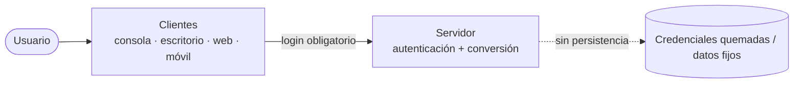

# Visión general

Este repositorio contiene **cuatro implementaciones independientes** del mismo sistema:
un **conversor de unidades** con inicio de sesión. Cada implementación combina:

- un **estilo de servicio web**: [[vault/02 - Variantes/RESTful vs SOAP|RESTful o SOAP]];
- una **plataforma**: [[vault/02 - Variantes/Java vs .NET|Java o .NET]].

El resultado son cuatro variantes equivalentes en **contrato lógico** (mismas entidades,
casos de uso y operaciones) pero distintas en **tecnología** y **protocolo**.

## Principios

1. **Login obligatorio primero** — todo proyecto inicia con autenticación; sin login no hay
   conversión. Credenciales **quemadas** `MONSTER` / `MONSTER9`
   (ver [[vault/01 - Arquitectura/Autenticación]]).
2. **SINBDD** — no hay base de datos. Las credenciales y los datos de conversión son fijos
   o viven en memoria.
3. **Mismo caso de estudio** en las cuatro variantes: conversión de unidades + login.
4. **Coherencia** — los nombres de clases, operaciones y mensajes deben ser equivalentes
   entre variantes para facilitar la trazabilidad.
5. **Estructura uniforme** — todas las variantes comparten [[vault/01 - Arquitectura/Estructura de carpetas|la misma estructura de carpetas]].

## Diagrama de contexto

> [!info] Relacionado
> - [[vault/01 - Arquitectura/Autenticación]]
> - [[vault/02 - Variantes/Matriz de variantes]]
> - [[vault/03 - Entregables/04 Clientes y servidor]]
