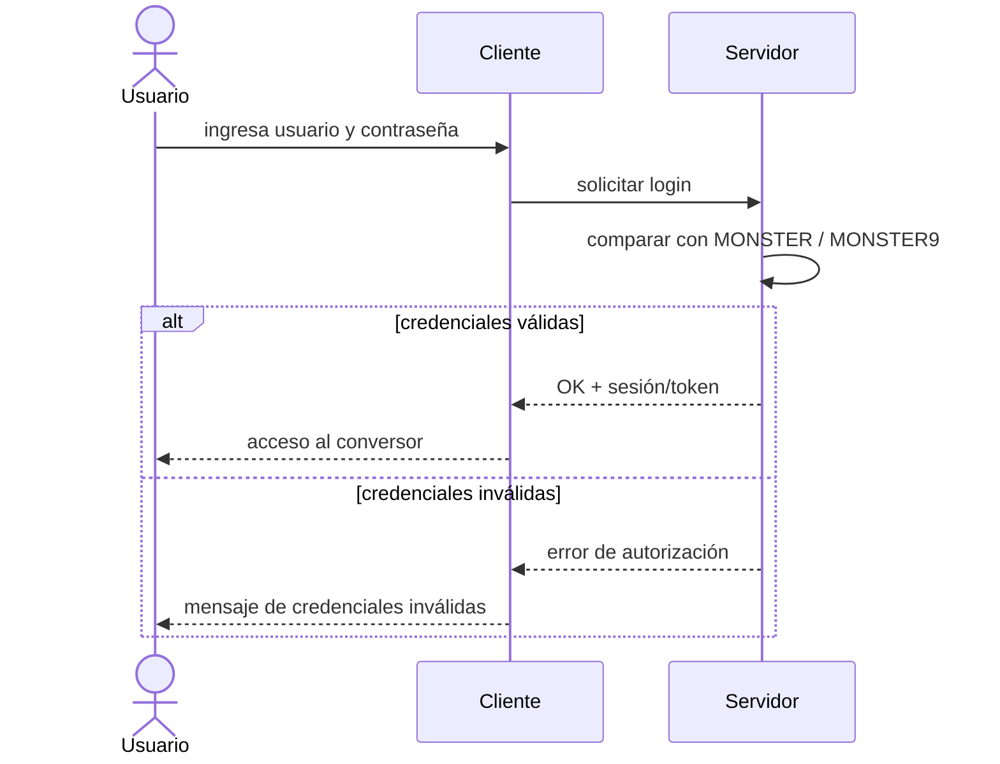

# Autenticación (login)

> [!danger] Requisito obligatorio
> **Todo proyecto debe iniciar con un login.** Ninguna conversión se ejecuta sin
> autenticación previa. Aplica a las **cuatro variantes** y a los **cuatro clientes**
> (consola, escritorio, web y móvil).

## Credenciales de esta unidad (quemadas)

Para esta unidad las credenciales están **quemadas en el código** (hardcoded), no en base
de datos:

| Usuario | Contraseña |
| --- | --- |
| `MONSTER` | `MONSTER9` |

- Se escriben **literalmente en el código** como constantes (o archivo de configuración).
- No hay tabla de usuarios, ni hash, ni persistencia (el proyecto es [SINBDD](../03-deliverables/03-bdd.md)).
- La comparación de credenciales es directa contra esos valores fijos.

## Flujo esperado

## Reglas para agentes

1. **Primer caso de uso** de cada cliente: iniciar sesión.
2. Proteger el módulo de conversión: si no hay sesión válida, devolver error de autorización.
3. Mantener la misma credencial quemada en las cuatro variantes para coherencia.
4. Ante error de credenciales, mostrar un mensaje claro y **no** permitir continuar.

> [!note] Base de este requisito
> Proviene del caso de estudio del ejemplo de referencia
> (`TALLER CASOS DE USO CONVERSION UNIDADES.docx`): "El acceso al sistema está restringido
> por un único usuario... El acceso al módulo de conversión debe estar protegido por un
> mecanismo de autenticación."

> [!info] Relacionado
> - [04-clients-and-server](../03-deliverables/04-clients-and-server.md)
> - [restful-vs-soap](../02-variants/restful-vs-soap.md)
> - [academic-data](../05-reference/academic-data.md)
