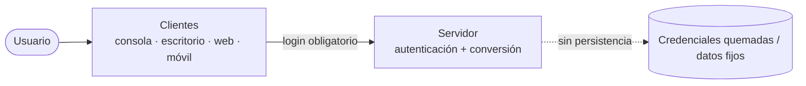

# Visión general

Este repositorio contiene **cuatro implementaciones independientes** del mismo sistema:
un **conversor de unidades** con inicio de sesión. Cada implementación combina:

- un **estilo de servicio web**: [RESTful o SOAP](../02-variants/restful-vs-soap.md);
- una **plataforma**: [Java o .NET](../02-variants/java-vs-dotnet.md).

El resultado son cuatro variantes equivalentes en **contrato lógico** (mismas entidades,
casos de uso y operaciones) pero distintas en **tecnología** y **protocolo**.

## Principios

1. **Login obligatorio primero** — todo proyecto inicia con autenticación; sin login no hay
   conversión. Credenciales **quemadas** `MONSTER` / `MONSTER9`
   (ver [authentication](authentication.md)).
2. **SINBDD** — no hay base de datos. Las credenciales y los datos de conversión son fijos
   o viven en memoria.
3. **Mismo caso de estudio** en las cuatro variantes: conversión de unidades + login.
4. **Coherencia** — los nombres de clases, operaciones y mensajes deben ser equivalentes
   entre variantes para facilitar la trazabilidad.
5. **Estructura uniforme** — todas las variantes comparten [la misma estructura de carpetas](folder-structure.md).

## Diagrama de contexto

> [!info] Relacionado
> - [authentication](authentication.md)
> - [variant-matrix](../02-variants/variant-matrix.md)
> - [04-clients-and-server](../03-deliverables/04-clients-and-server.md)
