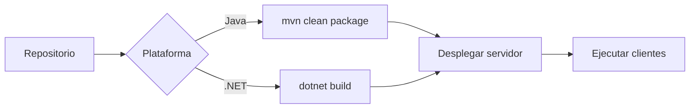

# Java vs .NET

Dos plataformas para el **servidor** y los **clientes**.

> [!warning] Tecnologías propuestas (por confirmar)
> Solo la rama **SOAP + Java** tiene respaldo documental en el repo (`examples/`:
> JAX-WS, servidor Payara, Swing, Android, consola, web; y un cliente **.NET MAUI**).
> El resto de celdas (REST/JAX-RS, ASP.NET, WCF/ASMX, WinForms/WPF, JSP/JSF, etc.) son
> **propuesta orientativa**, no un requisito verificado. Confírmalas por variante.

| Aspecto | Java | .NET |
| --- | --- | --- |
| Lenguaje | Java | C# |
| Build | Maven (`pom.xml`) / Gradle | `dotnet` (`*.csproj`) |
| REST | JAX-RS (Jersey/RESTEasy) | ASP.NET Core Web API |
| SOAP | JAX-WS (JAX-WS RI) | WCF / ASMX |
| Cliente web | JSP / JSF | ASP.NET MVC / Razor |
| Cliente escritorio | Swing / JavaFX | WinForms / WPF |
| Cliente móvil | Android (Kotlin/Java) | .NET MAUI / Xamarin |
| Consola | Java `main` | C# console |

## Convención de build por stack

> [!warning]
> Ejecuta siempre el **servidor** antes que los clientes. Ver
> [build-and-run](../04-guides/build-and-run.md).

> [!info] Relacionado
> - [variant-matrix](variant-matrix.md)
> - [build-and-run](../04-guides/build-and-run.md)
