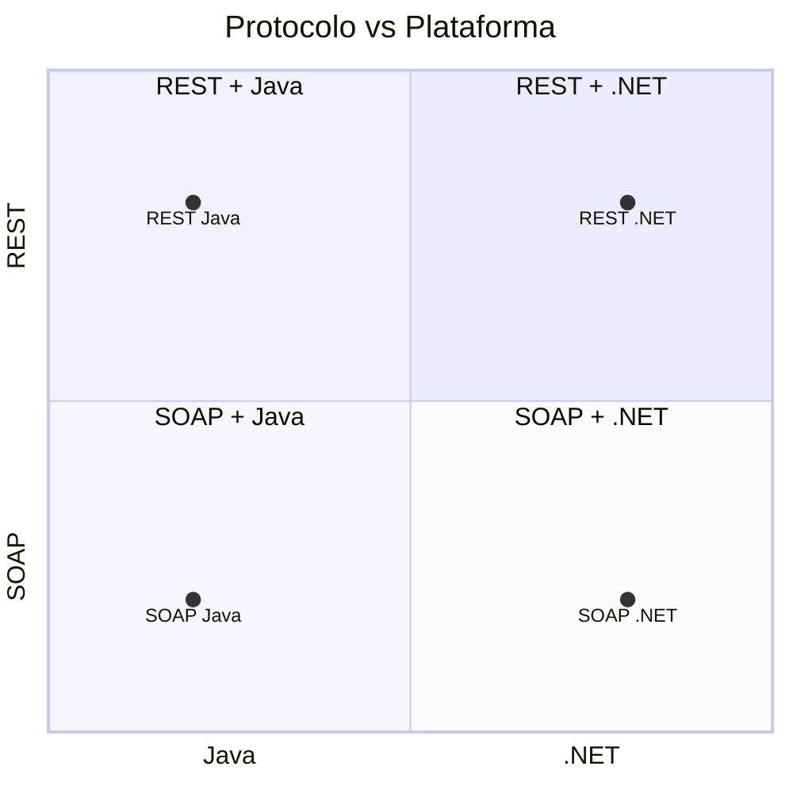

# Matriz de variantes

Las cuatro variantes cruzan dos protocolos con dos plataformas:

| Variante | Protocolo | Plataforma | Carpeta |
| --- | --- | --- | --- |
| RESTful + .NET | [REST](restful-vs-soap.md) | [.NET](java-vs-dotnet.md) | `TI.1.1. PAO202651_RESTFUL_DOTNET_SINBDD_NRC36884_GR09` |
| RESTful + Java | REST | Java | `TI.1.1. PAO202651_RESTFUL_JAVA_SINBDD_NRC36884_GR09` |
| SOAP + .NET | SOAP | .NET | `TI.1.1. PAO202651_SOAP_DOTNET_SINBDD_NRC36884_GR09` |
| SOAP + Java | SOAP | Java | `TI.1.1. PAO202651_SOAP_JAVA_SINBDD_NRC36884_GR09` |

## Diferencias por eje

## Qué es igual y qué cambia

| Aspecto | Igual en las 4 | Cambia según variante |
| --- | --- | --- |
| Casos de uso | ✅ | — |
| Entidades del dominio | ✅ | — |
| Contrato lógico de operaciones | ✅ | — |
| Estilo de servicio | ❌ | REST vs SOAP |
| Lenguaje / framework | ❌ | Java vs .NET |
| Cliente web / móvil | ❌ | Tecnología del cliente |

> [!info] Relacionado
> - [restful-vs-soap](restful-vs-soap.md)
> - [java-vs-dotnet](java-vs-dotnet.md)
> - [overview](../01-architecture/overview.md)
