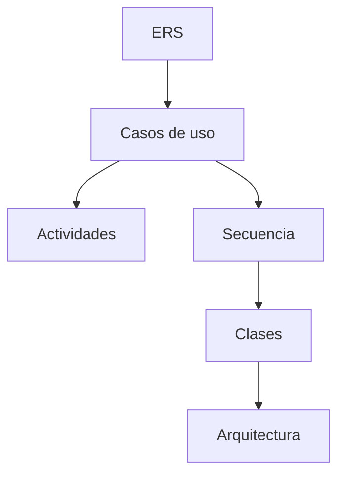

# 01 · UML

Carpeta `01. UML/` de cada variante. Agrupa la especificación de requisitos y todos los
modelos UML.

## Contenido

| Carpeta | Contenido | Formato |
| --- | --- | --- |
| `01. ERS/` | Especificación de Requisitos de Software + plantilla | `.docx` |
| `02. ECUD/` | Especificación de Casos de Uso Detallados | `.pdf` / `.docx` |
| `03. DIAGRAMAS UML/` | Modelos y exportados | nativo + `.png`/`.pdf` |

## Diagramas UML

| Subcarpeta | Diagrama |
| --- | --- |
| `01_CASOS_DE_USO` | Casos de uso |
| `02_ACTIVIDAD` | Actividades (login, conversión) |
| `03_SECUENCIA` | Secuencia (login, conversión) |
| `04_CLASES` | Clases del dominio |
| `05_ARQUITECTURA` | Arquitectura de componentes |

## Nomenclatura

- ERS: `ERS_<PROTOCOLO>_<PLATAFORMA>_SINBDD_<GRUPO>.docx`
- Plantilla ERS: `ERS_<...>_PLANTILLA.docx`
- ECUD: `ECUD_<PROYECTO>_<GRUPO>.pdf`

Ver [[vault/01 - Arquitectura/Convenciones de nombres]].

> [!tip] Modelos editables
> Guarda el modelo editable (archivo del programa de modelado) **junto** al exportado en
> la misma subcarpeta. La guía [[vault/04 - Guías/Generar el ERS]] explica cómo generar el
> documento desde la plantilla.

> [!info] Relacionado
> - [[vault/03 - Entregables/02 MER]]
> - [[vault/04 - Guías/Generar el ERS]]
