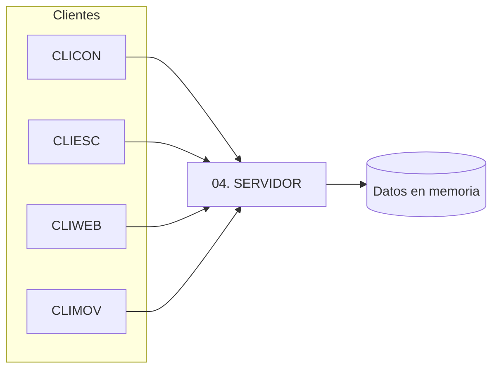

# 04 · Clientes y servidor

Cinco componentes de software por variante, cada uno en su carpeta.

> [!warning] Plataformas propuestas (por confirmar)
> "Plataforma típica" es una **propuesta orientativa**. Lo único respaldado por el repo es el
> ejemplo **SOAP + Java** (consola, Swing, web, Android, y un cliente .NET MAUI). Ajusta la
> plataforma real de cada cliente/servidor según tu variante.

| Carpeta | Componente | Plataforma típica |
| --- | --- | --- |
| `04. SERVIDOR` | Servicio web (REST o SOAP) | Java o .NET |
| `04. CLICON` | Cliente de consola | Java / C# consola |
| `04. CLIESC` | Cliente de escritorio | Swing/JavaFX · WinForms/WPF |
| `04. CLIWEB` | Cliente web | JSP/JSF · ASP.NET |
| `04. CLIMOV` | Cliente móvil (Android) | Android |

## Arquitectura

## Orden de trabajo

1. Implementa el **login** (autenticación obligatoria; credenciales quemadas
   `MONSTER` / `MONSTER9` — ver [[vault/01 - Arquitectura/Autenticación]]).
2. Implementa el **servidor** y verifica sus operaciones.
3. Implementa **CLICON** (el más simple) para validar el contrato.
4. Reutiliza el mismo contrato en **CLIESC**, **CLIWEB** y **CLIMOV**.

> [!tip] Contrato compartido
> Mantén idénticos los nombres lógicos de operaciones y campos entre las cuatro variantes;
> solo cambia la tecnología. Esto facilita comparar los entregables.

> [!info] Relacionado
> - [[vault/03 - Entregables/01 UML]]
> - [[vault/04 - Guías/Compilar y ejecutar]]
