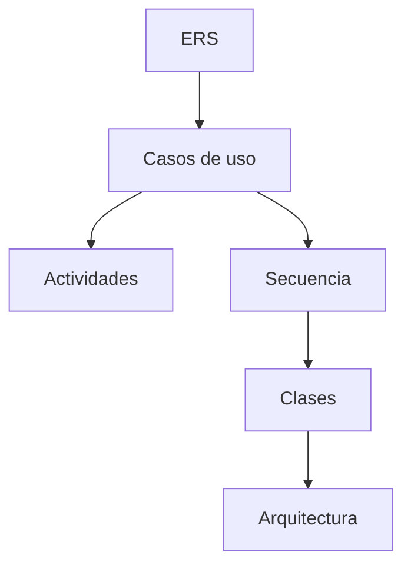

# 01 · UML

Carpeta `01. UML/` de cada variante. Agrupa la especificación de requisitos y todos los
modelos UML.

## Contenido

| Carpeta | Contenido | Formato |
| --- | --- | --- |
| `01. ERS/` | Especificación de Requisitos de Software (únicamente Word oficial) | `.docx` |
| `02. ECUD/` | Especificación de Casos de Uso Detallados ([ecud.md](ecud.md)) | `.pdf` / `.docx` |
| `03. DIAGRAMAS UML/` | Modelos y exportados | nativo (`.oom`, `.prj`, `.eam`, etc.) + `.png`/`.pdf` |

Adicionalmente, en la raíz de cada variante se ubica el espacio de trabajo de PowerDesigner (`CON_UNI_GR09.sws`) que enlaza los proyectos de diagramas.

## Diagramas UML

| Subcarpeta | Diagrama | Contenido y formatos |
| --- | --- | --- |
| `01_CASOS_DE_USO` | Casos de uso | Proyecto (`.prj`) y modelo de casos de uso (`.oom`) |
| `02_ACTIVIDAD` | Actividades (login, conversión) | Proyecto (`.prj`) y modelo de actividades (`.oom`) |
| `03_SECUENCIA` | Secuencia (login, conversión) | Proyecto (`.prj`) y modelo de secuencia (`.oom`) |
| `04_CLASES` | Clases del dominio | Sin persistencia (`SINBDD`). Documentado mediante `README.txt` |
| `05_ARQUITECTURA` | Arquitectura de componentes | Proyecto (`.prj`) y modelo de arquitectura (`.eam`) |

> [!NOTE] Estructura de `04_CLASES`
> Al tratarse de un sistema puramente en memoria y sin base de datos (`SINBDD`), la carpeta `04_CLASES` no requiere un modelo de persistencia relacional ni ORM. Siguiendo la convención de referencia, contiene un `README.txt` que documenta la metadata del estudiante, la naturaleza `SINBDD` y las credenciales quemadas (`MONSTER` / `MONSTER9`).

## Diagramas por Proyecto (Mermaid en Vault)

Las representaciones visuales interactivas en sintaxis Mermaid y el análisis detallado de cada modelo residen en la carpeta de documentación de cada proyecto en `vault/06-projects/`:

| Proyecto | Protocolo / Plataforma | Modelos en Mermaid |
| :--- | :--- | :--- |
| **TI.1.1** | SOAP Java | [Diagramas TI.1.1 SOAP Java](../06-projects/ti-1-1-soap-java/diagrams.md) |
| **TI.1.2** | SOAP .NET | [Diagramas TI.1.2 SOAP .NET](../06-projects/ti-1-2-soap-dotnet/diagrams.md) |
| **TI.1.3** | RESTful Java | [Diagramas TI.1.3 RESTful Java](../06-projects/ti-1-3-rest-java/diagrams.md) |
| **TI.1.4** | RESTful .NET | [Diagramas TI.1.4 RESTful .NET](../06-projects/ti-1-4-rest-dotnet/diagrams.md) |

## Nomenclatura

- ERS: `ERS_<PROTOCOLO>_<PLATAFORMA>_SINBDD_<GRUPO>.docx`
- Plantilla ERS: `ERS_<...>_PLANTILLA.docx`
- ECUD: `ECUD_<PROYECTO>_<GRUPO>.pdf`

Ver [naming-conventions](../01-architecture/naming-conventions.md).

> [!tip] Modelos editables
> Guarda el modelo editable (archivo del programa de modelado) **junto** al exportado en
> la misma subcarpeta. La guía [generate-ers](../04-guides/generate-ers.md) explica cómo generar el
> documento desde la plantilla.

> [!info] Relacionado
> - [02-mer](02-mer.md)
> - [generate-ers](../04-guides/generate-ers.md)

> [!IMPORTANT] Formato exclusivo en `01. ERS/`
> La carpeta `01. UML/01. ERS/` de cada variante contiene **exclusivamente el archivo Word final oficial (`.docx`)**. Los archivos `.md` de redacción y plantillas no deben colocarse en esta carpeta; residen centralizados en [vault/03-deliverables](srs-template.md) y [vault/06-projects](../06-projects/index.md). Tampoco requiere `.gitkeep` al contener ya el archivo `.docx`.
