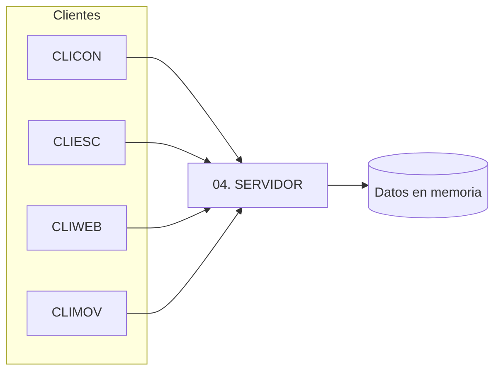

# 04 · Clientes y servidor

Cinco componentes de software por variante, cada uno en su carpeta.

> [!warning] Plataformas propuestas (por confirmar)
> "Plataforma típica" es una **propuesta orientativa**. Lo único respaldado por el repo es el
> ejemplo **SOAP + Java** (consola, Swing, web, Android, y un cliente .NET MAUI). Ajusta la
> plataforma real de cada cliente/servidor según tu variante.

| Carpeta | Componente | Plataforma típica |
| --- | --- | --- |
| `04. SERVIDOR` | Servicio web (REST o SOAP) | Java (Payara / GlassFish / Standalone) o .NET |
| `04. CLICON` | Cliente de consola | Java / C# consola |
| `04. CLIESC` | Cliente de escritorio | Swing/JavaFX · WinForms/WPF |
| `04. CLIWEB` | Cliente web | JSP/JSF · ASP.NET |
| `04. CLIMOV` | Cliente móvil (Android) | Android |

> [!tip] Implementación en SOAP Java (TI.1.1 - GR09)
> - **Servidor de Aplicaciones (RNF-004)**: Despliegue en Payara Server 5/6 mediante WAR (`ServidorSOAP.war`), `glassfish-web.xml`, `payara-web.xml` y `beans.xml` bajo context-root `/ServidorSOAP`.
> - **Arquitectura Interna**: Patrón de diseño **Estrategia (Strategy Pattern)** con `IConversor<U>`, enums estricto de 5 unidades por magnitud (`UnidadLongitud`, `UnidadMasa`, `UnidadTemperatura`) y fachada `ConversionUtil`.
> - **Doble modo de ejecución**: Standalone (`Publisher.java` vía `mvn exec:java`) y contenedor Java EE (`ServidorSOAP.war` en Payara Server).

> [!tip] Implementación en RESTful Java (TI.1.3 - GR09)
> - **Servidor de Aplicaciones (RNF-004)**: Despliegue en Payara Server 5/6 mediante WAR (`WS_CONV_UNI_RESTFULL_JAVA-1.0-SNAPSHOT.war`), `glassfish-web.xml`, `payara-web.xml` y `beans.xml`.
> - **Arquitectura Interna**: Patrón de diseño **Strategy** con `IConversor<U>` implementado en `ConversorLongitud`, `ConversorMasa` y `ConversorTemperatura`, con enums estrictos de 5 unidades y formateo a 2 decimales.
> - **Doble modo de ejecución**: Standalone (`ServidorRestMain.java` con Grizzly HTTP vía `mvn exec:java`) y contenedor Payara Server / GlassFish.

## Arquitectura

## Orden de trabajo

1. Implementa el **login** (autenticación obligatoria; credenciales quemadas
   `MONSTER` / `MONSTER9` — ver [authentication](../01-architecture/authentication.md)).
2. Implementa el **servidor** y verifica sus operaciones.
3. Implementa **CLICON** (el más simple) para validar el contrato.
4. Reutiliza el mismo contrato en **CLIESC**, **CLIWEB** y **CLIMOV**.

> [!tip] Contrato compartido
> Mantén idénticos los nombres lógicos de operaciones y campos entre las cuatro variantes;
> solo cambia la tecnología. Esto facilita comparar los entregables.

> [!info] Relacionado
> - [01-uml](01-uml.md)
> - [build-and-run](../04-guides/build-and-run.md)
