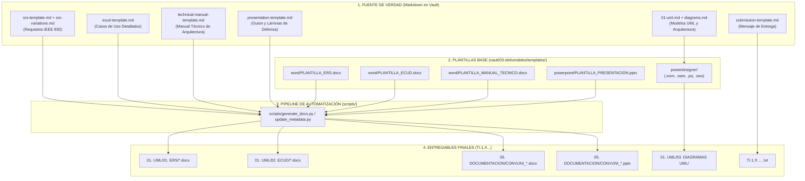

# Mapeo de Documentación, Fuentes de Verdad y Plantillas Reutilizables

Este documento establece la **matriz oficial de trazabilidad** del repositorio. Mapea cada documento entregable requerido en los talleres (`TI.1.X`) con su **fuente de verdad en Markdown** (residente en este Vault), su **plantilla binaria reutilizable** (`vault/03-deliverables/templates/`) y su **proceso de generación**.

---

## 1. Matriz de Mapeo Exhaustiva



---

## 2. Detalle de Correspondencia por Entregable

### A. Especificación de Requisitos de Software (ERS)
* **Entregable Oficial:** `<VARIANTE>/01. UML/01. ERS/ERS_<PROTOCOLO>_<PLATAFORMA>_SINBDD_<GRUPO>.docx`
* **Fuente de Verdad Markdown:**
  * Plantilla Maestra: [srs-template.md](srs-template.md) (Estructura formal IEEE 830, 21 tablas).
  * Matriz de Variaciones: [srs-variations.md](srs-variations.md) (Diferencias técnicas SOAP vs REST, Tomcat vs Kestrel).
  * Nota por Proyecto: `vault/06-projects/<variante>/srs.md`
* **Plantilla Binaria Base:** `vault/03-deliverables/templates/word/PLANTILLA_ERS.docx`
* **Metadatos Vinculados:** Portada formal con Autores (`Viche Castillo, Julio Enrique`, `Murillo Medina, Gabriel Omar`), NRC (`36884`), Grupo (`GR09`), Tutor (`Ing. Eduardo Mauricio Campaña Ortega`).

---

### B. Especificación de Casos de Uso Detallados (ECUD)
* **Entregable Oficial:** `<VARIANTE>/01. UML/02. ECUD/ECUD_<PROTOCOLO>_<PLATAFORMA>_SINBDD_<GRUPO>.docx`
* **Fuente de Verdad Markdown:**
  * Plantilla Maestra: [ecud-template.md](ecud-template.md)
  * Nota de Referencia: [ecud.md](ecud.md)
* **Plantilla Binaria Base:** `vault/03-deliverables/templates/word/PLANTILLA_ECUD.docx`
* **Casos de Uso Mapeados:**
  1. `CU-01`: Iniciar Sesión (Autenticación quemada `MONSTER`/`MONSTER9`, generación de token).
  2. `CU-02`: Convertir Longitud (5 unidades estrictas, validación 16 caracteres, precisión 2 decimales).
  3. `CU-03`: Convertir Masa (5 unidades estrictas, validación 16 caracteres, precisión 2 decimales).
  4. `CU-04`: Convertir Temperatura (5 unidades estrictas, soporte de valores negativos).

---

### C. Modelos de Modelado UML (SAP PowerDesigner)
* **Entregable Oficial:** `<VARIANTE>/01. UML/03. DIAGRAMAS UML/`
* **Fuente de Verdad Markdown:**
  * Visión General: [01-uml.md](01-uml.md)
  * Diagramas Mermaid interactivos: `vault/06-projects/<variante>/diagrams.md`
* **Plantillas Editables Base:**
  * Espacio de trabajo general: `vault/03-deliverables/templates/powerdesigner/CON_UNI_PLANTILLA.sws`
  * `01_CASOS_DE_USO/`: `OOm_Casos_De_Uso.oom`, `CU_Ingresar_Sistema.oom`, `.prj`
  * `02_ACTIVIDAD/`: `ActividadIniciarSesión.oom`, `ActividadConvertirUnidades.oom`, `.prj`
  * `03_SECUENCIA/`: `Secuencia.oom`, `SecuenciaConvertirUnidades.oom`, `.prj`
  * `04_CLASES/`: `README.txt` (Documenta la condición `SINBDD` en memoria)
  * `05_ARQUITECTURA/`: `Arquitectura.eam`, `.prj`

---

### D. Manual Técnico del Sistema
* **Entregable Oficial:** `<VARIANTE>/05. DOCUMENTACION/CONVUNI_<PROTOCOLO>_<PLATAFORMA>_<GRUPO>.docx`
* **Fuente de Verdad Markdown:**
  * Plantilla Maestra: [technical-manual-template.md](technical-manual-template.md)
  * Nota por Proyecto: `vault/06-projects/<variante>/technical-manual.md`
  * Guías por Estilo: [manual-tecnico-soap.md](manual-tecnico-soap.md), [manual-tecnico-restful.md](manual-tecnico-restful.md)
* **Plantilla Binaria Base:** `vault/03-deliverables/templates/word/PLANTILLA_MANUAL_TECNICO.docx`
* **Capítulos Mapeados:** Arquitectura, Capa de Servicios Web, Consumo desde Consola/Escritorio/Web/Móvil, Pruebas y Manual de Despliegue.

---

### E. Presentación Ejecutiva de Sustentación
* **Entregable Oficial:** `<VARIANTE>/05. DOCUMENTACION/CONVUNI_<PROTOCOLO>_<PLATAFORMA>_<GRUPO>.pptx`
* **Fuente de Verdad Markdown:**
  * Plantilla Maestra: [presentation-template.md](presentation-template.md) (Guion de 12 diapositivas estructuradas)
* **Plantilla Binaria Base:** `vault/03-deliverables/templates/powerpoint/PLANTILLA_PRESENTACION.pptx`
* **Láminas Clave:** Carátula institucional, Arquitectura física y lógica, Demostración de clientes multi-canal, Reglas de negocio y Métricas de calidad.

---

### F. Mensaje de Envío Académico
* **Entregable Oficial:** Raíz `TI.1.X PAO202651_<PROTO>_<PLAT>_SINBDD_NRC36884_GR09.txt`
* **Fuente de Verdad Markdown:** [submission-template.md](submission-template.md)
* **Contenido:** Formato formal de entrega para Classroom/correo con enlace a Google Drive e integrantes del grupo.

---

## 3. Guía de Automatización y Regeneración

Para actualizar o regenerar cualquier entregable sin intervención manual en interfaces gráficas:
1. **Actualizar el contenido:** Editar la nota Markdown correspondiente en el `vault/`.
2. **Ejecutar el script de sincronización:**
   ```powershell
   python scripts/update_metadata.py
   ```
3. **Compilar / Verificar:**
   * El script toma las plantillas de `vault/03-deliverables/templates/`, inyecta los textos y metadatos del Vault y sobrescribe los entregables en la carpeta del taller correspondiente.
