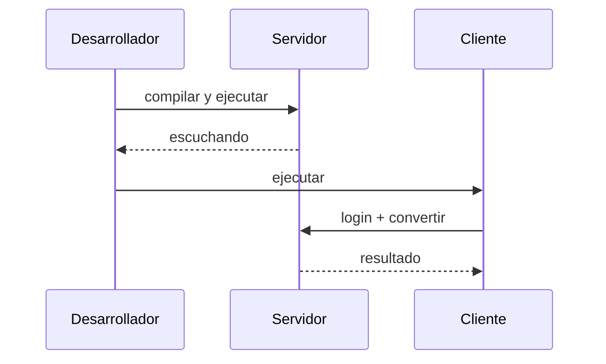

# Compilar y ejecutar

Guía general por stack. Ajusta los comandos a la estructura real de cada proyecto una vez
lo agregues a la variante.

> [!warning] Orden obligatorio
> 1. Compilar y **levantar el servidor**.
> 2. Verificar que responde.
> 3. Ejecutar los clientes.

## Java

| Acción | Comando |
| --- | --- |
| Compilar | `mvn clean package` |
| Ejecutar (genérico) | `mvn exec:java` |
| Ejecutar JAR | `java -jar target/<artefacto>.jar` |

Para servidores JAX-RS/JAX-WS suele desplegarse en un contenedor (Tomcat/Jetty). Documenta
la URL del endpoint en el `README.txt` del servidor.

## .NET

| Acción | Comando |
| --- | --- |
| Restaurar | `dotnet restore` |
| Compilar | `dotnet build` |
| Ejecutar | `dotnet run` |

## Android (CLIMOV)

| Acción | Comando |
| --- | --- |
| Compilar APK debug | `gradlew.bat assembleDebug` |
| Instalar en emulador | `gradlew.bat installDebug` |

> [!tip]
> Si el cliente móvil no conecta con el servidor local, revisa la URL/base del endpoint y
> la configuración de red (por ejemplo, `10.0.2.2` para el emulador de Android).

## Secuencia de verificación

> [!info] Relacionado
> - [[vault/03-deliverables/04-clients-and-server]]
> - [[vault/02-variants/java-vs-dotnet]]
