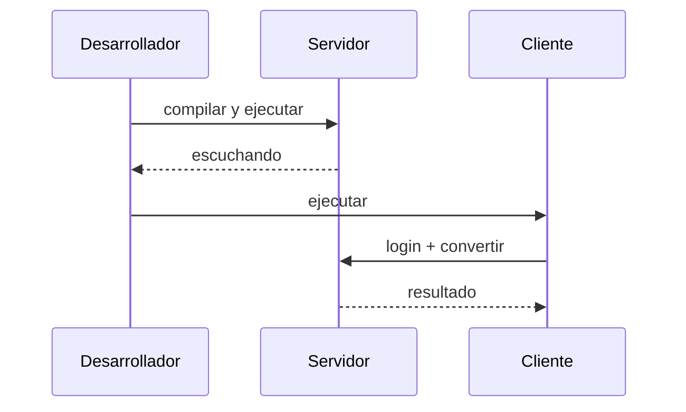

# Compilar y ejecutar

Guía general por stack. Ajusta los comandos a la estructura real de cada proyecto una vez
lo agregues a la variante.

> [!warning] Orden obligatorio
> 1. Compilar y **levantar el servidor**.
> 2. Verificar que responde.
> 3. Ejecutar los clientes.

## Java

| Acción | Comando |
| --- | --- |
| Compilar y empaquetar WAR | `mvn clean package` |
| Ejecutar Servidor Standalone | `mvn exec:java` |
| Ejecutar pruebas JUnit 5 | `mvn test` |

Para el **Servidor SOAP Java**, se dispone de soporte dual:
- **Payara Server / GlassFish (RNF-004)**: Genera `ServidorSOAP.war` configurado con `glassfish-web.xml` y `payara-web.xml` bajo el context-root `/ServidorSOAP`. Compatible con despliegue automático desde Apache NetBeans (`netbeans.hint.deploy.server=pfv5ee8`).
- **Publisher Standalone**: Permite ejecución directa mediante `mvn exec:java` sin requerir servidor externo, exponiendo los endpoints en `http://localhost:8080/ServidorSOAP/`.

## .NET

| Acción | Comando |
| --- | --- |
| Restaurar | `dotnet restore` |
| Compilar | `dotnet build` |
| Ejecutar | `dotnet run` |

## Android (CLIMOV)

| Acción | Comando |
| --- | --- |
| Compilar APK debug | `gradlew.bat assembleDebug` |
| Instalar en emulador | `gradlew.bat installDebug` |

> [!tip]
> Si el cliente móvil no conecta con el servidor local, revisa la URL/base del endpoint y
> la configuración de red (por ejemplo, `10.0.2.2` para el emulador de Android).

## Secuencia de verificación

> [!info] Relacionado
> - [04-clients-and-server](../03-deliverables/04-clients-and-server.md)
> - [java-vs-dotnet](../02-variants/java-vs-dotnet.md)
