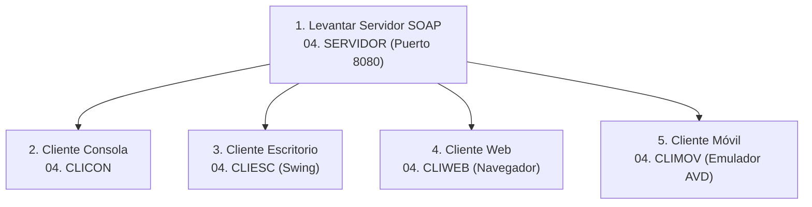

# Guía de Instalación y Replicabilidad del Entorno

Esta guía detalla **todas las herramientas, runtimes y configuraciones paso a paso** necesarias para compilar, levantar y ejecutar los 4 clientes y el servidor del proyecto **TI.1.1 (Conversor de Unidades SOAP Java SINBDD)** en cualquier equipo con Windows.

---

## 1. Resumen de Herramientas y Runtimes

| Componente | Herramienta | Versión Requerida | Estado en este equipo | Propósito |
| :--- | :--- | :--- | :--- | :--- |
| **Backend & Core** | Eclipse Temurin JDK | 17 LTS | ✅ Instalado | Compilación y ejecución de Java |
| **Gestor de Paquetes** | Apache Maven | 3.9+ | ✅ Instalado | Dependencias y builds (`pom.xml`) |
| **Cliente Consola** | Java CLI | 17+ | ✅ Listo | Ejecutable interactivo terminal |
| **Cliente Escritorio** | Java Swing + FlatLaf | 17+ | ✅ Listo | Ventana ejecutiva de escritorio |
| **Cliente Web** | Tomcat Embebido / JSP | 17+ | ✅ Listo | Interfaz web en navegador |
| **Cliente Móvil** | Android Studio + SDK | API 34/35 | ⏳ En proceso | Compilación y emulación Android |

---

## 2. Paso a Paso: Instalación y Configuración

### Paso 1: Java Development Kit (JDK 17 LTS)

El proyecto requiere Java 17 para compatibilidad con las especificaciones de Jakarta/JAX-WS y el plugin de Maven.

1. **Instalación con Winget:**
   ```powershell
   winget install EclipseAdoptium.Temurin.17.JDK --source winget
   ```
   *Ruta de instalación por defecto:* `C:\Program Files\Eclipse Adoptium\jdk-17.0.20.101-hotspot`

2. **Variables de Entorno (PowerShell como Administrador o Usuario):**
   ```powershell
   [System.Environment]::SetEnvironmentVariable("JAVA_HOME", "C:\Program Files\Eclipse Adoptium\jdk-17.0.20.101-hotspot", "User")
   $currentPath = [System.Environment]::GetEnvironmentVariable("Path", "User")
   [System.Environment]::SetEnvironmentVariable("Path", "$currentPath;C:\Program Files\Eclipse Adoptium\jdk-17.0.20.101-hotspot\bin", "User")
   ```

3. **Verificación:**
   ```powershell
   java -version
   ```

---

### Paso 2: Apache Maven (3.9+)

Utilizado para construir y empaquetar el servidor SOAP y los clientes de consola, escritorio y web.

1. **Descarga y Extracción:**
   ```powershell
   curl.exe -k -L -o "$env:TEMP\apache-maven-3.9.9-bin.zip" "https://archive.apache.org/dist/maven/maven-3/3.9.9/binaries/apache-maven-3.9.9-bin.zip"
   Expand-Archive -Path "$env:TEMP\apache-maven-3.9.9-bin.zip" -DestinationPath "$env:LOCALAPPDATA\Programs" -Force
   ```
   *Ruta final:* `%LOCALAPPDATA%\Programs\apache-maven-3.9.9`

2. **Variables de Entorno:**
   ```powershell
   [System.Environment]::SetEnvironmentVariable("M2_HOME", "$env:LOCALAPPDATA\Programs\apache-maven-3.9.9", "User")
   [System.Environment]::SetEnvironmentVariable("MAVEN_HOME", "$env:LOCALAPPDATA\Programs\apache-maven-3.9.9", "User")
   $currentPath = [System.Environment]::GetEnvironmentVariable("Path", "User")
   [System.Environment]::SetEnvironmentVariable("Path", "$currentPath;$env:LOCALAPPDATA\Programs\apache-maven-3.9.9\bin", "User")
   ```

3. **Verificación:**
   ```powershell
   mvn -v
   ```

---

### Paso 3: Android Studio y Android SDK (Para `04. CLIMOV`)

Para compilar y emular la aplicación móvil sin necesidad de un teléfono Android físico.

1. **Instalación:**
   * **Opción automática (Winget):**
     ```powershell
     winget install Google.AndroidStudio --source winget
     ```
   * **Opción manual:** Descargar desde [developer.android.com/studio](https://developer.android.com/studio) y seguir el asistente.

2. **Asistente de Primer Inicio (Setup Wizard):**
   * Al abrir Android Studio por primera vez, selecciona la instalación **"Standard"**.
   * Descargará automáticamente:
     - **Android SDK** (por defecto en `%LOCALAPPDATA%\Android\Sdk`).
     - **Android SDK Platform-Tools** (`adb`).
     - **Android Virtual Device (AVD)**.

3. **Creación del Emulador Virtual (AVD):**
   - En Android Studio, ve a **Tools > Device Manager**.
   - Haz clic en **Create Virtual Device**.
   - Selecciona **Phone > Pixel 6** (o cualquier modelo similar).
   - Descarga la imagen del sistema recomendada (ejemplo: **API 34 - Android 14** o **API 35**).
   - Finaliza el asistente y pulsa el botón **Play (▶)** para iniciar el celular en tu pantalla.

4. **Regla de Conexión de Red para Android:**
   > [!IMPORTANT]
   > En el emulador de Android Studio, la dirección `localhost` hace referencia al propio emulador. Para comunicarte con el servidor SOAP que corre en tu PC host, debes apuntar a:
   > ```text
   > http://10.0.2.2:8080/ServidorSOAP
   > ```
   > Si utilizas un celular físico conectado a tu misma red Wi-Fi, debes colocar la IP de tu PC: `http://192.168.X.X:8080/ServidorSOAP`.

---

## 3. Secuencia de Ejecución de la Solución Completa

Para que los clientes funcionen correctamente, deben ejecutarse en el siguiente orden:



### Comandos de Ejecución Rápida:

1. **Servidor SOAP:**
   ```powershell
   cd "TI.1.1. PAO202651_SOAP_JAVA_SINBDD_NRC36884_GR09\04. SERVIDOR"
   mvn exec:java
   ```
   *Verificar en navegador:* `http://localhost:8080/ServidorSOAP?wsdl`

2. **Cliente Consola:**
   ```powershell
   cd "..\04. CLICON"
   mvn exec:java
   ```

3. **Cliente Escritorio:**
   ```powershell
   cd "..\04. CLIESC"
   mvn exec:java
   ```

4. **Cliente Web:**
   ```powershell
   cd "..\04. CLIWEB"
   mvn package
   mvn exec:java
   # Abrir en navegador: http://localhost:8080/conversor.html
   ```

5. **Cliente Móvil:**
   ```powershell
   cd "..\04. CLIMOV"
   .\gradlew.bat assembleDebug
   # O abrir la carpeta 04. CLIMOV en Android Studio y presionar Run (Shift + F10)
   ```
