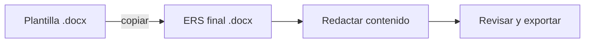

# Generar el ERS

El ERS (Especificación de Requisitos de Software) se redacta a partir de una **plantilla**.
En el ejemplo de referencia existe un script de PowerShell que copia la plantilla sin
sobrescribir archivos existentes.

## Plantilla y nombres

- Plantilla: `ERS_<PROTOCOLO>_<PLATAFORMA>_SINBDD_<GRUPO>_PLANTILLA.docx`
- Documento final: `ERS_<PROTOCOLO>_<PLATAFORMA>_SINBDD_<GRUPO>.docx`

Ambos viven en `01. UML/01. ERS/`.

## Flujo

1. Copia la plantilla (a mano o con un script) hacia el nombre del documento final.
2. Completa las secciones: introducción, alcance, requisitos funcionales y no funcionales,
   reglas de negocio, restricciones (recuerda: **SINBDD**) y glosario.
3. Guarda en `01. UML/01. ERS/`.

> [!tip] Script de referencia
> El ejemplo incluye `generar_plantilla_ers.ps1`, que valida rutas y no sobrescribe. Puedes
> reutilizar su lógica adaptando las rutas a tu variante. **No modifiques el archivo dentro
> de `examples/`**: cópialo si lo necesitas.

> [!info] Relacionado
> - [[vault/03-deliverables/01-uml]]
> - [[vault/01-architecture/naming-conventions]]
