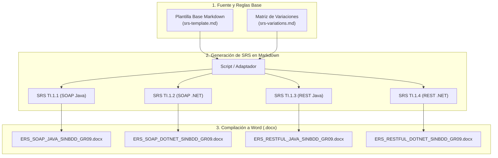

# Generar y Gestionar los Documentos ERS / SRS

Esta guía documenta el **proceso de creación de la plantilla Markdown institucional**, el proceso de depuración aplicado y el **pipeline de generación** que utilizaremos para producir las especificaciones de requisitos (SRS) de cada taller y sus entregables finales en formato Microsoft Word (`.docx`).

---

## 1. Proceso de Extracción y Limpieza de la Plantilla

Para evitar la manipulación manual propensa a errores en archivos binarios `.docx`, se implementó un proceso de ingeniería inversa sobre la plantilla de referencia (`examples/ERS_SOAP_JAVA_SINBDD_GR69_PLANTILLA.docx`):

### A. Extracción Estructurada desde OpenXML
- Se utilizó la librería Python `python-docx` y lectura directa del árbol XML (`word/document.xml`).
- **Rescate de Metadatos y Portada:** Los datos de la carátula estaban encapsulados en cajas de texto flotantes de dibujo (`w:txbxContent`), invisibles para extractores de párrafos estándar. Se recuperaron los títulos institucionales, el tutor y los marcadores de autor.
- **Tablas:** Se extrajeron y convirtieron automáticamente 21 tablas de requisitos y atributos de calidad a sintaxis de tablas Markdown GFM.

### B. Depuración de Residuos e Inconsistencias
- **Eliminación de índices contaminados:** El índice de tablas original contenía referencias residuales de un proyecto ajeno de taller automotriz (`Registrar clientes`, `Asignar mecánico`, `Gestionar vehículo`). Se reconstruyó un índice limpio y coherente con las 32 tablas reales del Convertidor de Unidades.
- **Eliminación de bloques obsoletos:** Se eliminó la sección inconclusa que iba desde `GRUPO 01` hasta la viñeta vacía `4.`.
- **Estandarización de Integrantes:** Se configuró el formato reglamentario con apellidos primero y solo el autor del taller:
  ```markdown
  | **Integrantes** | **Viche Castillo, Julio Enrique** |
  ```
- **Corrección de Jerarquías Markdown:**
  - `#### 8.2.2. Objetivos Específicos` (corregido desde estilo de texto normal a H4).
  - `#### 9.1.5. Base de Datos` (corregido desde texto normal a subtítulo H4).
  - `## 10. Conclusiones` y `## 11. Recomendaciones` (estandarizados como títulos H2 y reordenados lógicamente).
  - `## 12. Bibliografía` (incorporado con citas formales IEEE 830, W3C SOAP y Oracle Java).

El resultado depurado es la plantilla maestra: [[vault/03-deliverables/srs-template|srs-template.md]].

---

## 2. Pipeline de Generación por Taller

El flujo de trabajo adoptado en este repositorio utiliza **Markdown como fuente única de verdad** para la redacción y revisión, garantizando control de versiones limpio en git antes de compilar al formato Word final.



---

## 3. Etapas del Flujo de Trabajo

### Paso 1: Mantenimiento de la Plantilla Base y la Matriz
- [[vault/03-deliverables/srs-template|srs-template.md]]: Estructura formal IEEE 830 completa.
- [[vault/03-deliverables/srs-variations|srs-variations.md]]: Diccionario de diferencias tecnológicas (SOAP vs REST, Java vs .NET, bibliotecas cliente, servidores Kestrel/Tomcat y tokens).

### Paso 2: Generación de los Markdown Específicos de cada Taller
Para cada variante se genera un documento Markdown específico que adapta la carátula, RNF-001 a RNF-005, e interfaces según la plataforma:
- `TI.1.1`: SOAP en Java (JAX-WS, NetBeans, Tomcat/Embebido).
- `TI.1.2`: SOAP en .NET (CoreWCF, Visual Studio, Kestrel).
- `TI.1.3`: REST en Java (Jakarta REST / Spring Boot, Jackson).
- `TI.1.4`: REST en .NET (ASP.NET Core Web API, System.Text.Json).

### Paso 3: Compilación a Microsoft Word (`.docx`)
Una vez revisado y aprobado el Markdown de cada taller:
1. Un script automatizado inyecta el contenido formateado sobre la plantilla oficial `.docx` preservando estilos, márgenes institucionales y tipografías.
2. El archivo `.docx` resultante se ubica en la carpeta de entregables correspondiente:
   `TI.1.X.../01. UML/01. ERS/ERS_<PROTOCOLO>_<PLATAFORMA>_SINBDD_GR09.docx`.

---

## 4. Notas y Buenas Prácticas

> [!TIP] Versionamiento en Git
> Los documentos `.md` se versionan y comitean en git para mantener un historial claro de los cambios en los requisitos. Los binarios `.docx` se generan antes de las entregas y solo se versionan cuando el usuario lo apruebe explícitamente.

> [!IMPORTANT]
> Recuerda que los 4 talleres comparten el mismo caso de estudio (**Convertidor de Unidades**), la restricción **SINBDD** y la autenticación quemada con `MONSTER` / `MONSTER9`.
