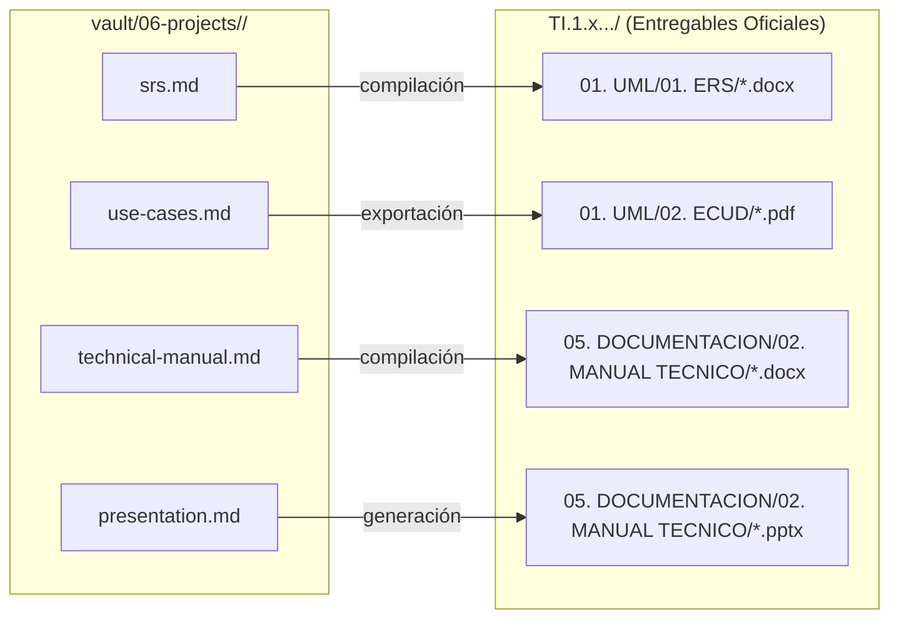

# 06 · Projects

Espacio centralizado para la documentación técnica, especificaciones y guías de cada uno
de los cuatro talleres del proyecto de **Conversión de Unidades (SINBDD)**.

Cada taller cuenta con su propia carpeta donde residen los documentos maestros en formato
Markdown (`.md`), a partir de los cuales se compilan los archivos oficiales de entrega (`.docx` y `.pptx`).

---

## 1. Índice de Talleres

| Taller | Protocolo | Plataforma | Carpeta en Vault | Entrega Oficial |
| :--- | :--- | :--- | :--- | :--- |
| **TI.1.1** | SOAP | Java (Payara / JAX-WS) | [TI.1.1 · SOAP Java](ti-1-1-soap-java/index.md) | `TI.1.1. PAO202651_SOAP_JAVA_SINBDD_NRC36884_GR09` |
| **TI.1.2** | SOAP | .NET (CoreWCF / ASMX) | [TI.1.2 · SOAP .NET](ti-1-2-soap-dotnet/index.md) | `TI.1.1. PAO202651_SOAP_DOTNET_SINBDD_NRC36884_GR09` |
| **TI.1.3** | RESTful | Java (Jersey / Spring) | [TI.1.3 · RESTful Java](ti-1-3-rest-java/index.md) | `TI.1.1. PAO202651_RESTFUL_JAVA_SINBDD_NRC36884_GR09` |
| **TI.1.4** | RESTful | .NET (ASP.NET Core Web API) | [TI.1.4 · RESTful .NET](ti-1-4-rest-dotnet/index.md) | `TI.1.1. PAO202651_RESTFUL_DOTNET_SINBDD_NRC36884_GR09` |

---

## 2. Convención del "Gemelo Digital"

Para cumplir con la regla de entregas limpias de **`AGENTS.md`**, la redacción y mantenimiento se realiza en Markdown dentro de esta carpeta, mientras que en las carpetas de entrega solo se depositan los formatos finales oficiales:

---

## 3. Estructura estándar por taller

Cada subcarpeta de taller sigue la siguiente organización:

- **`index.md`**: Ficha técnica, estado de componentes (Servidor, Consola, Escritorio, Móvil, Web), checklist y comandos.
- **`srs.md`**: Especificación de Requisitos de Software formal (fuente del documento Word oficial).
- **`use-cases.md`**: Especificación de Casos de Uso Detallados (tablas formales de flujos de eventos).
- **`technical-manual.md`**: Manual técnico exhaustivo de instalación, despliegue del servidor y ejecución de clientes.
- **`presentation.md`**: Guion estructurado de diapositivas para la defensa o exposición.

---

> [!info] Documentación transversal y plantillas
> - [srs-template](../03-deliverables/srs-template.md): Plantilla base IEEE-830 común.
> - [srs-variations](../03-deliverables/srs-variations.md): Matriz de diferencias técnicas entre las 4 variantes.
> - [01-uml](../03-deliverables/01-uml.md): Modelos UML y diagramas Mermaid oficiales.
> - [build-and-run](../04-guides/build-and-run.md): Comandos de compilación y ejecución.
