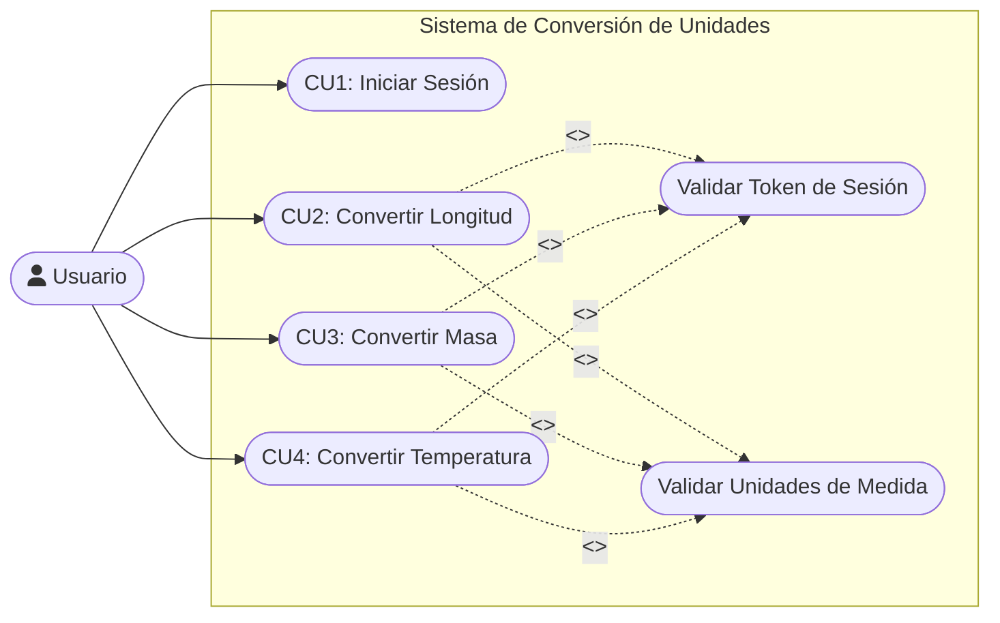
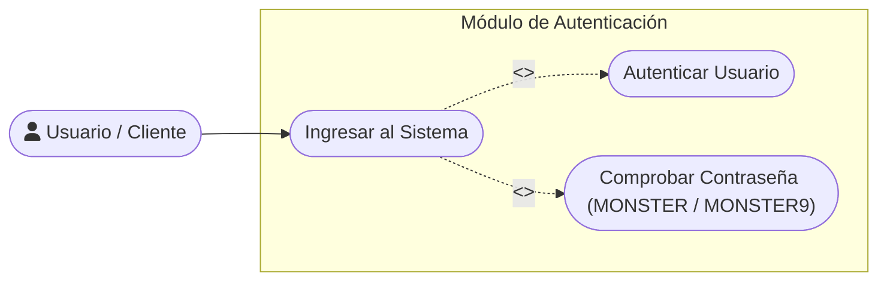
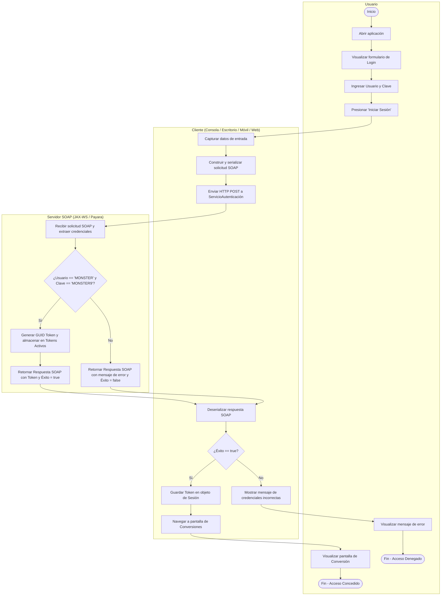
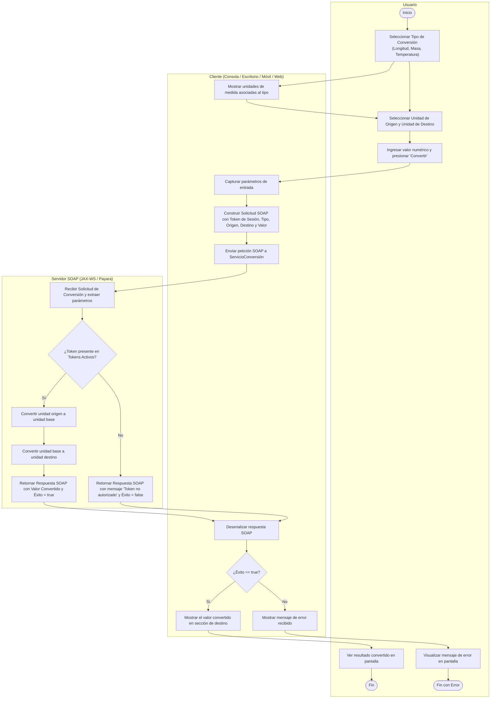
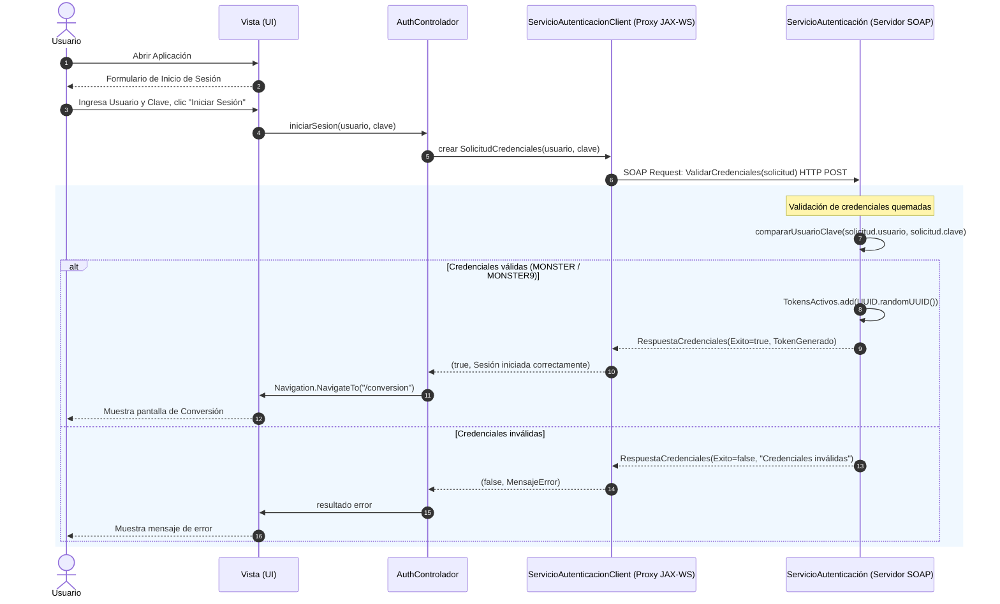
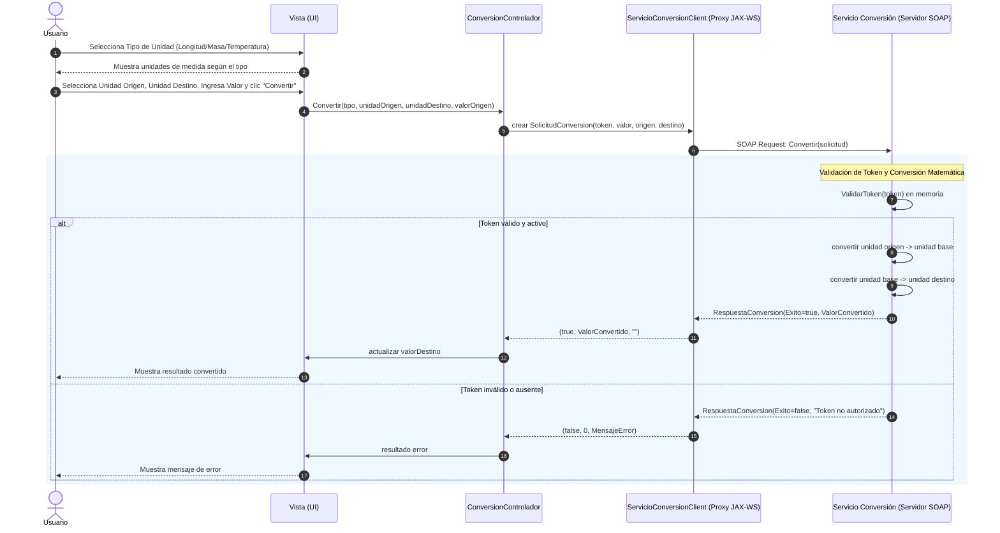
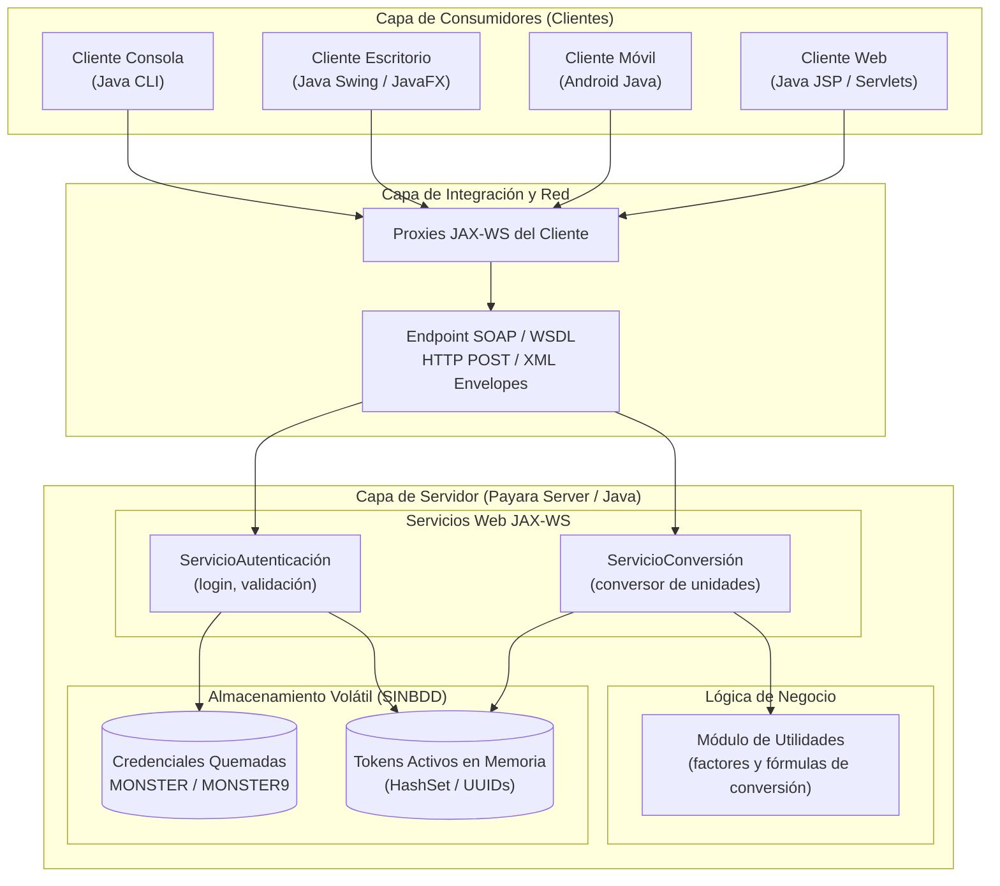

# Diagramas UML · TI.1.1 SOAP Java (SINBDD)

Este documento contiene la representación visual en sintaxis **Mermaid** de todos los modelos
UML nativos de PowerDesigner (`.oom` y `.eam`) correspondientes al taller **TI.1.1** (SOAP en Java, `SINBDD`).

Los modelos nativos editables y el espacio de trabajo se ubican en la carpeta del proyecto:
`TI.1.1. PAO202651_SOAP_JAVA_SINBDD_NRC36884_GR09/` y se abren conjuntamente mediante el archivo `CON_UNI_GR09.sws`.

---

## 1. Casos de Uso (`01_CASOS_DE_USO`)

**Modelo nativo:** `01_CASOS_DE_USO/01_CASOS_DE_USO.prj`, `OOm_Casos_De_Uso.oom`, `CU_Ingresar_Sistema.oom`.

### 1.1. Diagrama General de Casos de Uso
Ilustra el acceso protegido del actor `Usuario` a los servicios de conversión de longitud, masa y temperatura, los cuales incluyen obligatoriamente la validación de token y unidades.

### 1.2. Detalle del Módulo de Autenticación
Descompone el caso de uso de inicio de sesión con validación de credenciales fijas (`MONSTER` / `MONSTER9`).

---

## 2. Diagramas de Actividad (`02_ACTIVIDAD`)

**Modelo nativo:** `02_ACTIVIDAD/02_ACTIVIDAD.prj`, `ActividadIniciarSesión.oom`, `ActividadConvertirUnidades.oom`.

### 2.1. Actividad: Iniciar Sesión
Flujo de control con 3 swimlanes (*Usuario*, *Cliente*, *Servidor SOAP*).

### 2.2. Actividad: Convertir Unidades
Flujo de selección de magnitud, unidades, valor y procesamiento matemático de conversión en el servidor.

---

## 3. Diagramas de Secuencia (`03_SECUENCIA`)

**Modelo nativo:** `03_SECUENCIA/03_SECUENCIA.prj`, `Secuencia.oom`, `SecuenciaConvertirUnidades.oom`.

### 3.1. Secuencia: Iniciar Sesión
Interacción temporal entre las capas de presentación, control y servicios JAX-WS.

### 3.2. Secuencia: Conversión de Unidades
Cálculo de conversión en el servidor tras la validación del token de sesión en memoria.

---

## 4. Clases del Dominio (`04_CLASES`)

Al tratarse de una arquitectura **SINBDD** (sin persistencia en base de datos), la solución no requiere un modelo relacional ni mapeo ORM. La estructura en memoria y las credenciales se encuentran documentadas en el archivo:
`TI.1.1. PAO202651_SOAP_JAVA_SINBDD_NRC36884_GR09/01. UML/03. DIAGRAMAS UML/04_CLASES/README.txt`

---

## 5. Arquitectura de Componentes (`05_ARQUITECTURA`)

**Modelo nativo:** `05_ARQUITECTURA/05_ARQUITECTURA.prj`, `Arquitectura.eam`.

Muestra los cuatro consumidores cliente comunicándose mediante sobres SOAP / XML contra el servidor Payara con almacenamiento volátil en memoria.

---

> [!info] Enlaces relacionados
> - [index.md](index.md): Panel principal del taller TI.1.1.
> - [srs.md](srs.md): Especificación de Requisitos de Software de TI.1.1.
> - [technical-manual.md](technical-manual.md): Manual técnico de instalación y despliegue.
> - [01-uml](../../03-deliverables/01-uml.md): Catálogo general de UML en el vault.
