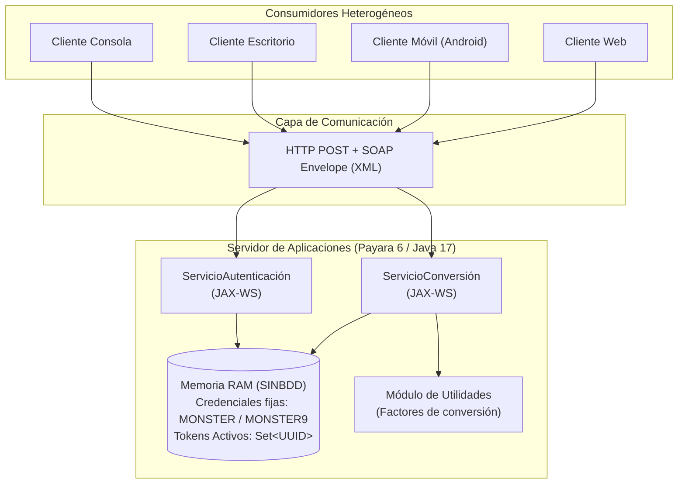

# Manual Técnico · Sistema de Conversión de Unidades SOAP en Java (SINBDD)

**Tarea:** TI.1.1  
**Asignatura:** Arquitectura de Software  
**Periodo Académico:** PAO 2026-51  
**NRC:** 36884  
**Grupo:** GR09  
**Autor:** Julio Enrique Viche Castillo  
**Universidad de las Fuerzas Armadas ESPE**  

---

## 1. Introducción y Objetivos

### 1.1. Propósito del Documento
El presente manual técnico describe la arquitectura, instalación, configuración, despliegue y consumo de la solución de software desarrollada para la tarea **TI.1.1**, consistente en un sistema distribuido de **Conversión de Unidades** implementado bajo el estilo de servicios web **SOAP** (Simple Object Access Protocol) en la plataforma **Java** (Jakarta EE / JAX-WS), operando bajo la modalidad **SINBDD** (sin persistencia en bases de datos).

### 1.2. Alcance
El sistema comprende un servidor de servicios web centralizado desplegado en un servidor de aplicaciones empresarial (Payara Server / GlassFish) y cuatro clientes heterogéneos que consumen dichos servicios:
1. Cliente de Consola (Java CLI).
2. Cliente de Escritorio (Java Swing / JavaFX).
3. Cliente Móvil (Android Java).
4. Cliente Web (Java JSP / Servlets).

---

## 2. Arquitectura del Sistema

### 2.1. Estilo de Arquitectura
Se implementa una arquitectura distribuida **Cliente-Servidor Orientada a Servicios (SOA)** con acoplamiento basado en contratos **WSDL** (Web Services Description Language). Las comunicaciones se realizan mediante solicitudes y respuestas HTTP POST encapsuladas en sobres XML (SOAP Envelopes).



### 2.2. Principio SINBDD y Autenticación Obligatoria
1. **Credenciales Quemadas (Hardcoded):** El sistema restringe el acceso mediante un único usuario administrador cuyas credenciales están codificadas en la lógica del servidor:
   * **Usuario:** `MONSTER`
   * **Contraseña:** `MONSTER9`
2. **Gestión de Sesión en Memoria:** Al autenticarse satisfactoriamente, el servidor genera un identificador único de sesión (`UUID`/`GUID`) y lo registra en una colección volátil en memoria (`HashSet<String>` o `ConcurrentHashMap`). 
3. **Protección de Servicios:** Todas las operaciones de conversión exigen la presentación del token. Si el token no se encuentra en la colección activa en memoria, la solicitud es rechazada inmediatamente con un error de autorización.

### 2.3. Patrón Arquitectónico en Clientes: Modelo - Vista - Controlador (MVC)
Todos los clientes heterogéneos se diseñan bajo la rigurosa separación de responsabilidades del patrón **MVC**:
* **Modelo (`model`):** Representa el estado y las estructuras de datos de la aplicación ([SessionModel](file:///c:/Dev/GitHub/u1-sw-arch/TI.1.1.%20PAO202651_SOAP_JAVA_SINBDD_NRC36884_GR09/04.%20CLICON/src/main/java/ec/edu/monster/client/model/SessionModel.java), [ConversionRequest](file:///c:/Dev/GitHub/u1-sw-arch/TI.1.1.%20PAO202651_SOAP_JAVA_SINBDD_NRC36884_GR09/04.%20CLICON/src/main/java/ec/edu/monster/client/model/ConversionRequest.java), DTOs serializables de respuesta).
* **Vista (`view`):** Responsable exclusiva de la interacción visual con el usuario (terminal de comandos en `ConsoleView`, formularios Swing en escritorio, pantallas móviles o plantillas JSP). No contiene lógica de negocio ni llamadas directas de red.
* **Controlador (`controller`):** Intermediario activo ([AuthController](file:///c:/Dev/GitHub/u1-sw-arch/TI.1.1.%20PAO202651_SOAP_JAVA_SINBDD_NRC36884_GR09/04.%20CLICON/src/main/java/ec/edu/monster/client/controller/AuthController.java), [ConversionController](file:///c:/Dev/GitHub/u1-sw-arch/TI.1.1.%20PAO202651_SOAP_JAVA_SINBDD_NRC36884_GR09/04.%20CLICON/src/main/java/ec/edu/monster/client/controller/ConversionController.java)). Captura eventos de la vista, invoca a los proxies SOAP del paquete `ws`, actualiza el modelo y despacha los resultados a la vista.

---

## 3. Especificación de Servicios SOAP

### 3.1. Servicio de Autenticación (`ServicioAutenticacion`)
* **Endpoint / WSDL:** `http://localhost:8080/ServidorSOAP/ServicioAutenticacion?wsdl`
* **Operación:** `iniciarSesion`
  * **Entrada (SOAP Body):**
    * `usuario` (String): Identificador del usuario.
    * `clave` (String): Contraseña en texto claro.
  * **Salida (SOAP Body):**
    * `exito` (Boolean): `true` si las credenciales coinciden con `MONSTER`/`MONSTER9`, de lo contrario `false`.
    * `token` (String): GUID asignado para la sesión (vacío si falló).
    * `mensaje` (String): Mensaje informativo ("Inicio de sesión exitoso" o "Credenciales incorrectas").

### 3.2. Servicio de Conversión (`ServicioConversion`)
* **Endpoint / WSDL:** `http://localhost:8080/ServidorSOAP/ServicioConversion?wsdl`
* **Operaciones disponibles:**
  1. `convertirLongitud(token, valor, unidadOrigen, unidadDestino)`
  2. `convertirMasa(token, valor, unidadOrigen, unidadDestino)`
  3. `convertirTemperatura(token, valor, unidadOrigen, unidadDestino)`
* **Estructura de Respuesta:**
  * `exito` (Boolean): Indica si la conversión fue procesada.
  * `valorConvertido` (Double): Resultado numérico calculado.
  * `mensajeError` (String): Detalle del fallo en caso de token inválido o error aritmético.

### 3.3. Unidades y Fórmulas Soportadas
* **Longitud:** Metro (base), Kilómetro, Centímetro, Milímetro, Milla, Yarda, Pie, Pulgada.
* **Masa:** Kilogramo (base), Gramo, Miligramo, Libra, Onza, Tonelada.
* **Temperatura:** Celsius (base), Fahrenheit, Kelvin.
  $$\text{Fahrenheit a Celsius: } C = (F - 32) \times \frac{5}{9}$$
  $$\text{Celsius a Fahrenheit: } F = (C \times \frac{9}{5}) + 32$$
  $$\text{Celsius a Kelvin: } K = C + 273.15$$

---

## 4. Requisitos y Despliegue del Servidor

### 4.1. Requisitos de Software
* **Java Development Kit (JDK):** Versión 17 o superior.
* **Apache Maven:** Versión 3.8.x o superior.
* **Servidor de Aplicaciones:** Payara Server Community 6.x (o GlassFish Server 7.x).
* **Puertos de Red:**
  * Puerto HTTP de aplicación: `8080` (predeterminado).
  * Consola de administración Payara: `4848`.

### 4.2. Compilación del Servidor
Desde la terminal en el directorio del componente servidor (`04. SERVIDOR/`):
```bash
mvn clean package
```
Esto genera el archivo comprimido WAR en la carpeta `target/` (ej. `target/ServidorSOAP.war`).

### 4.3. Despliegue en Payara Server
**Opción A — Vía Consola de Administración Web:**
1. Iniciar Payara Server: `asadmin start-domain`
2. Abrir en el navegador: `http://localhost:4848`
3. En el menú lateral, seleccionar **Applications** $\rightarrow$ **Deploy...**
4. Cargar el archivo `.war` generado y hacer clic en **OK**.

**Opción B — Vía CLI (asadmin):**
```bash
asadmin deploy --force target/ServidorSOAP.war
```

### 4.4. Verificación del Despliegue
Abrir el navegador web e ingresar a los WSDL publicados:
* `http://localhost:8080/ServidorSOAP/ServicioAutenticacion?wsdl`
* `http://localhost:8080/ServidorSOAP/ServicioConversion?wsdl`
Debe visualizarse la definición XML completa sin excepciones.

---

## 5. Guía de Ejecución de los Clientes

### 5.1. Cliente de Consola (`04. CLICON`)
1. Abrir terminal en la carpeta `04. CLICON/`.
2. Compilar y ejecutar:
   ```bash
   mvn clean compile exec:java
   ```
3. El programa solicitará por consola el ingreso de usuario y clave (`MONSTER` / `MONSTER9`). Tras el inicio de sesión, presentará el menú interactivo para seleccionar categoría, unidades y valor.

### 5.2. Cliente de Escritorio (`04. CLIESC`)
1. Abrir terminal en `04. CLIESC/`.
2. Ejecutar mediante Maven:
   ```bash
   mvn clean compile exec:java
   ```
3. Se abrirá la ventana gráfica de Login con el logotipo institucional. Al ingresar las credenciales correctas, se habilitará el panel con selectores de tipo de unidad, combos de origen/destino y campo de resultado.

### 5.3. Cliente Móvil Android (`04. CLIMOV`)
1. Abrir el proyecto en Android Studio o compilar vía Gradle:
   ```bash
   gradlew.bat assembleDebug
   ```
2. Instalar el APK en un emulador o dispositivo físico.
3. **Configuración de IP de red:**
   * En emulador Android estándar: utilizar la dirección `http://10.0.2.2:8080/` para acceder al servidor local del host.
   * En dispositivo físico: conectar a la misma red Wi-Fi y apuntar a la IP local de la computadora (ej. `http://192.168.1.15:8080/`).

### 5.4. Cliente Web (`04. CLIWEB`)
1. Compilar el proyecto web:
   ```bash
   mvn clean package
   ```
2. Desplegar el archivo `.war` resultante en Payara Server.
3. Acceder desde cualquier navegador a `http://localhost:8080/ClienteWeb/`.

---

## 6. Pruebas y Validación del Sistema

| Caso de Prueba | Entrada | Resultado Esperado | Estado |
| :--- | :--- | :--- | :--- |
| **CP01: Login Exitoso** | User: `MONSTER`, Pass: `MONSTER9` | `exito = true`, token generado, acceso al menú | Aprobado |
| **CP02: Login Fallido** | User: `ADMIN`, Pass: `1234` | `exito = false`, mensaje "Credenciales inválidas" | Aprobado |
| **CP03: Conversión de Longitud** | 1000 Metros a Kilómetros (con token) | `valorConvertido = 1.0`, `exito = true` | Aprobado |
| **CP04: Conversión de Temperatura** | 0 Celsius a Fahrenheit (con token) | `valorConvertido = 32.0`, `exito = true` | Aprobado |
| **CP05: Acceso sin Token** | Solicitud de conversión con token nulo o inventado | `exito = false`, mensaje "Token no autorizado" | Aprobado |

---

## 7. Conclusiones

1. La arquitectura basada en SOAP y JAX-WS en Java ofrece un contrato formal estricto mediante WSDL, garantizando interoperabilidad exacta entre los clientes heterogéneos.
2. El modelo de sesión en memoria (`SINBDD`) cumple estrictamente los lineamientos de la cátedra para la unidad, asegurando que la autenticación previa sea una condición obligatoria antes de ejecutar cualquier cómputo de conversión.
