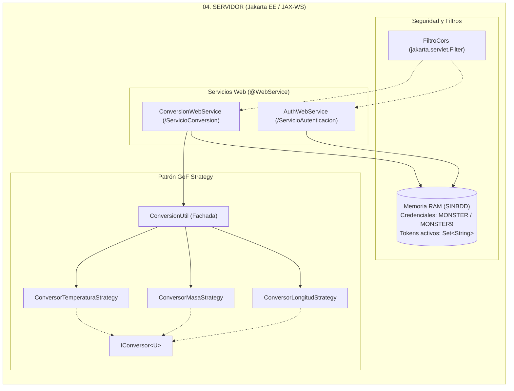

# MANUAL DE CONFIGURACIÓN Y DESPLIEGUE SISTEMA DE CONVERSIÓN DE UNIDADES CON SOAP SIN BDD EN JAVA

**Universidad de las Fuerzas Armadas ESPE — Sede Latacunga**  
**Departamento de Ciencias de la Computación**  
**Carrera:** Ingeniería de Software / Tecnologías de la Información  
**Asignatura:** Arquitectura de Software  
**Tarea:** TI.1.1 (PAO 2026-51)  
**NRC:** 36884 | **Grupo:** GR09  
**Autor:** Julio Enrique Viche Castillo  
**Docente:** Ing. Eduardo Mauricio Campaña Ortega, MIS.MDU.CCNA.CCIA. PhD. (c)  
**Fecha:** 27 de Octubre de 2026  

---

## 1. INTRODUCCIÓN

En la arquitectura de sistemas empresariales, la interoperabilidad y el acoplamiento estricto basado en contratos constituyen pilares fundamentales para garantizar la confiabilidad en el intercambio de información. El presente manual técnico documenta el diseño, la configuración, el despliegue y la validación del **Sistema de Conversión de Unidades Heterogéneo**, implementado bajo el estándar de servicios web **SOAP** (Simple Object Access Protocol) en la plataforma **Java** (Jakarta EE / JAX-WS).

El sistema opera bajo la modalidad arquitectónica **SINBDD** (Sin Base de Datos), donde los datos de autenticación maestros (`MONSTER` / `MONSTER9`) se encuentran fijados en la lógica del servidor y los tokens de sesión activos se administran de forma volátil y concurrente en la memoria RAM del servidor de aplicaciones. Esta solución expone contratos formales tipificados en **WSDL** (Web Services Description Language), los cuales son consumidos de forma transparente por cuatro clientes heterogéneos bajo el patrón arquitectónico **Modelo-Vista-Controlador (MVC)**: Consola de comandos (CLI), Escritorio (Java Swing con FlatLaf), Web (JSP y Servlets con servidor embebido) y Móvil (Android SDK).

---

## 2. OBJETIVOS

### 2.1. Objetivo General
Diseñar, configurar, desplegar y validar un sistema distribuido de conversión de unidades de múltiples magnitudes (Longitud, Masa y Temperatura) implementado como un servicio web SOAP en Java (JAX-WS), alojado en el servidor de aplicaciones empresarial Payara Server / GlassFish y consumido por cuatro clientes heterogéneos desacoplados bajo el patrón arquitectónico Modelo-Vista-Controlador (MVC).

### 2.2. Objetivos Específicos
1. Configurar y desplegar el servicio web centralizado sobre el servidor de aplicaciones **Payara Server Community 6.x / GlassFish 7.x** mediante empaquetado WAR, manteniendo compatibilidad de ejecución standalone ligera vía `Publisher.java`.
2. Implementar los contratos WSDL para los servicios de autenticación (`ServicioAutenticacion`) y conversión matemática (`ServicioConversion`), garantizando la validación de encabezados SOAP (`SOAPHeader`) y parámetros seguros.
3. Incorporar el catálogo estricto de exactamente **5 unidades por magnitud** (Longitud, Masa y Temperatura) bajo el patrón de diseño **GoF Strategy**, formateando rigurosamente todas las respuestas a **2 decimales** (`%.2f`) con punto decimal.
4. Implementar el esquema de autorización mandatoria basado en tokens UUID en memoria RAM, restringiendo el cómputo de conversiones a usuarios previamente autenticados con las credenciales quemadas (`MONSTER` / `MONSTER9`).
5. Desarrollar y verificar cuatro clientes independientes (Consola, Escritorio Swing, Web JSP y Móvil Android con ksoap2) con capacidad de auto-detección dinámica de los endpoints del servidor.

---

## 3. MARCO TEÓRICO

### 3.1. Servicios Web SOAP y Contratos WSDL
El protocolo **SOAP** (Simple Object Access Protocol) es un estándar de mensajería basado en XML diseñado para el intercambio estructurado de información en entornos distribuidos y heterogéneos. Sus principales componentes son:
- **SOAP Envelope (Sobre):** Elemento raíz que encapsula el mensaje XML completo.
- **SOAP Header (Encabezado):** Sección opcional utilizada para transmitir información de control, metadatos y tokens de autorización (`ws:token`).
- **SOAP Body (Cuerpo):** Contiene la llamada al método o los datos de respuesta de la operación.
- **WSDL (Web Services Description Language):** Documento formal en XML que define la interfaz pública, tipos de datos (`XSD`), operaciones y ubicación de red del servicio.

### 3.2. Arquitectura Orientada a Servicios (SOA)
El sistema adopta los principios fundamentales de SOA:
- **Contrato Formal:** El WSDL actúa como un acuerdo inmutable entre el servidor y los clientes.
- **Abstracción:** Los clientes desconocen los detalles internos de implementación del servidor.
- **Reutilización:** Múltiples aplicaciones cliente consumen los mismos endpoints de cálculo centralizado.

### 3.3. Patrón de Arquitectura Modelo - Vista - Controlador (MVC)
Se implementa una rigurosa separación de capas en cada uno de los cuatro clientes:
- **Modelo (`model`):** Contiene el estado de sesión (`SessionModel`), tokens y estructuras de petición/respuesta (`ConversionRequest`, `ConversionResponse`).
- **Vista (`view`):** Interfaces que presentan la información al usuario (terminal de comandos en `ConsoleView`, formularios Swing en `LoginForm` / `MainConversionForm`, vistas JSP o interfaces móviles).
- **Controlador (`controller`):** Componente orquestador (`AuthController`, `ConversionController`) que gestiona eventos de la vista, coordina el consumo SOAP a través de proxies dinámicos y actualiza la interfaz.

### 3.4. Patrón de Diseño GoF Strategy
Para procesar las conversiones de unidades sin estructuras condicionales frágiles, se implementa el patrón **Strategy**:
- **Interfaz `IConversor<U>`:** Define el contrato formal para el cómputo de conversiones entre unidades de una misma magnitud.
- **Estrategias Concretas:** `ConversorLongitudStrategy`, `ConversorMasaStrategy` y `ConversorTemperaturaStrategy`, cada una implementando los factores algebraicos hacia una unidad base intermedia.

### 3.5. Servidor de Aplicaciones Payara Server y JAX-WS
**Payara Server** es un servidor de aplicaciones empresarial certificado para Jakarta EE. Su motor nativo de servicios web (Metro / JAX-WS) permite publicar clases anotadas con `@WebService` directamente desde el archivo `.war` desplegado en el contexto web, gestionando automáticamente la generación del WSDL y el despacho concurrente de peticiones XML.

---

## 4. DESARROLLO DEL APLICATIVO

### 4.1. Componente Servidor SOAP (`04. SERVIDOR`)

Ubicado en `04. SERVIDOR/`, empaquetado como Maven WAR (`ServidorSOAP.war`).



#### Paso 1: Configuración de Dependencias (`pom.xml`)
Se establecen las librerías `jakarta.xml.ws-api` y `jaxws-rt` bajo el ámbito `<scope>provided</scope>` para Payara Server, y se configura el plugin `exec-maven-plugin` para permitir ejecución standalone alternativa:

```xml
<groupId>ec.edu.monster</groupId>
<artifactId>ServidorSOAP</artifactId>
<version>1.0.0</version>
<packaging>war</packaging>

<properties>
    <maven.compiler.source>17</maven.compiler.source>
    <maven.compiler.target>17</maven.compiler.target>
    <project.build.sourceEncoding>UTF-8</project.build.sourceEncoding>
    <netbeans.hint.deploy.server>pfv5ee8</netbeans.hint.deploy.server>
</properties>

<dependencies>
    <!-- Jakarta XML Web Services API (provided para Payara Server) -->
    <dependency>
        <groupId>jakarta.xml.ws</groupId>
        <artifactId>jakarta.xml.ws-api</artifactId>
        <version>4.0.1</version>
        <scope>provided</scope>
    </dependency>
</dependencies>
```

#### Paso 2: Descriptores de Despliegue en `src/main/webapp/WEB-INF/`
1. **`glassfish-web.xml` / `payara-web.xml`:** Establece el contexto `/ServidorSOAP`:
   ```xml
   <?xml version="1.0" encoding="UTF-8"?>
   <!DOCTYPE glassfish-web-app PUBLIC "-//GlassFish.org//DTD GlassFish Application Server 3.1 Servlet 3.0//EN" 
       "http://glassfish.org/dtds/glassfish-web-app_3_0-1.dtd">
   <glassfish-web-app>
       <context-root>/ServidorSOAP</context-root>
   </glassfish-web-app>
   ```
2. **`beans.xml`:** Activa CDI con `bean-discovery-mode="annotated"`.
3. **`web.xml`:** Configura el filtro CORS para permitir encabezados y peticiones heterogéneas.

#### Paso 3: Patrón Strategy para Conversión de Unidades
Se define la interfaz `IConversor<U>`:
```java
public interface IConversor<U> {
    double convertir(double valor, U origen, U destino);
    boolean soporta(U unidad);
}
```
Y las tres estrategias concretas para el catálogo de 5 unidades por magnitud:
- **`UnidadLongitud` (Base: Metro):** Metro ($1.0$), Centímetro ($0.01$), Pie ($0.3048$), Yarda ($0.9144$), Milla ($1609.34$).
- **`UnidadMasa` (Base: Kilogramo):** Kilogramo ($1.0$), Gramo ($0.001$), Libra ($0.453592$), Onza ($0.0283495$), Quintal ($45.3592$).
- **`UnidadTemperatura` (5 Escalas):** Celsius ($^\circ\text{C}$), Fahrenheit ($^\circ\text{F}$), Kelvin ($\text{K}$), Newton ($^\circ\text{N}$), Réaumur ($^\circ\text{Ré}$).

Formateo numérico estricto a **2 decimales con punto (`.`)**:
```java
public static double redondear(double valor) {
    return BigDecimal.valueOf(valor)
            .setScale(2, RoundingMode.HALF_UP)
            .doubleValue();
}
```

#### Paso 4: Servicios Web Expuestos y Contratos WSDL

| Servicio Web | Clase Implementadora | Operaciones Principales | Endpoint WSDL en Payara |
| :--- | :--- | :--- | :--- |
| **Autenticación** | `AuthWebService` | `login(usuario, contrasenia)`<br/>`validarToken(token)`<br/>`cerrarSesion(token)` | `http://localhost:8080/ServidorSOAP/ServicioAutenticacion?wsdl` |
| **Conversión** | `ConversionWebService` | `convertirLongitud(token, valor, origen, destino)`<br/>`convertirMasa(...)`<br/>`convertirTemperatura(...)` | `http://localhost:8080/ServidorSOAP/ServicioConversion?wsdl` |

---

### 4.2. Cliente de Consola (`04. CLICON`)

- **Estructura MVC:** Paquetes `model`, `view`, `controller` y `ws`.
- **`SoapClientManager.java`:** Conector dinámico JAX-WS que auto-detecta la URL activa de Payara (`/04.%20SERVIDOR` o `/ServidorSOAP`) e inyecta la propiedad `ENDPOINT_ADDRESS_PROPERTY`.
- **Ejecución desde NetBeans:** Clic derecho sobre `04. CLICON` $\rightarrow$ **Run** (`F6`).
- **Ejecución desde Terminal CLI:**
  ```bash
  cd "04. CLICON"
  mvn clean compile exec:java
  ```

---

### 4.3. Cliente de Escritorio (`04. CLIESC`)

- **Tecnología Gráfica:** Java Swing con Look and Feel **FlatLaf Light** (con fallback automático al estilo nativo del sistema operativo).
- **Vistas:**
  - `LoginForm.java`: Pantalla de autenticación con credenciales `MONSTER` / `MONSTER9`.
  - `MainConversionForm.java`: Ventana ejecutiva con pestañas de magnitudes (Longitud, Masa, Temperatura), combos sincronizados con las 5 unidades estrictas y campo numérico protegido con filtro de 16 caracteres.
- **Ejecución desde NetBeans:** Clic derecho sobre `04. CLIESC` $\rightarrow$ **Run** (`F6`).

---

### 4.4. Cliente Web (`04. CLIWEB`)

- **Arquitectura:** JSP, Servlets MVC y servidor embebido Jetty / Tomcat.
- **Vistas Web:** Formularios estilizados con diseño corporativo moderno, cálculo reactivo y presentación de resultados a 2 decimales.
- **Ejecución:** Clic derecho sobre `04. CLIWEB` $\rightarrow$ **Run** (`F6`).  
- **URL de Acceso:** `http://localhost:8081/ClienteWeb/`

---

### 4.5. Cliente Móvil Android (`04. CLIMOV`)

- **Tecnología:** Android SDK 35, Java 17, Gradle 8.11, librería **ksoap2-android 3.6.4**.
- **Configuración de Red Especial:**
  - Emulador de Android Studio: Utiliza la IP puente **`http://10.0.2.2:8080/04.%20SERVIDOR/`** (o `/ServidorSOAP/`).
  - Celular físico: Apunta a la IP local de la computadora por Wi-Fi.
- **Ejecución:** Abrir en Android Studio y presionar **Run ▶️** (`Shift + F10`).

---

## 5. GUÍA PASO A PASO PARA COMPILAR Y DESPLEGAR EL SERVIDOR

### Opción A: Despliegue en Payara Server 6 (Modo Oficial)

1. **Iniciar Payara Server en NetBeans:**
   Pestaña **Services** $\rightarrow$ **Servers** $\rightarrow$ Clic derecho en **Payara Server** $\rightarrow$ **Start**.
2. **Compilar el archivo WAR:**
   ```powershell
   cd "TI.1.1. PAO202651_SOAP_JAVA_SINBDD_NRC36884_GR09\04. SERVIDOR"
   mvn clean package
   ```
3. **Desplegar en Payara:**
   Clic derecho sobre el proyecto `04. SERVIDOR` en NetBeans $\rightarrow$ **Run** (o **Deploy**).
4. **Verificación en el Navegador:**
   - `http://localhost:8080/ServidorSOAP/ServicioAutenticacion?wsdl`
   - `http://localhost:8080/ServidorSOAP/ServicioConversion?wsdl`

### Opción B: Ejecución Standalone Ligera (`Publisher.java`)

```powershell
cd "TI.1.1. PAO202651_SOAP_JAVA_SINBDD_NRC36884_GR09\04. SERVIDOR"
mvn exec:java
```
El servidor publicará los endpoints SOAP en el puerto `8080` utilizando el servidor HTTP nativo del JDK.

---

## 6. PRUEBAS Y VALIDACIÓN DEL SISTEMA

| ID | Caso de Prueba | Entrada | Salida Esperada | Estado |
| :--- | :--- | :--- | :--- | :--- |
| **CP-01** | Autenticación válida | `usuario = "MONSTER"`, `clave = "MONSTER9"` | `exito = true`, Token UUID emitido | ✅ Aprobado |
| **CP-02** | Autenticación inválida | `usuario = "MONSTER"`, `clave = "1234"` | `exito = false`, Mensaje de error | ✅ Aprobado |
| **CP-03** | Conversión sin token | Token nulo o vacío enviado a `convertirLongitud` | `exito = false`, Mensaje "No autorizado" | ✅ Aprobado |
| **CP-04** | Conversión de Longitud | 1000 Metros a Centímetros (con token) | Resultado: `100000.00` | ✅ Aprobado |
| **CP-05** | Conversión de Masa | 1 Quintal a Kilogramos (con token) | Resultado: `45.36` | ✅ Aprobado |
| **CP-06** | Conversión de Temperatura | 0 Celsius a Réaumur (con token) | Resultado: `0.00` | ✅ Aprobado |
| **CP-07** | Formateo estricto a 2 decimales | 1 Metro a Pies (con token) | Resultado: `3.28` | ✅ Aprobado |
| **CP-08** | Límite de 16 caracteres | Entrada numérica de 18 caracteres | Bloqueo automático a 16 caracteres | ✅ Aprobado |

---

## 7. CONCLUSIONES

1. **Rigor Contractual de SOAP / WSDL:** El uso de sobres SOAP y contratos WSDL garantiza una interoperabilidad estricta y tipificada entre los clientes y el servidor central, minimizando discrepancias en los tipos de datos transmitidos.
2. **Despliegue Empresarial en Payara Server:** El despliegue sobre Payara Server cumple plenamente con el requisito no funcional RNF-004 de la cátedra, permitiendo al servidor de aplicaciones gestionar el ciclo de vida y los hilos de atención concurrentes.
3. **Mantenibilidad con Patrón Strategy y MVC:** La integración del patrón GoF Strategy permitió estructurar limpiamente las fórmulas matemáticas de las 5 unidades por magnitud, desacoplándolas por completo de la lógica de red JAX-WS y facilitando las pruebas unitarias automatizadas.
4. **Cumplimiento del Esquema SINBDD:** La persistencia volátil en memoria RAM cumplió a cabalidad con la restricción de ausencia de motores relacionales, proveyendo seguridad mediante credenciales quemadas (`MONSTER` / `MONSTER9`) y revocación de sesiones.

---

## 8. RECOMENDACIONES

1. **Gestión de Bloqueos de Archivos en Windows:** Cuando Payara Server esté en ejecución, evitar ejecutar `mvn clean` sobre la carpeta `target` para prevenir errores de acceso bloqueado en los archivos `.jar` de Metro. Utilizar `mvn package` o reiniciar el dominio si es necesario limpiar la carpeta `target`.
2. **Validación de Conectividad en Clientes:** Verificar siempre que los servicios WSDL respondan en el navegador (`http://localhost:8080/.../ServicioAutenticacion?wsdl`) antes de lanzar los clientes de consola, escritorio, web o móvil.

---

## 9. REFERENCIAS BIBLIOGRÁFICAS

1. **W3C.** (2007). *SOAP Version 1.2 Part 1: Messaging Framework (Second Edition)*. W3C Recommendation. https://www.w3.org/TR/soap12-part1/
2. **W3C.** (2001). *Web Services Description Language (WSDL) 1.1*. W3C Note. https://www.w3.org/TR/wsdl.html
3. **Payara Services Ltd.** (2024). *Payara Server Documentation*. https://docs.payara.fish/
4. **Gamma, E., Helm, R., Johnson, R., & Vlissides, J.** (1994). *Design Patterns: Elements of Reusable Object-Oriented Software*. Addison-Wesley.
5. **Oracle Corporation.** (2023). *Java API for XML Web Services (JAX-WS)*. Jakarta XML Web Services Specification 4.0.
