# Manual Técnico - Conversor de Unidades SOAP en Java (SINBDD)

**Universidad de las Fuerzas Armadas ESPE — Sede Latacunga**  
**Departamento de Ciencias de la Computación**  
**Asignatura:** Arquitectura de Software | **NRC:** 36884 | **Grupo:** GR09  
**Autores:** Murillo Medina, Gabriel Omar; Viche Castillo, Julio Enrique  
**Docente:** Ing. Eduardo Mauricio Campaña Ortega, MIS.MDU.CCNA.CCIA. PhD. (c)  
**Fecha:** 28 de Octubre de 2026

---

## PARTE PRÁCTICA

### INTRODUCCIÓN

Un Web Service SOAP es una interfaz de comunicación basada en protocolos estandarizados que permite el intercambio de información estructurada entre sistemas computacionales. A diferencia de otros enfoques, SOAP se fundamenta estrictamente en el uso de XML como lenguaje para el envío de mensajes y depende de un contrato formal conocido como WSDL (Web Services Description Language), que define las operaciones, parámetros y tipos de datos disponibles. Esta arquitectura es esencial en entornos empresariales donde la seguridad, la transaccionalidad y el cumplimiento estricto de protocolos son prioritarios.

En el desarrollo de servicios SOAP con Java, la lógica suele organizarse mediante la exposición de Endpoints (puntos de acceso). A diferencia del patrón MVC tradicional de aplicaciones web, SOAP se centra en la Orientación a Servicios (SOA), donde el servidor actúa como un proveedor de funciones específicas que el cliente consume tras conocer la definición del servicio. El intercambio de datos en la red se realiza a través del protocolo HTTP.

Para el despliegue de estos servicios, se utiliza Payara Server, un servidor de aplicaciones de alto rendimiento derivado de GlassFish. Payara es un contenedor compatible con Jakarta EE que incluye soporte nativo para la especificación JAX-WS (Java API for XML Web Services). Esto permite gestionar servicios web complejos con herramientas avanzadas de administración, monitoreo y escalabilidad, asegurando una integración fluida en ecosistemas empresariales heterogéneos.

### OBJETIVOS

#### OBJETIVO GENERAL

Desarrollar un manual de documentación que explique la construcción de un conversor de unidades de múltiples magnitudes (longitud, masa y temperatura) basado en una arquitectura cliente-servidor, con patrón arquitectónico MVC, con clientes en escritorio, consola, web y móvil, y un servidor SOAP implementado en Java y alojado en Payara Server.

#### OBJETIVOS ESPECÍFICOS

Describir detalladamente el diseño e implementación del servicio SOAP utilizando la especificación JAX-WS integrada en un servidor Payara, incluyendo la generación automática del contrato WSDL.

Proporcionar guías para el desarrollo de aplicaciones cliente en múltiples plataformas (escritorio, consola, web y móvil), detallando el proceso de consumo del servicio y comunicación con el servidor.

Explicar los fundamentos de la arquitectura SOA y las ventajas de utilizar un servidor Payara, destacando su capacidad para gestionar la interoperabilidad, la seguridad y el intercambio de datos estructurados entre sistemas heterogéneos.

### INSTALACIÓN Y CONFIGURACIÓN DE HERRAMIENTAS

Para dar inicio al desarrollo de la práctica, primero se deben instalar y configurar las herramientas esenciales. Para este proyectó se utilizó Windows 11.

#### INSTALACIÓN Y CONFIGURACIÓN DE APACHE NETBEANS 24

Previo a este proceso se supone la instalación y configuración de Java, en este proyecto se utilizó JDK 21 descargado desde la página oficial de Oracle https://www.oracle.com/java/technologies/javase/jdk21-archive-downloads.html y agregada a las variables de entorno. Se verifica la instalación ejecutando el siguiente comando en el símbolo del sistema o Powershell:

| Java --version |
| --- |

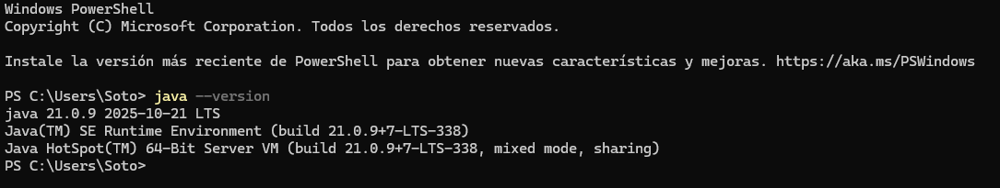

*_Figura 3. Versión de Java JDK 17 en el símbolo del sistema_*

Para la instalación de la herramienta se accede a la página oficial de descarga de Apache https://netbeans.apache.org/front/main/download/ se selecciona la opción ‘Older Releases’, ‘Apache NetBeans 24’ y la opción para el sistema operativo.


*_Figura 4. Página oficial de descarga de Apache NetBeans_*

Una vez seleccionada la opción para el sistema operativo, se inicia la descarga y se obtendrá el siguiente ejecutable.

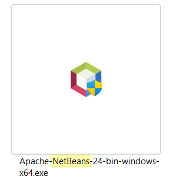

*_Figura 5. Instalador Apache NetBeans 24_*

Al ejecutar el instalador se muestra la siguiente pantalla, en el proceso de instalación se aceptan los términos y condiciones, se selecciona la ubicación de la descarga y se finaliza la instalación.

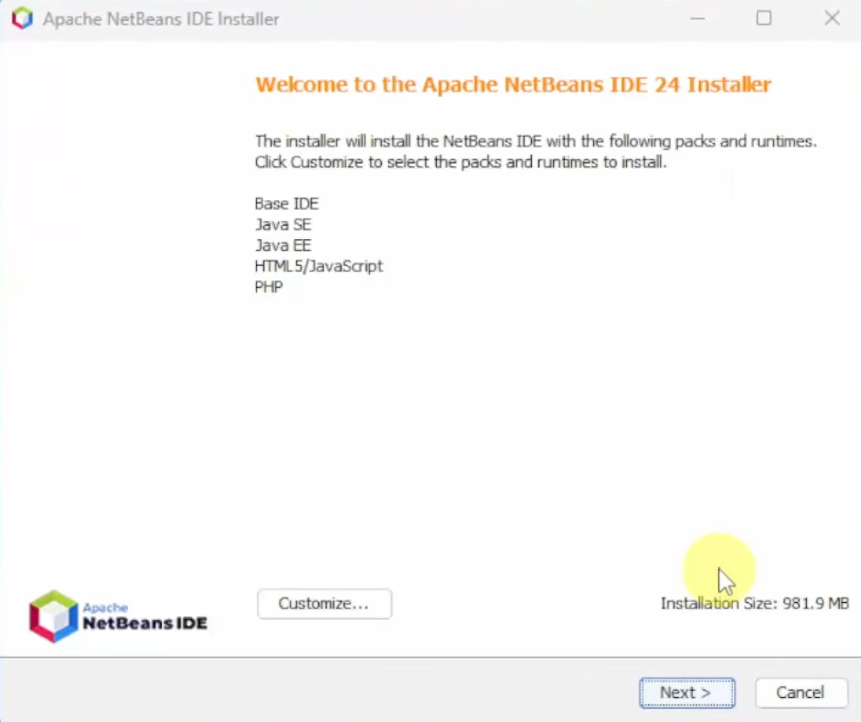

*_Figura 6. Pantalla inicial de instalación NetBeans 24_*

Una vez finalizada la descarga se ejecuta la aplicación y se iniciará Apache NetBeans 24.


*_Figura 7. Aplicación Apache NetBeans 24_*

#### INSTALACIÓN Y CONFIGURACIÓN DE ANDROID STUDIO

Para la instalación de la herramienta se accede a la página oficial de descarga de Android Studio https://developer.android.com/studio se selecciona la opción de descarga, se aceptan términos y condiciones e iniciará la descarga.

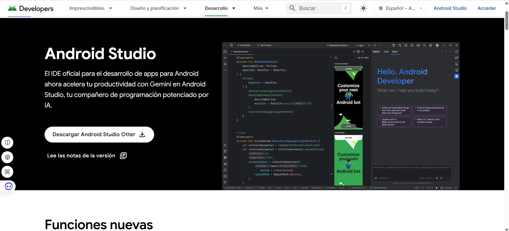

*_Figura 8. Página oficial de descarga de Android Studio_*

Al finalizar la descarga se obtendrá el instalador ejecutable.


*_Figura 9. Ejecutable Android Studio_*

Al ejecutar el instalador se mostrará la siguiente pantalla:


*_Figura 10. Pantalla inicial de instalación de Android Studio_*

Durante la instalación se selecciona los componentes a instalar, ubicación y carpeta de inicio. Al finalizar la instalación se iniciará la configuración en donde se selecciona el Setup Standard se aceptan términos y condiciones y se inicia la descarga de componentes.


*_Figura 11. Aplicación Android Studio_*

### ESTRUCTURA DE PROYECTO

Para la elaboración del proyecto, en primer lugar, es necesario crear una carpeta en la cual se alojarán los archivos necesarios para su funcionamiento.

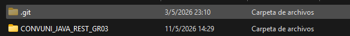

*_Figura 1. Creación de la carpeta raíz_*

Dentro de la carpeta principal del proyecto, se debe ubicar la siguiente subestructura.

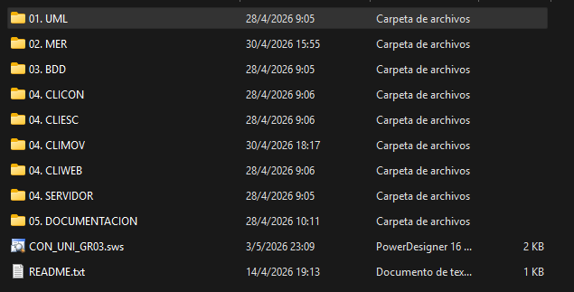

*_Figura 2. Estructura inicial del proyecto_*

Todo esto con la finalidad de llevar buenas prácticas y mantener organizado el proyecto.

## APLICACIONES SERVIDOR

> [!NOTE] Despliegue Standalone y en Contenedor (Payara Server)
> El servidor SOAP se puede desplegar tanto en el servidor de aplicaciones **Payara Server 6 / GlassFish** como de manera independiente (Standalone) mediante la clase `ec.edu.monster.publisher.Publisher`, que expone los endpoints en `http://localhost:8080/ServidorSOAP/ServicioAutenticacion?wsdl` y `http://localhost:8080/ServidorSOAP/ServicioConversion?wsdl`.
> 
> **Requerimientos Académicos Estrictos (TI.1.1):**
> - **SINBDD:** Autenticación obligatoria con credenciales quemadas en código: Usuario `MONSTER`, Contraseña `MONSTER9`.
> - **Catálogo de 5 unidades por magnitud:**
>   - **Longitud (5):** Metro, Centímetro, Pie, Yarda, Milla.
>   - **Masa (5):** Kilogramo, Gramo, Libra, Onza, Quintal.
>   - **Temperatura (5):** Celsius, Fahrenheit, Kelvin, Newton, Réaumur.
> - **Formateo numérico:** Salidas a exactamente **2 decimales** (`%.2f`) con punto decimal (`.`) y validación de entrada restringida a un máximo de **16 caracteres** numéricos.

### CREACIÓN DEL PROYECTO SERVIDOR

Se crea el proyecto en NetBeans seleccionando ‘New Project’, ‘Java with Maven’ y ‘Web Application’. Se coloca el nombre del proyecto, ubicación y grupo. Se selecciona el servidor Payara y la versión de Jakarta. Finalmente se hace clic en ‘Finish’.

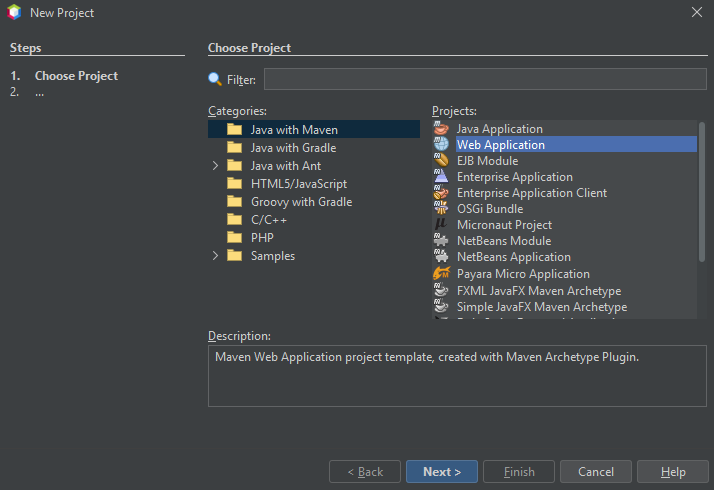

*_Figura 12. Creación del proyecto – Servidor SOAP_*

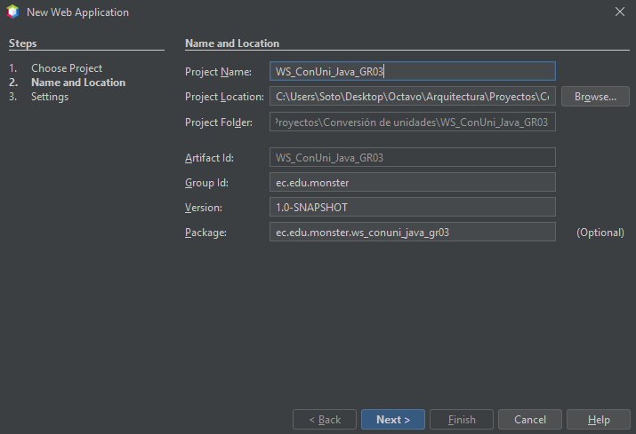

*_Figura 13. Configuración del proyecto 1 - Servidor SOAP_*

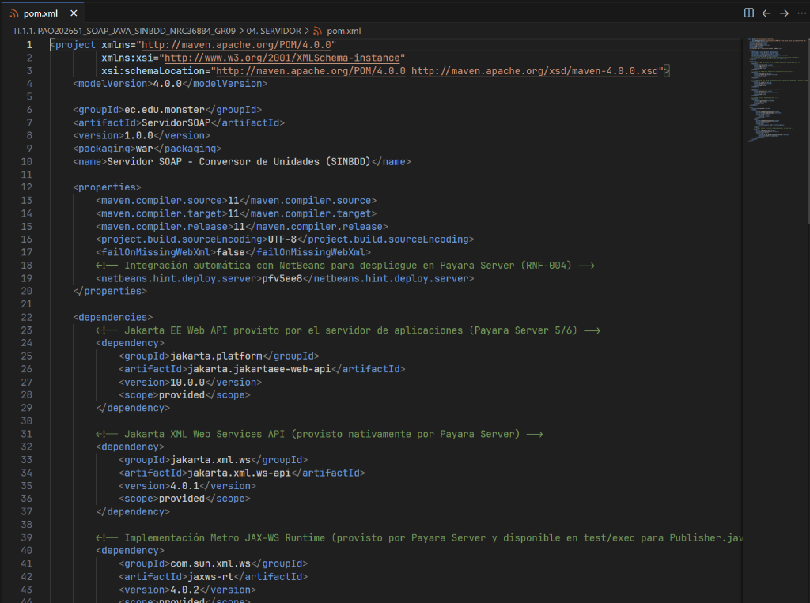

*_Figura 14. Configuración Maven pom.xml y dependencias del Servidor SOAP_*

### CODIFICACIÓN DEL PROYECTO SERVIDOR

#### CREACIÓN DE PAQUETES

Al tratarse de una arquitectura orientada a servicios (SOA) sin conexión a base de datos (SINBDD), se organiza la estructura modular dentro del paquete base `ec.edu.monster`. Se estructuran los paquetes: `ec.edu.monster.model` (entidades de intercambio y sesión), `ec.edu.monster.publisher` (publicador standalone), `ec.edu.monster.seguridad` (control de tokens en memoria), `ec.edu.monster.strategy` (patrón Strategy para conversiones), `ec.edu.monster.util` y `ec.edu.monster.ws` (endpoints JAX-WS).

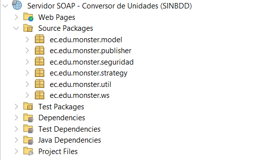

*_Figura 15. Estructura de paquetes ec.edu.monster del Servidor SOAP_*

#### CREACIÓN DE WEBSERVICES

Para la exposición de las funcionalidades hacia los clientes (Consola, Escritorio, Web y Móvil), se utiliza la especificación Jakarta XML Web Services (JAX-WS). En esta capa se definen los Endpoints que transforman las peticiones XML en llamadas a los servicios de lógica de negocio desacoplados bajo el patrón GoF Strategy.

Se utilizan anotaciones de Jakarta EE como `@WebService` para publicar el contrato y `@WebMethod` para exponer cada función específica (`iniciarSesion`, `validarToken`, `convertirLongitud`, `convertirMasa`, `convertirTemperatura`). Esta estructura permite generar el archivo WSDL oficial para el consumo de los clientes heterogéneos.

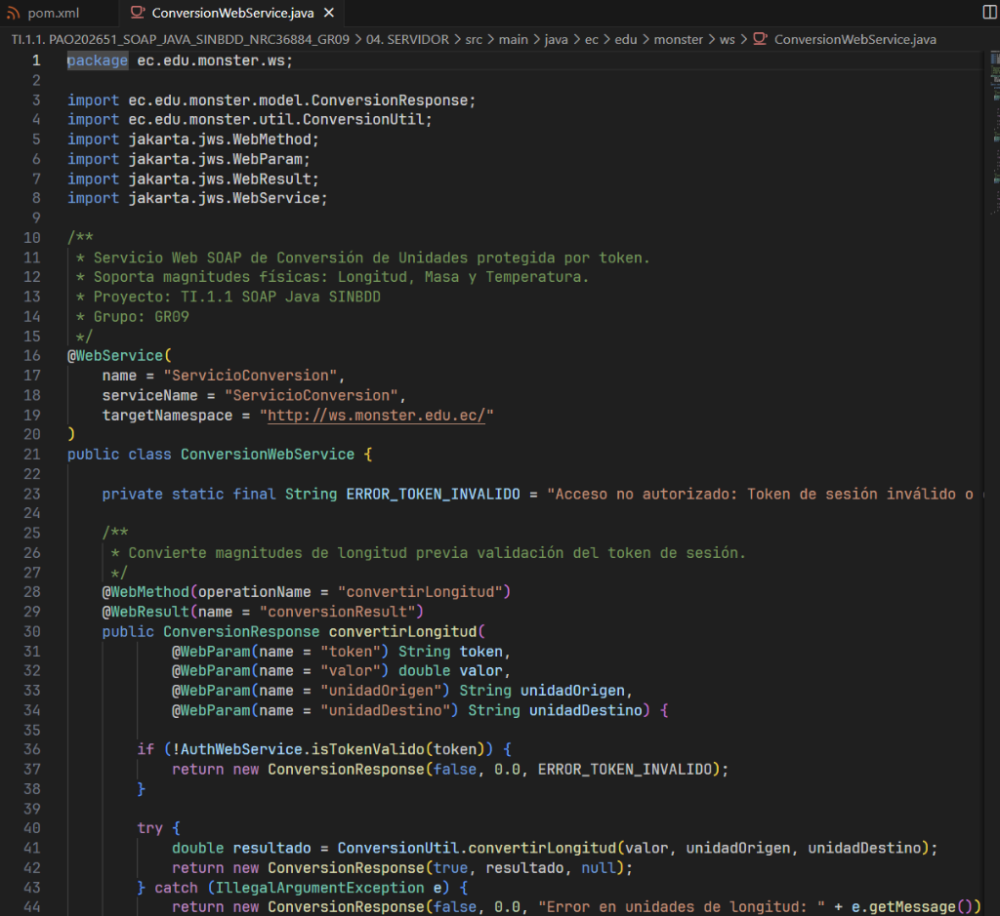

*_Figura 16. Implementación del Endpoint ConversionWebService con JAX-WS_*

Tabla 1. Clase WSLogin

package ec.edu.monster.WebServices;

import jakarta.jws.WebService;

import jakarta.jws.WebMethod;

import jakarta.jws.WebParam;

import java.util.UUID;

import java.util.HashMap;

import java.util.Map;

/**

* @author Julio Enrique Viche Castillo - GR09 - NRC 36884

*/

@WebService(serviceName = "WSLogin")

public class WSLogin {

// Guarda los tokens validos

public static Map<String, Boolean> tokensValidos = new HashMap<>();

@WebMethod(operationName = "login")

public String login(@WebParam(name = "usuario") String usuario, @WebParam(name = "clave") String clave) {

if ("MONSTER".equals(usuario) && "MONSTER9".equals(clave)) {

String token = UUID.randomUUID().toString(); //generar token

tokensValidos.put(token, true); //guardar token valido

return token;

}

return "ERROR: Credenciales inválidas";

}

}

Tabla 2. Clase WSLongitud

package ec.edu.monster.WebServices;

import ec.edu.monster.servicios.ConversorLongitud; // Importas tu lógica movida

import jakarta.jws.WebService;

import jakarta.jws.WebMethod;

import jakarta.jws.WebParam;

/**

* @author Julio Enrique Viche Castillo - GR09 - NRC 36884

*/

@WebService(serviceName = "WSLongitud")

public class WSLongitud {

ConversorLongitud servicio = new ConversorLongitud();

@WebMethod(operationName = "convertirLongitud")

public double convertirLongitud(

@WebParam(name = "valor") double valor,

@WebParam(name = "unidadOrigen") String unidadOrigen,

@WebParam(name = "unidadDestino") String unidadDestino,

@WebParam(name = "token") String token) {

// Validación de seguridad obligatoria

if (WSLogin.tokensValidos.containsKey(token)) {

return servicio.convertirLongitud(valor, unidadOrigen, unidadDestino);

} else {

return -999999.401;

}

}

}

Tabla 3. Clase WSMasa

package ec.edu.monster.WebServices;

import ec.edu.monster.servicios.ConversorMasa;

import jakarta.jws.WebService;

import jakarta.jws.WebMethod;

import jakarta.jws.WebParam;

/**

* @author Julio Enrique Viche Castillo - GR09 - NRC 36884

*/

@WebService(serviceName = "WSMasa")

public class WSMasa {

ConversorMasa servicio = new ConversorMasa();

@WebMethod(operationName = "convertirMasa")

public double convertirMasa(

@WebParam(name = "valor") double valor,

@WebParam(name = "unidadOrigen") String unidadOrigen,

@WebParam(name = "unidadDestino") String unidadDestino,

@WebParam(name = "token") String token) {

if (WSLogin.tokensValidos.containsKey(token)) {

return servicio.convertirMasa(valor, unidadOrigen, unidadDestino);

} else {

return -9999999.401;

}

}

}

Tabla 4. Clase WSTemperatura

package ec.edu.monster.WebServices;

import ec.edu.monster.servicios.ConversorTemperatura;

import jakarta.jws.WebService;

import jakarta.jws.WebMethod;

import jakarta.jws.WebParam;

/**

* @author Julio Enrique Viche Castillo - GR09 - NRC 36884

*/

@WebService(serviceName = "WSTemperatura")

public class WSTemperatura {

ConversorTemperatura servicio = new ConversorTemperatura();

@WebMethod(operationName = "convertirTemperatura")

public double convertirTemperatura(

@WebParam(name = "valor") double valor,

@WebParam(name = "opcionOrigen") String opcionOrigen,

@WebParam(name = "opcionDestino") String opcionDestino,

@WebParam(name = "token") String token) {

if (WSLogin.tokensValidos.containsKey(token)) {

return servicio.convertirTemperatura(valor, opcionOrigen, opcionDestino);

} else {

return -9999999.401;

}

}

}

#### CREACIÓN DE SERVICIO

En esta sección se implementa la "capa de servicio", que es el cerebro de la aplicación. Aquí se separa la lógica matemática y de seguridad del protocolo de comunicación. Al no contar con una base de datos, toda la gestión de datos se realiza en memoria, optimizando la velocidad de respuesta.

Servicio de Seguridad: Encargado de la validación de credenciales "hardcoded" y la generación/verificación de tokens de sesión para proteger los puntos de entrada del servidor.

Servicio de Conversiones: Contiene los algoritmos y factores de conversión para las magnitudes de longitud, masa y temperatura. Está diseñado para ser escalable, permitiendo añadir nuevas unidades sin afectar la estructura principal.


*_Figura 17. Estructura de paquetes - servicios_*

Tabla 5. Clase ConversorLongitud

| package ec.edu.monster.servicios;/** * * @author Julio Enrique Viche Castillo - GR09 - NRC 36884 */public class ConversorLongitud { public double convertirLongitud(double valor, String unidadOrigen, String unidadDestino) { double valorEnMetros = 0.0; String origen = unidadOrigen.toLowerCase().trim(); String destino = unidadDestino.toLowerCase().trim(); try { //Lleva cualquier unidad a metros switch (origen) { case "centimetros": valorEnMetros = valor / 100.0; break; case "metros": valorEnMetros = valor; break; case "pies": valorEnMetros = valor * 0.3048; break; case "yardas": valorEnMetros = valor * 0.9144; break; case "millas": valorEnMetros = valor * 1609.34; break; default: return -999999.404; } //Lleva de metros a la unidad de destino switch (destino) { case "centimetros": return valorEnMetros * 100.0; case "metros": return valorEnMetros; case "pies": return valorEnMetros / 0.3048; case "yardas": return valorEnMetros / 0.9144; case "millas": return valorEnMetros / 1609.34; default: return -999999.404; } } catch (Exception e) { return -999999.500; //error de calculo } }} |
| --- |

Tabla 6. Clase ConversorMasa

| package ec.edu.monster.servicios;/** * * @author Julio Enrique Viche Castillo - GR09 - NRC 36884 */public class ConversorMasa { public double convertirMasa(double valor, String unidadOrigen, String unidadDestino) { double valorEnKilos = 0.0; String origen = unidadOrigen.toLowerCase(); String destino = unidadDestino.toLowerCase(); try { //Lleva cualquier unidad a kg switch (origen) { case "gramos": valorEnKilos = valor / 1000.0; break; case "kilogramos": valorEnKilos = valor; break; case "onzas": valorEnKilos = valor * 0.0283495; break; case "libras": valorEnKilos = valor * 0.453592; break; case "quintales": valorEnKilos = (valor * 100.0) * 0.453592; break; default: return -999999.404; //codigo de error para unidad no existente } //De kg a la unidad destino switch (destino) { case "gramos": return valorEnKilos * 1000.0; case "kilogramos": return valorEnKilos; case "onzas": return valorEnKilos / 0.0283495; case "libras": return valorEnKilos / 0.453592; case "quintales": return (valorEnKilos / 0.453592) / 100.0; default: return -999999.404; //codigo de error de unidad no existente } } catch (Exception e) { return -999999.500; //error de calculo } }} |
| --- |

Tabla 7. Clase ConversorTemperatura

| package ec.edu.monster.servicios;/** * * @author Julio Enrique Viche Castillo - GR09 - NRC 36884 */public class ConversorTemperatura { public double convertirTemperatura(double valor, String opcionOrigen, String opcionDestino) { double valorEnCelsius = 0.0; String origen = opcionOrigen.toLowerCase(); String destino = opcionDestino.toLowerCase(); try { //Lleva cualquier temperatura a celsius switch (origen) { case "fahrenheit": valorEnCelsius = (valor - 32) * 5.0 / 9.0; break; case "kelvin": valorEnCelsius = valor - 273.15; break; case "celsius": valorEnCelsius = valor; break; case "newton": valorEnCelsius = valor * 100.0 / 33.0; break; case "reaumur": valorEnCelsius = valor * 5.0 / 4.0; break; default: return -999999.404; } //Lleva de celsius a la unidad de destino switch (destino) { case "fahrenheit": return (valorEnCelsius * 9.0 / 5.0) + 32; case "kelvin": return valorEnCelsius + 273.15; case "celsius": return valorEnCelsius; case "newton": return valorEnCelsius * 33.0 / 100.0; case "reaumur": return valorEnCelsius * 4.0 / 5.0; default: return -999999.404; } }catch (Exception e) { return -999999.500; //error de calculo } }} |
| --- |

### PUBLICACIÓN Y DESPLIEGUE EN PAYARA SERVER

El servidor web SOAP se empaqueta como un archivo WAR (`ServidorSOAP.war`) y se despliega directamente sobre el servidor de aplicaciones empresarial **Payara Server**. Al iniciarse el dominio de Payara, el motor de Web Services de GlassFish/Metro analiza automáticamente las anotaciones `@WebService` en `AuthWebService` y `ConversionWebService`, publicando los endpoints en el puerto estándar `8080` bajo la raíz de contexto `/ServidorSOAP`.

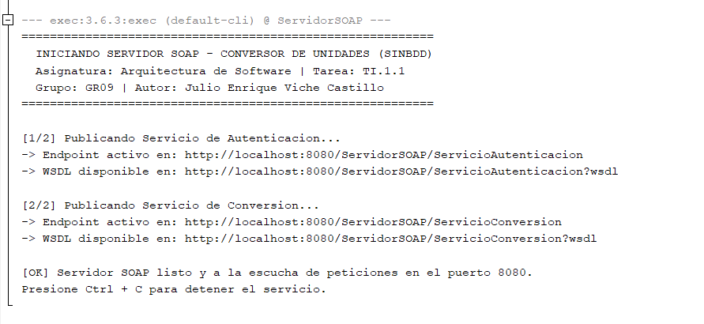

*_Figura 17. Salida en consola de despliegue con los endpoints activos en el puerto 8080 de Payara Server_*

### PRUEBAS DE LOS SERVICIOS

Al trabajar con una arquitectura basada en SOAP, la validación de que el servidor está en línea y operando correctamente se realiza verificando la generación del archivo WSDL (Web Services Description Language). Este documento en formato XML actúa como el contrato formal de comunicación que los clientes deberán consumir.

El sistema expone dos servicios web principales fuertemente tipados utilizando la especificación JAX-WS:

1. **ServicioAutenticacion:** Punto de entrada para el módulo de seguridad SINBDD. Valida las credenciales maestras fijas (`MONSTER` / `MONSTER9`) y emite tokens UUID en memoria RAM.
2. **ServicioConversion:** Expone las operaciones matemáticas de cálculo (`convertirLongitud`, `convertirMasa`, `convertirTemperatura`), requiriendo obligatoriamente un token de sesión activo.

Para comprobar la correcta publicación y disponibilidad de las operaciones, se accede desde el navegador web a la URL del contrato WSDL generado automáticamente.

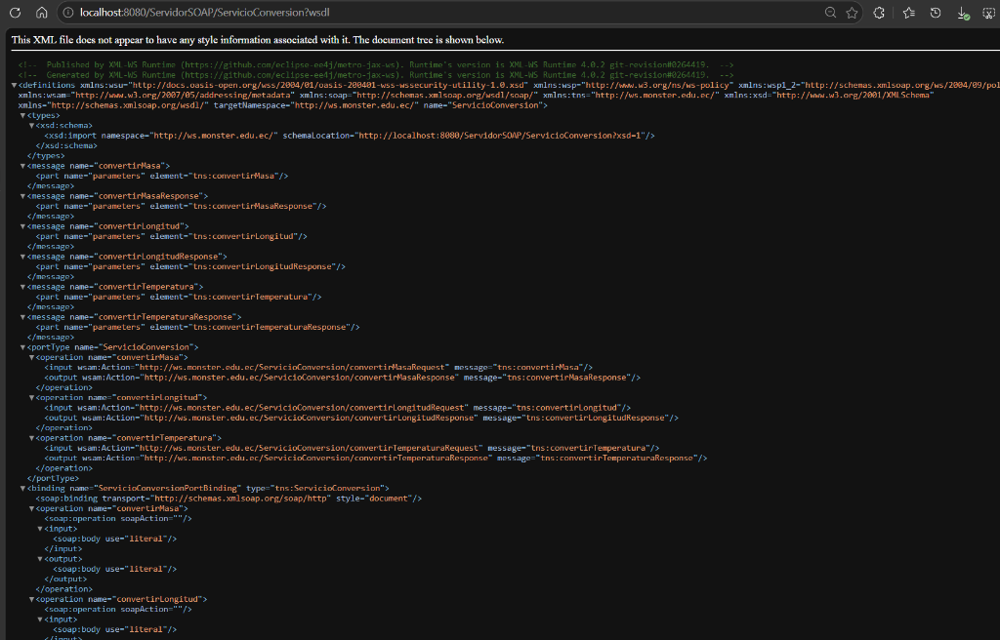

*_Figura 18. Contrato WSDL del Servicio de Conversión desplegado en http://localhost:8080/ServidorSOAP/ServicioConversion?wsdl_*

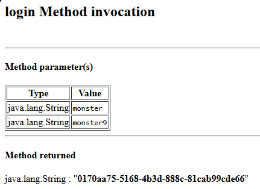

*_Figura 19. Prueba 1: Login._*

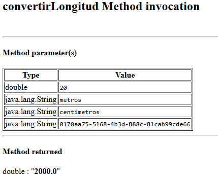

*_Figura 20. Prueba 2: Conversor de Longitud._*


*_Figura 21. Prueba 3: Conversor de masa._*


*_Figura 22. Prueba 4: Conversor de temperatura._*

## CODIFICACIÓN DE LOS CLIENTES

### CLIENTE CONSOLA

#### CREACIÓN DEL PROYECTO

El proyecto se crea usando NetBeans seleccionando ‘Nuevo Proyecto’, ‘Java with Maven’ y ‘Java Application’.

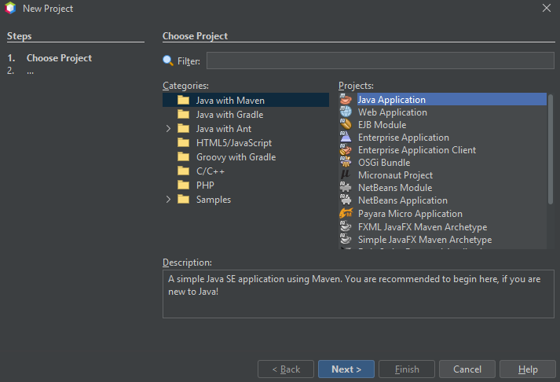

*_Figura 23. Creación del proyecto - Cliente consola_*

En este paso se define el nombre del proyecto y la ubicación.

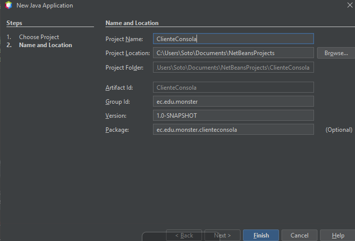

*_Figura 24. Configuración del proyecto - Cliente consola_*

#### ESTRUCTURA DEL PROYECTO

Una vez creado el proyecto se crea la estructura de paquetes basada en el patrón MVC

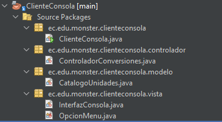

*_Figura 25. Estructura del proyecto - Cliente consola_*

### CODIFICACIÓN DEL PROYECTO CLIENTE CONSOLA

#### CREACIÓN DE MODELOS Y VISTAS

Dado que no se requiere persistencia local ni mapeo de entidades complejas, el modelo se enfoca en la organización lógica de las opciones. Se crea la clase CatalogoUnidades dentro del paquete modelo para gestionar paramétricamente los tipos de unidades de medida disponibles.

En la capa de interacción, dentro del paquete vista, se implementan las clases InterfazConsola y el enumerador OpcionMenu. Estas clases se encargan de abstraer la clase Scanner, capturar los datos por teclado de forma segura y desplegar los menús interactivos al usuario sin mezclar la lógica de negocio.


*_Figura 26. Creación de modelos y vistas - Cliente consola_*

Tabla 8. Clase CatalogoUnidades - Cliente consola

| package ec.edu.monster.clienteconsola.modelo;/** * * @author Julio Enrique Viche Castillo - GR09 - NRC 36884 */public class CatalogoUnidades { public enum Longitud { CENTIMETROS, METROS, MILLAS, YARDAS, PIES } public enum Masa { GRAMOS, KILOGRAMOS, ONZAS, LIBRAS, QUINTALES } public enum Temperatura { CELSIUS, FAHRENHEIT, KELVIN, NEWTON, REAUMUR }} |
| --- |

Tabla 9. Clase InterfazConsola - Cliente consola

| package ec.edu.monster.clienteconsola.vista;import java.util.Scanner;/** * * @author Julio Enrique Viche Castillo - GR09 - NRC 36884 */public class InterfazConsola { private final Scanner entrada; public InterfazConsola() { this.entrada = new Scanner(System.in); } public OpcionMenu seleccionarConversion() { System.out.println("\n--- Menú de Conversión de Unidades ---"); for (OpcionMenu opcion : OpcionMenu.values()) { System.out.println(opcion.getNumero() + ". " + opcion.getDescripcion()); } System.out.print("Selecciona una opción: "); String seleccion = entrada.nextLine(); for (OpcionMenu opcion : OpcionMenu.values()) { if (opcion.getNumero().equals(seleccion)) { return opcion; } } System.out.println("Opción inválida. Intenta de nuevo."); return null; } public <T extends Enum<T>> T seleccionarUnidad(String titulo, T[] opciones) { System.out.println("\n--- " + titulo + " ---"); for (int i = 0; i < opciones.length; i++) { System.out.println((i + 1) + ". " + opciones[i].name()); } System.out.print("Elige una unidad: "); try { int seleccion = Integer.parseInt(entrada.nextLine()); if (seleccion >= 1 && seleccion <= opciones.length) { return opciones[seleccion - 1]; } } catch (NumberFormatException e) { // Ignorar para que caiga en el error de abajo } System.out.println("Unidad inválida. Operación cancelada."); return null; } public Double pedirValorAConvertir() { System.out.print("\nIngresa el valor a convertir: "); try { return Double.valueOf(entrada.nextLine()); } catch (NumberFormatException e) { System.out.println("Debe ser un número válido."); return null; } } public String pedirTexto(String mensaje) { System.out.print(mensaje); return entrada.nextLine().trim(); }} |
| --- |

Tabla 10. Clase OpcionMenu - Cliente consola

| package ec.edu.monster.clienteconsola.vista;/** * * @author Julio Enrique Viche Castillo - GR09 - NRC 36884 */public enum OpcionMenu { CONVERTIR_LONGITUD("1", "Convertir Longitud"), CONVERTIR_MASA("2", "Convertir Masa"), CONVERTIR_TEMPERATURA("3", "Convertir Temperatura"), SALIR("4", "Salir"); private final String numero; private final String descripcion; OpcionMenu(String numero, String descripcion) { this.numero = numero; this.descripcion = descripcion; } public String getNumero() { return numero; } public String getDescripcion() { return descripcion; }} |
| --- |

CONSUMO DEL SERVICIO SOAP (CONTROLADOR)

En esta sección se reemplazan los clientes REST tradicionales. Para la comunicación con el servidor, se utilizó la herramienta "Web Service Client" de NetBeans para generar los artefactos JAX-WS a partir del WSDL expuesto por Payara.


*_Figura 27. Creación de controlador - Cliente consola_*

Se crea la clase ControladorConversiones en la carpeta controlador. Esta clase centraliza la comunicación y se encarga de instanciar los puertos de los servicios SOAP (WSLogin, WSLongitud, WSMasa, WSTemperatura). Su función es recibir los datos de la vista, invocar las operaciones remotas (pasando los parámetros de unidad de origen, destino y valor) y devolver el resultado procesado.

Tabla 11. Clase ControladorConversiones - Cliente consola

| package ec.edu.monster.clienteconsola.controlador;import ec.edu.monster.clientesws.*;/** * * @author Julio Enrique Viche Castillo - GR09 - NRC 36884 */public class ControladorConversiones { private String token; public boolean iniciarSesion(String usuario, String clave) { String msgCredencialesInvalidas = "ERROR: Credenciales inválidas"; try { WSLogin_Service service = new WSLogin_Service(); this.token = service.getWSLoginPort().login(usuario, clave); if(this.token.equals(msgCredencialesInvalidas)){ System.out.println("Credenciales incorrectas"); return false; } return true; } catch (Exception e) { System.err.println("Error en la comunicación con el servicio: " + e.getMessage()); return false; } } public double convertirLongitud(double valor, String origen, String destino) throws Exception { WSLongitud_Service service = new WSLongitud_Service(); return service.getWSLongitudPort().convertirLongitud(valor, origen, destino, token); } public double convertirTemperatura(double valor, String origen, String destino) throws Exception { WSTemperatura_Service service = new WSTemperatura_Service(); return service.getWSTemperaturaPort().convertirTemperatura(valor, origen, destino, token); } public double convertirMasa(double valor, String origen, String destino) throws Exception { WSMasa_Service service = new WSMasa_Service(); return service.getWSMasaPort().convertirMasa(valor, origen, destino, token); }} |
| --- |

CLASE PRINCIPAL (EJECUCIÓN)

Finalmente, se codifica la clase ClienteConsola.java que orquesta el flujo completo de la aplicación. El sistema inicia solicitando credenciales al usuario para invocar el servicio de seguridad; únicamente si la autenticación es exitosa, se instancia la interfaz y el controlador para permitir el uso de las operaciones de conversión.


*_Figura 28. Creación de clase principal - Cliente consola_*

Tabla 12. Clase ControladorConversiones - Cliente consola

| package ec.edu.monster.clienteconsola;import ec.edu.monster.clienteconsola.controlador.ControladorConversiones;import ec.edu.monster.clienteconsola.vista.InterfazConsola;import ec.edu.monster.clienteconsola.vista.OpcionMenu;import ec.edu.monster.clienteconsola.modelo.CatalogoUnidades;public class ClienteConsola { public static void main(String[] args) { InterfazConsola interfaz = new InterfazConsola(); // Instanciamos nuestro nuevo controlador ControladorConversiones controlador = new ControladorConversiones(); System.out.println("=== BIENVENIDO AL SISTEMA DE CONVERSIONES ==="); boolean autenticado = false; while (!autenticado) { // Nota: Debes implementar estos dos métodos en InterfazConsola String usuario = interfaz.pedirTexto("Ingresa tu usuario: "); String clave = interfaz.pedirTexto("Ingresa tu clave: "); System.out.println("[Autenticando...]"); autenticado = controlador.iniciarSesion(usuario, clave); if (!autenticado) { System.out.println("Credenciales incorrectas o error de red. Intenta nuevamente.\n"); } } System.out.println("Sesión iniciada con éxito\n"); OpcionMenu opcion; do { opcion = interfaz.seleccionarConversion(); if (opcion != null) { switch (opcion) { case CONVERTIR_LONGITUD -> ejecutarFlujoConversion( interfaz, CatalogoUnidades.Longitud.values(), (v, o, d) -> controlador.convertirLongitud(v, o, d) ); case CONVERTIR_TEMPERATURA -> ejecutarFlujoConversion( interfaz, CatalogoUnidades.Temperatura.values(), (v, o, d) -> controlador.convertirTemperatura(v, o, d) ); case CONVERTIR_MASA -> ejecutarFlujoConversion( interfaz, CatalogoUnidades.Masa.values(), (v, o, d) -> controlador.convertirMasa(v, o, d) ); case SALIR -> System.out.println("Saliendo..."); } } } while (opcion != OpcionMenu.SALIR); } /** * Interfaz funcional simplificada. Ya no maneja credenciales. */ @FunctionalInterface private interface OperacionSOAP { double ejecutar(double valor, String origen, String destino) throws Exception; } /** * Flujo de UI genérico. */ private static <T extends Enum<T>> void ejecutarFlujoConversion( InterfazConsola interfaz, T[] valoresCatalogo, OperacionSOAP operacion) { T origen = interfaz.seleccionarUnidad("Selecciona la unidad de ORIGEN", valoresCatalogo); if (origen == null) return; T destino = interfaz.seleccionarUnidad("Selecciona la unidad de DESTINO", valoresCatalogo); if (destino == null) return; Double valor = interfaz.pedirValorAConvertir(); if (valor == null) return; System.out.println("\n[Llamando Controlador...] Convirtiendo " + valor + " de " + origen.name() + " a " + destino.name()); try { // El controlador maneja la complejidad subyacente double result = operacion.ejecutar(valor, origen.name(), destino.name()); System.out.println("Resultado = " + result); } catch (Exception ex) { System.err.println("Error durante la conversión: " + ex.getMessage()); } }} |
| --- |

#### EJECUCIÓN DEL CLIENTE DE CONSOLA

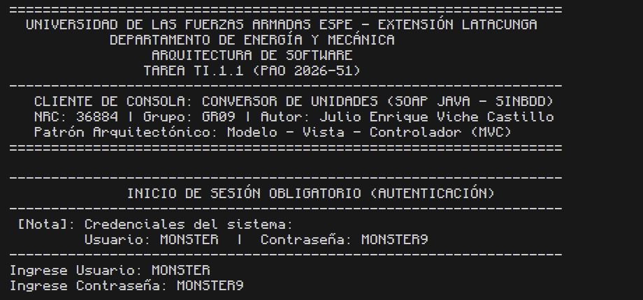

*_Figura 29. Login - Cliente consola_*

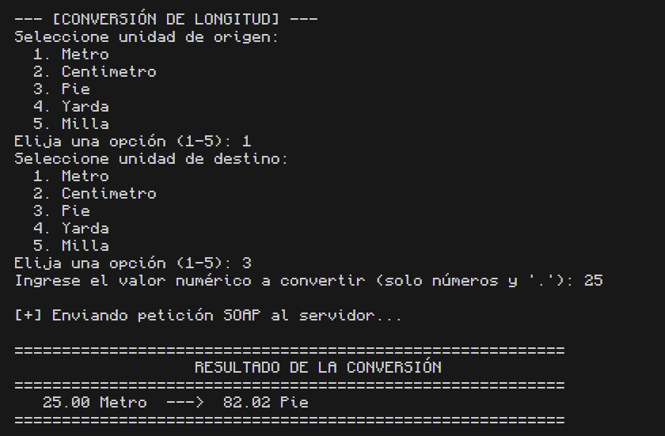

*_Figura 30. Conversión de Longitud - Cliente consola_*

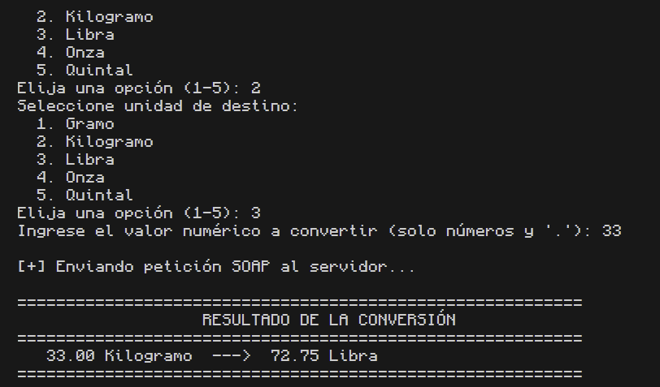

*_Figura 31. Conversión de Masa - Cliente consola_*

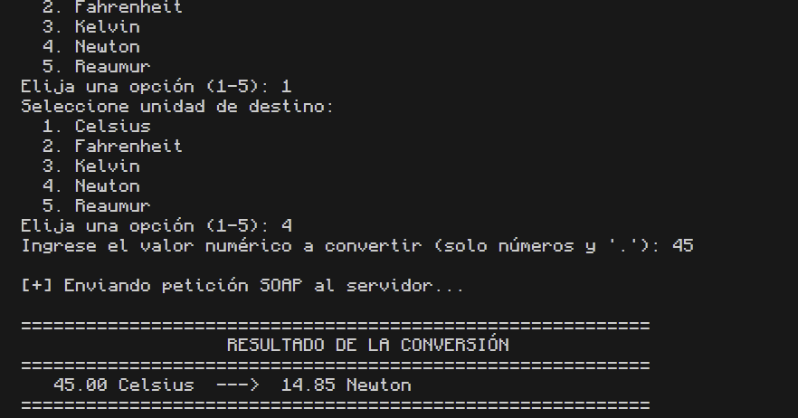

*_Figura 32. Conversión de Temperatura - Cliente consola_*

### CLIENTE ESCRITORIO

#### CREACIÓN DEL PROYECTO

El proyecto se crea de igual manera que el cliente de consola Java Application

#### ESTRUCTURA DEL PROYECTO

El cliente de escritorio con interfaz gráfica se estructuró bajo el patrón MVC. Se crearon los paquetes modelo, vista y controlador para separar el diseño visual de la lógica de consumo del servicio web.


*_Figura 33. Estructura del proyecto - Cliente escritorio_*

### CODIFICACIÓN DEL PROYECTO CLIENTE ESCRITORIO

#### CREACIÓN DE MODELOS

Al no requerir base de datos, en el paquete modelo solo se manejan clases auxiliares y enumeradores. Estos sirven exclusivamente para llenar las opciones de listas desplegables en las ventanas.


*_Figura 34. Creación de modelo - Cliente escritorio_*

CREACIÓN DE CONTROLADOR

Para conectar la interfaz con el servidor, se generaron los clientes JAX-WS a partir del WSDL. En el paquete controlador se crearon las clases que capturan los datos ingresados en las ventanas, invocan las operaciones SOAP remotas y devuelven el resultado a la pantalla.


*_Figura 35. Creación de servicio - Cliente consola_*

Tabla 13. Clase ControladorConversiones - Cliente escritorio

| package ec.edu.monster.clienteescritorio.controlador;import ec.edu.monster.clientesws.*;/** * * @author Julio Enrique Viche Castillo - GR09 - NRC 36884 */public class ControladorConversiones { private String token; public boolean iniciarSesion(String usuario, String clave) { String msgCredencialesInvalidas = "ERROR: Credenciales inválidas"; try { WSLogin_Service service = new WSLogin_Service(); this.token = service.getWSLoginPort().login(usuario, clave); if(this.token.equals(msgCredencialesInvalidas)){ System.out.println("Credenciales incorrectas"); return false; } return true; } catch (Exception e) { System.err.println("Error en la comunicación con el servicio: " + e.getMessage()); return false; } } public double convertirLongitud(double valor, String origen, String destino) throws Exception { WSLongitud_Service service = new WSLongitud_Service(); return service.getWSLongitudPort().convertirLongitud(valor, origen, destino, token); } public double convertirTemperatura(double valor, String origen, String destino) throws Exception { WSTemperatura_Service service = new WSTemperatura_Service(); return service.getWSTemperaturaPort().convertirTemperatura(valor, origen, destino, token); } public double convertirMasa(double valor, String origen, String destino) throws Exception { WSMasa_Service service = new WSMasa_Service(); return service.getWSMasaPort().convertirMasa(valor, origen, destino, token); }} |
| --- |

CREACIÓN DE VISTAS

En el paquete vista se diseñaron las interfaces gráficas utilizando los formularios (JFrames) de NetBeans. Estas ventanas contienen los componentes visuales necesarios para interactuar con el usuario. Su función es estrictamente visual: capturan los datos de entrada y muestran los resultados obtenidos, delegando todo el procesamiento al controlador.


*_Figura 36. Creación de vistas - Cliente escritorio_*

CLASE PRINCIPAL (EJECUCIÓN)

La clase principal del proyecto funciona como el punto de entrada de la aplicación. Su única responsabilidad es instanciar la ventana inicial del sistema (la interfaz de inicio de sesión) y hacerla visible en la pantalla para iniciar el flujo gráfico del programa.


*_Figura 37. Creación de vistas - Cliente escritorio_*

#### EJECUCIÓN DEL CLIENTE DE ESCRITORIO

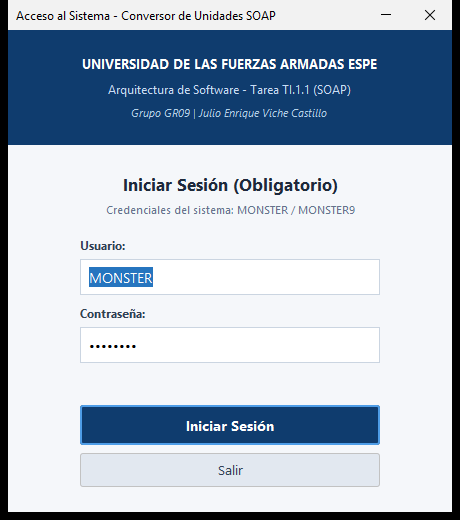

*_Figura 38. Login - Cliente escritorio_*

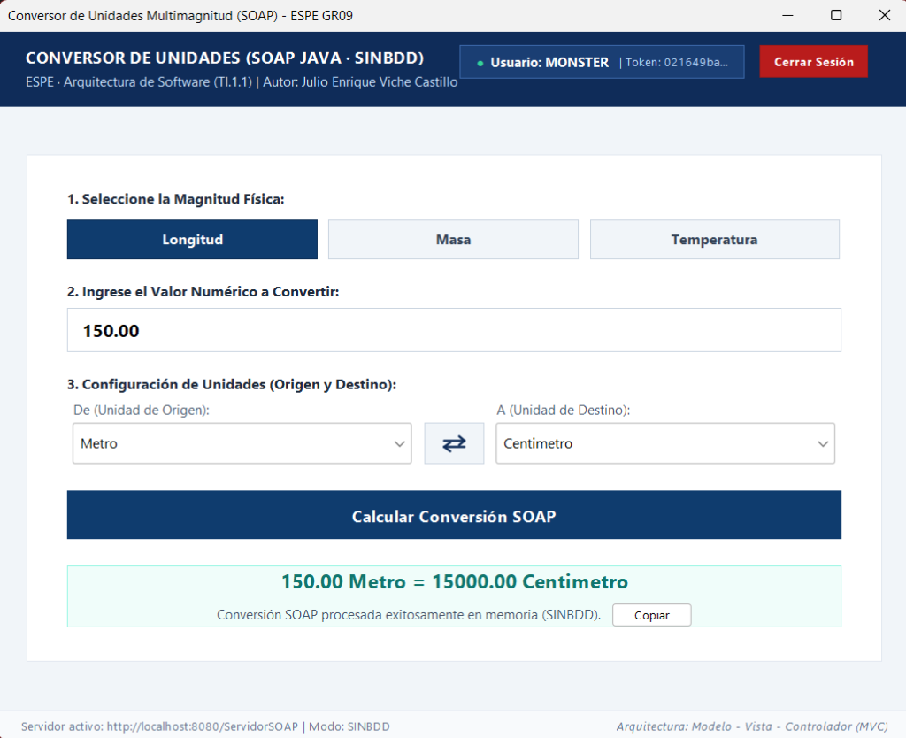

*_Figura 39. Pantalla de Conversiones - Cliente escritorio_*

### CLIENTE WEB

#### CREACIÓN DEL PROYECTO

El proyecto se crea de igual manera que el webservice con ‘Web Application’.

#### ESTRUCTURA DEL PROYECTO

El cliente web se desarrolló siguiendo el patrón MVC utilizando Servlets y JavaServer Pages (JSP). La estructura separa la lógica de control (en el paquete controlador) de las interfaces de usuario (páginas web).


*_Figura 40. Estructura del proyecto - Cliente web_*

### CODIFICACIÓN DEL PROYECTO CLIENTE WEB

CONSUMO DEL SERVICIO SOAP (SERVLETS)

Para la comunicación con el servidor SOAP, se crearon controladores basados en Servlets de Jakarta EE. Clases como LoginServlet y ConversorServlet se encargan de recibir las peticiones HTTP (GET y POST) desde el navegador, instanciar los clientes JAX-WS para consumir los servicios remotos y redirigir los resultados obtenidos hacia las páginas correspondientes.


*_Figura 41. Creación de servlets - Cliente web_*

Tabla 14. Clase ConversorServlet - Cliente web

| package ec.edu.monster.controlador; import java.io.IOException; import jakarta.servlet.ServletException; import jakarta.servlet.annotation.WebServlet; import jakarta.servlet.http.HttpServlet; import jakarta.servlet.http.HttpServletRequest; import jakarta.servlet.http.HttpServletResponse; import jakarta.servlet.http.HttpSession; import ec.edu.monster.controlador.WSLongitud_Service; import ec.edu.monster.controlador.WSMasa_Service; import ec.edu.monster.controlador.WSTemperatura_Service; /** * * @author Julio Enrique Viche Castillo - GR09 - NRC 36884 */ @WebServlet(name = "ConversorServlet", urlPatterns = {"/ConversorServlet"}) public class ConversorServlet extends HttpServlet { @Override protected void doPost(HttpServletRequest request, HttpServletResponse response) throws ServletException, IOException { response.setContentType("text/plain;charset=UTF-8"); HttpSession sesion = request.getSession(); String token = (String) sesion.getAttribute("miToken"); if (token == null) { response.getWriter().write("ERROR_SESSION"); return; } double valor = Double.parseDouble(request.getParameter("txtValor")); String tipo = request.getParameter("cmbTipo"); String origen = request.getParameter("txtOrigen"); String destino = request.getParameter("txtDestino"); if (valor < 0 && (tipo.equals("longitud") // tipo.equals("masa"))) { response.getWriter().write("ERROR: No existen valores negativos en " + tipo + "."); return; } double resultado = 0; try { switch (tipo) { case "longitud": if (valor < 0){ response.getWriter().write("ERROR: No se permiten valores negativos para esta magnitud."); break; } var portLon = new WSLongitud_Service().getWSLongitudPort(); resultado = portLon.convertirLongitud(valor, origen, destino, token); break; case "masa": if (valor < 0){ response.getWriter().write("ERROR: No se permiten valores negativos para esta magnitud."); break; } var portMas = new WSMasa_Service().getWSMasaPort(); resultado = portMas.convertirMasa(valor, origen, destino, token); break; case "temperatura": var portTemp = new WSTemperatura_Service().getWSTemperaturaPort(); resultado = portTemp.convertirTemperatura(valor, origen, destino, token); break; } if (resultado == -9999999.401) { response.getWriter().write("ERROR: Sesión inválida. Loguéate de nuevo."); } else if (resultado == -999999.404) { response.getWriter().write("ERROR: Unidades no reconocidas por el sistema."); } else { response.getWriter().write(String.valueOf(resultado)); } } catch (Exception e) { response.getWriter().write("ERROR: Fallo al conectar con el servicio web."); } }} |
| --- |

Tabla 15. Clase LoginServlet - Cliente web

| package ec.edu.monster.controlador;import ec.edu.monster.controlador.WSLogin_Service; import java.io.IOException;import java.io.PrintWriter;import jakarta.servlet.ServletException;import jakarta.servlet.annotation.WebServlet;import jakarta.servlet.http.HttpServlet;import jakarta.servlet.http.HttpServletRequest;import jakarta.servlet.http.HttpServletResponse;import jakarta.servlet.http.HttpSession;/** * * @author Julio Enrique Viche Castillo - GR09 - NRC 36884 */@WebServlet(name = "LoginServlet", urlPatterns = {"/LoginServlet"})public class LoginServlet extends HttpServlet { @Override protected void doPost(HttpServletRequest request, HttpServletResponse response) throws ServletException, IOException { //Recoger datos del jsp String user = request.getParameter("txtUsuario"); String pass = request.getParameter("txtClave"); try { //Llamar al web service WSLogin_Service loginService = new WSLogin_Service(); var portLogin = loginService.getWSLoginPort(); String token = portLogin.login(user, pass); if (token.contains("ERROR")) { request.setAttribute("error", "Credenciales incorrectas, intenta de nuevo."); request.getRequestDispatcher("index.jsp").forward(request, response); } else { HttpSession sesion = request.getSession(); sesion.setAttribute("miToken", token); response.sendRedirect("conversor.jsp"); } } catch (Exception e) { request.setAttribute("error", "Error de conexión con el Servidor Payara."); request.getRequestDispatcher("index.jsp").forward(request, response); } }} |
| --- |

CREACIÓN DE VISTAS

Las interfaces de usuario se construyeron utilizando HTML y la tecnología JSP (JavaServer Pages) dentro del directorio Web Pages. Se diseñaron dos vistas principales: index.jsp, que actúa como la pantalla de inicio de sesión interactuando con el LoginServlet, y conversor.jsp, que contiene los formularios dinámicos para seleccionar las unidades de medida, capturar los valores y mostrar los resultados procesados por el ConversorServlet.

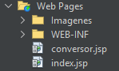

*_Figura 42. Creación de vistas - Cliente web_*

Tabla 16. Archivo conversor - Cliente web

| <%@page contentType="text/html" pageEncoding="UTF-8"%><% String token = (String) session.getAttribute("miToken"); if (token == null) { response.sendRedirect("index.jsp"); return; }%><!DOCTYPE html><html><head> <title>Panel de Conversiones - ESPE</title> <style> /* Estilos generales */ body { font-family: Arial, sans-serif; background-color: #121212; color: white; display: flex; justify-content: center; align-items: center; height: 100vh; margin: 0; } /* Contenedor principal con el borde sutil */ .converter-box { background-color: #111111; padding: 40px; border-radius: 4px; border: 2px solid #e0e0fa; /* Borde clarito de tu imagen */ width: 450px; box-shadow: 0 4px 15px rgba(0,0,0,0.8); } h3 { margin-top: 0; font-size: 1.2em; margin-bottom: 10px; } /* Selector principal de arriba */ .main-select { width: 60%; padding: 8px; background-color: #1a1a1a; color: white; border: 1px solid #555; margin-bottom: 40px; outline: none; } /* Contenedor de las dos columnas */ .columns-container { display: flex; justify-content: space-between; align-items: flex-end; margin-bottom: 30px; } /* Cada columna (Origen y Destino) */ .col { display: flex; flex-direction: column; width: 40%; } .col label { font-weight: bold; font-size: 0.9em; margin-bottom: 15px; } .col select, .col input { background-color: #111; color: white; border: 1px solid #fff; padding: 8px; margin-bottom: 15px; outline: none; } /* Columna del medio para la mano */ .col-center { width: 15%; display: flex; justify-content: center; align-items: center; padding-bottom: 25px; /* Para alinear con los inputs */ } .hand-img { width: 40px; /* Ajusta el tamaño de tu imagen aquí */ } /* Botón azul gigante */ button { background-color: #5b88e5; color: white; cursor: pointer; font-weight: bold; font-size: 1.1em; width: 100%; padding: 15px; border: none; } button:hover { background-color: #4a75c9; } .error { color: #ff4d4d; margin-top: 15px; font-weight: bold; text-align: center; } .logout { display: block; text-align: center; margin-top: 20px; color: #888; text-decoration: none; font-size: 0.9em; } </style> <script> const dicUnidades = { longitud: ["centimetros", "metros", "pies", "yardas", "millas"], masa: ["gramos", "kilogramos", "libras", "quintales"], temperatura: ["fahrenheit", "kelvin", "celsius", "newton", "reaumur"] }; function actualizarListas() { const magnitud = document.getElementById("cmbTipo").value; const listaOrigen = document.getElementById("listaOrigen"); const listaDestino = document.getElementById("listaDestino"); listaOrigen.innerHTML = ""; listaDestino.innerHTML = ""; dicUnidades[magnitud].forEach(unidad => { listaOrigen.add(new Option(unidad, unidad)); listaDestino.add(new Option(unidad, unidad)); }); // Limpiamos los inputs al cambiar de magnitud document.getElementById("txtValor").value = ""; document.getElementById("txtResultado").value = ""; document.getElementById("errorTxt").innerText = ""; } window.onload = function() { actualizarListas(); document.getElementById("formConversor").addEventListener("submit", async function(e) { e.preventDefault(); const formData = new URLSearchParams(new FormData(this)); try { const response = await fetch('ConversorServlet', { method: 'POST', body: formData }); const texto = await response.text(); document.getElementById("errorTxt").innerText = ""; document.getElementById("txtResultado").value = ""; if (texto === "ERROR_SESSION") { window.location.href = "index.jsp"; } else if (texto.startsWith("ERROR")) { document.getElementById("errorTxt").innerText = texto.replace("ERROR:", ""); } else { // Aquí metemos el resultado en la cajita derecha document.getElementById("txtResultado").value = texto; } } catch (error) { document.getElementById("errorTxt").innerText = "Error conectando al servidor."; } }); }; </script></head><body> <div class="converter-box"> <form id="formConversor"> <h3>Elija el tipo de unidad para la conversión</h3> <select name="cmbTipo" id="cmbTipo" onchange="actualizarListas()" class="main-select"> <option value="longitud">Longitud</option> <option value="masa">Masa</option> <option value="temperatura">Temperatura</option> </select> <div class="columns-container"> <div class="col"> <label>Unidad de origen</label> <select name="txtOrigen" id="listaOrigen"></select> <input type="number" step="any" name="txtValor" id="txtValor" required> </div> <div class="col-center">  </div> <div class="col"> <label>Unidad de destino</label> <select name="txtDestino" id="listaDestino"></select> <input type="text" id="txtResultado" readonly> </div> </div> <button type="submit">CONVERTIR</button> </form> <div id="errorTxt" class="error"></div> <a href="index.jsp" class="logout">Cerrar Sesión</a> </div></body></html> |
| --- |

Tabla 17. Archivo index - Cliente web

| <%@page contentType="text/html" pageEncoding="UTF-8"%><!DOCTYPE html><html> <head> <meta charset="UTF-8"> <title>Login - Conversor ESPE</title> <style> /* Fondo general de la página */ body { font-family: sans-serif; background-color: #121212; color: white; display: flex; justify-content: center; align-items: center; height: 100vh; margin: 0; } /* Contenedor principal (la caja negra) */ .login-container { display: flex; background-color: #151515; padding: 30px; border: 1px solid #333; box-shadow: 0 4px 15px rgba(0,0,0,0.8); gap: 40px; /* Espacio entre el form y la foto */ } /* Columna izquierda (Formulario) */ .form-section { display: flex; flex-direction: column; justify-content: center; width: 280px; } h3 { margin-top: 0; margin-bottom: 40px; font-size: 1.1em; font-weight: bold; } /* Fila para cada label + input */ .input-group { display: flex; justify-content: space-between; align-items: center; margin-bottom: 20px; } label { font-weight: bold; font-size: 0.9em; } input { background-color: #404040; border: none; color: white; padding: 10px; width: 170px; outline: none; } button { background-color: #5b88e5; color: white; border: none; padding: 15px; font-weight: bold; margin-top: 20px; cursor: pointer; width: 100%; font-size: 1em; } button:hover { background-color: #4a75c9; } /* Columna derecha (Imagen) */ .image-section img { width: 220px; height: 100%; object-fit: cover; border-radius: 2px; } /* Mensaje de error */ .error { color: #ff4d4d; font-size: 0.85em; margin-top: 15px; text-align: center; font-weight: bold; } </style> </head> <body> <div class="login-container"> <div class="form-section"> <h3>Ingrese sus credenciales:</h3> <form method="POST" action="LoginServlet"> <div class="input-group"> <label>Usuario:</label> <input type="text" name="txtUsuario" required> </div> <div class="input-group"> <label>Clave:</label> <input type="password" name="txtClave" required> </div> <button type="submit">INICIAR SESIÓN</button> </form> <%-- Mensaje de error si falla el login --%> <% if(request.getAttribute("error") != null) { %> <div class="error"><%= request.getAttribute("error") %></div> <% } %> </div> <div class="image-section">  </div> </div> </body></html> |
| --- |

EJECUCIÓN DEL CLIENTE DE WEB

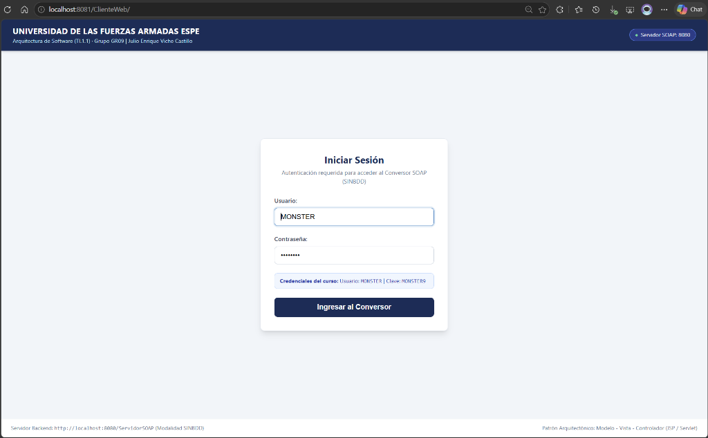

*_Figura 43. Login - Cliente web_*

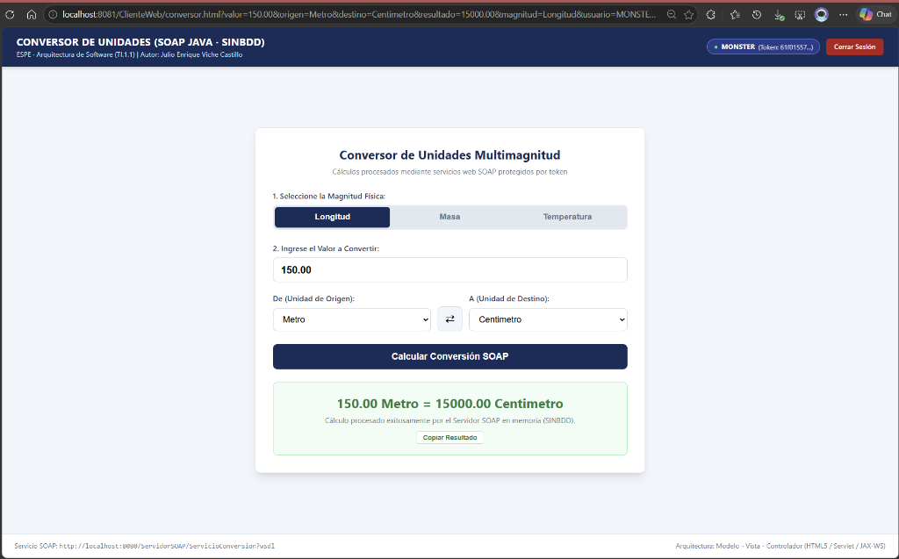

*_Figura 44. Pantalla de Conversiones - Cliente web_*

### CLIENTE MÓVIL

#### CREACIÓN DEL PROYECTO

El proyecto se debe crear en Android Studio. Se selecciona la opción ‘New Project’, en la pantalla siguiente ‘Empty Activity’ y finalmente se configura el proyecto con nombre, ubicación y la opción ‘Kotlin’ en Build Configuration Laguaje. Finalizamos haciendo click en el botón ‘Finish’.


*_Figura 45. Configuración del proyecto - Cliente móvil_*

#### ESTRUCTURA DEL PROYECTO

El desarrollo de la aplicación móvil en Android Studio se organizó bajo el patrón arquitectónico MVC (Modelo-Vista-Controlador). Para asegurar el desacoplamiento de la lógica, la vista y el consumo de red, se estructuró el proyecto en los paquetes model, view y controller.

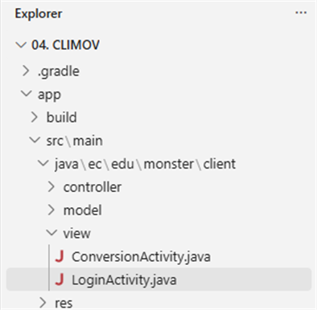

*_Figura 46. Estructura del proyecto - Cliente móvil_*

### CODIFICACIÓN DEL PROYECTO CLIENTE MÓVIL

#### CREACIÓN DE MODELOS

En el paquete model se crearon las clases necesarias para el intercambio de información: ConversionRequest, ConversionResult, LoginResult y la enumeración ServiceType.

Adicionalmente, debido a que Android no incluye bibliotecas nativas para el consumo directo de WSDL (como JAX-WS en escritorio), se implementó la clase SoapClient para estructurar y ejecutar las peticiones HTTP/XML hacia el servidor Payara, apoyada por SoapErrorMapper para una correcta gestión de excepciones de red.

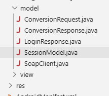

*_Figura 47. Creación de modelos - Cliente móvil_*

CREACIÓN DE CONTROLADORES

Para el cliente móvil Android se implementa la comunicación SOAP consumiendo los Web Services mediante peticiones HTTP POST con sobres XML (SOAP Envelope). En el paquete controller se desarrollaron las clases LoginController y ConversionController. Estos controladores operan de forma asíncrona (en hilos secundarios) para no bloquear la interfaz gráfica; capturan los datos de la pantalla, invocan al SoapClient pasándole los parámetros requeridos y devuelven la respuesta procesada a las actividades correspondientes.

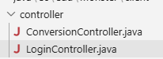

*_Figura 48. Creación de controladores - Cliente móvil_*

Tabla 18. Clase LoginController - Cliente móvil

```java
package ec.edu.monster.client.controller;

import android.os.Handler;
import android.os.Looper;

import ec.edu.monster.client.model.LoginResponse;
import ec.edu.monster.client.model.SessionModel;
import ec.edu.monster.client.model.SoapClient;

import java.util.concurrent.Future;

/**
 * [CONTROLADOR] Gestiona el flujo de autenticación para la vista móvil.
 * Coordina llamadas asíncronas y publica resultados en el hilo principal (MainLooper).
 */
public class LoginController {

    public interface LoginCallback {
        void onSuccess(SessionModel session);
        void onError(String mensaje);
    }

    private final SoapClient soapClient;
    private final Handler mainHandler;

    public LoginController() {
        this.soapClient = new SoapClient();
        this.mainHandler = new Handler(Looper.getMainLooper());
    }

    public void procesarLogin(String baseUrl, String usuario, String clave, LoginCallback callback) {
        new Thread(() -> {
            try {
                Future<LoginResponse> future = soapClient.iniciarSesion(baseUrl, usuario, clave);
                LoginResponse resp = future.get();

                mainHandler.post(() -> {
                    if (resp != null && resp.isExito() && resp.getToken() != null) {
                        SessionModel session = new SessionModel(usuario, resp.getToken());
                        callback.onSuccess(session);
                    } else {
                        String err = (resp != null && resp.getMensaje() != null) 
                                ? resp.getMensaje() 
                                : "Error al iniciar sesión.";
                        callback.onError(err);
                    }
                });

            } catch (Exception e) {
                mainHandler.post(() -> callback.onError("Error de conexión: " + e.getMessage()));
            }
        }).start();
    }
}
```

Tabla 19. Clase ConversionController - Cliente móvil

```java
package ec.edu.monster.client.controller;

import android.os.Handler;
import android.os.Looper;

import ec.edu.monster.client.model.ConversionRequest;
import ec.edu.monster.client.model.ConversionResponse;
import ec.edu.monster.client.model.SoapClient;

import java.util.concurrent.Future;

/**
 * [CONTROLADOR] Gestiona el despacho de conversiones de unidades SOAP.
 */
public class ConversionController {

    public interface ConversionCallback {
        void onSuccess(ConversionResponse response);
        void onError(String mensaje);
    }

    private final SoapClient soapClient;
    private final Handler mainHandler;

    public ConversionController() {
        this.soapClient = new SoapClient();
        this.mainHandler = new Handler(Looper.getMainLooper());
    }

    public void procesarConversion(String baseUrl, String token, ConversionRequest req, ConversionCallback callback) {
        new Thread(() -> {
            try {
                Future<ConversionResponse> future;
                String magnitud = req.getMagnitud().toLowerCase();

                switch (magnitud) {
                    case "longitud":
                        future = soapClient.convertirLongitud(baseUrl, token, req.getValor(), req.getUnidadOrigen(), req.getUnidadDestino());
                        break;
                    case "masa":
                        future = soapClient.convertirMasa(baseUrl, token, req.getValor(), req.getUnidadOrigen(), req.getUnidadDestino());
                        break;
                    case "temperatura":
                        future = soapClient.convertirTemperatura(baseUrl, token, req.getValor(), req.getUnidadOrigen(), req.getUnidadDestino());
                        break;
                    default:
                        mainHandler.post(() -> callback.onError("Magnitud física no soportada: " + req.getMagnitud()));
                        return;
                }

                ConversionResponse resp = future.get();
                mainHandler.post(() -> {
                    if (resp != null && resp.isExito()) {
                        callback.onSuccess(resp);
                    } else {
                        String err = (resp != null && resp.getMensajeError() != null) 
                                ? resp.getMensajeError() 
                                : "Error al procesar la conversión.";
                        callback.onError(err);
                    }
                });

            } catch (Exception e) {
                mainHandler.post(() -> callback.onError("Error de red: " + e.getMessage()));
            }
        }).start();
    }
}
```

CREACIÓN DE VISTAS

Se crean los archivos de interfaz gráfica en el paquete views.

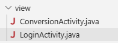

*_Figura 49. Creación de vistas - Cliente móvil_*

#### EJECUCIÓN DEL CLIENTE DE MÓVIL

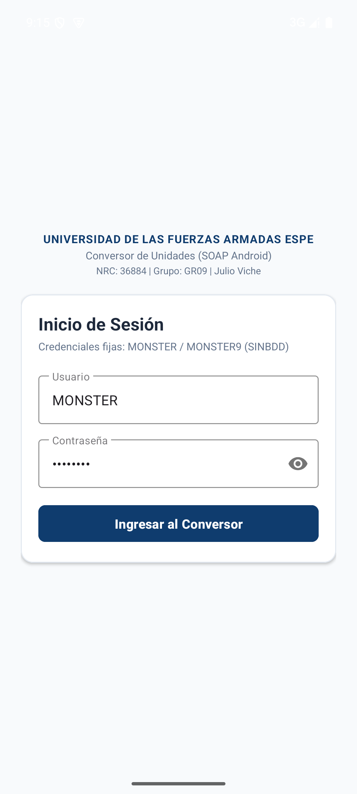

*_Figura 50. Inicio de sesión - Cliente móvil SOAP Java_*

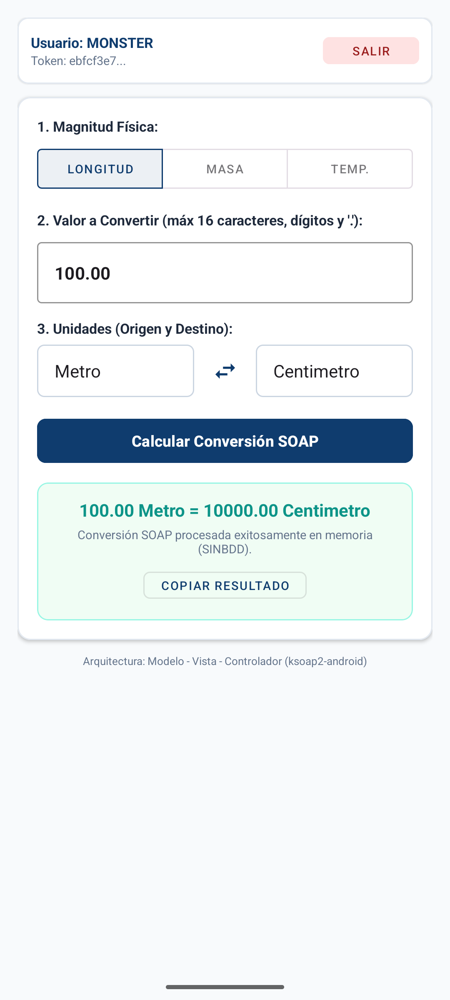

*_Figura 51. Conversión en Android: 100.00 Metro a 10000.00 Centimetro_*

**Figura 8. Cliente de consola SOAP Java: inicio de sesión.**


**Figura 9. Cliente de consola SOAP Java: conversión de longitud, 25 Metro a 82.02 Pie.**


**Figura 10. Cliente de consola SOAP Java: conversión de masa, 33 Kilogramo a 72.75 Libra.**


**Figura 11. Cliente de consola SOAP Java: conversión de temperatura, 45 Celsius a 14.85 Newton.**


**Figura 12. Cliente de escritorio SOAP Java: inicio de sesión.**


**Figura 13. Cliente de escritorio SOAP Java: conversión, 150 Metro a 15000 Centimetro.**


**Figura 14. Cliente móvil SOAP Java: conversión de masa, 100 Gramo a 0.10 Kilogramo.**

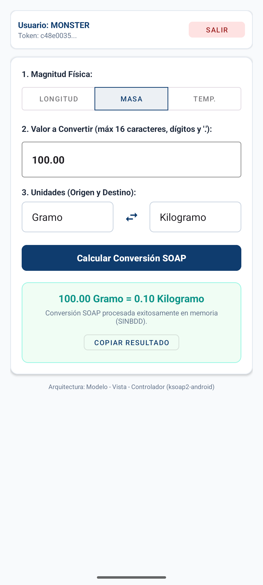

**Figura 15. Cliente móvil SOAP Java: conversión de temperatura, 100 Celsius a 212 Fahrenheit.**

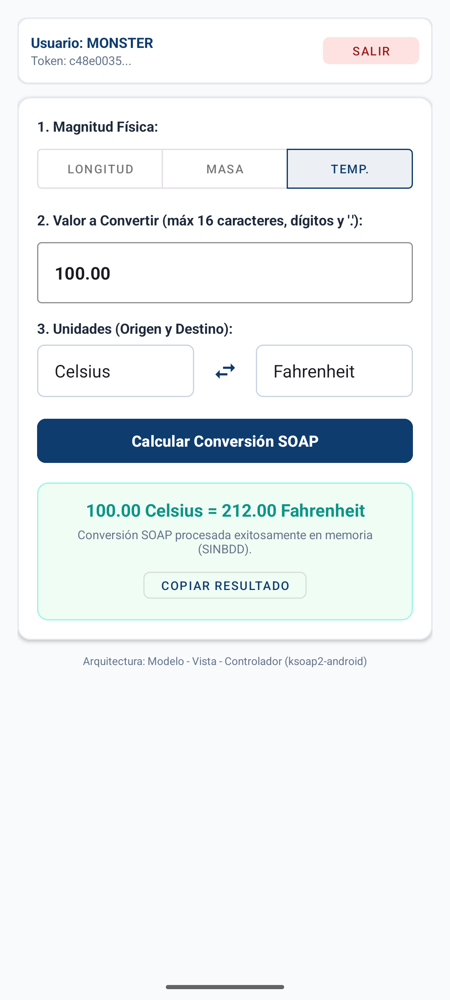

#### CONCLUSIONES

El desarrollo del proyecto permitió integrar múltiples tecnologías y herramientas necesarias para la construcción de un sistema completo basado en una arquitectura orientada a servicios (SOA) con SOAP, aplicando buenas prácticas de ingeniería de software. La instalación y configuración de entornos como NetBeans, el servidor Payara, Jakarta EE y Android Studio facilitaron un flujo de trabajo ordenado, garantizando que todos los componentes del sistema se ejecuten de forma consistente.

La implementación de los módulos de seguridad y conversiones evidenció la importancia de separar correctamente la lógica de negocio y la capa de exposición del servicio web. A pesar de no contar con conexión a una base de datos, el uso de DTOs, validaciones en memoria y manejo de sesiones simuladas dio como resultado soluciones mantenibles, escalables y con un nivel adecuado de desacoplamiento.

La construcción de los cuatro clientes (consola, escritorio, web con JSP/Servlets y móvil con Android) permitió evidenciar la correcta comunicación y consumo de servicios SOAP a partir del archivo WSDL. Se demostró la interoperabilidad entre tecnologías, gestionando exitosamente las peticiones JAX-WS en Java y estructurando peticiones HTTP/XML nativas en el entorno móvil. Además, se verificó el funcionamiento completo del flujo, desde el inicio de sesión hasta las transformaciones de longitud, masa y temperatura.

En conjunto, el proyecto consolida los aprendizajes del ciclo completo de desarrollo de software para servicios web clásicos: configuración del servidor de aplicaciones, diseño de la interfaz WSDL, exposición de métodos (WebMethods), consumo desde distintos clientes y validación funcional mediante pruebas controladas.

#### RECOMENDACIONES

Mantener la estructura modular y el patrón MVC utilizados en el proyecto para futuros desarrollos, ya que permite escalar nuevas categorías de conversión sin comprometer la arquitectura inicial del servidor SOAP.

Implementar un manejo de excepciones más detallado (como SOAPFaults) en el servidor, de modo que cuando el cliente envíe unidades no soportadas o datos erróneos, los mensajes de error XML sean estandarizados y faciliten el diagnóstico.

Añadir validaciones más estrictas en los servicios, especialmente en el control del tiempo de vida de las sesiones del usuario y en el bloqueo de peticiones con valores numéricos inválidos (como medidas de masa negativas).

Integrar un sistema de logs en el servidor Payara, lo cual permitiría rastrear las solicitudes SOAP entrantes y analizar el comportamiento de las conversiones en diferentes clientes.

Implementar mecanismos de caché o estructuras de datos optimizadas en memoria para los catálogos de unidades, en caso de que el sistema escale a un volumen masivo de peticiones concurrentes.

Desarrollar pruebas unitarias en la capa de servicios para asegurar la exactitud de las fórmulas matemáticas utilizadas en las transformaciones de temperatura, longitud y masa ante futuras modificaciones.

Mejorar la interfaz de usuario en los clientes web y móvil incorporando retroalimentación visual más precisa, controles de validación en los formularios y manejo asíncrono avanzado para no bloquear las pantallas durante la espera de respuesta del servidor.

Documentar el contrato WSDL detalladamente con comentarios estructurados, lo que permitirá a futuros desarrolladores entender rápidamente los tipos de datos requeridos y facilitar su consumo desde sistemas construidos en otros lenguajes de programación.

## ANEXO: Capturas de ejecución

Capturas verificadas del servidor y de los cuatro clientes del proyecto SOAP Java SINBDD, obtenidas o revisadas el 29 de octubre de 2026.

**Figura 1. Servidor SOAP Java: estado y endpoints publicados.**

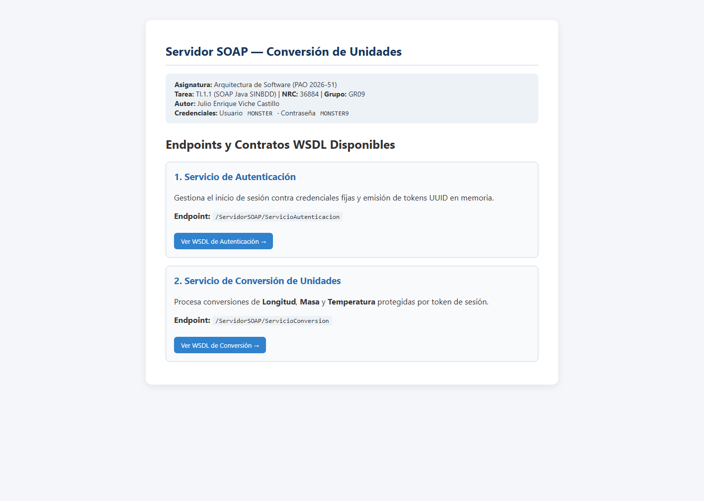

**Figura 2. Contrato WSDL del servicio SOAP Java.**

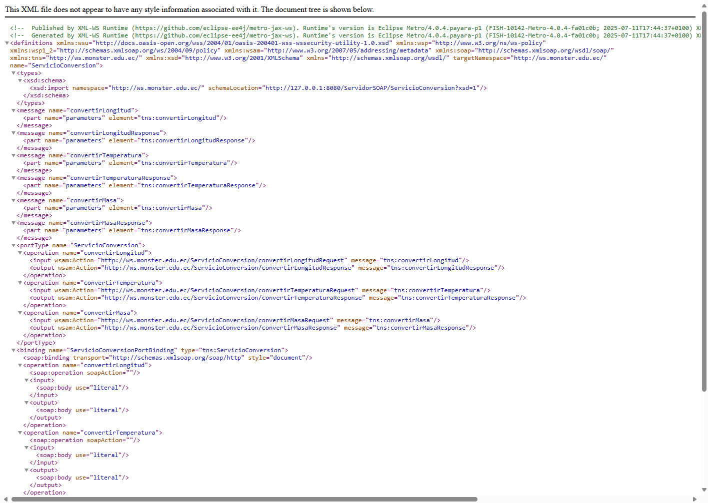

**Figura 3. Cliente web SOAP Java: inicio de sesión.**

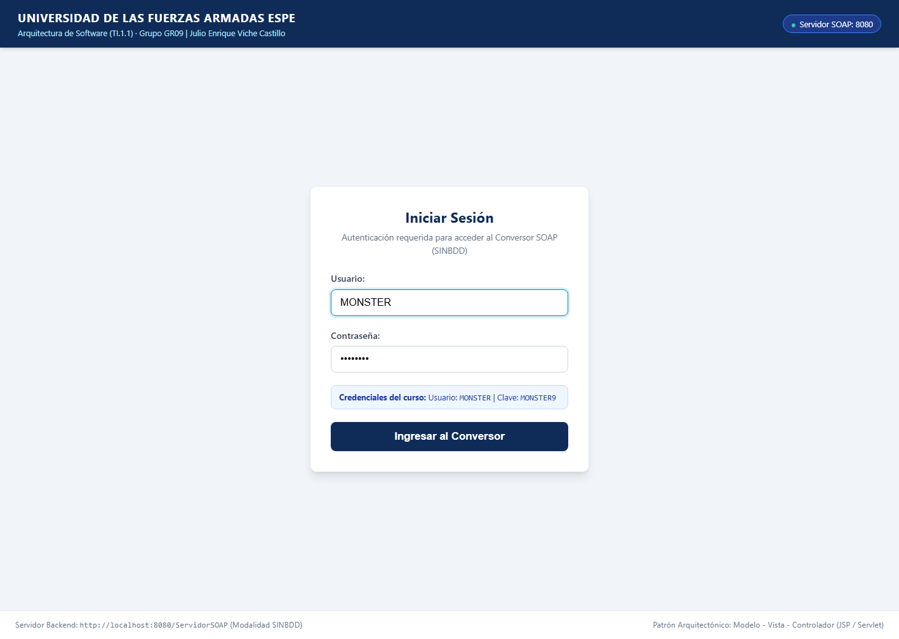

**Figura 4. Cliente web SOAP Java: conversor con sesión autenticada.**

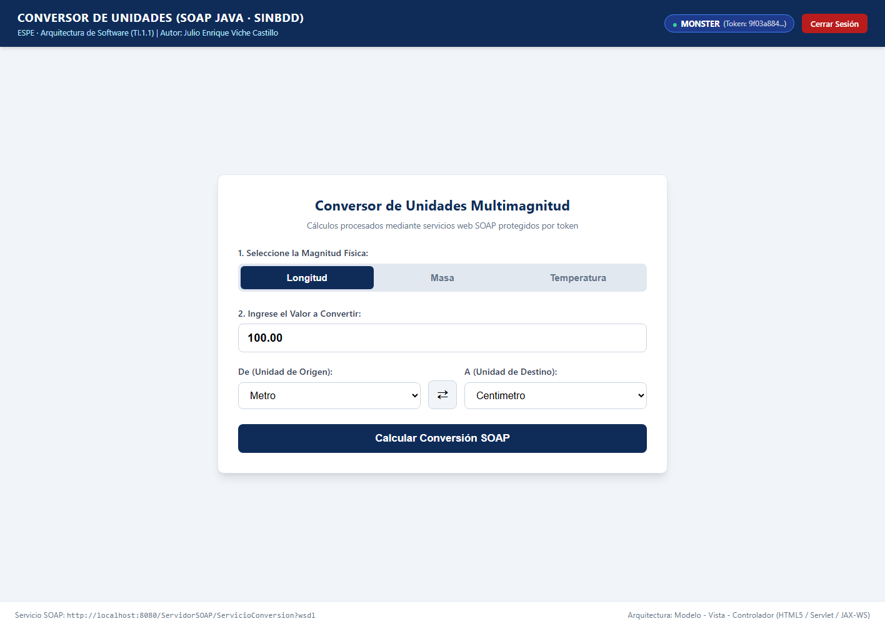

**Figura 5. Conversión SOAP Java: 10 Metro a 10.94 Yarda.**

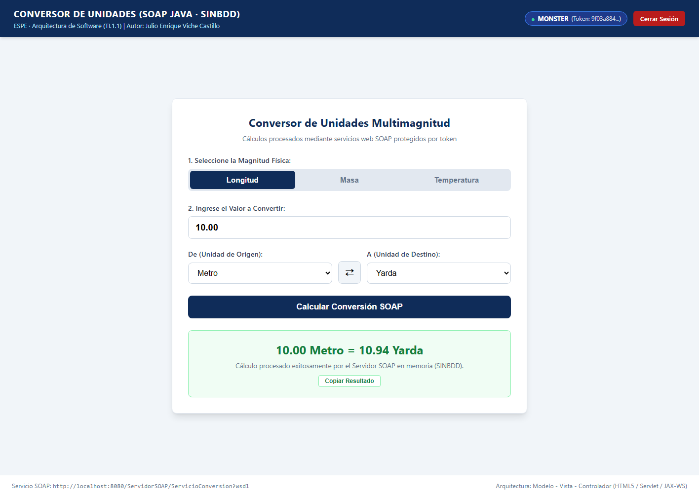

**Figura 6. Conversión SOAP Java: 500 Gramo a 17.64 Onza.**

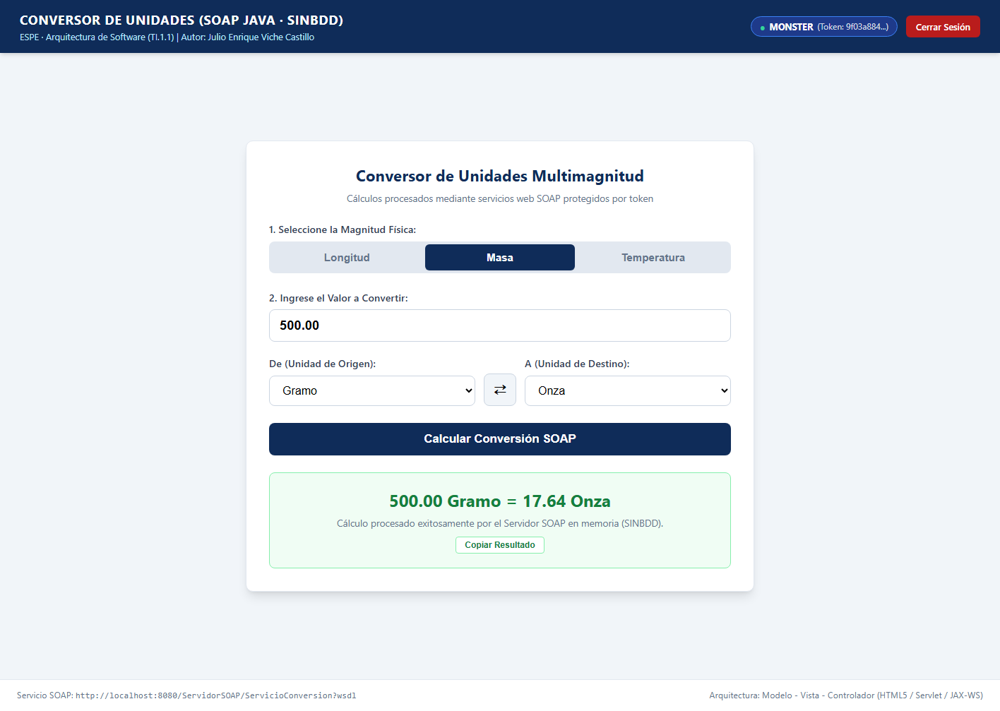

**Figura 7. Conversión SOAP Java: 0 Celsius a 273.15 Kelvin.**

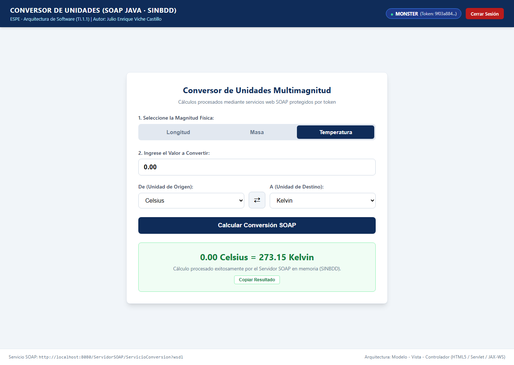

