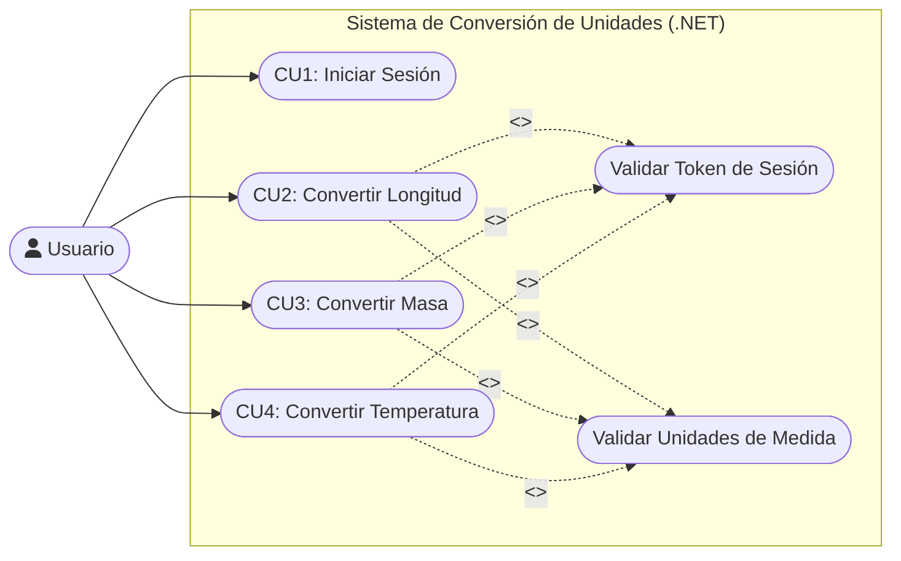
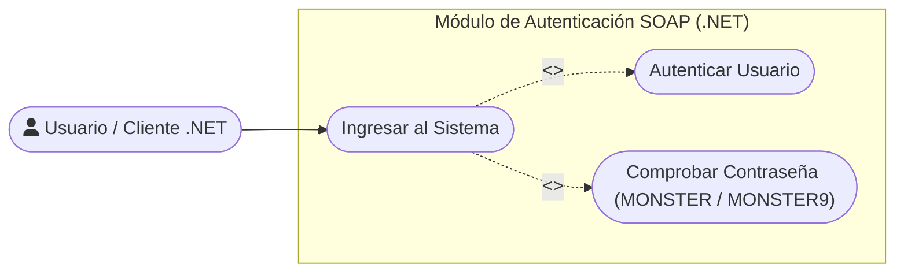
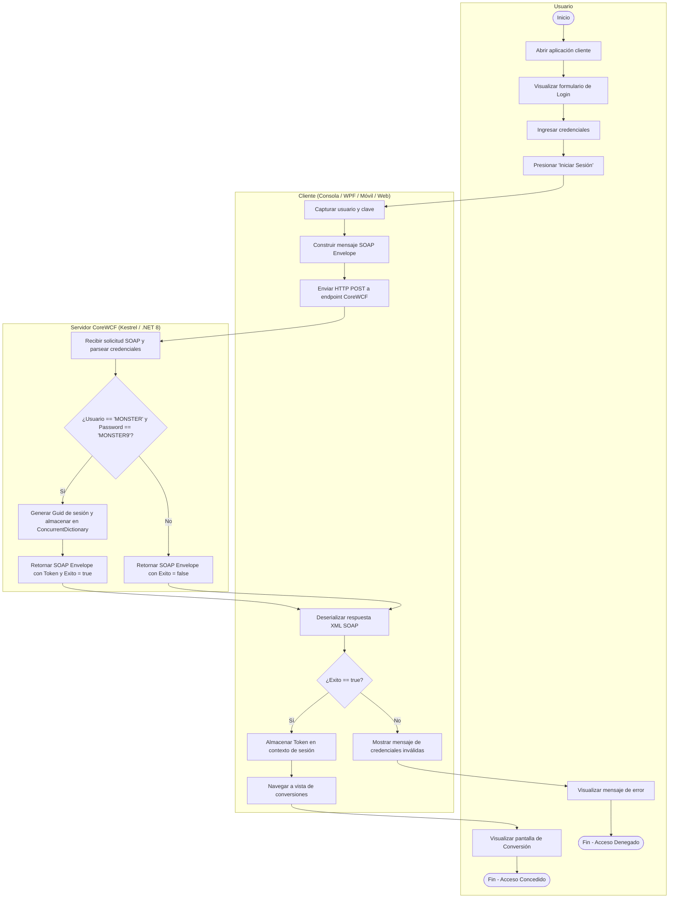
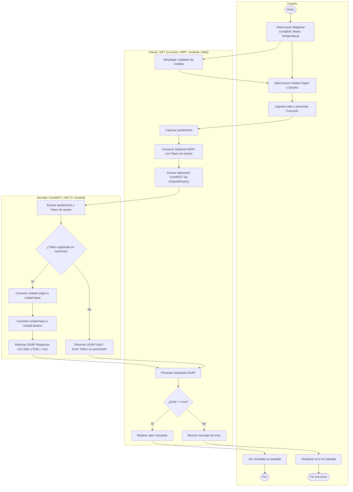
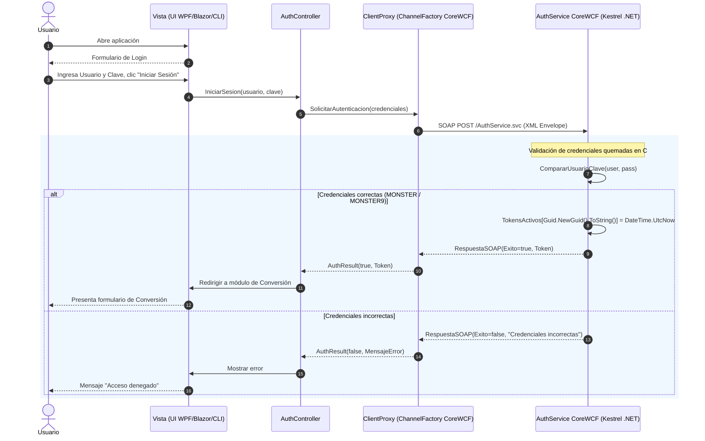
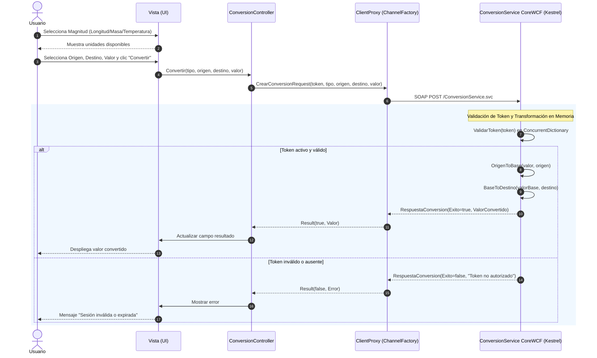
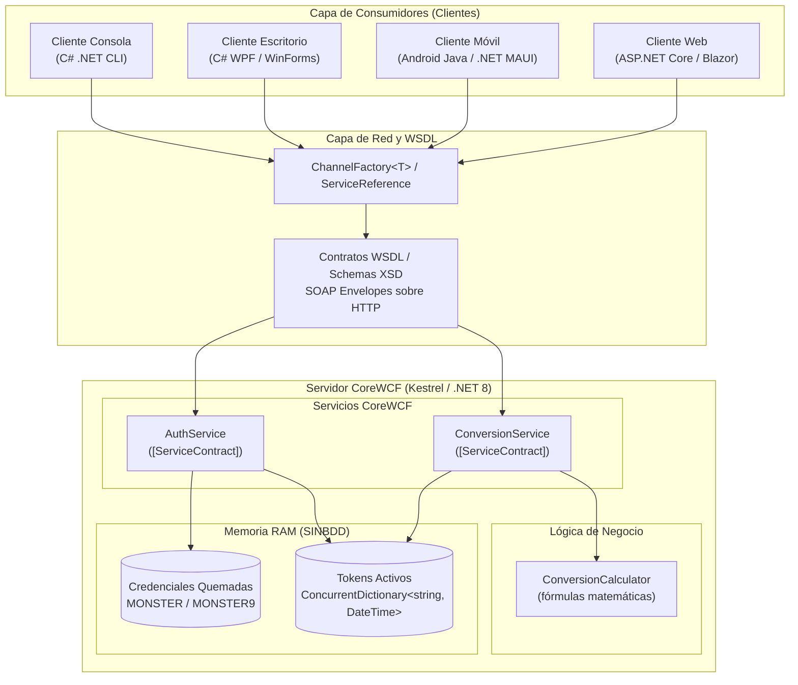

# Diagramas UML · TI.1.2 SOAP .NET (SINBDD)

Este documento contiene la representación visual en sintaxis **Mermaid** de todos los modelos
UML correspondientes al taller **TI.1.2** (Servicios Web SOAP en plataforma **.NET 8 / C#**, `SINBDD`).

---

## 1. Casos de Uso (`01_CASOS_DE_USO`)

### 1.1. Diagrama General de Casos de Uso
El actor `Usuario` interactúa con el sistema requiriendo autenticación previa obligatoria antes de realizar transformaciones físicas en tres magnitudes (Longitud, Masa, Temperatura).

### 1.2. Detalle del Módulo de Autenticación
Descompone el inicio de sesión contra credenciales fijas (`MONSTER` / `MONSTER9`).

---

## 2. Diagramas de Actividad (`02_ACTIVIDAD`)

### 2.1. Actividad: Iniciar Sesión
Flujo con 3 swimlanes (*Usuario*, *Cliente .NET*, *Servidor CoreWCF .NET*).

### 2.2. Actividad: Convertir Unidades
Flujo de validación de token y cómputo matemático en el servicio CoreWCF.

---

## 3. Diagramas de Secuencia (`03_SECUENCIA`)

### 3.1. Secuencia: Iniciar Sesión

### 3.2. Secuencia: Conversión de Unidades

---

## 4. Clases del Dominio (`04_CLASES`)

Al tratarse de una arquitectura **SINBDD**, la solución en .NET no utiliza Entity Framework Core ni bases de datos SQL. Las estructuras son DTOs y contratos en memoria documentados en:
`TI.1.1. PAO202651_SOAP_DOTNET_SINBDD_NRC36884_GR09/01. UML/03. DIAGRAMAS UML/04_CLASES/README.txt`

---

## 5. Arquitectura de Componentes (`05_ARQUITECTURA`)

---

> [!info] Enlaces relacionados
> - [index.md](index.md): Panel principal del taller TI.1.2.
> - [srs.md](srs.md): Especificación de Requisitos de Software de TI.1.2.
> - [01-uml](../../03-deliverables/01-uml.md): Catálogo general de UML en el vault.
