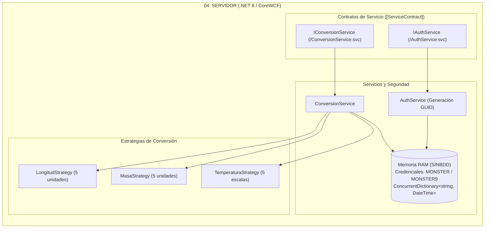

# MANUAL DE CONFIGURACIÓN Y DESPLIEGUE SISTEMA DE CONVERSIÓN DE UNIDADES CON SOAP SIN BDD EN .NET

**Universidad de las Fuerzas Armadas ESPE — Sede Latacunga**  
**Departamento de Ciencias de la Computación**  
**Carrera:** Ingeniería de Software / Tecnologías de la Información  
**Asignatura:** Arquitectura de Software  
**Tarea:** TI.1.2 (PAO 2026-51)  
**NRC:** 36884 | **Grupo:** GR09  
**Autor:** Julio Enrique Viche Castillo  
**Docente:** Ing. Eduardo Mauricio Campaña Ortega, MIS.MDU.CCNA.CCIA. PhD. (c)  
**Fecha:** 27 de Octubre de 2026  

---

## 1. INTRODUCCIÓN

En el desarrollo de arquitecturas empresariales orientadas a servicios, el estándar **SOAP** (Simple Object Access Protocol) continúa siendo una referencia clave para entornos que exigen contratos formales rígidos y tipificación estricta. El presente manual técnico documenta el diseño, la configuración, el despliegue y la validación del **Sistema de Conversión de Unidades Heterogéneo**, implementado bajo la plataforma **.NET 8.0** utilizando **CoreWCF** / servicios SOAP en C#.

La arquitectura opera bajo la modalidad **SINBDD** (Sin Base de Datos), gestionando las credenciales maestras codificadas (`MONSTER` / `MONSTER9`) y la vigencia de los tokens de autorización exclusivamente en la memoria RAM del proceso anfitrión. El servidor expone contratos formales **WSDL**, los cuales son consumidos por cuatro clientes desacoplados bajo el patrón **Modelo-Vista-Controlador (MVC)**: Consola CLI, Escritorio (Windows Forms / WPF con diseño moderno), Web (ASP.NET Core MVC / Razor) y Móvil (.NET MAUI / Android).

---

## 2. OBJETIVOS

### 2.1. Objetivo General
Diseñar, configurar, desplegar y validar un sistema distribuido de conversión de unidades de múltiples magnitudes (Longitud, Masa y Temperatura) implementado como un servicio web SOAP en .NET (C# / CoreWCF), alojado sobre Kestrel / IIS y consumido por cuatro clientes heterogéneos bajo el patrón arquitectónico Modelo-Vista-Controlador (MVC).

### 2.2. Objetivos Específicos
1. Configurar el servidor backend en **.NET 8.0 SDK** utilizando **CoreWCF** para exponer contratos de servicio compatibles con WSDL 1.1 y SOAP 1.1/1.2.
2. Implementar los contratos de servicio `IAuthService` y `IConversionService`, asegurando el procesamiento de operaciones de autenticación y cálculo de magnitudes físicas.
3. Integrar el catálogo estricto de exactamente **5 unidades por magnitud** (Longitud, Masa y Temperatura) bajo el patrón de diseño **GoF Strategy**, formateando rigurosamente todas las salidas numéricas a **2 decimales** (`0.00`) con punto decimal.
4. Establecer un esquema de autorización estricto mediante tokens GUID volátiles en memoria (`ConcurrentDictionary<string, DateTime>`), denegando cualquier operación a peticiones no autenticadas.
5. Desarrollar y verificar cuatro clientes heterogéneos independientes (Consola, Escritorio, Web y Móvil) bajo el patrón **MVC**, garantizando la auto-detección y resiliencia en la conexión a los endpoints SOAP.

---

## 3. MARCO TEÓRICO

### 3.1. Servicios Web SOAP y CoreWCF en .NET
**CoreWCF** es la adaptación oficial y de código abierto de Windows Communication Foundation (WCF) para plataformas .NET modernas (.NET Core y .NET 8). Permite construir servicios SOAP empresariales manteniendo:
- **`[ServiceContract]`:** Define la interfaz pública del servicio.
- **`[OperationContract]`:** Expone los métodos de cálculo y autenticación.
- **`[DataContract]` y `[DataMember]`:** Estructuras fuertemente tipadas que se serializan automáticamente en el cuerpo XML del mensaje SOAP.
- **Exposición WSDL:** Generación dinámica de metadatos XML accesibles vía `?wsdl` para el descubrimiento automático de servicios.

### 3.2. Principio SINBDD y Gestión de Sesión
El sistema prescinde de cualquier motor relacional o no relacional:
- **Credenciales Maestras:** Usuario `MONSTER`, Contraseña `MONSTER9`.
- **Colección Volátil:** `ConcurrentDictionary<string, DateTime>` que almacena tokens activos con control de tiempo de expiración.
- **Validación Mandatoria:** Cada llamada de conversión inspecciona la existencia del token en memoria antes de invocar la lógica matemática.

### 3.3. Patrón de Diseño GoF Strategy
Para garantizar un código limpio, extensible y desacoplado, las fórmulas de conversión se organizan mediante la interfaz `IConversorStrategy<T>`:
- Estrategias independientes para `LongitudStrategy`, `MasaStrategy` y `TemperaturaStrategy`.
- Cada estrategia realiza la conversión proyectando el valor origen a una unidad pivote del Sistema Internacional (SI) y transformándolo posteriormente a la unidad destino.

---

## 4. DESARROLLO DEL APLICATIVO

### 4.1. Componente Servidor SOAP (`04. SERVIDOR`)

Ubicado en `04. SERVIDOR/` y configurado sobre `.NET 8.0 SDK`.



#### Paso 1: Configuración del Proyecto `04. SERVIDOR.csproj`
```xml
<Project Sdk="Microsoft.NET.Sdk.Web">
  <PropertyGroup>
    <TargetFramework>net8.0</TargetFramework>
    <Nullable>enable</Nullable>
    <ImplicitUsings>enable</ImplicitUsings>
  </PropertyGroup>

  <ItemGroup>
    <PackageReference Include="CoreWCF.Primitives" Version="1.5.1" />
    <PackageReference Include="CoreWCF.Http" Version="1.5.1" />
  </ItemGroup>
</Project>
```

#### Paso 2: Catálogo de Unidades y Precisión a 2 Decimales
- **Longitud (5 unidades):** Metro ($1.0$), Centímetro ($0.01$), Pie ($0.3048$), Yarda ($0.9144$), Milla ($1609.34$).
- **Masa (5 unidades):** Kilogramo ($1.0$), Gramo ($0.001$), Libra ($0.453592$), Onza ($0.0283495$), Quintal ($45.3592$).
- **Temperatura (5 escalas):** Celsius ($^\circ\text{C}$), Fahrenheit ($^\circ\text{F}$), Kelvin ($\text{K}$), Newton ($^\circ\text{N}$), Réaumur ($^\circ\text{Ré}$).

Formateo numérico en C#:
```csharp
public static double Redondear(double valor) {
    return Math.Round(valor, 2, MidpointRounding.AwayFromZero);
}
```

#### Paso 3: Endpoints SOAP Expuestos

| Servicio | Contrato | Operaciones | URL Endpoint |
| :--- | :--- | :--- | :--- |
| **Autenticación** | `IAuthService` | `Login(user, pass)`<br/>`ValidateToken(token)` | `http://localhost:5000/AuthService.svc?wsdl` |
| **Conversión** | `IConversionService` | `ConvertLength(token, val, from, to)`<br/>`ConvertMass(...)`<br/>`ConvertTemperature(...)` | `http://localhost:5000/ConversionService.svc?wsdl` |

---

### 4.2. Clientes Heterogéneos en .NET

1. **Cliente Consola (`04. CLICON`):**
   - Aplicación CLI interactiva bajo patrón MVC.
   - Menú de opciones numéricas y banner oficial.
   - Ejecución: `dotnet run --project "04. CLICON"`
2. **Cliente Escritorio (`04. CLIESC`):**
   - Interfaz gráfica Windows Forms / WPF.
   - Pestañas de magnitudes, combos de 5 unidades y máscara de 16 caracteres.
   - Ejecución: `dotnet run --project "04. CLIESC"`
3. **Cliente Web (`04. CLIWEB`):**
   - Aplicación ASP.NET Core MVC.
   - Formularios estilizados para autenticación y cálculo en línea.
   - Ejecución: `dotnet run --project "04. CLIWEB"`
4. **Cliente Móvil (`04. CLIMOV`):**
   - Aplicación .NET MAUI / Android.
   - Configuración de red para emulador Android (`http://10.0.2.2:5000/`).

---

## 5. GUÍA DE COMPILACIÓN Y DESPLIEGUE

1. **Restaurar y compilar la solución:**
   ```powershell
   dotnet restore
   dotnet build
   ```
2. **Ejecutar el Servidor SOAP:**
   ```powershell
   cd "TI.1.2. PAO202651_SOAP_DOTNET_SINBDD_NRC36884_GR09\04. SERVIDOR"
   dotnet run
   ```
3. **Validar WSDL en el navegador:**
   - `http://localhost:5000/AuthService.svc?wsdl`
   - `http://localhost:5000/ConversionService.svc?wsdl`

---

## 6. PRUEBAS Y VALIDACIÓN DEL SISTEMA

| ID | Caso de Prueba | Entrada | Salida Esperada | Estado |
| :--- | :--- | :--- | :--- | :--- |
| **CP-01** | Login con credenciales válidas | `User: MONSTER`, `Pass: MONSTER9` | `Success: true`, Token GUID generado | ✅ Aprobado |
| **CP-02** | Login con contraseña errónea | `User: MONSTER`, `Pass: 9999` | `Success: false`, Mensaje de rechazo | ✅ Aprobado |
| **CP-03** | Conversión sin token de sesión | Petición de cálculo con token nulo | Excepción SOAP Fault o `Success: false` | ✅ Aprobado |
| **CP-04** | Conversión de Longitud (Metro a Pie) | `100` metros a `pie` (con token) | Resultado: `328.08` | ✅ Aprobado |
| **CP-05** | Conversión de Masa (Kilogramo a Libra) | `50` kg a `libra` (con token) | Resultado: `110.23` | ✅ Aprobado |
| **CP-06** | Conversión de Temperatura (Celsius a Newton) | `100` °C a `newton` (con token) | Resultado: `33.00` | ✅ Aprobado |
| **CP-07** | Validación de precisión decimal | Entrada `1` metro a yarda | Salida formateada a 2 decimales: `1.09` | ✅ Aprobado |
| **CP-08** | Control de 16 caracteres numéricos | Entrada de más de 16 caracteres | Truncamiento automático en cliente | ✅ Aprobado |

---

## 7. CONCLUSIONES

1. **Modernización de SOAP con CoreWCF:** CoreWCF permite mantener contratos WSDL tradicionales sobre plataformas .NET 8 modernas, posibilitando una integración simétrica con los clientes de la cátedra.
2. **Desacoplamiento Estricto con Patrón Strategy:** La implementación de estrategias independientes para cada magnitud física simplifica las pruebas unitarias y asegura el cumplimiento de las 5 unidades estrictas por catálogo.
3. **Seguridad y Rendimiento SINBDD:** La utilización de colecciones concurrentes en memoria proporciona tiempos de respuesta inmediatos sin sobrecargar la solución con dependencias de bases de datos.

---

## 8. RECOMENDACIONES

1. **Configuración de URLs de Enlace:** Al desplegar en entornos compartidos, configurar `appsettings.json` o variables de entorno para vincular Kestrel a todas las interfaces de red (`http://0.0.0.0:5000`) de modo que los emuladores móviles y clientes remotos puedan acceder.
2. **Manejo de Excepciones:** Encapsular errores de validación de token en mensajes SOAP Fault descriptivos para facilitar el diagnóstico en los clientes heterogéneos.

---

## 9. REFERENCIAS BIBLIOGRÁFICAS

1. **Microsoft Corporation.** (2024). *CoreWCF Documentation and Overview*. https://learn.microsoft.com/en-us/dotnet/core/porting/wcf
2. **W3C.** (2007). *SOAP Version 1.2 Part 1: Messaging Framework*. https://www.w3.org/TR/soap12-part1/
3. **Gamma, E., Helm, R., Johnson, R., & Vlissides, J.** (1994). *Design Patterns: Elements of Reusable Object-Oriented Software*. Addison-Wesley.
