# Manual Técnico - Conversor de Unidades SOAP en .NET (SINBDD)

**Universidad de las Fuerzas Armadas ESPE — Sede Latacunga**  
**Departamento de Ciencias de la Computación**  
**Asignatura:** Arquitectura de Software | **NRC:** 36884 | **Grupo:** GR09  
**Autores:** Julio Enrique Viche Castillo, Gabriel Omar Murillo Medina  
**Docente:** Ing. Eduardo Mauricio Campaña Ortega, MIS.MDU.CCNA.CCIA. PhD. (c)  
**Fecha:** 28 de Octubre de 2026

---

### PARTE PRÁCTICA

### ESTRUCTURA DEL PROYECTO

Para poder organizar el proyecto de acuerdo con los requerimientos definidos se tiene la siguiente estructura para los archivos en donde se los organiza en sus respectivas carpetas para el proyecto del servidor, así como los 4 clientes que se encargarán de consumir el servicio y permitir la interacción con el usuario, además de un directorio de base de datos el cual únicamente contendrá las credenciales de acceso al sistema en un archivo con extensión txt. Finalmente, tenemos una carpeta para organizar la documentación respectiva.

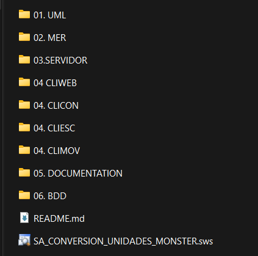

*_Figura SEQ Figura \* ARABIC 1 Estructura de carpetas del proyecto_*

1.2 CREACIÓN DE PROYECTO SERVIDOR

Abrir el IDE Visual Studio 2022 y en la pantalla inicial seleccione el botón inferior izquierdo “Crear un proyecto”.

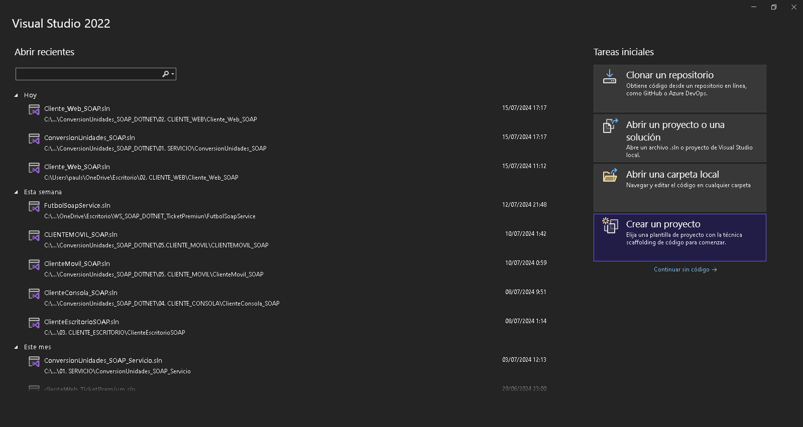

*_Figura 16. Crear nuevo proyecto._*

En la siguiente pantalla se debe elegir al tipo de proyecto como “Biblioteca de Servicios WCF”

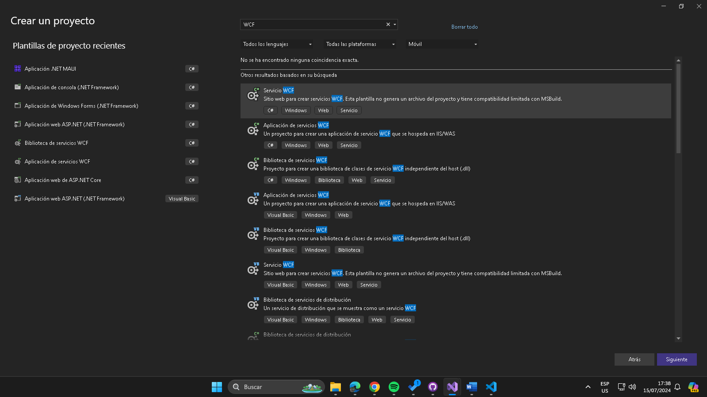

*_Figura 17. Selección de tipo de proyecto._*

Lo siguiente será seleccionar el nombre del proyecto y la ubicación del mismo, la ubicación no importará en general y quedará a cuestión de cada persona, en cuanto al nombre de preferencia llamarlo “Proyecto BDD Servidor_Dotnet SOAP_G04” siendo # el número de grupo al cual pertenece.

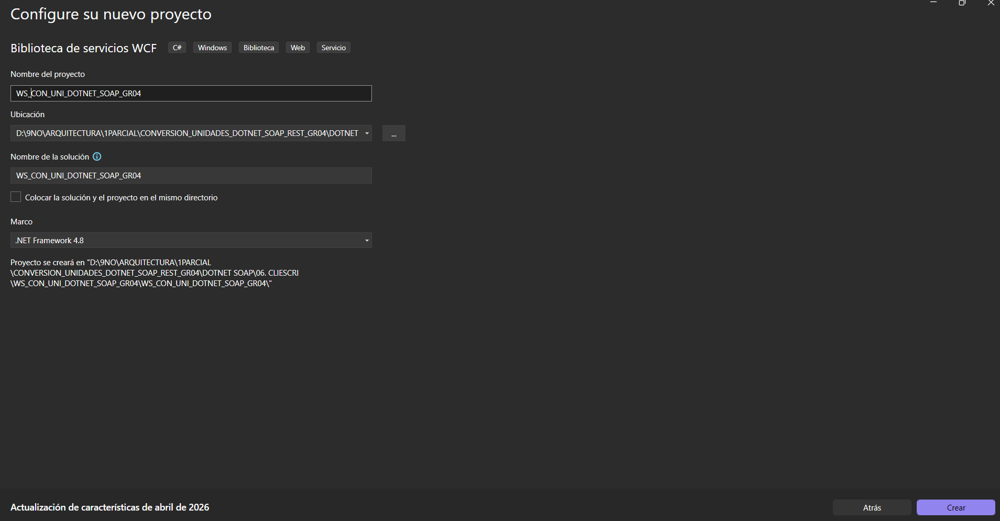

*_Figura 18. Nombre y ubicación del proyecto._*

A continuación, deberá seleccionar algunas opciones de configuración del proyecto y del servidor en donde se ejecutará el proyecto una vez este sea desplegado, primero se elegirá la versión del framework .NET el cual será la versión 6.0 para mayor compatibilidad y luego se desmarca la opción Configurar para HTTPS.

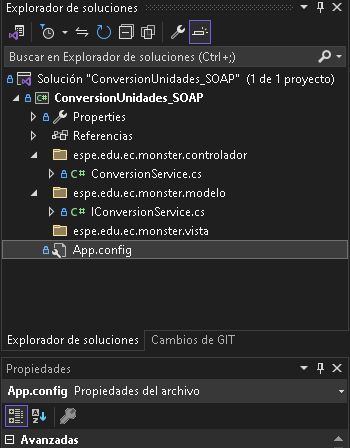

*_Figura 20. Estructura inicial de proyecto._*

#### 1.2.2 ESTRUCTURA MVC

Posteriormente será necesario crear 3 carpetas para los Controladores y Modelos en el proyecto esto lo puede lograr dando clic derecho en el proyecto, luego seleccionar “Agregar” y finalmente “Nueva Carpeta”. Debido a que se está realizando una API Restful no se va a crear una vista.

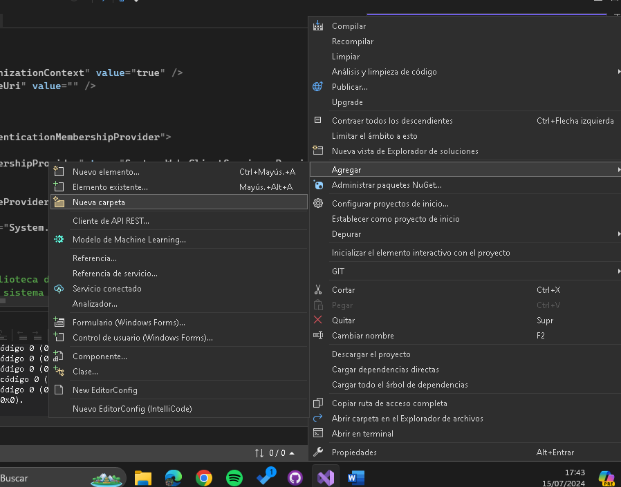

*_Figura 21. Creación de carpetas_*

Cada carpeta contendrá cada una de las partes del modelo MVC y tendrán archivos y clases que se encargaran de cumplir las funciones de cada componente, es decir el modelo actuando como clases de la base y su correspondiente acceso y consultas, el controlador respondiendo o órdenes de la vista y ejecutándolas en el modelo y la vista que será la presentación al usuario, por ello a cada uno de los paquetes colocar el nombre de cada uno de los componentes, a manera del siguiente formato, ec.edu.monster.(modelo-vista-controlador).

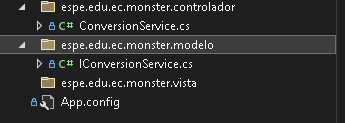

*_Figura 22. Nombre de carpetas._*

Al finalizar deberá tener la siguiente estructura en su proyecto.

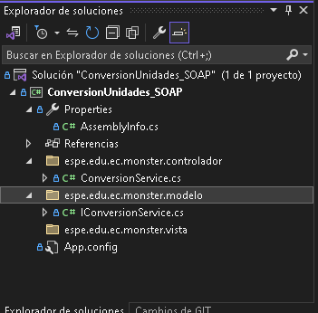

*_Figura 23. Estructura del proyecto._*

#### 1.2.3 CREACIÓN DE SERVICIOS

Tu proyecto es una Biblioteca de Servicios WCF. Esto significa que la lógica de servicio está implementada como una biblioteca que puede ser referenciada e instanciada por una aplicación de host. Aquí tienes el resumen de los archivos relevantes y su contenido para asegurar que tu biblioteca de servicios WCF esté correctamente implementada:

##### Archivo IServicioMonster.cs

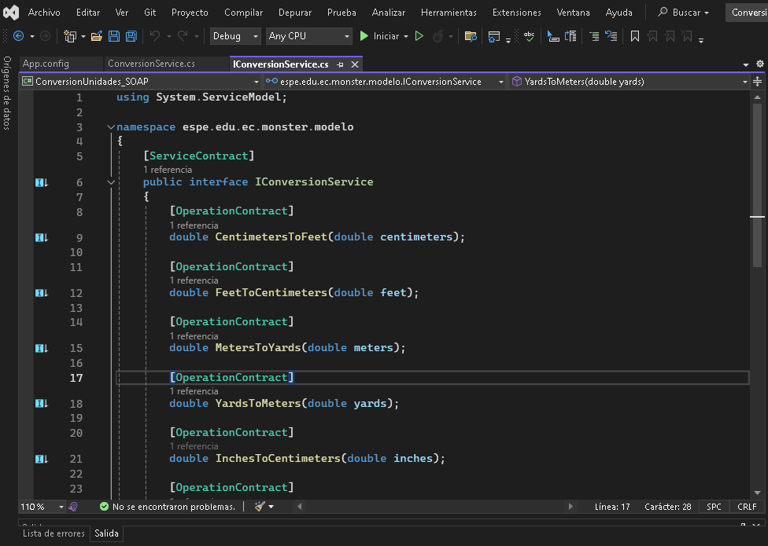

*_Figura 24. Creación de Interfaz IConversionService.cs_*

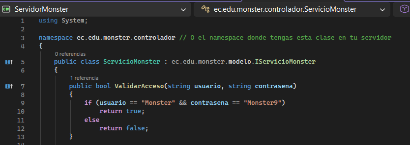

*_Figura 25. Creacion Clase ServicioMonster.cs_*

Finalmente en la siguiente ventana cambie la ruta y puerto donde se desplegara su servicio SOAP, esta parte cambiara acorde del entorno de ejecución en el cual quiera llevar su servicio, por el momento únicamente lo ejecutaremos en un ambiente local (localhost:8733)

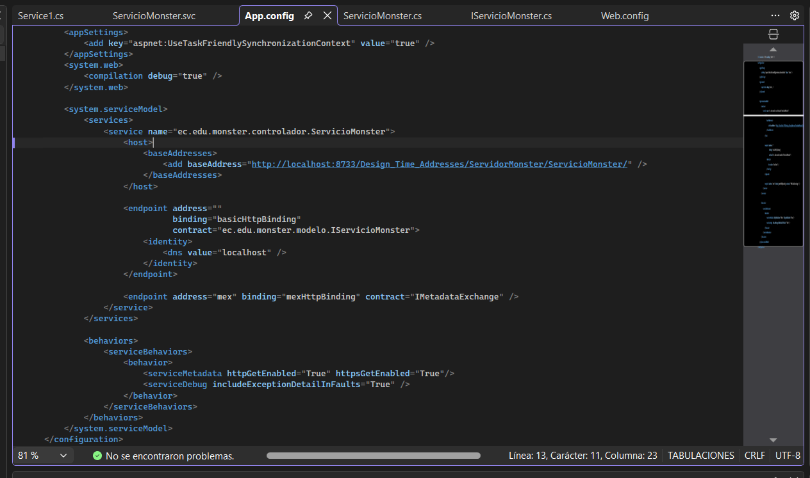

*_Figura 26. Archivo App.Config._*

Finalmente le quedará una estructura similar a la siguiente.

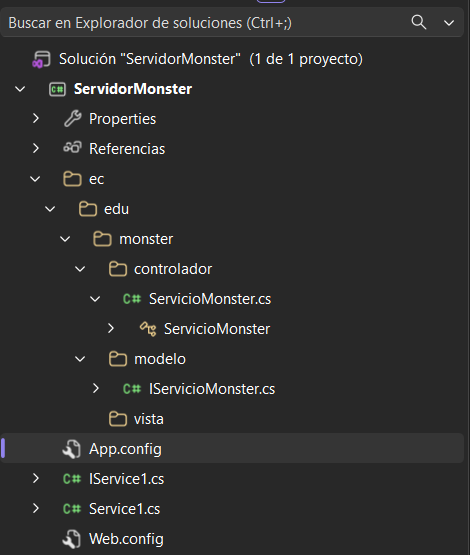

*_Figura 27. Estructura del proyecto._*

Tabla 3 Código IServicioMonster.cs

| using System.ServiceModel;namespace ec.edu.monster.modelo{ [ServiceContract] public interface IServicioMonster { [OperationContract] bool ValidarAcceso(string usuario, string contrasena); // --- MASA --- [OperationContract] double GramosAKilogramos(double valor); [OperationContract] double KilogramosALibras(double valor); [OperationContract] double LibrasAOnzas(double valor); [OperationContract] double ToneladasAKilogramos(double valor); [OperationContract] double OnzasAGramos(double valor); // --- TEMPERATURA --- [OperationContract] double CelsiusAFahrenheit(double valor); [OperationContract] double FahrenheitACelsius(double valor); [OperationContract] double CelsiusAKelvin(double valor); [OperationContract] double KelvinACelsius(double valor); [OperationContract] double FahrenheitAKelvin(double valor); // --- LONGITUD --- [OperationContract] double MetrosAKilometros(double valor); [OperationContract] double KilometrosAMillas(double valor); [OperationContract] double MetrosAPies(double valor); [OperationContract] double PiesAPulgadas(double valor); [OperationContract] double CentimetrosAMetros(double valor); }} |
| --- |

Tabla 4 Código ServicioMonster.cs

| using System;namespace ec.edu.monster.controlador // O el namespace donde tengas esta clase en tu servidor{ public class ServicioMonster : ec.edu.monster.modelo.IServicioMonster { public bool ValidarAcceso(string usuario, string contrasena) { if (usuario == "Monster" && contrasena == "Monster9") return true; else return false; } // ========================================== // --- MASA --- // ========================================== public double GramosAKilogramos(double valor) { return valor / 1000.0; } public double KilogramosALibras(double valor) { return valor * 2.20462; } public double LibrasAOnzas(double valor) { return valor * 16.0; } public double ToneladasAKilogramos(double valor) { return valor * 1000.0; } public double OnzasAGramos(double valor) { return valor * 28.3495; } // ========================================== // --- TEMPERATURA --- // ========================================== public double CelsiusAFahrenheit(double valor) { return (valor * 9.0 / 5.0) + 32.0; } public double FahrenheitACelsius(double valor) { return (valor - 32.0) * 5.0 / 9.0; } public double CelsiusAKelvin(double valor) { return valor + 273.15; } public double KelvinACelsius(double valor) { return valor - 273.15; } public double FahrenheitAKelvin(double valor) { return (valor - 32.0) * 5.0 / 9.0 + 273.15; } // ========================================== // --- LONGITUD --- // ========================================== public double MetrosAKilometros(double valor) { return valor / 1000.0; } public double KilometrosAMillas(double valor) { return valor / 1.60934; } public double MetrosAPies(double valor) { return valor * 3.28084; } public double PiesAPulgadas(double valor) { return valor * 12.0; } public double CentimetrosAMetros(double valor) { return valor / 100.0; } }} |
| --- |

Tabla 5 Código App.Config

| <?xml version="1.0" encoding="utf-8" ?><configuration><appSettings><add key="aspnet:UseTaskFriendlySynchronizationContext" value="true" /></appSettings><system.web><compilation debug="true" /></system.web><system.serviceModel><services><service name="ec.edu.monster.controlador.ServicioMonster"><host><baseAddresses><add baseAddress="http://localhost:8733/Design_Time_Addresses/ServidorMonster/ServicioMonster/" /></baseAddresses></host><endpoint address="" binding="basicHttpBinding" contract="ec.edu.monster.modelo.IServicioMonster"><identity><dns value="localhost" /></identity></endpoint><endpoint address="mex" binding="mexHttpBinding" contract="IMetadataExchange" /></service></services><behaviors><serviceBehaviors><behavior><serviceMetadata httpGetEnabled="True" httpsGetEnabled="True"/><serviceDebug includeExceptionDetailInFaults="True" /></behavior></serviceBehaviors></behaviors></system.serviceModel></configuration> |
| --- |

#### 1.2.6 TESTING DE SERVICIO

Una vez se ha desarrollado el servicio web o WebService deberá probar el servicio para validar su correcto funcionamiento y además validar sus resultados.

Debe dirigirse a la parte posterior de Visual Studio y dar click en el botón verde para ejecutar la aplicación.

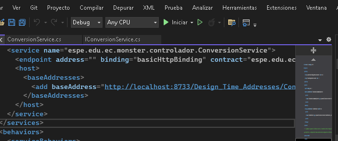

*_Figura 40. Despliegue de la aplicación._*

Una vez ejecutado, se podrá visualizar el cuadro de WCF con la información principal del servicio SOAP, el cual contiene, la dirección donde se almacena el servicio y sus métodos.

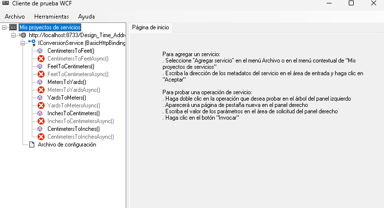

*_Figura 41. Cuadro WCF_*

Adicional podemos navegar dentro del formato XML del servicio copiando y pegando al dirección del servicio en cualquier navegador:

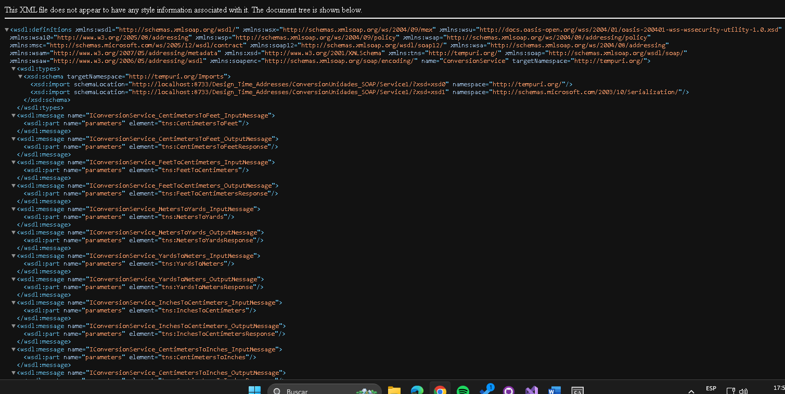

*_Figura 42. Archivo XML del servicio SOAP_*

Por último, se puede probar otra API en el navegador ingresando la URI, por ejemplo para el servicio de conversión de unidades.

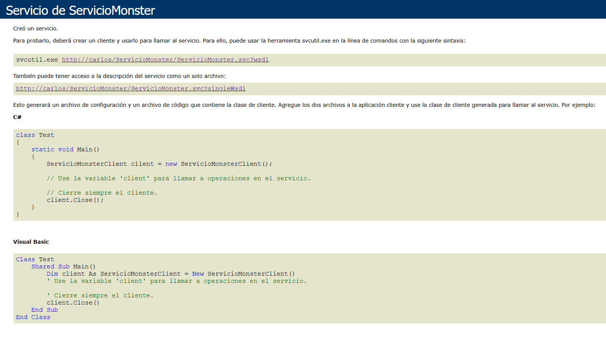

*_Figura 43. Pantalla de prueba de API en navegador._*

1.3 CREACIÓN DE PROYECTO CLIENTE EN CONSOLA

#### 1.3.1 CREACIÓN DEL PROYECTO

Para crear el cliente de la aplicación se debe abrir el IDE Visual Studio 2022 y seleccionar “Crear Proyecto”.

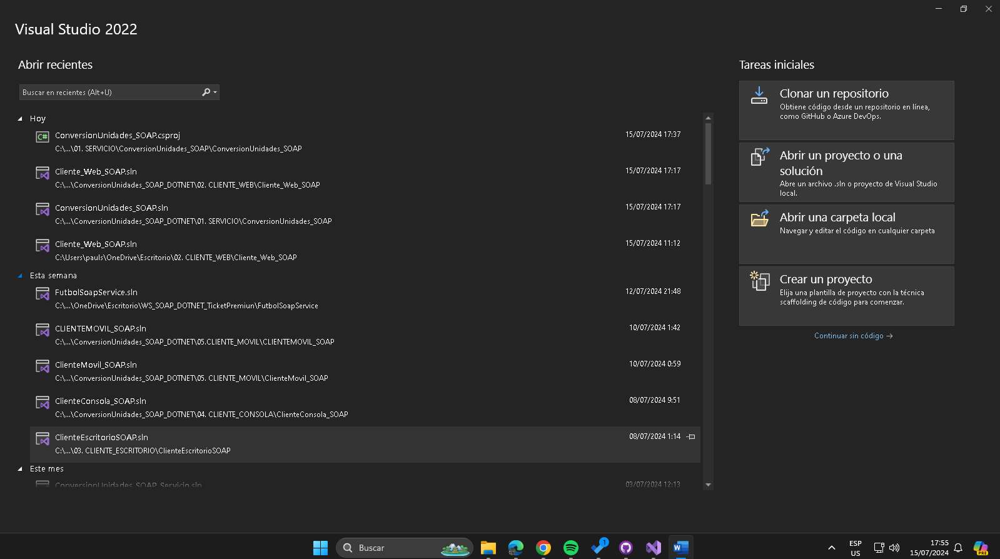

*_Figura 44. Crear nuevo proyecto._*

En la siguiente pantalla buscar el tipo de proyecto “Aplicación de consola .NET Framework” para crear la aplicación y se da en siguiente.

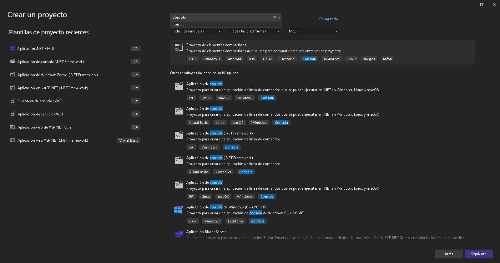

*_Figura 45. Selección de tipo de proyecto cliente._*

Lo siguiente será seleccionar el nombre del proyecto y la ubicación del mismo, la ubicación del proyecto en este caso deberá estar en el mismo disco del proyecto anterior para facilitar la ubicación de un archivo necesario para este proyecto que será consumido, en cuanto al nombre de preferencia llamarlo “Cliente Consola_SOAP_G04” siendo # el número de grupo al cual pertenece. Paso siguiente de clic en el botón “Crear”.

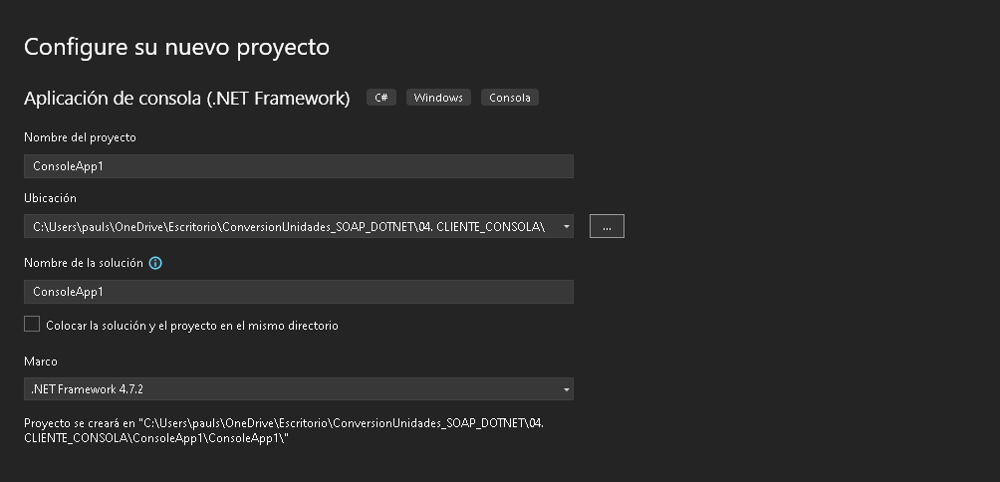

*_Figura 46. Nombre y ubicación del proyecto._*

Verifique una vez creado el proyecto que este contenga la siguiente estructura.

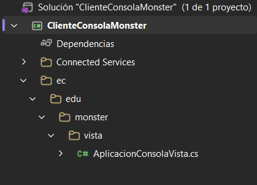

*_Figura 47. Estructura inicial de proyecto._*

#### 1.3.3 CREACIÓN Y CODIFICACIÓN DE ARCHIVOS DEL MODELO

En el modelo se deberán crear las mismas 3 clases correspondientes a las entidades de la base de datos.

Para ello primero abra el paquete modelo que fue creado con anterioridad y de clic derecho para desplegar el menú, luego presione en “Agregar” y luego en “Clase”.

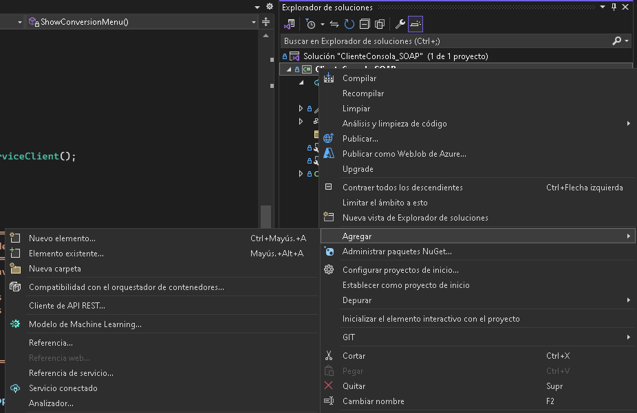

*_Figura 51. Creación de una nueva clase._*

Al finalizar se tendrá que colocar las propiedades correspondientes de la entidad como variables en la clase de la siguiente forma.

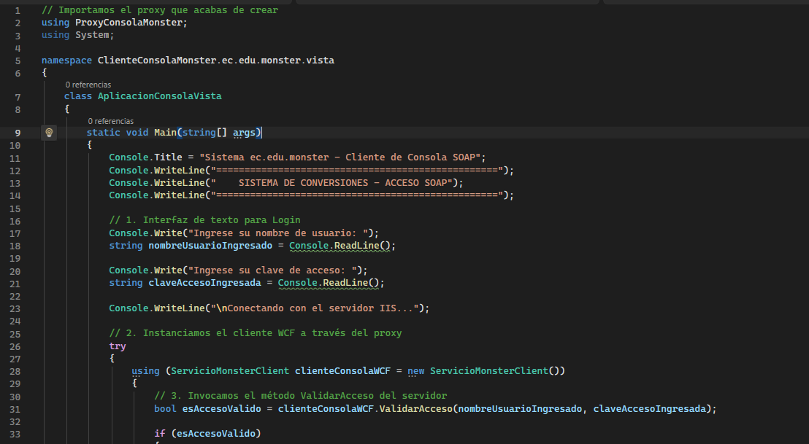

*_Figura 53. Inserción de código en el archivo modelo_*

Tabla 7 Código AplicacionConsola.cs

| // Importamos el proxy que acabas de crearusing ProxyConsolaMonster;using System;namespace ClienteConsolaMonster.ec.edu.monster.vista{ class AplicacionConsolaVista { static void Main(string[] args) { Console.Title = "Sistema ec.edu.monster - Cliente de Consola SOAP"; Console.WriteLine("=================================================="); Console.WriteLine(" SISTEMA DE CONVERSIONES - ACCESO SOAP"); Console.WriteLine("=================================================="); // 1. Interfaz de texto para Login Console.Write("Ingrese su nombre de usuario: "); string nombreUsuarioIngresado = Console.ReadLine(); Console.Write("Ingrese su clave de acceso: "); string claveAccesoIngresada = Console.ReadLine(); Console.WriteLine("\nConectando con el servidor IIS..."); // 2. Instanciamos el cliente WCF a través del proxy try { using (ServicioMonsterClient clienteConsolaWCF = new ServicioMonsterClient()) { // 3. Invocamos el método ValidarAcceso del servidor bool esAccesoValido = clienteConsolaWCF.ValidarAcceso(nombreUsuarioIngresado, claveAccesoIngresada); if (esAccesoValido) { Console.ForegroundColor = ConsoleColor.Green; Console.WriteLine("\n[+] ACCESO CONCEDIDO. Bienvenido a la red institucional."); Console.ResetColor(); Console.WriteLine("Presione Enter para continuar al menú principal..."); Console.ReadLine(); // --- INICIO DEL MENÚ INTERACTIVO --- bool mantenerSesionActivaSistema = true; while (mantenerSesionActivaSistema) { Console.Clear(); Console.WriteLine("=================================================="); Console.WriteLine(" SISTEMA CENTRAL DE CONVERSIONES WCF "); Console.WriteLine("=================================================="); Console.WriteLine("1. Operaciones de Masa"); Console.WriteLine("2. Operaciones de Temperatura"); Console.WriteLine("3. Operaciones de Longitud"); Console.WriteLine("4. Cerrar Sesión"); Console.WriteLine("=================================================="); Console.Write("Seleccione una categoría [1-4]: "); string opcionMenuPrincipalSeleccionada = Console.ReadLine() ?? ""; switch (opcionMenuPrincipalSeleccionada) { case "1": // MASA Console.WriteLine("\n--- CONVERSIONES DE MASA ---"); Console.WriteLine("1. Gramos a Kilogramos"); Console.WriteLine("2. Kilogramos a Libras"); Console.WriteLine("3. Libras a Onzas"); Console.WriteLine("4. Toneladas a Kilogramos"); Console.WriteLine("5. Onzas a Gramos"); Console.Write("Seleccione la operación específica [1-5]: "); string opcionSubMenuMasa = Console.ReadLine() ?? ""; Console.Write("Ingrese el valor numérico a convertir: "); // Convertimos el texto a número decimal (double) double valorIngresadoPorUsuario = Convert.ToDouble(Console.ReadLine()); double resultadoCalculadoServidor = 0; // Evaluamos la opción elegida if (opcionSubMenuMasa == "1") { // Usamos .Result porque el proxy asíncrono lo requiere resultadoCalculadoServidor = clienteConsolaWCF.GramosAKilogramosAsync(valorIngresadoPorUsuario).Result; Console.WriteLine($"\n[RESULTADO DESDE IIS]: {valorIngresadoPorUsuario} g = {resultadoCalculadoServidor} kg"); } else if (opcionSubMenuMasa == "2") { resultadoCalculadoServidor = clienteConsolaWCF.KilogramosALibrasAsync(valorIngresadoPorUsuario).Result; Console.WriteLine($"\n[RESULTADO DESDE IIS]: {valorIngresadoPorUsuario} kg = {resultadoCalculadoServidor} lb"); } // AQUÍ AGREGAS LOS ELSE IF FALTANTES DE MASA... break; case "2": // TEMPERATURA Console.WriteLine("\n--- CONVERSIONES DE TEMPERATURA ---"); // AQUÍ PONES TU MENÚ DE TEMPERATURA... break; case "3": // LONGITUD Console.WriteLine("\n--- CONVERSIONES DE LONGITUD ---"); // AQUÍ PONES TU MENÚ DE LONGITUD... break; case "4": // SALIR mantenerSesionActivaSistema = false; Console.WriteLine("\nCerrando sesión de forma segura..."); break; default: Console.ForegroundColor = ConsoleColor.Yellow; Console.WriteLine("\n[!] Opción no reconocida. Intente nuevamente."); Console.ResetColor(); break; } if (mantenerSesionActivaSistema) { Console.WriteLine("\nPresione cualquier tecla para volver al menú principal..."); Console.ReadKey(); } } // --- FIN DEL MENÚ INTERACTIVO --- } else { Console.ForegroundColor = ConsoleColor.Red; Console.WriteLine("\n[-] ACCESO DENEGADO. Credenciales incorrectas."); Console.ResetColor(); } } } catch (Exception ex) { Console.ForegroundColor = ConsoleColor.Red; Console.WriteLine("\n[!] Error de conexión con el servidor SOAP: " + ex.Message); Console.ResetColor(); } Console.WriteLine("\n=================================================="); Console.WriteLine("Presione cualquier tecla para salir..."); Console.ReadKey(); } }} |
| --- |

#### 1.3.5 CREACIÓN Y CODIDIFICACIÓN DE SERVICIO SOAP

De click derecho sobre el proyecto, navegue hasta donde diga Agregar y selección Referencia de Servicio:

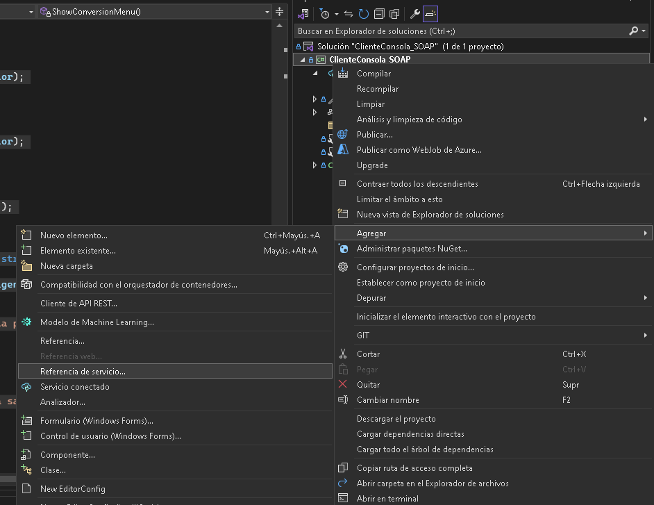

*_Figura 66. Referencia Servicio._*

En la ventana siguiente se debe asignar el nombre al archivo como “FederacionFutbolVista.cs”.

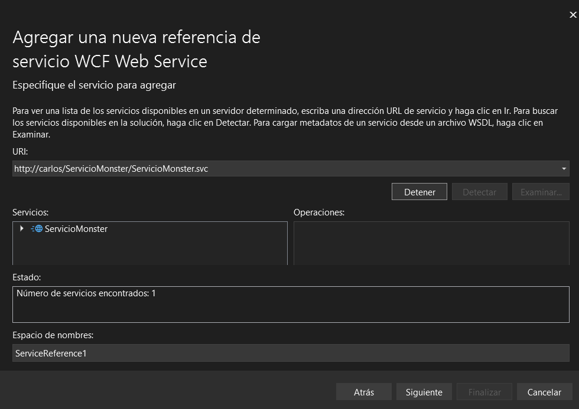

*_Figura 67. Creación del la referencia al servicio SOAP_*

Copie y pegue el link de la dirección del servicio SOAP, de click en Ir o Detectar y una vez se haya reconocido al servicio SOAP guárdelo con el nombre de “ProxyConsolaMonster” y de click en Aceptar. Una vez verificado podrá acceder a cada uno de los Metodos del Servicio SOAP y probar su funcionalidad.

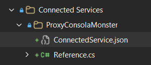

*_Figura 68. Verificar existencia del servicio SOAP en el proyecto_*

1.4 CREACIÓN DE PROYECTO CLIENTE EN ESCRITORIO

#### 1.4.1 CREACIÓN DEL PROYECTO

Para crear el cliente de la aplicación se debe abrir el IDE Visual Studio 2022 y seleccionar “Crear Proyecto”.

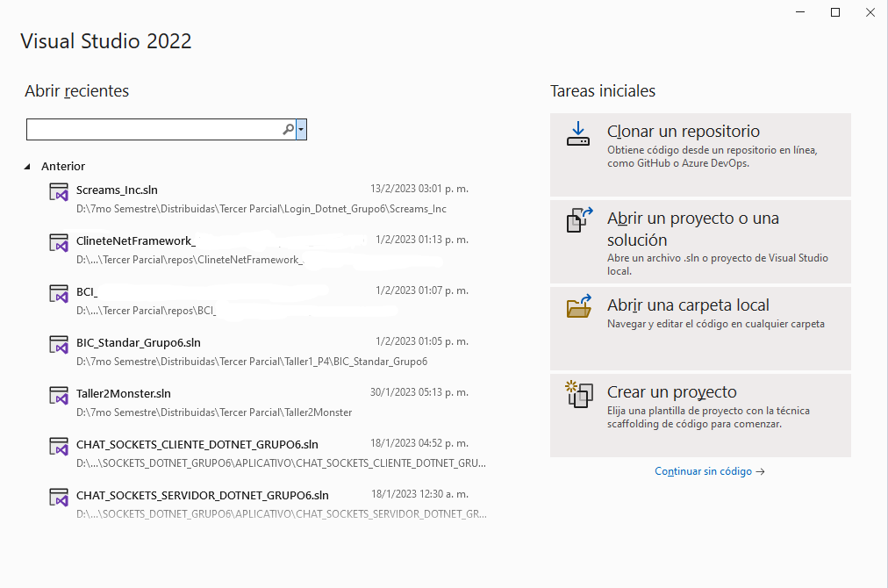

*_Figura 70. Crear nuevo proyecto._*

En la siguiente pantalla buscar el tipo de proyecto “Aplicación de Windows Forms .NET Framework” para crear la aplicación y se da en siguiente.

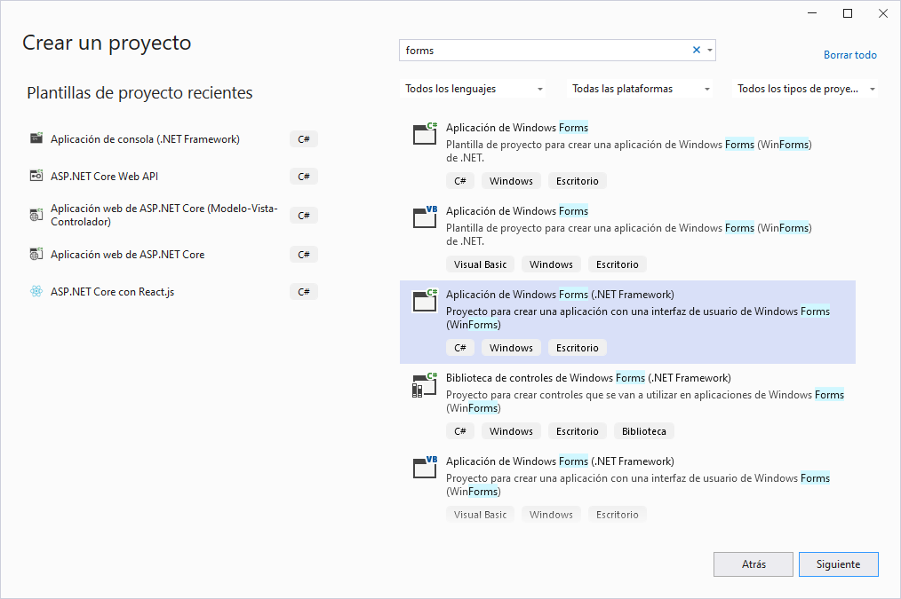

*_Figura 71. Selección de tipo de proyecto cliente._*

Lo siguiente será seleccionar el nombre del proyecto y la ubicación del mismo, la ubicación del proyecto en este caso deberá estar en el mismo disco del proyecto anterior para facilitar la ubicación de un archivo necesario para este proyecto que será consumido, en cuanto al nombre de preferencia llamarlo “Proyecto BDD Cliente Escritorio_Dotnet Rest_G#” siendo # el número de grupo al cual pertenece. Paso siguiente de clic en el botón “Crear”.

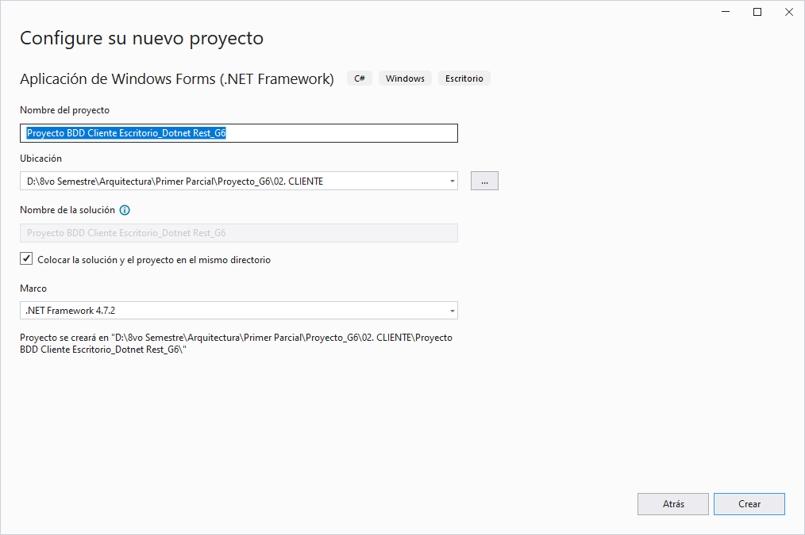

*_Figura 72. Nombre y ubicación del proyecto._*

Verifique una vez creado el proyecto que este contenga la siguiente estructura.

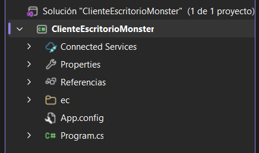

*_Figura 73. Estructura inicial de proyecto._*

#### 1.4.2 ESTRUCTURA MVC

Posteriormente será necesario crear 3 carpetas para los Controladores y Modelos en el proyecto esto lo puede lograr dando clic derecho en el proyecto, luego seleccionar “Agregar” y finalmente “Nueva Carpeta”.

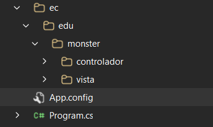

*_Figura 74. Creación de carpetas_*

Cada carpeta contendrá cada una de las partes del modelo MVC y tendrán archivos y clases que se encargaran de cumplir las funciones de cada componente, es decir el modelo actuando como clases de la base y su correspondiente acceso y consultas, el controlador respondiendo o órdenes de la vista y ejecutándolas en el modelo y la vista que será la presentación al usuario, por ello a cada uno de los paquetes colocar el nombre de cada uno de los componentes, en este caso los nombres de las carpetas seguirán el formato por ec.edu.monster.(vista, modelo, controlador).

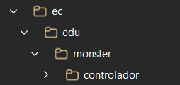

*_Figura 75. Nombre de carpetas._*

Al finalizar deberá tener la siguiente estructura en su proyecto.

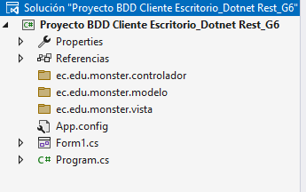

*_Figura 76. Estructura del proyecto._*

#### 1.4.4 CREACIÓN Y CODIFICACIÓN DE ARCHIVOS DE CONTROLADOR

Abra el paquete controlador que fue creado con anterioridad y de clic derecho para desplegar el menú, luego presione en “Agregar” y luego en “Clase”.

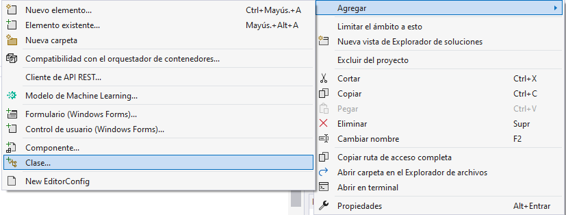

*_Figura 89. Creación de una nueva clase._*

En la ventana siguiente coloque como nombre de la clase “FederacionFutbolControlador.cs” y de clic en “Agregar”. El nombre se lo asigna para mantener una estructura ordenada en la vista.

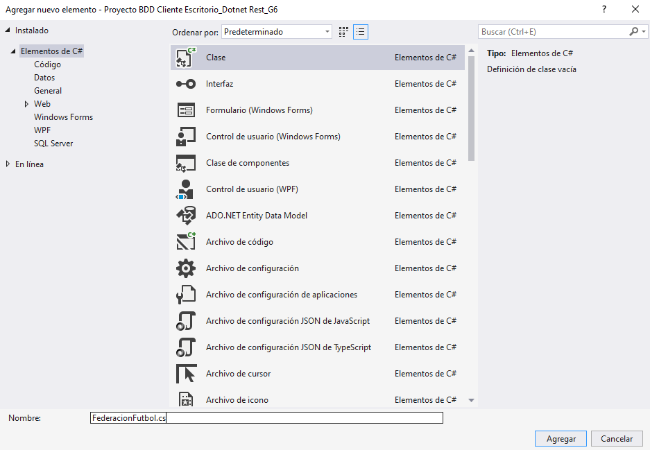

*_Figura 90. Creación del archivo FederacionFutbolControlador.cs_*

Al finalizar se tendrá que llamar a la API que se desarrolló en el servidor y se asigna a una variable para enviarla a la vista, así mismo se debe controlar las excepciones en caso de recibir una respuesta de error de parte del servidor.

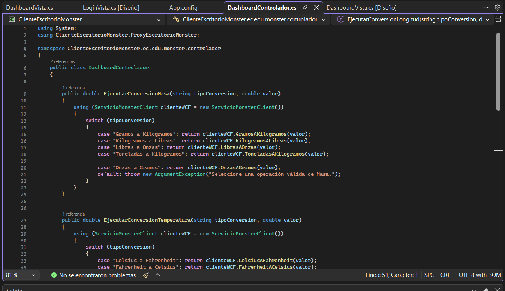

*_Figura 91. Codificación del archivo controlador_*

Nota: Cabe destacar que se debe reemplazar la IP de la URI por la de su computadora servidor o colocar “Localhost” en caso de querer una ejecución local.

Tabla 18 Código FederacionFutbolControlador.cs

| using System;using ClienteEscritorioMonster.ProxyEscritorioMonster;namespace ClienteEscritorioMonster.ec.edu.monster.controlador{ public class DashboardControlador { public double EjecutarConversionMasa(string tipoConversion, double valor) { using (ServicioMonsterClient clienteWCF = new ServicioMonsterClient()) { switch (tipoConversion) { case "Gramos a Kilogramos": return clienteWCF.GramosAKilogramos(valor); case "Kilogramos a Libras": return clienteWCF.KilogramosALibras(valor); case "Libras a Onzas": return clienteWCF.LibrasAOnzas(valor); case "Toneladas a Kilogramos": return clienteWCF.ToneladasAKilogramos(valor); case "Onzas a Gramos": return clienteWCF.OnzasAGramos(valor); default: throw new ArgumentException("Seleccione una operación válida de Masa."); } } } public double EjecutarConversionTemperatura(string tipoConversion, double valor) { using (ServicioMonsterClient clienteWCF = new ServicioMonsterClient()) { switch (tipoConversion) { case "Celsius a Fahrenheit": return clienteWCF.CelsiusAFahrenheit(valor); case "Fahrenheit a Celsius": return clienteWCF.FahrenheitACelsius(valor); case "Celsius a Kelvin": return clienteWCF.CelsiusAKelvin(valor); case "Kelvin a Celsius": return clienteWCF.KelvinACelsius(valor); case "Fahrenheit a Kelvin": return clienteWCF.FahrenheitAKelvin(valor); default: throw new ArgumentException("Seleccione una operación válida de Temperatura."); } } } public double EjecutarConversionLongitud(string tipoConversion, double valor) { using (ServicioMonsterClient clienteWCF = new ServicioMonsterClient()) { switch (tipoConversion) { case "Metros a Kilometros": return clienteWCF.MetrosAKilometros(valor); case "Kilometros a Millas": return clienteWCF.KilometrosAMillas(valor); case "Metros a Pies": return clienteWCF.MetrosAPies(valor); case "Pies a Pulgadas": return clienteWCF.PiesAPulgadas(valor); case "Centimetros a Metros": return clienteWCF.CentimetrosAMetros(valor); default: throw new ArgumentException("Seleccione una operación válida de Longitud."); } } } }} |
| --- |

#### 1.4.5 CREACIÓN Y CODIDIFICACIÓN DE ARCHIVOS DE LA VISTA

Abra el paquete de la vista que fue creado con anterioridad y de clic derecho para desplegar el menú, presione en “Agregar” y luego en “Formulario”.

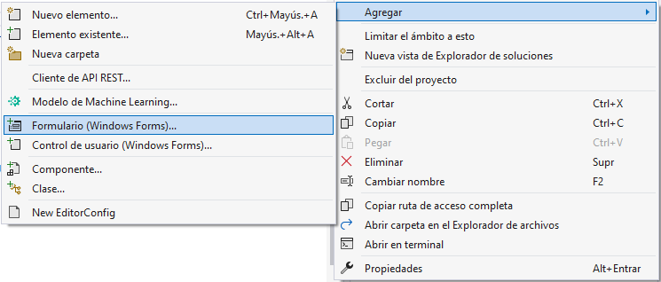

*_Figura 92. Creación de un nuevo formulario._*

En la ventana siguiente se debe asignar el nombre al archivo como “MenuPrincipal”.

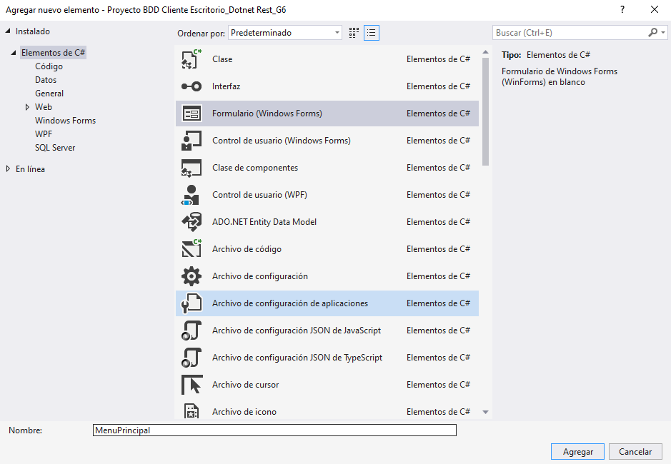

*_Figura 93. Creación del archivo MenuPrincipal.cs_*

Una vez creado se debe colocar los elementos del formulario en la interfaz gráfica, la misma deberá verse de la siguiente forma, colocándose en la misma botones para la navegación por el sistema.

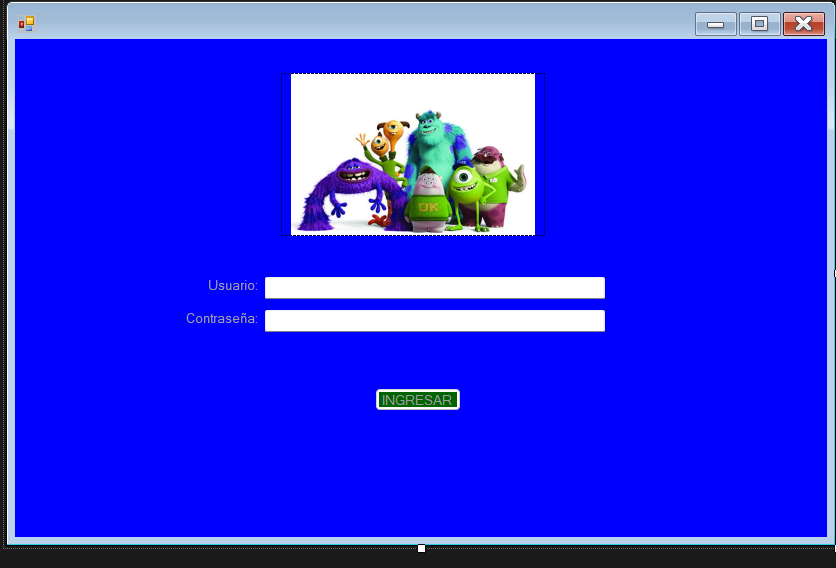

*_Figura 94. Diseño del formulario MenuPrincipal.cs_*

Una vez diseñado el formulario se debe codificar la funcionalidad de los botones de la pantalla, para ello se debe dar doble clic en los botones que van a tener codificación y se coloca el siguiente código.

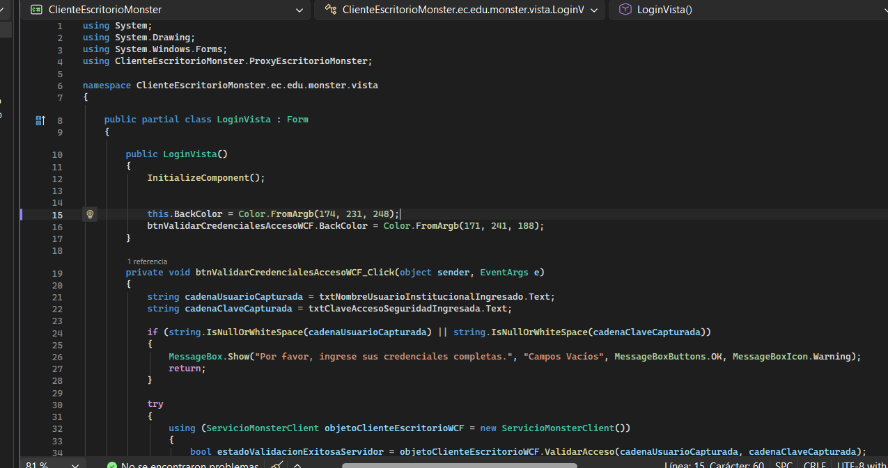

*_Figura 95. Codificación del archivo MenuPrincipal.cs_*

Tabla 19 Código MenuPrincipal.cs

| using System;using System.Drawing;using System.Windows.Forms;using ClienteEscritorioMonster.ProxyEscritorioMonster;namespace ClienteEscritorioMonster.ec.edu.monster.vista{ public partial class LoginVista : Form { public LoginVista() { InitializeComponent(); this.BackColor = Color.FromArgb(174, 231, 248); btnValidarCredencialesAccesoWCF.BackColor = Color.FromArgb(171, 241, 188); } private void btnValidarCredencialesAccesoWCF_Click(object sender, EventArgs e) { string cadenaUsuarioCapturada = txtNombreUsuarioInstitucionalIngresado.Text; string cadenaClaveCapturada = txtClaveAccesoSeguridadIngresada.Text; if (string.IsNullOrWhiteSpace(cadenaUsuarioCapturada) // string.IsNullOrWhiteSpace(cadenaClaveCapturada)) { MessageBox.Show("Por favor, ingrese sus credenciales completas.", "Campos Vacíos", MessageBoxButtons.OK, MessageBoxIcon.Warning); return; } try { using (ServicioMonsterClient objetoClienteEscritorioWCF = new ServicioMonsterClient()) { bool estadoValidacionExitosaServidor = objetoClienteEscritorioWCF.ValidarAcceso(cadenaUsuarioCapturada, cadenaClaveCapturada); if (estadoValidacionExitosaServidor) { MessageBox.Show("¡Acceso concedido!", "Ingreso Exitoso", MessageBoxButtons.OK, MessageBoxIcon.Information); DashboardVista formularioDashboard = new DashboardVista(); formularioDashboard.Show(); this.Hide(); } else { MessageBox.Show("Credenciales incorrectas. Verifique e intente nuevamente.", "Acceso Denegado", MessageBoxButtons.OK, MessageBoxIcon.Error); txtClaveAccesoSeguridadIngresada.Clear(); txtNombreUsuarioInstitucionalIngresado.Focus(); } } } catch (Exception excepcionServidorWCF) { MessageBox.Show("Fallo de comunicación con el IIS: " + excepcionServidorWCF.Message, "Error Crítico de Red", MessageBoxButtons.OK, MessageBoxIcon.Error); } } private void button1_Click(object sender, EventArgs e) { } private void label1_Click(object sender, EventArgs e) { } private void btnValidarCredencialesAccesoWCF_Load(object sender, EventArgs e) { } }} |
| --- |

Ahora se debe crear la vista para la vista de los partidos, para ello abra el paquete de la vista que fue creado con anterioridad y de clic derecho para desplegar el menú, presione en “Agregar” y luego en “Formulario”.

*_Figura 96. Creación de un nuevo formulario._*

En la ventana siguiente se debe asignar el nombre al archivo como “DashboardVista”.

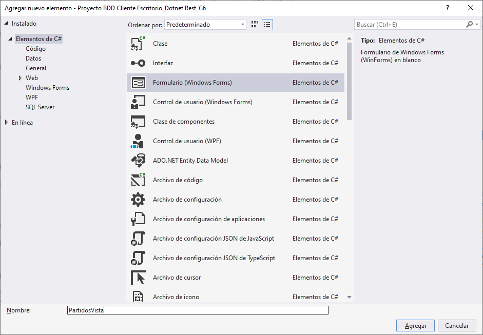

*_Figura 97. Creación del archivo DashboardVista.cs_*

Una vez creado se debe colocar los elementos del formulario en la interfaz gráfica, la misma deberá verse de la siguiente forma, colocándose en la misma dos DataGridView para el despliegue de la información de los partidos y sus localidades y botones para controlar ciertas funcionalidades como la compra o reportes.

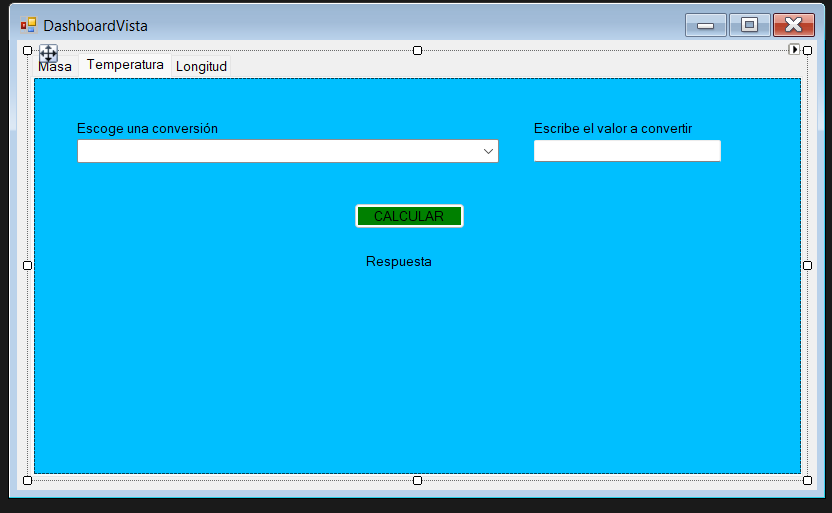

*_Figura 98. Diseño del formulario PartidosVista.cs_*

Una vez diseñado el formulario se debe codificar la funcionalidad de los botones de la pantalla, para ello se debe dar doble clic en los botones que van a tener codificación y se coloca el siguiente código.

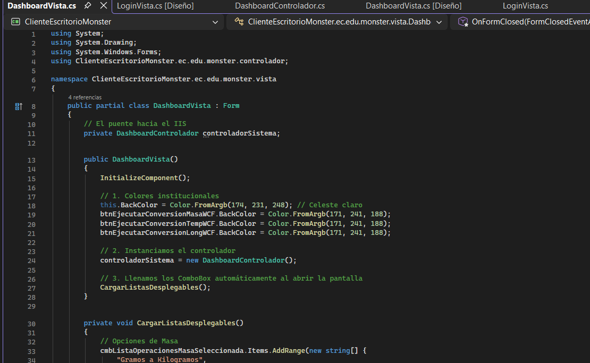

*_Figura 99. Codificación del archivo PartidosVista.cs_*

Tabla 20 Código PartidosVista.cs

| using System;using System.Drawing;using System.Windows.Forms;using ClienteEscritorioMonster.ec.edu.monster.controlador;namespace ClienteEscritorioMonster.ec.edu.monster.vista{ public partial class DashboardVista : Form { // El puente hacia el IIS private DashboardControlador controladorSistema; public DashboardVista() { InitializeComponent(); // 1. Colores institucionales this.BackColor = Color.FromArgb(174, 231, 248); // Celeste claro btnEjecutarConversionMasaWCF.BackColor = Color.FromArgb(171, 241, 188); btnEjecutarConversionTempWCF.BackColor = Color.FromArgb(171, 241, 188); btnEjecutarConversionLongWCF.BackColor = Color.FromArgb(171, 241, 188); // 2. Instanciamos el controlador controladorSistema = new DashboardControlador(); // 3. Llenamos los ComboBox automáticamente al abrir la pantalla CargarListasDesplegables(); } private void CargarListasDesplegables() { // Opciones de Masa cmbListaOperacionesMasaSeleccionada.Items.AddRange(new string[] { "Gramos a Kilogramos", "Kilogramos a Libras", "Libras a Onzas", "Toneladas a Kilogramos", "Onzas a Gramos" }); cmbListaOperacionesMasaSeleccionada.SelectedIndex = 0; // Selecciona el primero por defecto // Opciones de Temperatura cmbListaOperacionesTempSeleccionada.Items.AddRange(new string[] { "Celsius a Fahrenheit", "Fahrenheit a Celsius", "Celsius a Kelvin", "Kelvin a Celsius", "Fahrenheit a Kelvin" }); cmbListaOperacionesTempSeleccionada.SelectedIndex = 0; // Opciones de Longitud cmbListaOperacionesLongSeleccionada.Items.AddRange(new string[] { "Metros a Kilometros", "Kilometros a Millas", "Metros a Pies", "Pies a Pulgadas", "Centimetros a Metros" }); cmbListaOperacionesLongSeleccionada.SelectedIndex = 0; } // ============================================== // EVENTO: BOTÓN MASA // ============================================== private void btnEjecutarConversionMasaWCF_Click(object sender, EventArgs e) { if (string.IsNullOrWhiteSpace(txtValorNumericoIngresadoMasa.Text)) return; try { double valor = Convert.ToDouble(txtValorNumericoIngresadoMasa.Text); string opcion = cmbListaOperacionesMasaSeleccionada.Text; double resultado = controladorSistema.EjecutarConversionMasa(opcion, valor); lblResultadoCalculoMasaSistema.Text = $"{valor} -> {resultado}"; } catch (FormatException) { MessageBox.Show("Ingrese solo números.", "Error", MessageBoxButtons.OK, MessageBoxIcon.Warning); } catch (Exception ex) { MessageBox.Show(ex.Message, "Error WCF", MessageBoxButtons.OK, MessageBoxIcon.Error); } } // ============================================== // EVENTO: BOTÓN TEMPERATURA // ============================================== private void btnEjecutarConversionTempWCF_Click(object sender, EventArgs e) { if (string.IsNullOrWhiteSpace(txtValorNumericoIngresadoTemp.Text)) return; try { double valor = Convert.ToDouble(txtValorNumericoIngresadoTemp.Text); string opcion = cmbListaOperacionesTempSeleccionada.Text; double resultado = controladorSistema.EjecutarConversionTemperatura(opcion, valor); lblResultadoCalculoTempSistema.Text = $"{valor} -> {resultado}"; } catch (FormatException) { MessageBox.Show("Ingrese solo números.", "Error", MessageBoxButtons.OK, MessageBoxIcon.Warning); } catch (Exception ex) { MessageBox.Show(ex.Message, "Error WCF", MessageBoxButtons.OK, MessageBoxIcon.Error); } } // ============================================== // EVENTO: BOTÓN LONGITUD // ============================================== private void btnEjecutarConversionLongWCF_Click(object sender, EventArgs e) { if (string.IsNullOrWhiteSpace(txtValorNumericoIngresadoLong.Text)) return; try { double valor = Convert.ToDouble(txtValorNumericoIngresadoLong.Text); string opcion = cmbListaOperacionesLongSeleccionada.Text; double resultado = controladorSistema.EjecutarConversionLongitud(opcion, valor); lblResultadoCalculoLongSistema.Text = $"{valor} -> {resultado}"; } catch (FormatException) { MessageBox.Show("Ingrese solo números.", "Error", MessageBoxButtons.OK, MessageBoxIcon.Warning); } catch (Exception ex) { MessageBox.Show(ex.Message, "Error WCF", MessageBoxButtons.OK, MessageBoxIcon.Error); } } // ============================================== // CERRAR APLICACIÓN // ============================================== protected override void OnFormClosed(FormClosedEventArgs e) { base.OnFormClosed(e); Application.Exit(); } private void cmbListaOperacionesTempSeleccionada_SelectedIndexChanged(object sender, EventArgs e) { } private void cmbListaOperacionesLongSeleccionada_SelectedIndexChanged(object sender, EventArgs e) { } private void tabPage2_Click(object sender, EventArgs e) { } private void cmbListaOperacionesMasaSeleccionada_SelectedIndexChanged(object sender, EventArgs e) { } }} |
| --- |

1.5 CREACIÓN DE PROYECTO CLIENTE WEB

#### 1.5.1 CREACIÓN DEL PROYECTO

Para crear el cliente de la aplicación se debe abrir el IDE Visual Studio 2022 y seleccionar “Crear Proyecto”.

*_Figura 118. Crear nuevo proyecto._*

En la siguiente pantalla buscar el tipo de proyecto “Aplicación Web ASP .Net Core” para crear la aplicación y se da en siguiente.

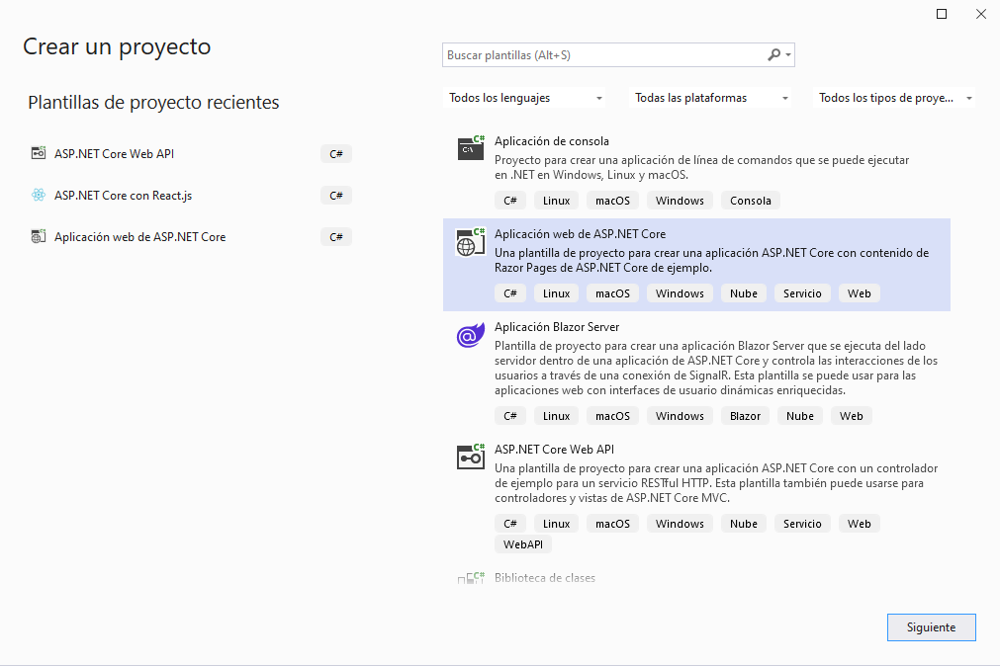

*_Figura 119. Selección de tipo de proyecto cliente._*

Lo siguiente será seleccionar el nombre del proyecto y la ubicación del mismo, la ubicación del proyecto en este caso deberá estar en el mismo disco del proyecto anterior para facilitar la ubicación de un archivo necesario para este proyecto que será consumido, en cuanto al nombre de preferencia llamarlo “Proyecto BD Cliente Web_Dotnet Rest_G#” siendo # el número de grupo al cual pertenece.

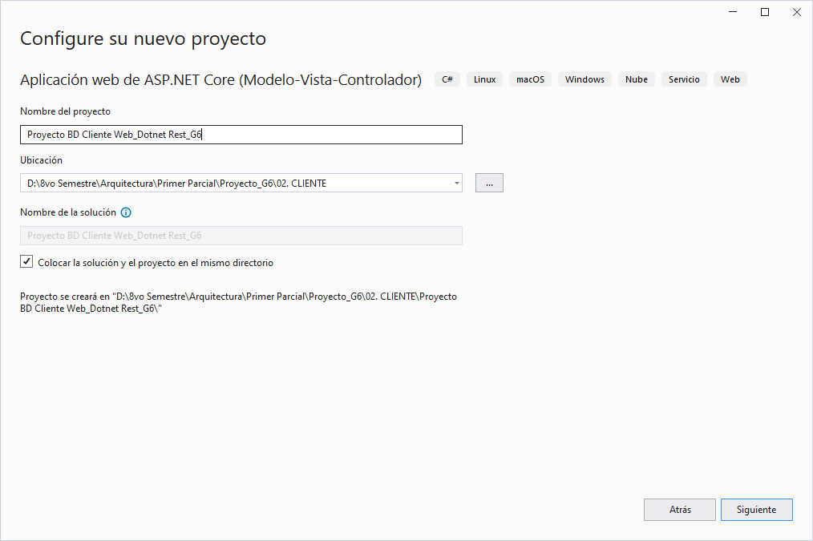

*_Figura 120. Nombre y ubicación del proyecto._*

A continuación, deberá seleccionar algunas opciones de configuración del proyecto y del servidor en donde se ejecutará el proyecto una vez este sea desplegado, primero se elegirá la versión del framework .NET el cual será la versión 6.0 para mayor compatibilidad y luego se desmarca la opción Configurar para HTTPS. Finalmente se presiona en “Crear”.

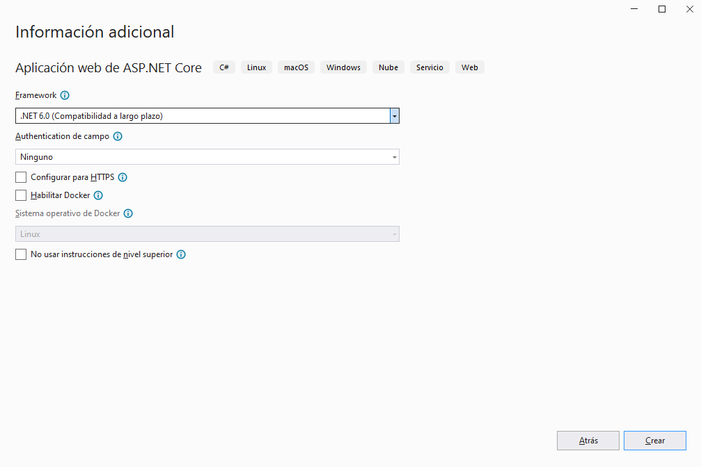

*_Figura 121. Selección de Framework._*

Verifique una vez creado el proyecto que este contenga la siguiente estructura.

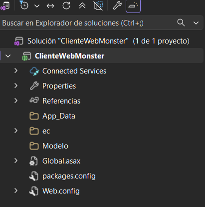

*_Figura 122. Estructura inicial de proyecto._*

#### 1.5.2 ESTRUCTURA MVC

Posteriormente será necesario crear 3 carpetas para los Controladores y Modelos en el proyecto esto lo puede lograr dando clic derecho en el proyecto, luego seleccionar “Agregar” y finalmente “Nueva Carpeta”.

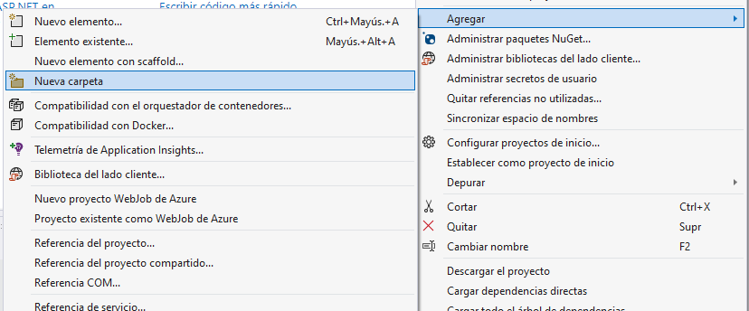

*_Figura 123. Creación de carpetas_*

Cada carpeta contendrá cada una de las partes del modelo MVC y tendrán archivos y clases que se encargaran de cumplir las funciones de cada componente, es decir el modelo actuando como clases de la base y su correspondiente acceso y consultas, el controlador respondiendo o órdenes de la vista y ejecutándolas en el modelo y la vista que será la presentación al usuario, por ello a cada uno de los paquetes colocar el nombre de cada uno de los componentes, en este caso se debe nombrar a la vista como “Vista”, al controlador como “Controlador” y al modelo como “Modelo”.

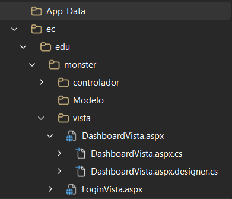

*_Figura 124. Nombre de carpetas._*

Al finalizar deberá tener la siguiente estructura en su proyecto.

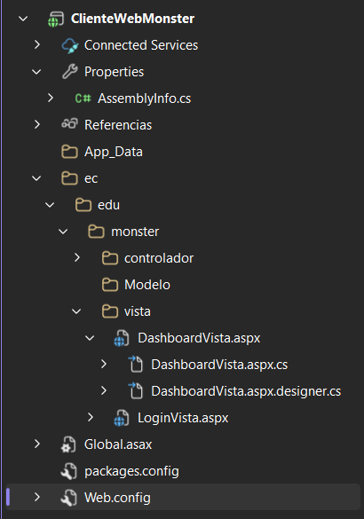

*_Figura 125. Estructura del proyecto._*

#### 1.5.4 CREACIÓN Y CODIFICACIÓN DE ARCHIVOS DE CONTROLADOR

Abra el paquete controlador que fue creado con anterioridad y de clic derecho para desplegar el menú, luego presione en “Agregar” y luego en “Controlador”.

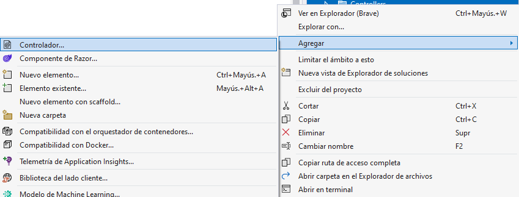

*_Figura 138. Creación de una nueva clase._*

En la ventana siguiente coloque “Controlador MVC: en Blanco”, paso siguiente le solicitará el nombre del controlador y se le debe asignar com “DashBoardControlador.cs”, luego de clic en “Agregar”.

*_Figura 139. Creación del archivo DashboardControlador.cs_*

Al finalizar se tendrá que llamar a la API que se desarrolló en el servidor y se asigna a una variable para enviarla a la vista, así mismo se debe controlar las excepciones en caso de recibir una respuesta de error de parte del servidor.

*_Figura 140. Codificación del archivo controlador_*

Nota: Cabe destacar que se debe reemplazar la IP de la URI por la de su computadora servidor o colocar “Localhost” en caso de querer una ejecución local.

Tabla 29 Código DashboardControlador.cs

| using ClienteWebMonster.ProxyWebMonster;using System;namespace ClienteWebMonster.ec.edu.monster.controlador{ public class DashboardControlador { public double EjecutarConversionMasa(string tipoConversion, double valor) { using (ServicioMonsterClient clienteWCF = new ServicioMonsterClient()) { switch (tipoConversion) { case "Gramos a Kilogramos": return clienteWCF.GramosAKilogramos(valor); case "Kilogramos a Libras": return clienteWCF.KilogramosALibras(valor); case "Libras a Onzas": return clienteWCF.LibrasAOnzas(valor); case "Toneladas a Kilogramos": return clienteWCF.ToneladasAKilogramos(valor); case "Onzas a Gramos": return clienteWCF.OnzasAGramos(valor); default: throw new ArgumentException("Seleccione una operación válida de Masa."); } } } public double EjecutarConversionTemperatura(string tipoConversion, double valor) { using (ServicioMonsterClient clienteWCF = new ServicioMonsterClient()) { switch (tipoConversion) { case "Celsius a Fahrenheit": return clienteWCF.CelsiusAFahrenheit(valor); case "Fahrenheit a Celsius": return clienteWCF.FahrenheitACelsius(valor); case "Celsius a Kelvin": return clienteWCF.CelsiusAKelvin(valor); case "Kelvin a Celsius": return clienteWCF.KelvinACelsius(valor); case "Fahrenheit a Kelvin": return clienteWCF.FahrenheitAKelvin(valor); default: throw new ArgumentException("Seleccione una operación válida de Temperatura."); } } } public double EjecutarConversionLongitud(string tipoConversion, double valor) { using (ServicioMonsterClient clienteWCF = new ServicioMonsterClient()) { switch (tipoConversion) { case "Metros a Kilometros": return clienteWCF.MetrosAKilometros(valor); case "Kilometros a Millas": return clienteWCF.KilometrosAMillas(valor); case "Metros a Pies": return clienteWCF.MetrosAPies(valor); case "Pies a Pulgadas": return clienteWCF.PiesAPulgadas(valor); case "Centimetros a Metros": return clienteWCF.CentimetrosAMetros(valor); default: throw new ArgumentException("Seleccione una operación válida de Longitud."); } } } }} |
| --- |

#### 1.5.5 CREACIÓN Y CODIDIFICACIÓN DE ARCHIVOS DE LA VISTA

Abra el paquete de la vista que fue creado con anterioridad y de clic derecho para desplegar el menú, presione en “Agregar” y finalmente “Nueva Carpeta”.

*_Figura 141. Creación de carpetas_*

En la ventana siguiente se debe seleccionar la opción “Vista de Razor: vacía” y asignar el nombre al archivo como “Index.cshtml”.

*_Figura 144. Creación del archivo Index.cshtml_*

Una vez creado se debe proceder a realizar la codificación de la vista realizando un menú que permita tener acceso a las funcionalidades del aplicativo, además asignar las funcionalidades como llamar a las funciones del controlador que obtienen los datos de las APIs y mostrarlas en pantalla.

*_Figura 145. Codificación del archivo Index.cshtml_*

Tabla 30 Código Index.cshtml

| @{ ViewData["Title"] = "Home Page";}
 <h1>Bienvenido a Ticket Premium Monster</h1> 
 <a class="" asp-area="" asp-controller="TicketPremium" asp-action="Partidos"><button type="button" class="btn btn-secondary main-button green1-background">Buscar Partidos</button></a> <a class="" asp-area="" asp-controller="TicketPremium" asp-action="Facturas"><button type="button" class="btn btn-secondary main-button green2-background">Revisar Compras</button></a> 
 
 |
| --- |

Paso siguiente se da clic derecho y se debe presionar en “Agregar”, luego “Vista”.

*_Figura 146. Carpetas y estructura de la Vista_*

En la ventana siguiente se debe seleccionar la opción “Vista de Razor: vacía” y asignar el nombre al archivo como “DashboardVista.aspx”.

*_Figura 147. Creación del archivo DashboardVista.aspx_*

Una vez creado se debe proceder a realizar la codificación de la vista realizando un menú que permita tener acceso a las funcionalidades del aplicativo, además asignar las funcionalidades como llamar a las funciones del controlador que obtienen los datos de las APIs y mostrarlas en pantalla.

*_Figura 148. Codificación del archivo Partidos.cshtml_*

Tabla 31 Código Dashboard.aspx

| <%@ Page Language="C#" AutoEventWireup="true" CodeBehind="DashboardVista.aspx.cs" Inherits="ClienteWebMonster.ec.edu.monster.vista.DashboardVista" %><!DOCTYPE html><html xmlns="http://www.w3.org/1999/xhtml"><head runat="server"> <title>Dashboard - Ecosistema Monster</title> </head><body> <form id="form1" runat="server"> 
 <asp:Image ID="imgLogo" runat="server" ImageUrl="https://compote.slate.com/images/aead9b4c-c925-4175-b797-5ee15e74f5c1.jpg" CssClass="logo-sistema" Width="50%" /> <h2>Panel de Conversiones</h2> 
 <asp:Button ID="btnTabMasa" runat="server" Text="Masa" CssClass="boton-pestana activa" OnClick="CambiarPestana" CommandArgument="0" /> <asp:Button ID="btnTabTemp" runat="server" Text="Temperatura" CssClass="boton-pestana" OnClick="CambiarPestana" CommandArgument="1" /> <asp:Button ID="btnTabLong" runat="server" Text="Longitud" CssClass="boton-pestana" OnClick="CambiarPestana" CommandArgument="2" /> 
 <asp:MultiView ID="mvwPestanas" runat="server" ActiveViewIndex="0"> <asp:View ID="vwMasa" runat="server"> 
 
 <label>Escoge una conversión:</label> <asp:DropDownList ID="cmbListaOperacionesMasaSeleccionada" runat="server" CssClass="lista-desplegable"></asp:DropDownList> 
 
 <label>Escribe el valor a convertir:</label> <asp:TextBox ID="txtValorNumericoIngresadoMasa" runat="server" CssClass="caja-texto"></asp:TextBox> 
 
 <asp:Button ID="btnEjecutarConversionMasaWCF" runat="server" Text="CALCULAR" CssClass="boton-verde" OnClick="btnEjecutarConversionMasaWCF_Click" /> 
 <asp:Label ID="lblResultadoCalculoMasaSistema" runat="server" Text="Resultado"></asp:Label> 
 </asp:View> <asp:View ID="vwTemp" runat="server"> 
 
 <label>Escoge una conversión:</label> <asp:DropDownList ID="cmbListaOperacionesTempSeleccionada" runat="server" CssClass="lista-desplegable"></asp:DropDownList> 
 
 <label>Escribe el valor a convertir:</label> <asp:TextBox ID="txtValorNumericoIngresadoTemp" runat="server" CssClass="caja-texto"></asp:TextBox> 
 
 <asp:Button ID="btnEjecutarConversionTempWCF" runat="server" Text="CALCULAR" CssClass="boton-verde" OnClick="btnEjecutarConversionTempWCF_Click" /> 
 <asp:Label ID="lblResultadoCalculoTempSistema" runat="server" Text="Resultado"></asp:Label> 
 </asp:View> <asp:View ID="vwLong" runat="server"> 
 
 <label>Escoge una conversión:</label> <asp:DropDownList ID="cmbListaOperacionesLongSeleccionada" runat="server" CssClass="lista-desplegable"></asp:DropDownList> 
 
 <label>Escribe el valor a convertir:</label> <asp:TextBox ID="txtValorNumericoIngresadoLong" runat="server" CssClass="caja-texto"></asp:TextBox> 
 
 <asp:Button ID="btnEjecutarConversionLongWCF" runat="server" Text="CALCULAR" CssClass="boton-verde" OnClick="btnEjecutarConversionLongWCF_Click" /> 
 <asp:Label ID="lblResultadoCalculoLongSistema" runat="server" Text="Resultado"></asp:Label> 
 </asp:View> </asp:MultiView> 
 </form></body></html> |
| --- |

Paso siguiente se da clic derecho sobre la carpeta recién creada “Vista” y se debe presionar en “Agregar”, luego “Vista”.

*_Figura 149. Carpetas y estructura de la Vista_*

En la ventana siguiente se debe seleccionar la opción “Vista de Razor: vacía” y asignar el nombre al archivo como “Localidad.cshtml”.

*_Figura 150. Creación del archivo LoginVista.aspx_*

Una vez creado se debe proceder a realizar la codificación de la vista realizando un menú que permita tener acceso a las funcionalidades del aplicativo, además asignar las funcionalidades como llamar a las funciones del controlador que obtienen los datos de las APIs y mostrarlas en pantalla.

*_Figura 151. Codificación del archivo LoginVista.aspx_*

Tabla 32 Código LoginVista.aspx

| <%@ Page Language="C#" AutoEventWireup="true" CodeBehind="LoginVista.aspx.cs" Inherits="ClienteWebMonster.ec.edu.monster.vista.LoginVista" %><!DOCTYPE html><html xmlns="http://www.w3.org/1999/xhtml"><head runat="server"> <title>Login - Ecosistema Monster</title> </head><body> <form id="form1" runat="server"> 
 <asp:Image ID="imgLogo" runat="server" ImageUrl="https://compote.slate.com/images/aead9b4c-c925-4175-b797-5ee15e74f5c1.jpg" CssClass="logo-sistema" /> <h2>Conversión de unidades - Cliente Web</h2> <asp:Label ID="Label1" runat="server" Text="Usuario:"></asp:Label> <asp:TextBox ID="txtNombreUsuarioInstitucionalIngresado" runat="server" CssClass="caja-texto"></asp:TextBox> <asp:Label ID="Label2" runat="server" Text="Contraseña:"></asp:Label> <asp:TextBox ID="txtClaveAccesoSeguridadIngresada" runat="server" TextMode="Password" CssClass="caja-texto"></asp:TextBox> <asp:Button ID="btnValidarCredencialesAccesoWCF" runat="server" Text="INGRESAR" CssClass="boton-verde" OnClick="btnValidarCredencialesAccesoWCF_Click" />    <asp:Label ID="lblMensajeError" runat="server" ForeColor="Red"></asp:Label> 
 </form></body></html> |
| --- |

Paso siguiente para poder usar el archivo de la vista se lo debe llamar desde el archivo “AsemblyInfo.cs” ubicado en la carpeta raíz de la aplicación. Se debe ingresar al archivo y colocar el siguiente código para poder completar el aplicativo.

*_Figura 161. Codificación del archivo AsemblyInfo.cs_*

Tabla 36 Código AsemblyInfo.cs

| using System.Reflection;using System.Runtime.CompilerServices;using System.Runtime.InteropServices;// La información general sobre un ensamblado se controla mediante el siguiente // conjunto de atributos. Cambie los valores de estos atributos para modificar la información// asociada a un ensamblado.[assembly: AssemblyTitle("ClienteWebMonster")][assembly: AssemblyDescription("")][assembly: AssemblyConfiguration("")][assembly: AssemblyCompany("")][assembly: AssemblyProduct("ClienteWebMonster")][assembly: AssemblyCopyright("Copyright © 2026")][assembly: AssemblyTrademark("")][assembly: AssemblyCulture("")]// Si ComVisible se establece en false, los componentes COM no verán los // tipos de este ensamblado. Si necesita obtener acceso a un tipo de este ensamblado desde // COM, establezca el atributo ComVisible en true en este tipo.[assembly: ComVisible(false)]// El siguiente GUID sirve como ID de typelib si este proyecto se expone a COM[assembly: Guid("4ff21fd1-345e-42bc-943c-62525acf9652")]// La información de versión de un ensamblado consta de los siguientes cuatro valores://// Versión principal// Versión secundaria // Número de compilación// Revisión//// Puede especificar todos los valores o usar los valores predeterminados de número de compilación y de revisión // mediante el carácter '*', como se muestra a continuación:[assembly: AssemblyVersion("1.0.0.0")][assembly: AssemblyFileVersion("1.0.0.0")] |
| --- |

1.6 CREACIÓN DE CLIENTE MOBILE

1.6.1 INSTALACIÓN DE LOS RECURSOS

Se hace la creación del cliente móvil, la cual se va a usar MAUI que es un framework de .NET.

*_Figura 162. Instalación de MAUI_*

1.6.2 CREACIÓN DEL PROYECTO

Se crea el proyecto con MAUI y se obtiene la siguiente estructura principal

*_Figura 163. Estructura del proyecto_*

Se crea el archivo LoginPagina.xaml la cual es la página principal del programa que es para iniciar sesión.

*_Figura 164. LoginPagina.xaml_*

Tabla 37 Código AsemblyInfo.cs

| <?xml version="1.0" encoding="utf-8" ?><ContentPage xmlns="http://schemas.microsoft.com/dotnet/2021/maui" xmlns:x="http://schemas.microsoft.com/winfx/2009/xaml" x:Class="ClienteMovilMonster.SeleccionPagina" BackgroundColor="#AEE7F8" Title="Menú Principal"> <VerticalStackLayout Padding="30" Spacing="20" VerticalOptions="Center"> <Label Text="¿QUÉ DESEAS CALCULAR?" FontSize="22" FontAttributes="Bold" HorizontalTextAlignment="Center" TextColor="#333" /> <Button Text="MASA" BackgroundColor="#ABF1BC" TextColor="Black" FontAttributes="Bold" HeightRequest="60" Clicked="OnMasaClicked" /> <Button Text="TEMPERATURA" BackgroundColor="#ABF1BC" TextColor="Black" FontAttributes="Bold" HeightRequest="60" Clicked="OnTempClicked" /> <Button Text="LONGITUD" BackgroundColor="#ABF1BC" TextColor="Black" FontAttributes="Bold" HeightRequest="60" Clicked="OnLongClicked" /> </VerticalStackLayout></ContentPage>namespace ClienteMovilMonster;public partial class LoginPagina : ContentPage{ public LoginPagina() { InitializeComponent(); } private async void OnLoginClicked(object? sender, EventArgs e) { // Verificamos nulos antes de usar los campos if (string.IsNullOrEmpty(txtUser?.Text) // string.IsNullOrEmpty(txtPass?.Text)) { await DisplayAlertAsync("Atención", "Llene todos los campos", "OK"); return; } if (txtUser.Text == "Monster" && txtPass.Text == "Monster9") { await Navigation.PushAsync(new SeleccionPagina()); } else { await DisplayAlertAsync("Error", "Credenciales incorrectas", "OK"); } }} |
| --- |

Se crea SeleccionPrograma.xaml que nos servirá para escoger que conversión queremos hacer

*_Figura 165. SeleccionPagina.xaml_*

Tabla 38 Código SeleccionPagina.xaml

| <?xml version="1.0" encoding="utf-8" ?><ContentPage xmlns="http://schemas.microsoft.com/dotnet/2021/maui" xmlns:x="http://schemas.microsoft.com/winfx/2009/xaml" x:Class="ClienteMovilMonster.SeleccionPagina" BackgroundColor="#AEE7F8" Title="Menú Principal"> <VerticalStackLayout Padding="30" Spacing="20" VerticalOptions="Center"> <Label Text="¿QUÉ DESEAS CALCULAR?" FontSize="22" FontAttributes="Bold" HorizontalTextAlignment="Center" TextColor="#333" /> <Button Text="MASA" BackgroundColor="#ABF1BC" TextColor="Black" FontAttributes="Bold" HeightRequest="60" Clicked="OnMasaClicked" /> <Button Text="TEMPERATURA" BackgroundColor="#ABF1BC" TextColor="Black" FontAttributes="Bold" HeightRequest="60" Clicked="OnTempClicked" /> <Button Text="LONGITUD" BackgroundColor="#ABF1BC" TextColor="Black" FontAttributes="Bold" HeightRequest="60" Clicked="OnLongClicked" /> </VerticalStackLayout></ContentPage>namespace ClienteMovilMonster;public partial class SeleccionPagina : ContentPage{ public SeleccionPagina() { InitializeComponent(); } private async void OnMasaClicked(object? sender, EventArgs e) => await Navigation.PushAsync(new MainPage("Masa")); private async void OnTempClicked(object? sender, EventArgs e) => await Navigation.PushAsync(new MainPage("Temperatura")); private async void OnLongClicked(object? sender, EventArgs e) => await Navigation.PushAsync(new MainPage("Longitud"));} |
| --- |

## 2.EJECUCIÓN DEL PROYECTO

#### 2.1 EJECUCIÓN DEL SERVIDOR

Para la ejecución del proyecto se debe dirigir hacia el proyecto servidor primero y presionar en el botón para ejecutarlo llamado “Iniciar” ubicado en la parte superior central de Visual Studio 2022.

*_Figura 171. Ejecución del servidor_*

#### 2.2 EJECUCIÓN DEL CLIENTE CONSOLA

Una vez el servidor se encuentre ejecutado, gracias a que ya se testeó su funcionamiento, se puede proceder a realizar el mismo procedimiento con el cliente, en este caso se debe abrir el cliente desarrollado para consola, dando clic en el botón Ejecutar.

*_Figura 172. Ejecución del cliente._*

Una vez ejecutado el cliente se visualizará una pantalla similar la cual será la pantalla de menú que contienelas funcionalidades de la aplicación.

*_Figura 173. Pantalla de ejecución del Cliente._*

En la misma se puede visualizar las conversiones al elegir una opción.

*_Figura 174. Página Disponible._*

De la misma forma se puede hacer la conversión dependiendo la opción que se escogió

*_Figura 175. Ejemplo de conversiones._*

Finalmente se puede visualizar la conversión hecha mediante la siguiente interfaz.

*_Figura 176. Página de Resumen de Ventas de un Partido._*

#### 2.3 EJECUCIÓN DEL CLIENTE ESCRITORIO

Una vez el servidor se encuentre ejecutado, gracias a que ya se testeó su funcionamiento, se puede proceder a realizar el mismo procedimiento con el cliente, en este caso se debe abrir el cliente desarrollado para escritorio, dando clic en el botón Ejecutar.

*_Figura 178. Ejecución del cliente._*

Una vez ejecutado el cliente se visualizará una pantalla similar la cual será la pantalla de menú que presenta la funcionalidad de dirigirse al inicio de sesión

*_Figura 184. Pantalla de ejecución del Cliente._*

Al dirigirse a la primera opción se podrá visualizar una pantalla similar a la siguiente la cual muestra un menú con las opciones a elegir para hacer la conversión de unidades.

*_Figura 185. Página de conversiones con menú_*

De la misma forma se hace la elección y se escribe el valor a convertir con la opción que se escogió para convertir de una unidad a otra, mostrándonos el resultado.

*_Figura 186. Página de conversiones ya con resultado._*

#### 2.5 EJECUCIÓN DEL CLIENTE WEB

Para la ejecución del cliente web se deben seguir los pasos similares de los anteriores clientes, abriendo el proyecto y dando clic en el botón IIS Express.

*_Figura 189. Ejecución del cliente._*

Se mostrará la pantalla principal que se trata del inicio de sesión donde debemos escribir nuestras credenciales.

*_Figura 190. Ejecución de la pantalla principal para iniciar sesión._*

Al momento de entrar se mostrará un menú para saber cual será el formato de conversión.

*_Figura 191. Menú para elegir que tipo de conversión de datos se hará._*

Se escoge cualquier tipo de conversión y se elige que conversión se hará y el valor

*_Figura 192. Elección de estado de conversión y escritura de valor a convertir._*

Ahora se dará en el botón calcular y se mostrará el resultado de la conversión.

*_Figura 193. Resultado obtenido de la conversión en el cliente web._*

#### 2.6 EJECUCIÓN DEL CLIENTE MÓVIL

Para la ejecución del cliente móvil se debe abrir la aplicación en el teléfono móvil una vez ya se tenga descargada y se mostrará la siguiente pantalla de inicio.

*_Figura 194. Pantalla de inicio._*

Ahora una vez adentro se debe escoger por qué tipo de conversión se quiere hacer.

*_Figura 195. Menú de conversión_*

Se elige la opción de temperatura para hacer la conversión y obtener el resultado.

*_Figura 196. Conversión exitosa mediante el cliente de móvil._*

## CONCLUSIONES

La comunicación entre una aplicación cliente y una API es fundamental para obtener y enviar datos de manera eficiente y segura.

El proyecto demostró de manera práctica cómo una arquitectura orientada a servicios (SOA) permite la comunicación fluida entre sistemas completamente heterogéneos. Un único backend en WCF pudo servir como motor de cálculo tanto para un entorno Web (navegadores) como para un ecosistema Móvil nativo (Android), garantizando que las reglas de negocio sean idénticas y consistentes en todo el ecosistema.

Se logró construir una arquitectura de clientes "ligeros" o Thin Clients. Al delegar todo el peso del procesamiento matemático al servidor IIS, las aplicaciones de interfaz (Web y Móvil) consumen menos memoria y batería.

## RECOMENDACIONES

Se recomienda integrar herramientas de registro de eventos (como Serilog o NLog) en el servidor backend. Esto permitirá a los administradores del sistema auditar qué operaciones de conversión son las más demandadas, medir los tiempos de respuesta del servidor y capturar errores de red de forma proactiva, en lugar de depender únicamente de las alertas mostradas en la pantalla del usuario final.

Aunque la validación actual cumple su propósito funcional, se aconseja evolucionar el sistema de login hacia un modelo de autenticación basado en Tokens (como JWT o la implementación de WS-Security para WCF). Esto evitará el envío constante de credenciales en las peticiones subsecuentes y permitirá manejar sesiones seguras con tiempo de expiración.

Para mitigar los problemas de configuración de red local, permisos de Firewall y dependencias de IIS experimentados durante el ciclo de desarrollo, se recomienda para futuras fases empaquetar el servicio backend utilizando contenedores Docker.
