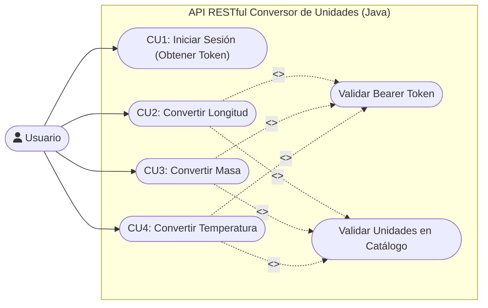
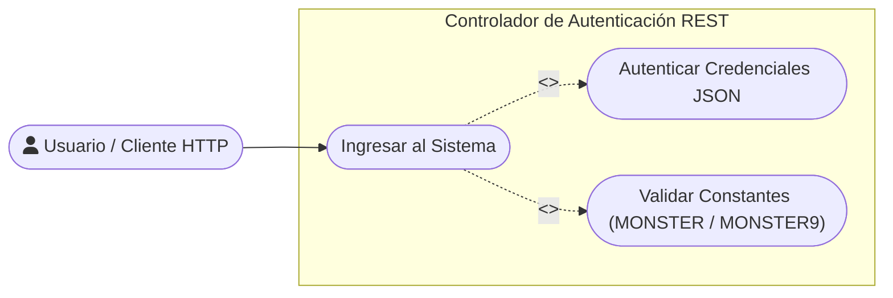
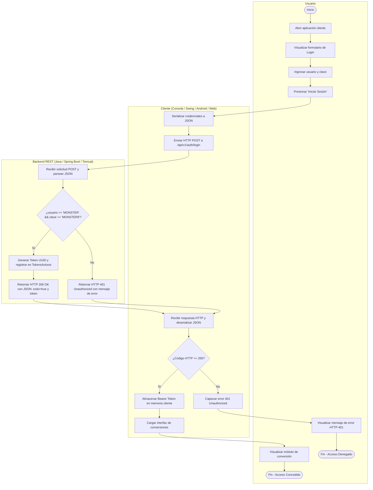
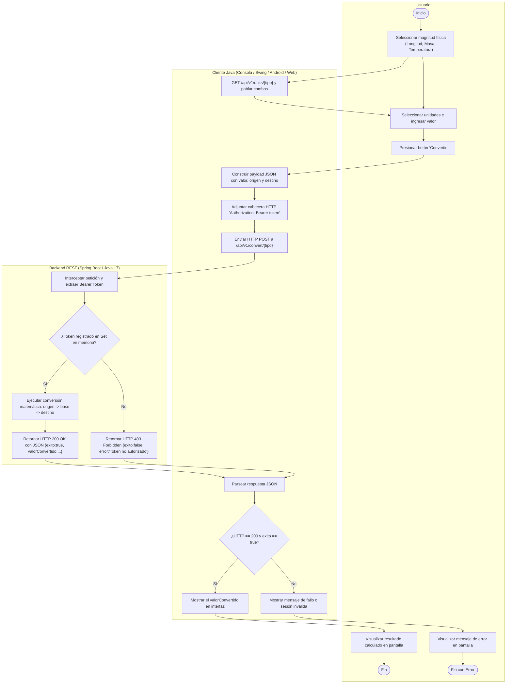
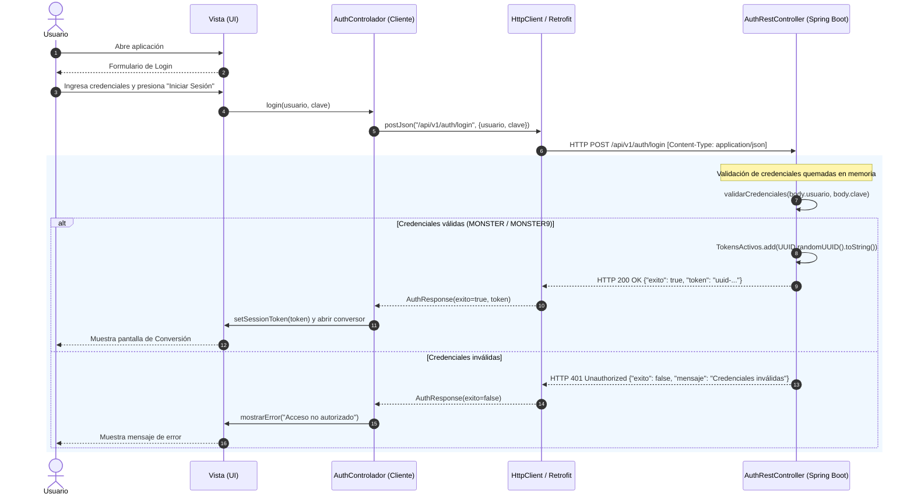
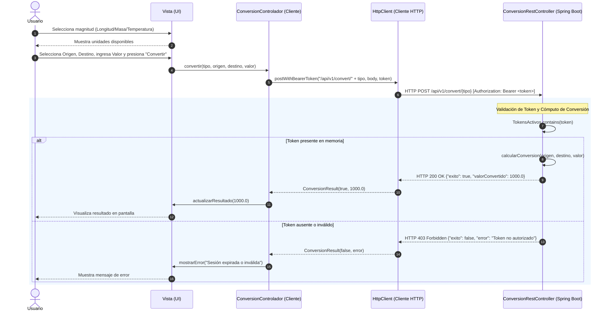
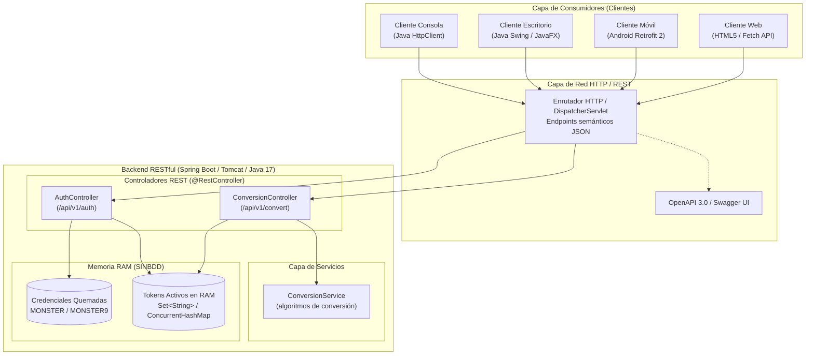

# Diagramas UML · TI.1.3 RESTful Java (SINBDD)

Este documento contiene la representación visual en sintaxis **Mermaid** de todos los modelos
UML correspondientes al taller **TI.1.3** (Servicios Web RESTful con payloads JSON en plataforma **Java 17+ / Spring Boot / Jakarta REST**, `SINBDD`).

---

## 1. Casos de Uso (`01_CASOS_DE_USO`)

### 1.1. Diagrama General de Casos de Uso
El usuario interactúa con la API RESTful. La obtención del Bearer Token es precondición obligatoria antes de consumir los endpoints de conversión.

### 1.2. Detalle del Módulo de Autenticación REST
Endpoint `POST /api/v1/auth/login` contra credenciales quemadas `MONSTER` / `MONSTER9`.

---

## 2. Diagramas de Actividad (`02_ACTIVIDAD`)

### 2.1. Actividad: Iniciar Sesión (Autenticación REST)
Flujo HTTP POST JSON con 3 swimlanes (*Usuario*, *Cliente Java*, *Backend REST Spring Boot*).

### 2.2. Actividad: Convertir Unidades (Endpoints REST)
Flujo de petición `POST /api/v1/convert/{type}` con cabecera `Authorization: Bearer <token>`.

---

## 3. Diagramas de Secuencia (`03_SECUENCIA`)

### 3.1. Secuencia: Iniciar Sesión (REST JSON)

### 3.2. Secuencia: Conversión de Unidades (REST JSON)

---

## 4. Clases del Dominio (`04_CLASES`)

Al tratarse de una arquitectura **SINBDD**, la solución en Java RESTful no utiliza JPA ni Hibernate. Toda la lógica de transformación y catálogo reside en memoria RAM documentada en:
`TI.1.1. PAO202651_RESTFUL_JAVA_SINBDD_NRC36884_GR09/01. UML/03. DIAGRAMAS UML/04_CLASES/README.txt`

---

## 5. Arquitectura de Componentes (`05_ARQUITECTURA`)

---

> [!info] Enlaces relacionados
> - [index.md](index.md): Panel principal del taller TI.1.3.
> - [srs.md](srs.md): Especificación de Requisitos de Software de TI.1.3.
> - [01-uml](../../03-deliverables/01-uml.md): Catálogo general de UML en el vault.
