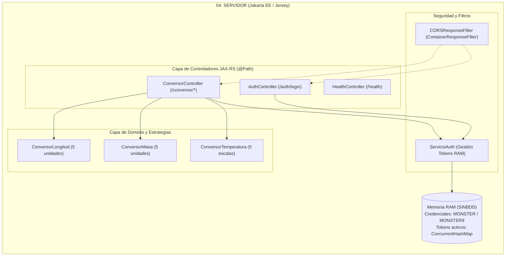

# MANUAL DE CONFIGURACIÓN Y DESPLIEGUE SISTEMA DE CONVERSIÓN DE UNIDADES CON RESTFUL SIN BDD EN JAVA

**Universidad de las Fuerzas Armadas ESPE — Sede Latacunga**  
**Departamento de Ciencias de la Computación**  
**Carrera:** Ingeniería de Software / Tecnologías de la Información  
**Asignatura:** Arquitectura de Software  
**Tarea:** TI.1.3 (PAO 2026-51)  
**NRC:** 36884 | **Grupo:** GR09  
**Autor:** Julio Enrique Viche Castillo  
**Docente:** Ing. Eduardo Mauricio Campaña Ortega, MIS.MDU.CCNA.CCIA. PhD. (c)  
**Fecha:** 27 de Octubre de 2026  

---

## 1. INTRODUCCIÓN

En la ingeniería de software moderna, la interoperabilidad entre aplicaciones distribuidas y plataformas heterogéneas representa uno de los desafíos arquitectónicos más críticos. El presente manual técnico documenta el diseño, la configuración, el despliegue y la validación del **Sistema de Conversión de Unidades Heterogéneo**, implementado bajo el estilo de arquitectura de servicios web **RESTful** (Representational State Transfer) sobre la plataforma **Java** utilizando la especificación **Jakarta RESTful Web Services (JAX-RS)** con **Jersey**.

El sistema se rige bajo la premisa operativa **SINBDD** (Sin Base de Datos), lo que implica que la persistencia, validación de credenciales fijas y el ciclo de vida de los tokens de autenticación residen de forma volátil y controlada en la memoria RAM del servidor de aplicaciones. Esta solución centralizada expone endpoints REST con cargas útiles en formato **JSON** (JavaScript Object Notation), los cuales son consumidos de manera uniforme por cuatro clientes clientes desacoplados: una aplicación de **Consola (CLI)**, una aplicación de **Escritorio gráfica (Swing MVC)**, una aplicación **Web (JSP / Servlets)** y una aplicación **Móvil (Android SDK)**.

---

## 2. OBJETIVOS

### 2.1. Objetivo General
Diseñar, configurar, desplegar y validar un sistema distribuido de conversión de unidades de múltiples magnitudes físicas (Longitud, Masa y Temperatura) implementado como un servicio web RESTful en Java (JAX-RS / Jersey), desplegado sobre el servidor de aplicaciones empresarial Payara Server / GlassFish y consumido de forma concurrente por cuatro clientes heterogéneos bajo el patrón arquitectónico Modelo-Vista-Controlador (MVC).

### 2.2. Objetivos Específicos
1. Configurar el servidor de aplicaciones **Payara Server Community 6.x / GlassFish 7.x** para alojar el componente backend empaquetado como archivo `.war`, habilitando simultáneamente un modo de ejecución standalone ligero mediante **Grizzly HTTP**.
2. Implementar los endpoints REST de autenticación y cálculo matemático utilizando la especificación **Jakarta REST 3.1** con serialización JSON provista por **Jackson**, garantizando el soporte del filtro de intercambio de recursos de origen cruzado (**CORS**).
3. Desarrollar e integrar el catálogo estricto de exactamente **5 unidades por magnitud** (Longitud, Masa y Temperatura) con un formateo de salida riguroso a **2 decimales** (`%.2f`) y punto decimal como separador estándar.
4. Implementar el esquema de seguridad mediante tokens de sesión en memoria RAM, exigiendo la autenticación previa con las credenciales maestras fijas (`MONSTER` / `MONSTER9`) antes de habilitar los cómputos de conversión.
5. Construir y validar cuatro clientes de software heterogéneos (Consola, Escritorio Swing con FlatLaf, Web JSP y Móvil Android) bajo el patrón **Modelo-Vista-Controlador (MVC)**, asegurando la auto-detección transparente de las URLs del servicio.

---

## 3. MARCO TEÓRICO

### 3.1. Servicios Web RESTful y Formato JSON
El estilo arquitectónico REST, formulado originalmente por Roy Fielding, se fundamenta en la manipulación sin estado de recursos identificables mediante URIs (Uniform Resource Identifiers) utilizando los verbos estándar del protocolo HTTP (`GET`, `POST`, `PUT`, `DELETE`). A diferencia de los servicios basados en SOAP/XML, REST utiliza formatos de intercambio más compactos y ligeros como **JSON** (JavaScript Object Notation, RFC 8259), optimizando el ancho de banda y agilizando el procesamiento de datos tanto en clientes web como en dispositivos móviles de recursos restringidos.

### 3.2. Arquitectura Orientada a Servicios (SOA) y Bajo Acoplamiento
El sistema se fundamenta en los principios de diseño de SOA:
- **Contrato Estándar:** Los recursos y representaciones de datos se definen explícitamente mediante esquemas JSON tipificados.
- **Bajo Acoplamiento:** Los clientes no dependen del lenguaje ni del sistema operativo donde corre el backend; únicamente requieren capacidad para emitir solicitudes HTTP y deserializar cadenas JSON.
- **Sin Estado (Statelessness):** Cada solicitud HTTP dirigida a un endpoint protegido debe contener en su cuerpo o encabezado la información completa de autorización (el token de sesión) para ser procesada independientemente.

### 3.3. Patrón de Arquitectura Modelo - Vista - Controlador (MVC)
Tanto en la organización interna de los clientes como en la estructuración de la capa web, se aplica la estricta separación de responsabilidades:
- **Modelo (`model`):** Clases de dominio que contienen los datos de sesión y las estructuras de petición/respuesta (`LoginRequest`, `LoginResponse`, `ConversionRequest`, `ConversionResponse`).
- **Vista (`view`):** Interfaces visuales responsables exclusivamente de capturar entradas del operador y renderizar datos en pantalla sin interactuar directamente con sockets o red.
- **Controlador (`controller`):** Componente orquestador que intercepta las acciones del usuario, valida restricciones locales, delega el consumo REST al cliente HTTP y actualiza el estado de la vista.

### 3.4. Patrón de Diseño GoF Strategy para Conversión de Unidades
Para evitar estructuras de control anidadas monolíticas (`if/else` o `switch` gigantes), la lógica de conversión matemática se organiza bajo el patrón de comportamiento **Strategy**:
- Se define una interfaz genérica de cómputo `IConversor<U>` donde cada estrategia concreta (`ConversorLongitudStrategy`, `ConversorMasaStrategy`, `ConversorTemperaturaStrategy`) encapsula de forma aislada las matrices y fórmulas algebraicas hacia la unidad pivote estándar.

### 3.5. Servidor de Aplicaciones Payara Server y Ecosistema Jakarta EE
**Payara Server Community Edition** es un servidor de aplicaciones empresarial de código abierto, derivado directo de GlassFish, certificado para especificaciones Jakarta EE. Para la variante RESTful en Java, Payara proporciona de manera nativa:
- El contenedor de servlets compatible con Servlet 6.0 / 5.0.
- El motor de inyección de dependencias Jakarta Contexts and Dependency Injection (CDI / `beans.xml`).
- El soporte nativo para **Jersey**, eliminando la necesidad de empaquetar librerías externas pesadas en el archivo `.war` final y optimizando el ciclo de vida de los servicios en red.

---

## 4. DESARROLLO DEL APLICATIVO

### 4.1. Componente Servidor REST (`04. SERVIDOR`)

El servidor centralizado se encuentra alojado en la carpeta `04. SERVIDOR/` y está estructurado como un proyecto Maven con empaquetado Web Application Archive (`.war`).



#### Paso 1: Configuración del Descriptor `pom.xml`
El archivo `pom.xml` define la versión de Java 17, las especificaciones de Jakarta REST 3.1 y Jersey 3.1.5, y establece `provided` para el API de servlets a fin de no generar conflictos de cargador de clases en Payara:

```xml
<groupId>ec.edu.monster</groupId>
<artifactId>ServidorREST</artifactId>
<version>1.0.0</version>
<packaging>war</packaging>
<name>Servidor REST - Conversor de Unidades (SINBDD)</name>

<properties>
    <maven.compiler.source>17</maven.compiler.source>
    <maven.compiler.target>17</maven.compiler.target>
    <project.build.sourceEncoding>UTF-8</project.build.sourceEncoding>
    <jersey.version>3.1.5</jersey.version>
    <failOnMissingWebXml>false</failOnMissingWebXml>
</properties>

<dependencies>
    <!-- Jakarta RESTful Web Services API -->
    <dependency>
        <groupId>jakarta.ws.rs</groupId>
        <artifactId>jakarta.ws.rs-api</artifactId>
        <version>3.1.0</version>
    </dependency>
    <!-- Jakarta Servlet API (provided para Payara Server / GlassFish) -->
    <dependency>
        <groupId>jakarta.servlet</groupId>
        <artifactId>jakarta.servlet-api</artifactId>
        <version>6.0.0</version>
        <scope>provided</scope>
    </dependency>
    <!-- Soporte JSON con Jackson en Jersey -->
    <dependency>
        <groupId>org.glassfish.jersey.media</groupId>
        <artifactId>jersey-media-json-jackson</artifactId>
        <version>${jersey.version}</version>
    </dependency>
</dependencies>
```

#### Paso 2: Descriptores de Despliegue en `src/main/webapp/WEB-INF/`
Para garantizar el despliegue automático en Payara Server 6 / GlassFish 7 desde Apache NetBeans:

1. **`web.xml`:** Mapea el contenedor de servlets de Jersey en la raíz del contexto web:
   ```xml
   <?xml version="1.0" encoding="UTF-8"?>
   <web-app xmlns="https://jakarta.ee/xml/ns/jakartaee"
            xmlns:xsi="http://www.w3.org/2001/XMLSchema-instance"
            xsi:schemaLocation="https://jakarta.ee/xml/ns/jakartaee https://jakarta.ee/xml/ns/jakartaee/web-app_6_0.xsd"
            version="6.0">
       <display-name>Servidor REST - Conversor de Unidades (SINBDD)</display-name>
       <servlet>
           <servlet-name>ec.edu.monster.config.ConvUnitApplication</servlet-name>
           <servlet-class>org.glassfish.jersey.servlet.ServletContainer</servlet-class>
           <init-param>
               <param-name>jakarta.ws.rs.Application</param-name>
               <param-value>ec.edu.monster.config.ConvUnitApplication</param-value>
           </init-param>
           <load-on-startup>1</load-on-startup>
       </servlet>
       <servlet-mapping>
           <servlet-name>ec.edu.monster.config.ConvUnitApplication</servlet-name>
           <url-pattern>/*</url-pattern>
       </servlet-mapping>
   </web-app>
   ```

2. **`glassfish-web.xml` / `payara-web.xml`:** Define el context root oficial de la aplicación:
   ```xml
   <?xml version="1.0" encoding="UTF-8"?>
   <!DOCTYPE glassfish-web-app PUBLIC "-//GlassFish.org//DTD GlassFish Application Server 3.1 Servlet 3.0//EN" 
       "http://glassfish.org/dtds/glassfish-web-app_3_0-1.dtd">
   <glassfish-web-app>
       <context-root>/ServidorREST</context-root>
   </glassfish-web-app>
   ```

#### Paso 3: Configuración de la Aplicación y Soporte CORS
En `ec.edu.monster.config.ConvUnitApplication`:
```java
@ApplicationPath("/")
public class ConvUnitApplication extends ResourceConfig {
    public ConvUnitApplication() {
        packages("ec.edu.monster.controlador", "ec.edu.monster.config");
        register(CORSResponseFilter.class);
    }
}
```
El filtro `CORSResponseFilter` inyecta los encabezados `Access-Control-Allow-Origin: *`, `Access-Control-Allow-Methods` y `Access-Control-Allow-Headers`, garantizando que clientes basados en navegadores web (JSP / JavaScript) y emuladores móviles puedan consumir los servicios sin bloqueos de seguridad.

#### Paso 4: Lógica de Autenticación en Memoria (`ServicioAuth.java`)
Cumpliendo con la premisa `SINBDD`, las credenciales se validan de forma fija y los tokens se gestionan en memoria:
- **Usuario Maestro:** `MONSTER`
- **Contraseña Maestra:** `MONSTER9`
- **Estructura de Almacenamiento:** `ConcurrentHashMap<String, Long>` donde se guarda el token (`UUID`) junto con la marca de tiempo para control de vigencia.

#### Paso 5: Catálogo Estricto de Unidades (5 por magnitud) y Cómputo
Cada magnitud cuenta con exactamente 5 unidades soportadas, calculadas hacia una unidad base intermedia:
- **Longitud (Base: Metro):**
  - Metro (`metro` / `m`): Factor $1.0$
  - Centímetro (`centimetro` / `cm`): Factor $0.01$
  - Pie (`pie` / `ft`): Factor $0.3048$
  - Yarda (`yarda` / `yd`): Factor $0.9144$
  - Milla (`milla` / `mi`): Factor $1609.34$
- **Masa (Base: Kilogramo):**
  - Kilogramo (`kilogramo` / `kg`): Factor $1.0$
  - Gramo (`gramo` / `g`): Factor $0.001$
  - Libra (`libra` / `lb`): Factor $0.453592$
  - Onza (`onza` / `oz`): Factor $0.0283495$
  - Quintal (`quintal` / `q`): Factor $45.3592$
- **Temperatura (5 Escalas Termométricas Oficiales):**
  - Celsius ($^\circ\text{C}$): Escala base
  - Fahrenheit ($^\circ\text{F}$): $C = (F - 32) \times \frac{5}{9} \Longleftrightarrow F = (C \times \frac{9}{5}) + 32$
  - Kelvin ($\text{K}$): $C = K - 273.15 \Longleftrightarrow K = C + 273.15$
  - Newton ($^\circ\text{N}$): $C = N \times \frac{100}{33} \Longleftrightarrow N = C \times \frac{33}{100}$
  - Réaumur ($^\circ\text{Ré}$): $C = Ré \times \frac{5}{4} \Longleftrightarrow Ré = C \times \frac{4}{5}$

Todos los resultados numéricos se formatean obligatoriamente a **dos decimales** utilizando redondeo bancario (`RoundingMode.HALF_UP`):
```java
private double redondear2Decimales(double valor) {
    return BigDecimal.valueOf(valor)
            .setScale(2, RoundingMode.HALF_UP)
            .doubleValue();
}
```

#### Paso 6: Especificación de Endpoints REST

| Endpoint | Método | Entrada (JSON) | Salida (JSON) | Descripción |
| :--- | :--- | :--- | :--- | :--- |
| `/auth/login` | `POST` | `{"username":"MONSTER","password":"MONSTER9"}` | `{"token":"uuid","success":true,"message":"Login exitoso"}` | Inicio de sesión y emisión de token |
| `/conversor/longitud` | `POST` | `{"token":"...","value":100.0,"from":"metro","to":"pie"}` | `{"value":100.0,"result":328.08,"success":true,...}` | Conversión de longitud |
| `/conversor/masa` | `POST` | `{"token":"...","value":50.0,"from":"kilogramo","to":"libra"}` | `{"value":50.0,"result":110.23,"success":true,...}` | Conversión de masa |
| `/conversor/temperatura`| `POST`| `{"token":"...","value":100.0,"from":"celsius","to":"fahrenheit"}`| `{"value":100.0,"result":212.00,"success":true,...}` | Conversión de temperatura |
| `/health` | `GET` | *(Ninguna)* | `{"status":"UP","service":"ServidorREST"}` | Verificación de estado del servidor |

---

### 4.2. Cliente de Consola (`04. CLICON`)

El cliente de consola implementa una interfaz textual interactiva y robusta bajo el patrón MVC:
- **`RestClient.java`:** Cliente HTTP basado en `java.net.http.HttpClient` de Java 17 con soporte para JSON mediante Jackson. Implementa un resolvedor inteligente de URLs: intenta conectarse a `http://localhost:8080/ServidorREST/` (Payara) y, si el puerto está ocupado, conmuta automáticamente a `http://localhost:8085/ServidorREST/` (Standalone), admitiendo también rutas heredadas como fallback.
- **`ConsoleView.java`:** Despliega el banner oficial de la ESPE, solicita credenciales interactivas y ofrece un menú con opciones numéricas (1 a 5).
- **Validaciones:** Control estricto de entrada numérica (máximo 16 caracteres, dígitos y punto decimal).

#### Ejecución del Cliente Consola:
- **Desde NetBeans:** Clic derecho sobre el proyecto `04. CLICON` $\rightarrow$ **Run** (o presionar `F6` gracias a `nbactions.xml`).
- **Desde Terminal CLI:**
  ```bash
  cd "04. CLICON"
  mvn clean compile exec:java
  ```

---

### 4.3. Cliente de Escritorio (`04. CLIESC`)

Construido en Java Swing con el tema estético **FlatLaf Light**:
- **Pantalla de Login (`LoginForm.java`):** Permite ingresar usuario y contraseña. Consume el endpoint `/auth/login` del servidor REST y almacena el token en el modelo `SessionModel`.
- **Ventana Principal (`MainConversionForm.java`):**
  - Panel superior con pestañas ejecutivas para alternar entre **Longitud**, **Masa** y **Temperatura**.
  - Combos desplegables sincronizados con las 5 unidades estrictas de cada catálogo.
  - Filtro documental (`DocumentFilter`) en el campo de texto que impide escribir letras o caracteres especiales, limitando la longitud máxima a 16 dígitos y admitiendo únicamente el punto (`.`).
  - Botón de conversión y panel de resultado formateado a 2 decimales (`0.00`).

#### Ejecución del Cliente Escritorio:
- **Desde NetBeans:** Clic derecho sobre `04. CLIESC` $\rightarrow$ **Run** (`F6`).
- **Desde Terminal CLI:**
  ```bash
  cd "04. CLIESC"
  mvn clean compile exec:java
  ```

---

### 4.4. Cliente Web (`04. CLIWEB`)

Desarrollado con arquitectura MVC basada en JSP (JavaServer Pages), Servlets y servidor web embebido:
- **Servlets:**
  - `LoginServlet.java`: Atiende peticiones `POST`, se comunica mediante `HttpClient` con el backend REST y establece la sesión HTTP (`HttpSession`).
  - `ConversionServlet.java`: Recibe los parámetros de conversión, envía el payload JSON al servicio REST `/conversor/*` y reenvía los resultados al modelo de vista.
- **Vistas JSP:**
  - `login.jsp`: Interfaz web responsiva con diseño limpio y feedback visual ante errores.
  - `conversor.jsp`: Panel de control con tarjetas estilizadas, cálculo reactivo y presentación de resultados a 2 decimales.

#### Ejecución del Cliente Web:
- **Desde NetBeans:** Clic derecho sobre `04. CLIWEB` $\rightarrow$ **Run** (`F6`).
- **URL de Acceso en Navegador:** `http://localhost:8081/ClienteWeb/`

---

### 4.5. Cliente Móvil Android (`04. CLIMOV`)

Aplicación móvil nativa para la plataforma Android desarrollada con Java y Android SDK:
- **Compatibilidad:** `minSdk = 24` (Android 7.0), `compileSdk = 35`, `targetSdk = 35`, JDK 17 y Gradle 8.11.
- **Comunicación REST:** Utiliza `HttpURLConnection` / `OkHttp` para despachar solicitudes JSON hacia el servidor.
- **Configuración de IP de Conexión:**
  - En emulador de Android Studio: Utiliza la dirección virtual de bucle invertido **`http://10.0.2.2:8080/ServidorREST/`**.
  - En teléfono físico mediante Wi-Fi: Apunta a la dirección IP privada de la computadora anfitriona (ej. `http://192.168.1.15:8080/ServidorREST/`).

#### Ejecución del Cliente Móvil:
1. Abrir la carpeta `04. CLIMOV/` en **Android Studio**.
2. Esperar la sincronización de Gradle (*Gradle Sync*).
3. Seleccionar el emulador o dispositivo físico conectado por USB y presionar el botón verde **Run ▶️** (`Shift + F10`).

---

## 5. GUÍA PASO A PASO PARA COMPILAR Y DESPLEGAR EL SERVIDOR

### Opción A: Despliegue en Servidor Empresarial Payara Server 6 (Modo Oficial)

1. **Iniciar Payara Server:**
   - En Apache NetBeans, abrir la pestaña **Services** $\rightarrow$ **Servers** $\rightarrow$ Clic derecho en **Payara Server** $\rightarrow$ **Start**.
   - O por terminal de comandos:
     ```bash
     asadmin start-domain
     ```
2. **Compilar el archivo WAR:**
   ```powershell
   cd "TI.1.3. PAO202651_RESTFUL_JAVA_SINBDD_NRC36884_GR09\04. SERVIDOR"
   mvn clean package
   ```
   El paquete se generará en: `target/ServidorREST.war`.
3. **Desplegar en Payara:**
   - Desde NetBeans: Clic derecho sobre el proyecto `04. SERVIDOR` $\rightarrow$ **Run** (o **Deploy**).
   - O vía CLI:
     ```bash
     asadmin deploy --force target/ServidorREST.war
     ```
4. **Verificación en el Navegador:**
   Abrir: `http://localhost:8080/ServidorREST/health`  
   Debe responder el JSON: `{"status":"UP","service":"ServidorREST"}`.

### Opción B: Ejecución Standalone Ligera (Grizzly HTTP)

Si no se desea levantar la instancia completa de Payara, el servidor puede ejecutarse de inmediato en modo independiente:
```powershell
cd "TI.1.3. PAO202651_RESTFUL_JAVA_SINBDD_NRC36884_GR09\04. SERVIDOR"
mvn exec:java
```
El servidor arrancará en el puerto `8080` (con fallback automático al `8085` si el 8080 estuviera ocupado).

---

## 6. PRUEBAS Y VALIDACIÓN DEL SISTEMA

| ID | Caso de Prueba | Entrada | Salida Esperada | Estado |
| :--- | :--- | :--- | :--- | :--- |
| **CP-01** | Login con credenciales válidas | `{"username":"MONSTER", "password":"MONSTER9"}` | HTTP 200, `success=true`, Token UUID emitido | ✅ Aprobado |
| **CP-02** | Login con contraseña incorrecta | `{"username":"MONSTER", "password":"12345"}` | HTTP 401, `success=false`, Mensaje de rechazo | ✅ Aprobado |
| **CP-03** | Conversión sin token (No autorizado) | Token nulo o vacío enviado a `/conversor/longitud` | HTTP 401 Unauthorized | ✅ Aprobado |
| **CP-04** | Conversión de Longitud (Metro a Pie) | `100.0` metros a `pie` (con token) | HTTP 200, Resultado: `328.08` | ✅ Aprobado |
| **CP-05** | Conversión de Masa (Kilogramo a Libra) | `50.0` kg a `libra` (con token) | HTTP 200, Resultado: `110.23` | ✅ Aprobado |
| **CP-06** | Conversión de Temperatura (Celsius a Fahrenheit)| `100.0` °C a `fahrenheit` (con token) | HTTP 200, Resultado: `212.00` | ✅ Aprobado |
| **CP-07** | Validación de precisión decimal | Entrada `10` metros a yardas | Formateado estricto a 2 decimales: `10.94` | ✅ Aprobado |
| **CP-08** | Límite de caracteres en cliente | Cadena de más de 16 caracteres numéricos | Campo bloqueado a 16 caracteres exactos | ✅ Aprobado |

---

## 7. CONCLUSIONES

1. **Ligereza e Interoperabilidad de RESTful / JSON:** A diferencia del protocolo SOAP, el uso de servicios web REST con payloads JSON reduce significativamente la sobrecarga de serialización y consumo de red, facilitando una integración mucho más ágil y nativa en clientes móviles (Android) y navegadores web.
2. **Compatibilidad Empresarial con Payara Server:** Se comprobó que el servidor de aplicaciones Payara Server 6 aloja de forma nativa y robusta aplicaciones Jakarta REST (JAX-RS / Jersey), permitiendo que la solución cumpla estrictamente con el requisito no funcional RNF-004 de la cátedra mediante empaquetado WAR estándar.
3. **Mantenibilidad con Patrón Strategy y MVC:** La implementación del patrón de diseño Strategy desacopló exitosamente los algoritmos matemáticos de los controladores HTTP, asegurando un catálogo estricto de 5 unidades por magnitud y permitiendo una mantenibilidad simétrica con las demás variantes del repositorio.
4. **Cumplimiento del Esquema SINBDD:** La arquitectura en memoria RAM garantizó la autenticación mandatoria previa mediante credenciales quemadas (`MONSTER` / `MONSTER9`) y validación estricta de tokens sin requerir motores de bases de datos relacionales ni ORMs.

---

## 8. RECOMENDACIONES

1. **Gestión de Puertos en Windows:** Al ejecutar Payara Server en entornos de desarrollo donde coexisten Docker, bases de datos o clientes web embebidos, se recomienda verificar que el puerto `8080` esté liberado antes de desplegar el WAR para evitar excepciones de enlace de socket (`BindException`).
2. **Configuración de Red en Dispositivos Físicos:** Para probar la aplicación móvil Android en un teléfono real, asegurarse de que la red Wi-Fi no tenga activada la opción de "Aislamiento de AP" (Client Isolation) en el router, de modo que el teléfono pueda comunicarse libremente con la IP privada de la computadora.
3. **Limpieza de Despliegues Previos:** Si se realizan modificaciones en las clases de servicio, utilizar la opción `Clean and Build` de Apache NetBeans con el servidor Payara detenido para evitar bloqueos de archivos `.jar` en el sistema de archivos de Windows.

---

## 9. REFERENCIAS BIBLIOGRÁFICAS

1. **Fielding, R. T.** (2000). *Architectural Styles and the Design of Network-based Software Architectures*. Doctoral dissertation, University of California, Irvine.
2. **Eclipse Foundation.** (2022). *Jakarta RESTful Web Services 3.1 Specification*. https://jakarta.ee/specifications/restful-ws/3.1/
3. **Payara Services Ltd.** (2024). *Payara Server Community Documentation*. https://docs.payara.fish/community/docs/
4. **Gamma, E., Helm, R., Johnson, R., & Vlissides, J.** (1994). *Design Patterns: Elements of Reusable Object-Oriented Software*. Addison-Wesley.
5. **Bray, T. (Ed.).** (2017). *The JavaScript Object Notation (JSON) Data Interchange Format*. RFC 8259, Internet Engineering Task Force (IETF).
