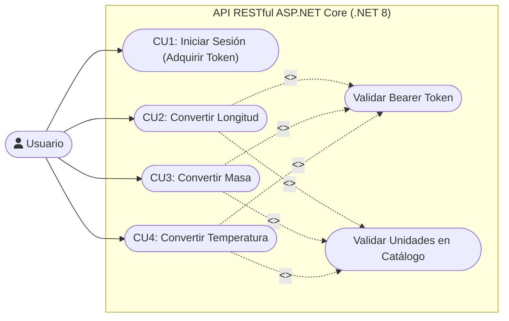
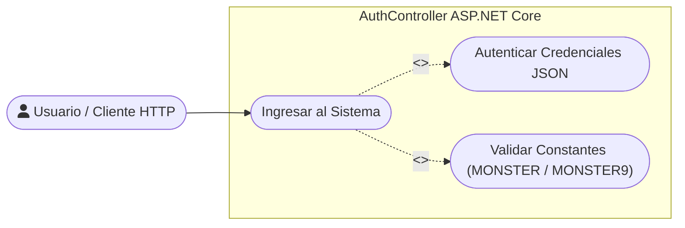
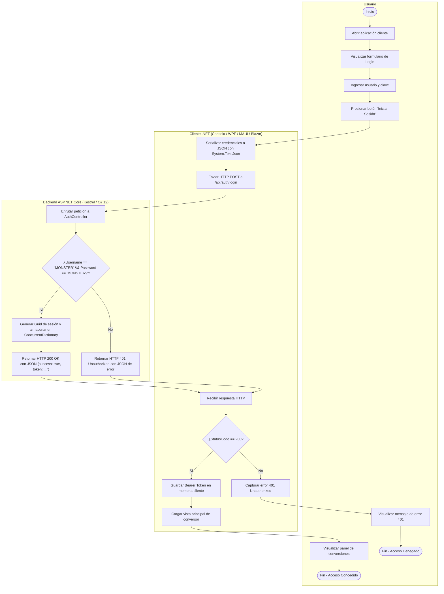
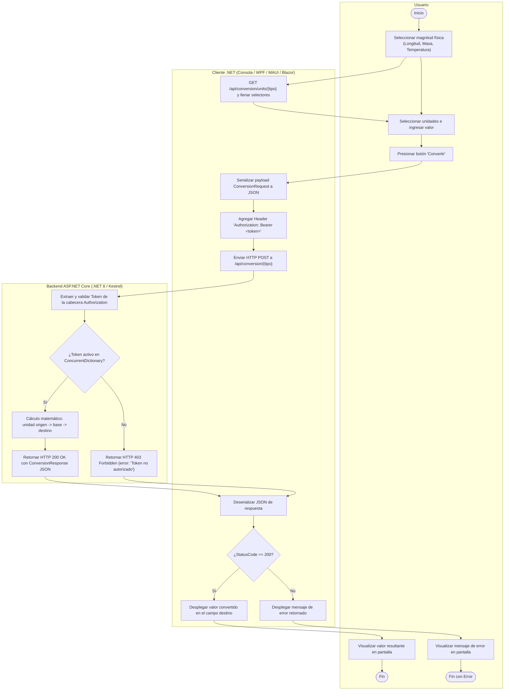
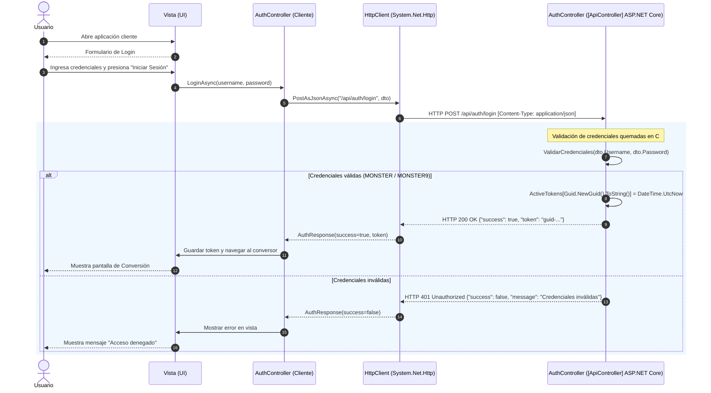
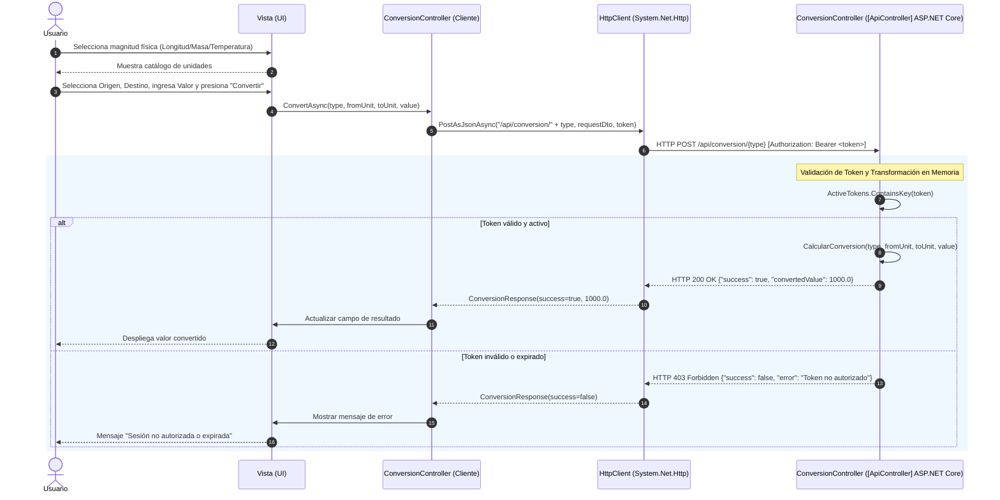
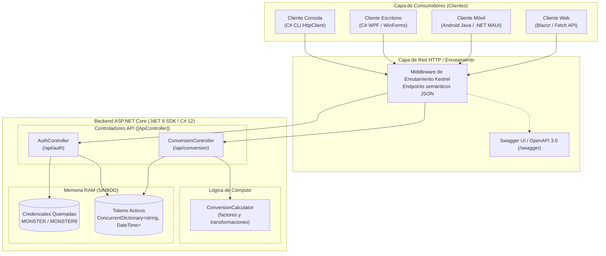

# Diagramas UML · TI.1.4 RESTful .NET (SINBDD)

Este documento contiene la representación visual en sintaxis **Mermaid** de todos los modelos
UML correspondientes al taller **TI.1.4** (Servicios Web RESTful en plataforma **.NET 8 / C# / ASP.NET Core Web API**, `SINBDD`).

---

## 1. Casos de Uso (`01_CASOS_DE_USO`)

### 1.1. Diagrama General de Casos de Uso
El actor `Usuario` interactúa con la API RESTful expuesta por Kestrel en .NET. La autenticación y adquisición del Bearer Token es obligatoria para acceder a las operaciones de conversión.

### 1.2. Detalle del Módulo de Autenticación
Endpoint `POST /api/auth/login` validado contra las constantes en código (`MONSTER` / `MONSTER9`).

---

## 2. Diagramas de Actividad (`02_ACTIVIDAD`)

### 2.1. Actividad: Iniciar Sesión (Autenticación REST .NET)
Flujo HTTP POST JSON con 3 swimlanes (*Usuario*, *Cliente C# / Multi-canal*, *Backend ASP.NET Core Web API*).

### 2.2. Actividad: Convertir Unidades (Endpoints REST .NET)
Flujo de invocación a `POST /api/conversion/{type}` con validación de cabecera `Authorization: Bearer <token>`.

---

## 3. Diagramas de Secuencia (`03_SECUENCIA`)

### 3.1. Secuencia: Iniciar Sesión (REST JSON .NET)

### 3.2. Secuencia: Conversión de Unidades (REST JSON .NET)

---

## 4. Clases del Dominio (`04_CLASES`)

Al tratarse de una arquitectura **SINBDD**, la solución en .NET RESTful no utiliza Entity Framework Core ni migraciones SQL. Todo el estado reside en colecciones en memoria documentadas en:
`TI.1.4. PAO202651_RESTFUL_DOTNET_SINBDD_NRC36884_GR09/01. UML/03. DIAGRAMAS UML/04_CLASES/README.txt`

---

## 5. Arquitectura de Componentes (`05_ARQUITECTURA`)

---

> [!info] Enlaces relacionados
> - [index.md](index.md): Panel principal del taller TI.1.4.
> - [srs.md](srs.md): Especificación de Requisitos de Software de TI.1.4.
> - [01-uml](../../03-deliverables/01-uml.md): Catálogo general de UML en el vault.
