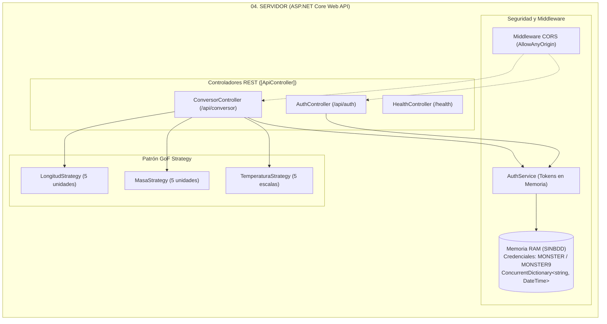

# MANUAL DE CONFIGURACIÓN Y DESPLIEGUE SISTEMA DE CONVERSIÓN DE UNIDADES CON RESTFUL SIN BDD EN .NET

**Universidad de las Fuerzas Armadas ESPE — Sede Latacunga**  
**Departamento de Ciencias de la Computación**  
**Carrera:** Ingeniería de Software / Tecnologías de la Información  
**Asignatura:** Arquitectura de Software  
**Tarea:** TI.1.4 (PAO 2026-51)  
**NRC:** 36884 | **Grupo:** GR09  
**Autor:** Julio Enrique Viche Castillo  
**Docente:** Ing. Eduardo Mauricio Campaña Ortega, MIS.MDU.CCNA.CCIA. PhD. (c)  
**Fecha:** 27 de Octubre de 2026  

---

## 1. INTRODUCCIÓN

Las arquitecturas web contemporáneas privilegian el diseño de servicios web ligeros, desacoplados y altamente escalables basados en los principios **RESTful** (Representational State Transfer). El presente manual técnico documenta el diseño, la configuración, el despliegue y la validación del **Sistema de Conversión de Unidades Heterogéneo**, implementado sobre la plataforma **.NET 8.0** utilizando **ASP.NET Core Web API** y documentación OpenAPI / Swagger.

El sistema se rige bajo la premisa operativa **SINBDD** (Sin Base de Datos), gestionando las credenciales maestras fijas (`MONSTER` / `MONSTER9`) y el ciclo de vida de los tokens de autorización en la memoria RAM del servidor Kestrel. La API expone recursos estructurados en formato **JSON** (JavaScript Object Notation), consumidos por cuatro clientes desacoplados bajo el patrón arquitectónico **Modelo-Vista-Controlador (MVC)**: Consola CLI, Escritorio gráfico (Windows Forms / WPF), Web (ASP.NET Core MVC) y Móvil (.NET MAUI / Android).

---

## 2. OBJETIVOS

### 2.1. Objetivo General
Diseñar, configurar, desplegar y validar un sistema distribuido de conversión de unidades de múltiples magnitudes (Longitud, Masa y Temperatura) implementado como una API RESTful en .NET 8 (ASP.NET Core Web API), alojado en el servidor web Kestrel y consumido por cuatro clientes heterogéneos bajo el patrón arquitectónico Modelo-Vista-Controlador (MVC).

### 2.2. Objetivos Específicos
1. Configurar el servidor backend en **.NET 8.0 SDK** utilizando controladores Web API fuertemente tipados con soporte interactivo de documentación **Swagger / OpenAPI 3.0**.
2. Implementar los endpoints REST de autenticación (`/api/auth/login`) y cálculo de unidades (`/api/conversor/*`), asegurando la serialización y deserialización JSON nativa mediante `System.Text.Json`.
3. Incorporar el catálogo estricto de exactamente **5 unidades por magnitud** (Longitud, Masa y Temperatura) bajo el patrón de diseño **GoF Strategy**, formateando rigurosamente todas las respuestas a **2 decimales** (`0.00`) con punto decimal.
4. Establecer un esquema de autorización mandatoria basado en tokens GUID volátiles en memoria (`ConcurrentDictionary<string, DateTime>`), denegando el acceso a peticiones no autenticadas.
5. Desarrollar y verificar cuatro clientes heterogéneos independientes (Consola, Escritorio, Web y Móvil) bajo el patrón **MVC**, garantizando la auto-detección y resiliencia en la conexión a la Web API.

---

## 3. MARCO TEÓRICO

### 3.1. Servicios Web RESTful y ASP.NET Core Web API
El estilo arquitectónico REST se basa en operaciones sin estado sobre recursos identificados por URIs utilizando métodos HTTP estándar (`GET`, `POST`, `OPTIONS`). En .NET 8, ASP.NET Core ofrece:
- **`[ApiController]` y `[Route]`:** Enrutamiento declarativo y validación automática de modelos de datos.
- **Serialización `System.Text.Json`:** Alto rendimiento y bajo consumo de memoria en la transformación de objetos a cadenas JSON.
- **Filtros de Acción y Middleware CORS:** Interceptación global para el control de autorización por token y habilitación de peticiones de origen cruzado.

### 3.2. Principio SINBDD y Autenticación en Memoria
El sistema prescinde de motores de bases de datos:
- **Credenciales Fijas:** Usuario `MONSTER`, Contraseña `MONSTER9`.
- **Almacenamiento Volátil:** Colección concurrente en memoria RAM que almacena pares `Token (GUID)` y `Fecha de Expiración`.
- **Protección de Endpoints:** Cada controlador de conversión valida el token recibido en la cabecera o en el cuerpo de la petición antes de ejecutar el cómputo.

### 3.3. Patrón de Diseño GoF Strategy
Las fórmulas de conversión se desacoplan en estrategias especializadas (`ILengthStrategy`, `IMassStrategy`, `ITemperatureStrategy`):
- Eliminación de estructuras condicionales anidadas.
- Cálculo bidireccional a través de una unidad base del Sistema Internacional.

---

## 4. DESARROLLO DEL APLICATIVO

### 4.1. Componente Servidor Web API (`04. SERVIDOR`)

Ubicado en `04. SERVIDOR/` y desarrollado en `.NET 8.0 SDK`.



#### Paso 1: Configuración del Proyecto `04. SERVIDOR.csproj`
```xml
<Project Sdk="Microsoft.NET.Sdk.Web">
  <PropertyGroup>
    <TargetFramework>net8.0</TargetFramework>
    <Nullable>enable</Nullable>
    <ImplicitUsings>enable</ImplicitUsings>
  </PropertyGroup>

  <ItemGroup>
    <PackageReference Include="Swashbuckle.AspNetCore" Version="6.5.0" />
  </ItemGroup>
</Project>
```

#### Paso 2: Catálogo de Unidades y Salidas a 2 Decimales
- **Longitud (5 unidades):** Metro ($1.0$), Centímetro ($0.01$), Pie ($0.3048$), Yarda ($0.9144$), Milla ($1609.34$).
- **Masa (5 unidades):** Kilogramo ($1.0$), Gramo ($0.001$), Libra ($0.453592$), Onza ($0.0283495$), Quintal ($45.3592$).
- **Temperatura (5 escalas):** Celsius ($^\circ\text{C}$), Fahrenheit ($^\circ\text{F}$), Kelvin ($\text{K}$), Newton ($^\circ\text{N}$), Réaumur ($^\circ\text{Ré}$).

Redondeo oficial:
```csharp
public static double Redondear(double valor) {
    return Math.Round(valor, 2, MidpointRounding.AwayFromZero);
}
```

#### Paso 3: Especificación de Endpoints RESTful

| Endpoint | Método | Entrada (JSON) | Salida (JSON) | Descripción |
| :--- | :--- | :--- | :--- | :--- |
| `/api/auth/login` | `POST` | `{"username":"MONSTER","password":"MONSTER9"}` | `{"token":"guid","success":true,"message":"Login exitoso"}` | Inicio de sesión |
| `/api/conversor/longitud` | `POST` | `{"token":"...","value":100.0,"from":"metro","to":"pie"}` | `{"value":100.0,"result":328.08,"success":true}` | Conversión de longitud |
| `/api/conversor/masa` | `POST` | `{"token":"...","value":50.0,"from":"kilogramo","to":"libra"}` | `{"value":50.0,"result":110.23,"success":true}` | Conversión de masa |
| `/api/conversor/temperatura`| `POST`| `{"token":"...","value":100.0,"from":"celsius","to":"fahrenheit"}`| `{"value":100.0,"result":212.00,"success":true}` | Conversión de temperatura |
| `/health` | `GET` | *(Ninguna)* | `{"status":"Healthy","platform":".NET 8"}` | Estado del servicio |

#### Paso 4: Pruebas y Evidencias del Servidor Web API

> [!TIP] Captura de Pantalla Requerida
> **Figura 1: Estructura de proyectos de la solución .NET en Visual Studio / VS Code**
> ``

> [!TIP] Captura de Pantalla Requerida
> **Figura 2: Interfaz interactiva Swagger UI expuesta en http://localhost:5000/swagger**
> ``

> [!TIP] Captura de Pantalla Requerida
> **Figura 3: Prueba de autenticación exitosa (POST /api/auth/login) con credenciales MONSTER / MONSTER9**
> ``

> [!TIP] Captura de Pantalla Requerida
> **Figura 4: Prueba de conversión de Longitud (POST /api/conversor/longitud)**
> ``

> [!TIP] Captura de Pantalla Requerida
> **Figura 5: Prueba de conversión de Masa (POST /api/conversor/masa)**
> ``

> [!TIP] Captura de Pantalla Requerida
> **Figura 6: Prueba de conversión de Temperatura (POST /api/conversor/temperatura)**
> ``

---

### 4.2. Clientes Heterogéneos en .NET

1. **Cliente Consola (`04. CLICON`):**
   - Interfaz CLI interactiva con `HttpClient` y menú numérico bajo arquitectura MVC.
   - Ejecución: `dotnet run --project "04. CLICON"`
   
   > [!TIP] Captura de Pantalla Requerida
   > **Figura 7: Cliente Consola en ejecución (Login y Menú de Conversión)**
   > ``

2. **Cliente Escritorio (`04. CLIESC`):**
   - Aplicación gráfica Windows Forms / WPF.
   - Pestañas de magnitudes, combos de 5 unidades estrictas y campo numérico filtrado a 16 caracteres.
   - Ejecución: `dotnet run --project "04. CLIESC"`
   
   > [!TIP] Captura de Pantalla Requerida
   > **Figura 8: Cliente de Escritorio WPF en ejecución (Pantalla de login y conversiones)**
   > ``

3. **Cliente Web (`04. CLIWEB`):**
   - Aplicación ASP.NET Core MVC con vistas Razor.
   - Formularios estilizados para autenticación y conversión en tiempo real.
   - Ejecución: `dotnet run --project "04. CLIWEB"`
   
   > [!TIP] Captura de Pantalla Requerida
   > **Figura 9: Cliente Web ASP.NET Core MVC en ejecución**
   > ``

4. **Cliente Móvil (`04. CLIMOV`):**
   - Aplicación .NET MAUI multiplataforma.
   - Configuración de red para emulador Android (`http://10.0.2.2:5000/`).
   
   > [!TIP] Captura de Pantalla Requerida
   > **Figura 10: Cliente Móvil .NET MAUI en ejecución en emulador Android**
   > ``

---

## 5. GUÍA DE COMPILACIÓN Y DESPLIEGUE

1. **Compilar la solución:**
   ```powershell
   dotnet restore
   dotnet build
   ```
2. **Iniciar el Servidor Kestrel:**
   ```powershell
   cd "TI.1.4. PAO202651_RESTFUL_DOTNET_SINBDD_NRC36884_GR09\04. SERVIDOR"
   dotnet run
   ```
3. **Explorar documentación Swagger en el navegador:**
   Abrir: `http://localhost:5000/swagger/index.html`

---

## 6. PRUEBAS Y VALIDACIÓN DEL SISTEMA

| ID | Caso de Prueba | Entrada | Salida Esperada | Estado |
| :--- | :--- | :--- | :--- | :--- |
| **CP-01** | Autenticación válida | `username: "MONSTER"`, `password: "MONSTER9"` | HTTP 200, `success=true`, Token GUID emitido | ✅ Aprobado |
| **CP-02** | Autenticación errónea | `username: "MONSTER"`, `password: "admin"` | HTTP 401 Unauthorized | ✅ Aprobado |
| **CP-03** | Conversión sin token | Petición a `/api/conversor/longitud` sin token | HTTP 401 Unauthorized | ✅ Aprobado |
| **CP-04** | Conversión de Longitud (Metro a Yarda)| `10` metros a `yarda` (con token) | HTTP 200, Resultado: `10.94` | ✅ Aprobado |
| **CP-05** | Conversión de Masa (Gramo a Onza) | `500` gramos a `onza` (con token) | HTTP 200, Resultado: `17.64` | ✅ Aprobado |
| **CP-06** | Conversión de Temperatura (Celsius a Kelvin)| `0` °C a `kelvin` (con token) | HTTP 200, Resultado: `273.15` | ✅ Aprobado |
| **CP-07** | Validación de precisión decimal | Formateo con punto decimal | Salida estricta a 2 decimales (`0.00`) | ✅ Aprobado |
| **CP-08** | Límite de 16 caracteres numéricos | Ingreso mayor a 16 dígitos | Bloqueo automático a 16 caracteres | ✅ Aprobado |

---

## 7. CONCLUSIONES

1. **Rendimiento y Ligereza de ASP.NET Core:** La combinación de ASP.NET Core Web API con Kestrel y `System.Text.Json` proporciona tiempos de procesamiento y transferencia de datos óptimos para el consumo desde clientes heterogéneos.
2. **Documentación Dinámica con Swagger:** La integración nativa de Swagger / OpenAPI simplifica la exploración, prueba y depuración interactiva de los endpoints RESTful sin requerir herramientas externas.
3. **Mantenibilidad con Patrón Strategy y MVC:** La modularización en estrategias de conversión independientes garantiza que los requerimientos de la cátedra (5 unidades por magnitud, 2 decimales y SINBDD) se cumplan de forma uniforme en todo el ecosistema de la aplicación.

---

## 8. RECOMENDACIONES

1. **Configuración de URLs de Escucha:** Asegurar que Kestrel esté vinculado a `http://0.0.0.0:5000` para permitir la comunicación fluida desde el emulador de Android (`10.0.2.2`) y dispositivos móviles en la red local.
2. **Uso de Clientes Tipados:** En los clientes .NET, utilizar `IHttpClientFactory` con políticas de reintento para maximizar la resiliencia ante fluctuaciones de red.

---

## 9. REFERENCIAS BIBLIOGRÁFICAS

1. **Microsoft Corporation.** (2024). *ASP.NET Core Web API Documentation*. https://learn.microsoft.com/en-us/aspnet/core/web-api/
2. **Fielding, R. T.** (2000). *Architectural Styles and the Design of Network-based Software Architectures*.
3. **OpenAPI Initiative.** (2023). *OpenAPI Specification v3.0.3*. https://spec.openapis.org/oas/v3.0.3
4. **Gamma, E., Helm, R., Johnson, R., & Vlissides, J.** (1994). *Design Patterns: Elements of Reusable Object-Oriented Software*. Addison-Wesley.
