# Manual Técnico - Conversor de Unidades RESTful en .NET (SINBDD)

**Universidad de las Fuerzas Armadas ESPE — Sede Latacunga**  
**Departamento de Ciencias de la Computación**  
**Asignatura:** Arquitectura de Software | **NRC:** 36884 | **Grupo:** GR09  
**Autores:** Julio Enrique Viche Castillo, Gabriel Omar Murillo Medina  
**Docente:** Ing. Eduardo Mauricio Campaña Ortega, MIS.MDU.CCNA.CCIA. PhD. (c)  
**Fecha:** 28 de Octubre de 2026

---

## PARTE PRÁCTICA

### INTRODUCCIÓN

REST es un estilo de arquitectura que organiza la funcionalidad en recursos identificados por rutas HTTP. Este proyecto intercambia solicitudes y respuestas JSON para autenticar usuarios y convertir longitud, masa y temperatura.

El servidor REST implementa recursos con ASP.NET Core Web API (Kestrel). Los clientes envían solicitudes HTTP a rutas definidas y reciben respuestas JSON; Kestrel proporciona el servidor HTTP embebido.

ServidorRestMain inicia ASP.NET Core sobre Kestrel (.NET 10) en el puerto 8080 y usa 8085 si el puerto preferido está ocupado. Jackson gestiona JSON; el servicio se ejecuta desde 04. SERVIDOR con dotnet run.

### OBJETIVOS

#### OBJETIVO GENERAL

Documentar la arquitectura, configuración y uso de un conversor de unidades con autenticación previa, clientes Java de consola, escritorio, web y móvil, y una API REST implementada con Jersey y Kestrel. El sistema convierte longitud, masa y temperatura y opera sin base de datos (SINBDD).

#### OBJETIVOS ESPECÍFICOS

Describir las rutas /health, /auth/login y /conversor/longitud, /masa y /temperatura, los métodos HTTP utilizados y los modelos JSON de solicitud y respuesta.

Explicar cómo los clientes Java de consola, escritorio, web y móvil envían solicitudes HTTP/JSON, realizan el inicio de sesión y usan el token antes de convertir.

Explicar la organización de recursos REST, los métodos HTTP y el intercambio de modelos JSON con los clientes.

### INSTALACIÓN Y CONFIGURACIÓN DE HERRAMIENTAS

Para dar inicio al desarrollo de la práctica, primero se deben instalar y configurar las herramientas esenciales. Para este proyectó se utilizó Windows 11.

#### INSTALACIÓN Y CONFIGURACIÓN DE APACHE NETBEANS 24

El proyecto REST requiere .NET 10 SDK. Verifica Java con dotnet --version y Maven con dotnet --info desde PowerShell o la terminal integrada de Visual Studio.

| Java --version |
| --- |

Figura 3. Versión de .NET 10 SDK en el símbolo del sistema

Para la instalación de la herramienta se accede a la página oficial de descarga de Apache https://netbeans.apache.org/front/main/download/ se selecciona la opción ‘Older Releases’, ‘Visual Studio 2022 / VS Code’ y la opción para el sistema operativo.

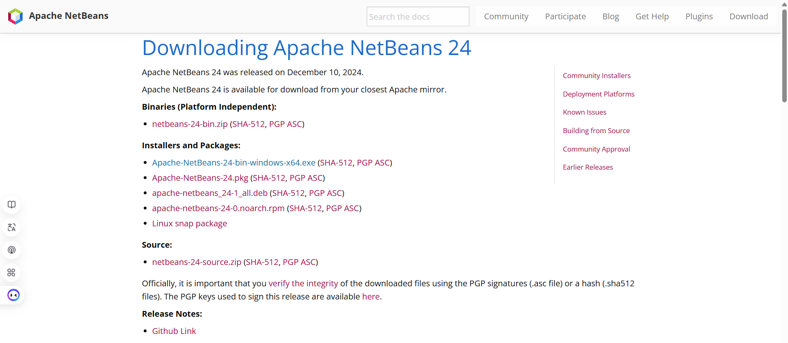

Figura 4. Página oficial de descarga de Visual Studio 2022

Una vez seleccionada la opción para el sistema operativo, se inicia la descarga y se obtendrá el siguiente ejecutable.

Figura 5. Instalador Visual Studio 2022 / VS Code

Al ejecutar el instalador se muestra la siguiente pantalla, en el proceso de instalación se aceptan los términos y condiciones, se selecciona la ubicación de la descarga y se finaliza la instalación.

Figura 6. Pantalla inicial de instalación Visual Studio 24

Una vez finalizada la descarga se ejecuta la aplicación y se iniciará Visual Studio 2022 / VS Code.

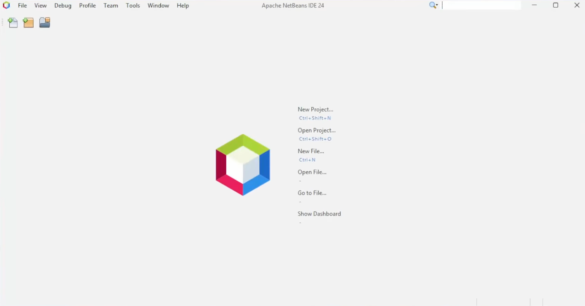

Figura 7. Aplicación Visual Studio 2022 / VS Code

#### INSTALACIÓN Y CONFIGURACIÓN DE ANDROID STUDIO

Para la instalación de la herramienta se accede a la página oficial de descarga de Android Studio https://developer.android.com/studio se selecciona la opción de descarga, se aceptan términos y condiciones e iniciará la descarga.

Figura 8. Página oficial de descarga de Android Studio

Al finalizar la descarga se obtendrá el instalador ejecutable.

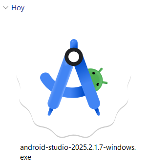

Figura 9. Ejecutable Android Studio

Al ejecutar el instalador se mostrará la siguiente pantalla:

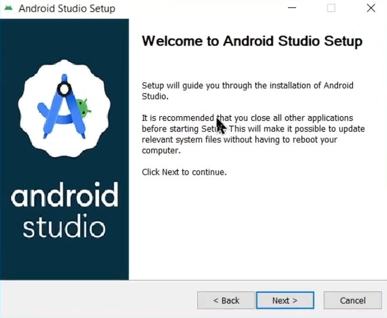

Figura 10. Pantalla inicial de instalación de Android Studio

Durante la instalación se selecciona los componentes a instalar, ubicación y carpeta de inicio. Al finalizar la instalación se iniciará la configuración en donde se selecciona el Setup Standard se aceptan términos y condiciones y se inicia la descarga de componentes.

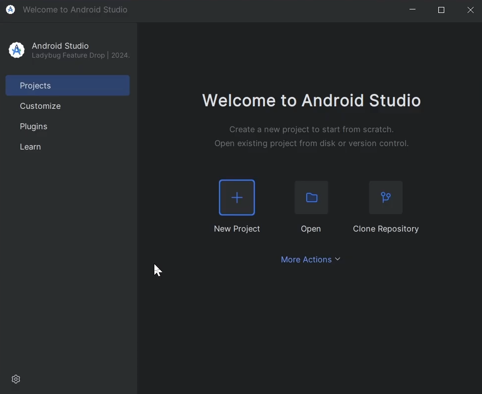

Figura 11. Aplicación Android Studio

### ESTRUCTURA DE PROYECTO

Para la elaboración del proyecto, en primer lugar, es necesario crear una carpeta en la cual se alojarán los archivos necesarios para su funcionamiento.

Figura 1. Creación de la carpeta raíz

Dentro de la carpeta principal del proyecto, se debe ubicar la siguiente subestructura.

Figura 2. Estructura inicial del proyecto

Todo esto con la finalidad de llevar buenas prácticas y mantener organizado el proyecto.

## APLICACIONES SERVIDOR

### CREACIÓN DEL PROYECTO SERVIDOR

El servidor es un proyecto Java con Maven. En Visual Studio abre la carpeta 04. SERVIDOR, revisa 04. SERVIDOR.csproj y ejecuta Monster.Server.ServidorRestMain mediante dotnet run; Maven descarga Jersey, Kestrel y Jackson según el 04. SERVIDOR.csproj.

Figura 12. Creación del proyecto – SERVIDOR RESTFUL

Figura 13. Configuración del proyecto 1 - SERVIDOR RESTFUL

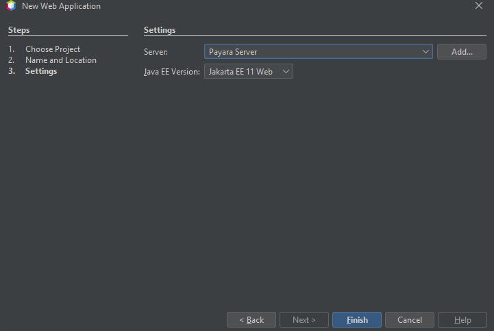

Figura 14. Configuración del proyecto 2 - SERVIDOR RESTFUL

### CODIFICACIÓN DEL PROYECTO SERVIDOR

#### CREACIÓN DE PAQUETES

El servidor separa la configuración Jersey, los controladores REST, los modelos de intercambio y los servicios de conversión. Los paquetes reales son Monster.config, Monster.controlador, Monster.modelo, Monster.servicio y Monster.Server; no hay base de datos.

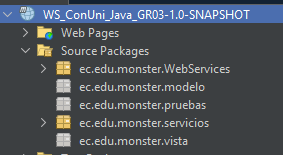

Figura 15. Estructura de paquetes - SERVIDOR RESTFUL

#### CREACIÓN DE RECURSOS REST

AuthController expone el inicio de sesión. ConversorController publica las operaciones HTTP de longitud, masa y temperatura; las clases de servicio realizan los cálculos y el servidor serializa las respuestas como JSON.

Los recursos usan @Path, @POST, @Consumes y @Produces. AuthController valida MONSTER / MONSTER9 y crea un token en memoria; ConversorController verifica el token antes de ejecutar una conversión.

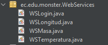

Figura 16. Estructura de paquetes - controladores REST

Tabla 1. Método login - AuthController.cs

public Response login(Conversion modelo) {

if (modelo == null) {

Conversion error = new Conversion();

error.setSuccess(false);

error.setMessage("Cuerpo de solicitud requerido.");

return Response.status(Response.Status.BAD_REQUEST).entity(error).build();

}

String usuario = modelo.getFrom();

String clave = modelo.getTo();

String token = authService.validarLogin(usuario, clave);

if (token != null) {

modelo.setToken(token);

modelo.setSuccess(true);

modelo.setMessage("Autenticación satisfactoria. Bienvenido al sistema.");

return Response.ok(modelo).build();

} else {

modelo.setSuccess(false);

modelo.setMessage("Usuario o contraseña incorrectos. Credenciales válidas: MONSTER / MONSTER9");

return Response.status(Response.Status.UNAUTHORIZED).entity(modelo).build();

}

}

Tabla 2. Método convertirLongitud - ConversorController.cs

public Response convertirLongitud(Conversion modelo) {

if (modelo == null) {

return respuestaError(Response.Status.BAD_REQUEST, "Cuerpo de solicitud requerido.");

}

if (!authService.esTokenValido(modelo.getToken())) {

modelo.setSuccess(false);

modelo.setMessage("Sesión inválida o expirada. Debe iniciar sesión primero.");

return Response.status(Response.Status.UNAUTHORIZED).entity(modelo).build();

}

try {

double resultado = longitudService.convertirLongitud(modelo.getValue(), modelo.getFrom(), modelo.getTo());

double resultadoRedondeado = redondear2Decimales(resultado);

modelo.setResult(resultadoRedondeado);

modelo.setSuccess(true);

modelo.setMessage("Conversión de longitud realizada exitosamente.");

return Response.ok(modelo).build();

} catch (IllegalArgumentException e) {

modelo.setSuccess(false);

modelo.setMessage(e.getMessage());

return Response.status(Response.Status.BAD_REQUEST).entity(modelo).build();

}

}

Tabla 3. Método convertirLongitud - ConversorLongitud.cs

public double convertirLongitud(double valor, String unidadOrigen, String unidadDestino) {

if (unidadOrigen == null || unidadDestino == null) {

throw new IllegalArgumentException("Las unidades de origen y destino no pueden ser nulas.");

}

String origen = normalizar(unidadOrigen);

String destino = normalizar(unidadDestino);

double valorEnMetros;

// 1. Paso a Metros (unidad base)

switch (origen) {

case "centimetros":

case "centimetro":

case "cm":

valorEnMetros = valor / 100.0;

break;

case "metros":

case "metro":

case "m":

valorEnMetros = valor;

break;

case "pies":

case "pie":

case "ft":

valorEnMetros = valor * 0.3048;

break;

case "yardas":

case "yarda":

case "yd":

valorEnMetros = valor * 0.9144;

break;

case "millas":

case "milla":

case "mi":

valorEnMetros = valor * 1609.34;

break;

default:

throw new IllegalArgumentException("Unidad de origen no reconocida en catálogo de longitud: " + unidadOrigen);

}

// 2. Paso de Metros a Destino

switch (destino) {

case "centimetros":

case "centimetro":

case "cm":

return valorEnMetros * 100.0;

case "metros":

case "metro":

case "m":

return valorEnMetros;

case "pies":

case "pie":

case "ft":

return valorEnMetros / 0.3048;

case "yardas":

case "yarda":

case "yd":

return valorEnMetros / 0.9144;

case "millas":

case "milla":

case "mi":

return valorEnMetros / 1609.34;

default:

throw new IllegalArgumentException("Unidad de destino no reconocida en catálogo de longitud: " + unidadDestino);

}

}

Tabla 4. Método main - Program.cs

public static void main(String[] args) {

int preferredPort = Integer.getInteger("server.port", 8080);

HttpServer server = null;

try {

server = startServer(preferredPort);

activePort = preferredPort;

} catch (Exception e) {

if (e.getCause() instanceof BindException || e.getMessage().contains("Address already in use")) {

System.out.println("⚠️ El puerto " + preferredPort + " está ocupado. Intentando en puerto alternativo 8085...");

try {

server = startServer(8085);

activePort = 8085;

} catch (Exception ex) {

System.err.println("❌ No se pudo iniciar el servidor en puerto 8085: " + ex.getMessage());

return;

}

} else {

System.err.println("❌ Error al iniciar el servidor: " + e.getMessage());

e.printStackTrace();

return;

}

}

try {

System.out.println("====================================================================");

System.out.println("🚀 SERVIDOR RESTFUL INICIADO (TI.1.3 - SINBDD)");

System.out.println(" URL Base: http://localhost:" + activePort + CONTEXT_PATH);

System.out.println(" Health: http://localhost:" + activePort + CONTEXT_PATH + "health");

System.out.println(" Login: http://localhost:" + activePort + CONTEXT_PATH + "auth/login");

System.out.println(" Longitud: http://localhost:" + activePort + CONTEXT_PATH + "conversor/longitud");

System.out.println(" Masa: http://localhost:" + activePort + CONTEXT_PATH + "conversor/masa");

System.out.println(" Temperatura: http://localhost:" + activePort + CONTEXT_PATH + "conversor/temperatura");

System.out.println("====================================================================");

System.out.println("Credenciales quemadas: usuario 'MONSTER', contraseña 'MONSTER9'");

System.out.println("Presione Ctrl+C en la consola para detener el servidor...");

Thread.currentThread().join();

} catch (InterruptedException e) {

System.out.println("Servidor detenido.");

Thread.currentThread().interrupt();

}

}

#### CREACIÓN DE SERVICIO

En esta sección se implementa la "capa de servicio", que es el cerebro de la aplicación. Aquí se separa la lógica matemática y de seguridad del protocolo de comunicación. Al no contar con una base de datos, toda la gestión de datos se realiza en memoria, optimizando la velocidad de respuesta.

Servicio de Seguridad: Encargado de la validación de credenciales "hardcoded" y la generación/verificación de tokens de sesión para proteger los puntos de entrada del servidor.

Servicio de Conversiones: Contiene los algoritmos y factores de conversión para las magnitudes de longitud, masa y temperatura. Está diseñado para ser escalable, permitiendo añadir nuevas unidades sin afectar la estructura principal.

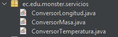

Figura 17. Estructura de paquetes - servicios

Tabla 5. Método convertirLongitud - ConversorLongitud.cs

| public double convertirLongitud(double valor, String unidadOrigen, String unidadDestino) { if (unidadOrigen == null // unidadDestino == null) { throw new IllegalArgumentException("Las unidades de origen y destino no pueden ser nulas."); } String origen = normalizar(unidadOrigen); String destino = normalizar(unidadDestino); double valorEnMetros; // 1. Paso a Metros (unidad base) switch (origen) { case "centimetros": case "centimetro": case "cm": valorEnMetros = valor / 100.0; break; case "metros": case "metro": case "m": valorEnMetros = valor; break; case "pies": case "pie": case "ft": valorEnMetros = valor * 0.3048; break; case "yardas": case "yarda": case "yd": valorEnMetros = valor * 0.9144; break; case "millas": case "milla": case "mi": valorEnMetros = valor * 1609.34; break; default: throw new IllegalArgumentException("Unidad de origen no reconocida en catálogo de longitud: " + unidadOrigen); } // 2. Paso de Metros a Destino switch (destino) { case "centimetros": case "centimetro": case "cm": return valorEnMetros * 100.0; case "metros": case "metro": case "m": return valorEnMetros; case "pies": case "pie": case "ft": return valorEnMetros / 0.3048; case "yardas": case "yarda": case "yd": return valorEnMetros / 0.9144; case "millas": case "milla": case "mi": return valorEnMetros / 1609.34; default: throw new IllegalArgumentException("Unidad de destino no reconocida en catálogo de longitud: " + unidadDestino); } } |
| --- |

Tabla 6. Método convertirMasa - ConversorMasa.cs

| public double convertirMasa(double valor, String unidadOrigen, String unidadDestino) { if (unidadOrigen == null // unidadDestino == null) { throw new IllegalArgumentException("Las unidades de origen y destino no pueden ser nulas."); } String origen = normalizar(unidadOrigen); String destino = normalizar(unidadDestino); double valorEnKilos; // 1. Paso a Kilogramos (unidad base) switch (origen) { case "gramos": case "gramo": case "g": valorEnKilos = valor / 1000.0; break; case "kilogramos": case "kilogramo": case "kilos": case "kilo": case "kg": valorEnKilos = valor; break; case "onzas": case "onza": case "oz": valorEnKilos = valor * 0.0283495; break; case "libras": case "libra": case "lb": case "lbs": valorEnKilos = valor * 0.453592; break; case "quintales": case "quintal": case "q": // 1 quintal = 100 libras valorEnKilos = (valor * 100.0) * 0.453592; break; default: throw new IllegalArgumentException("Unidad de origen no reconocida en catálogo de masa: " + unidadOrigen); } // 2. Paso de Kilogramos a Destino switch (destino) { case "gramos": case "gramo": case "g": return valorEnKilos * 1000.0; case "kilogramos": case "kilogramo": case "kilos": case "kilo": case "kg": return valorEnKilos; case "onzas": case "onza": case "oz": return valorEnKilos / 0.0283495; case "libras": case "libra": case "lb": case "lbs": return valorEnKilos / 0.453592; case "quintales": case "quintal": case "q": return (valorEnKilos / 0.453592) / 100.0; default: throw new IllegalArgumentException("Unidad de destino no reconocida en catálogo de masa: " + unidadDestino); } } |
| --- |

Tabla 7. Método convertirTemperatura - ConversorTemperatura.cs

| public double convertirTemperatura(double valor, String opcionOrigen, String opcionDestino) { if (opcionOrigen == null // opcionDestino == null) { throw new IllegalArgumentException("Las unidades de origen y destino no pueden ser nulas."); } String origen = normalizar(opcionOrigen); String destino = normalizar(opcionDestino); double valorEnCelsius; // 1. Paso a Celsius (unidad base de trabajo) switch (origen) { case "celsius": case "centigrados": case "c": valorEnCelsius = valor; break; case "fahrenheit": case "f": valorEnCelsius = (valor - 32.0) * 5.0 / 9.0; break; case "kelvin": case "k": valorEnCelsius = valor - 273.15; break; case "newton": case "n": valorEnCelsius = valor * 100.0 / 33.0; break; case "reaumur": case "re": valorEnCelsius = valor * 5.0 / 4.0; break; default: throw new IllegalArgumentException("Unidad de origen no reconocida en catálogo de temperatura: " + opcionOrigen); } // 2. Paso de Celsius a Destino switch (destino) { case "celsius": case "centigrados": case "c": return valorEnCelsius; case "fahrenheit": case "f": return (valorEnCelsius * 9.0 / 5.0) + 32.0; case "kelvin": case "k": return valorEnCelsius + 273.15; case "newton": case "n": return valorEnCelsius * 33.0 / 100.0; case "reaumur": case "re": return valorEnCelsius * 4.0 / 5.0; default: throw new IllegalArgumentException("Unidad de destino no reconocida en catálogo de temperatura: " + opcionDestino); } } |
| --- |

### PRUEBAS DE LOS SERVICIOS

Comprueba el servidor en http://localhost:8080/api/health; usa el mismo contexto para POST auth/login y POST conversor/longitud, conversor/masa y conversor/temperatura. Si 8080 está ocupado, ServidorRestMain usa 8085.

La API publica health para comprobar disponibilidad, auth/login para autenticación y conversor/longitud, conversor/masa y conversor/temperatura para las conversiones. Todas las rutas usan el contexto de aplicación indicado en ServidorRestMain.

WSLogin: Punto de entrada para el módulo de seguridad. Recibe la petición del cliente y procesa la validación de credenciales para permitir o denegar el acceso a las funciones del servidor.

WSLongitud: Expone las operaciones matemáticas para las conversiones de medidas de longitud soportadas por el sistema (centímetros, metros, pies, yardas y millas).

WSMasa: Se encarga de recibir los parámetros y retornar las transformaciones entre las distintas unidades de masa (gramos, kilogramos, onzas, libras y quintales).

WSTemperatura: Maneja las peticiones referentes a las variaciones térmicas, permitiendo convertir entre Fahrenheit, Kelvin, Celsius, Newton y Réaumur.

Consulta la ruta health y envía solicitudes JSON a auth/login y a las rutas conversor. Usa MONSTER / MONSTER9 para obtener un token y adjúntalo en las conversiones.

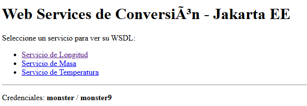

Figura 18. Rutas HTTP publicadas por ASP.NET Core sobre Kestrel (.NET 10) para autenticación y conversiones con respuestas JSON.

Figura 19. Prueba 1: Login.

Figura 20. Prueba 2: Conversor de Longitud.

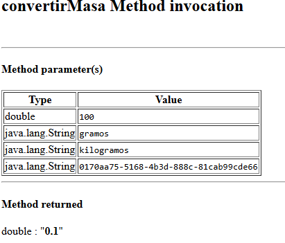

Figura 21. Prueba 3: Conversor de masa.

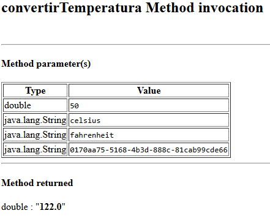

Figura 22. Prueba 4: Conversor de temperatura.

## CODIFICACIÓN DE LOS CLIENTES

### CLIENTE CONSOLA

#### CREACIÓN DEL PROYECTO

El proyecto se crea usando Visual Studio seleccionando ‘Nuevo Proyecto’, ‘C# Console Application’ y ‘.NET Application’.

Figura 23. Creación del proyecto - Cliente consola

En este paso se define el nombre del proyecto y la ubicación.

Figura 24. Configuración del proyecto - Cliente consola

#### ESTRUCTURA DEL PROYECTO

Una vez creado el proyecto se crea la estructura de paquetes basada en el patrón MVC

Figura 25. Estructura del proyecto - Cliente consola

### CODIFICACIÓN DEL PROYECTO CLIENTE CONSOLA

#### CREACIÓN DE MODELOS Y VISTAS

Dado que no se requiere persistencia local ni mapeo de entidades complejas, el modelo se enfoca en la organización lógica de las opciones. Se crea la clase CatalogoUnidades dentro del paquete modelo para gestionar paramétricamente los tipos de unidades de medida disponibles.

En la capa de interacción, dentro del paquete vista, se implementan las clases InterfazConsola y el enumerador OpcionMenu. Estas clases se encargan de abstraer la clase Scanner, capturar los datos por teclado de forma segura y desplegar los menús interactivos al usuario sin mezclar la lógica de negocio.

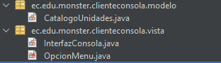

Figura 26. Creación de modelos y vistas - Cliente consola

Tabla 8. Clase ConversionRequest - Cliente consola

| package Monster.Client.model;import java.io.Serializable;/** * [MODELO] Solicitud de conversión creada a partir de las entradas del usuario. * * @author Julio Enrique Viche Castillo - GR09 - NRC 36884 */public class ConversionRequest implements Serializable { private static final long serialVersionUID = 1L; private String magnitud; private String unidadOrigen; private String unidadDestino; private double valor; public ConversionRequest() { } public ConversionRequest(String magnitud, String unidadOrigen, String unidadDestino, double valor) { this.magnitud = magnitud; this.unidadOrigen = unidadOrigen; this.unidadDestino = unidadDestino; this.valor = valor; } public String getMagnitud() { return magnitud; } public void setMagnitud(String magnitud) { this.magnitud = magnitud; } public String getUnidadOrigen() { return unidadOrigen; } public void setUnidadOrigen(String unidadOrigen) { this.unidadOrigen = unidadOrigen; } public String getUnidadDestino() { return unidadDestino; } public void setUnidadDestino(String unidadDestino) { this.unidadDestino = unidadDestino; } public double getValor() { return valor; } public void setValor(double valor) { this.valor = valor; }} |
| --- |

Tabla 9. Clase ConsoleView - Cliente consola

| package Monster.Client.view;import Monster.Client.model.ConversionRequest;import Monster.Client.model.ConversionResponse;import Monster.Client.model.SessionModel;import java.util.Locale;import java.util.Scanner;/** * [VISTA] Interfaz de usuario para la consola de comandos. * Formateo estricto a 2 decimales con punto decimal (Locale.US) y límite de 16 caracteres numéricos. * * @author Julio Enrique Viche Castillo - GR09 - NRC 36884 */public class ConsoleView { public static final String[] UNIDADES_LONGITUD = { "metro", "centimetro", "pie", "yarda", "milla" }; public static final String[] UNIDADES_MASA = { "gramo", "kilogramo", "libra", "onza", "quintal" }; public static final String[] UNIDADES_TEMPERATURA = { "celsius", "fahrenheit", "kelvin", "newton", "reaumur" }; private final Scanner scanner; public ConsoleView() { this.scanner = new Scanner(System.in); } public void mostrarBanner() { System.out.println("=================================================================="); System.out.println(" UNIVERSIDAD DE LAS FUERZAS ARMADAS ESPE - EXTENSIÓN LATACUNGA"); System.out.println(" DEPARTAMENTO DE ENERGÍA Y MECÁNICA"); System.out.println(" ARQUITECTURA DE SOFTWARE"); System.out.println(" TAREA TI.1.3 (PAO 2026-51)"); System.out.println("------------------------------------------------------------------"); System.out.println(" CLIENTE DE CONSOLA: CONVERSOR DE UNIDADES (RESTFUL JAVA - SINBDD)"); System.out.println(" NRC: 36884 / Grupo: GR09 / Autor: Julio Enrique Viche Castillo "); System.out.println(" Patrón Arquitectónico: Modelo - Vista - Controlador (MVC)"); System.out.println("==================================================================\n"); } public String[] pedirCredenciales() { System.out.println("------------------------------------------------------------------"); System.out.println(" INICIO DE SESIÓN OBLIGATORIO (AUTENTICACIÓN) "); System.out.println("------------------------------------------------------------------"); System.out.println(" [Nota]: Credenciales del sistema:"); System.out.println(" Usuario: MONSTER / Contraseña: MONSTER9"); System.out.println("------------------------------------------------------------------"); System.out.print("Ingrese Usuario: "); String usuario = scanner.nextLine().trim(); System.out.print("Ingrese Contraseña: "); String clave = scanner.nextLine().trim(); return new String[]{usuario, clave}; } public boolean preguntarReintento() { System.out.print("\n¿Desea reintentar el inicio de sesión? (s/n): "); String resp = scanner.nextLine().trim().toLowerCase(); return resp.equals("s") // resp.equals("si") // resp.equals("y"); } public String mostrarMenuPrincipal(SessionModel session) { System.out.println("\n=========================================================="); System.out.println(" MENÚ PRINCIPAL DE CONVERSIONES REST (MVC) "); System.out.println("=========================================================="); System.out.printf(" Sesión activa: %s / Token: %s\n", session.getUsuario(), session.getTokenAbreviado()); System.out.println("----------------------------------------------------------"); System.out.println(" 1. Conversión de Longitud (metro, centimetro, pie, yarda, milla)"); System.out.println(" 2. Conversión de Masa (gramo, kilogramo, libra, onza, quintal)"); System.out.println(" 3. Conversión de Temperatura (celsius, fahrenheit, kelvin, newton, reaumur)"); System.out.println(" 4. Verificar estado del token de sesión"); System.out.println(" 5. Cerrar sesión y Salir"); System.out.println("=========================================================="); System.out.print("Seleccione una opción (1-5): "); return scanner.nextLine().trim(); } public ConversionRequest solicitarDatosConversion(String magnitud, String[] unidades) { System.out.println("\n--- [CONVERSIÓN DE " + magnitud.toUpperCase() + "] ---"); String origen = seleccionarUnidad("origen", unidades); if (origen == null) return null; String destino = seleccionarUnidad("destino", unidades); if (destino == null) return null; double valor = pedirValorNumerico(); return new ConversionRequest(magnitud, origen, destino, valor); } private String seleccionarUnidad(String tipo, String[] unidades) { System.out.println("Seleccione unidad de " + tipo + ":"); for (int i = 0; i < unidades.length; i++) { System.out.printf(" %d. %s\n", (i + 1), capitalizar(unidades[i])); } System.out.print("Elija una opción (1-" + unidades.length + "): "); String input = scanner.nextLine().trim(); try { int idx = Integer.parseInt(input) - 1; if (idx >= 0 && idx < unidades.length) { return unidades[idx]; } else { mostrarError("Opción de unidad fuera de rango."); return null; } } catch (NumberFormatException e) { mostrarError("Entrada no numérica."); return null; } } public double pedirValorNumerico() { while (true) { System.out.print("Ingrese el valor numérico a convertir (solo números y '.'): "); String input = scanner.nextLine().trim(); if (input.length() > 16) { mostrarError("Longitud excedida. El valor no puede superar los 16 caracteres."); continue; } if (!input.matches("^-?\\d+(\\.\\d+)?$")) { mostrarError("Entrada no válida. Solo se permiten números y el punto decimal '.' (ejemplo: 25.5 o 100)."); continue; } try { return Double.parseDouble(input); } catch (NumberFormatException e) { mostrarError("Ingrese un número válido (ejemplo: 25.5 o 100)."); } } } public void mostrarResultadoConversion(ConversionRequest req, ConversionResponse resp) { if (resp != null && resp.isExito()) { System.out.println("\n=========================================================="); System.out.println(" RESULTADO DE LA CONVERSIÓN "); System.out.println("=========================================================="); System.out.printf(Locale.US, " %.2f %s ---> %.2f %s\n", req.getValor(), capitalizar(req.getUnidadOrigen()), resp.getValorConvertido(), capitalizar(req.getUnidadDestino())); System.out.println("=========================================================="); } else { String err = (resp != null) ? resp.getMensajeError() : "Sin respuesta del servidor"; mostrarError("En la conversión: " + err); } } public void mostrarMensaje(String mensaje) { System.out.println(mensaje); } public void mostrarExito(String mensaje) { System.out.println("\n[OK] " + mensaje); } public void mostrarError(String mensaje) { System.out.println("\n[ERROR] " + mensaje); } public void mostrarDespedida() { System.out.println("\n=========================================================="); System.out.println(" Gracias por utilizar el Conversor de Unidades RESTful (GR09)"); System.out.println("==========================================================\n"); } private String capitalizar(String str) { if (str == null // str.isEmpty()) return ""; return str.substring(0, 1).toUpperCase() + str.substring(1); }} |
| --- |

Tabla 10. Clase RestClient - Cliente consola

| package Monster.Client.rest;import com.fasterxml.jackson.databind.JsonNode;import com.fasterxml.jackson.databind.ObjectMapper;import Monster.Client.model.ConversionResponse;import Monster.Client.model.LoginResponse;import java.io.IOException;import java.net.URI;import java.net.http.HttpClient;import java.net.http.HttpRequest;import java.net.http.HttpResponse;import java.time.Duration;import java.util.HashMap;import java.util.Map;/** * Cliente HTTP RESTful con soporte de fallback dinámico de URLs y serialización JSON. * Se comunica con WS_CONV_UNI_RESTFULL_JAVA. * * @author Julio Enrique Viche Castillo - GR09 - NRC 36884 */public class RestClient { private static final String DEFAULT_URL_8080 = "http://localhost:8080/api/"; private static final String FALLBACK_URL_8085 = "http://localhost:8085/api/"; private final HttpClient httpClient; private final ObjectMapper objectMapper; private String baseUrl; public RestClient() { this(null); } public RestClient(String customBaseUrl) { this.httpClient = HttpClient.newBuilder() .connectTimeout(Duration.ofSeconds(5)) .build(); this.objectMapper = new ObjectMapper(); if (customBaseUrl != null && !customBaseUrl.trim().isEmpty()) { this.baseUrl = normalizarUrl(customBaseUrl); } else { this.baseUrl = resolverUrlActiva(); } } private String normalizarUrl(String url) { String u = url.trim(); return u.endsWith("/") ? u : u + "/"; } private String resolverUrlActiva() { // 1. Probar variable de entorno o propiedad del sistema String envUrl = System.getenv("API_BASE_URL"); if (envUrl == null) { envUrl = System.getProperty("api.base.url"); } if (envUrl != null && !envUrl.trim().isEmpty()) { return normalizarUrl(envUrl); } // 2. Probar puerto 8080 if (probarServidor(DEFAULT_URL_8080)) { return DEFAULT_URL_8080; } // 3. Probar puerto 8085 (por si 8080 estaba ocupado) if (probarServidor(FALLBACK_URL_8085)) { return FALLBACK_URL_8085; } // Predeterminado return DEFAULT_URL_8080; } private boolean probarServidor(String testUrl) { try { HttpRequest req = HttpRequest.newBuilder() .uri(URI.create(testUrl + "health")) .timeout(Duration.ofMillis(800)) .GET() .build(); HttpResponse<String> resp = httpClient.send(req, HttpResponse.BodyHandlers.ofString()); return resp.statusCode() == 200; } catch (Exception e) { return false; } } public String getBaseUrl() { return baseUrl; } public void setBaseUrl(String baseUrl) { this.baseUrl = normalizarUrl(baseUrl); } public LoginResponse login(String usuario, String clave) { try { Map<String, Object> payload = new HashMap<>(); payload.put("from", usuario); payload.put("to", clave); String requestJson = objectMapper.writeValueAsString(payload); HttpRequest request = HttpRequest.newBuilder() .uri(URI.create(baseUrl + "auth/login")) .header("Content-Type", "application/json") .timeout(Duration.ofSeconds(10)) .POST(HttpRequest.BodyPublishers.ofString(requestJson)) .build(); HttpResponse<String> response = httpClient.send(request, HttpResponse.BodyHandlers.ofString()); JsonNode root = objectMapper.readTree(response.body()); boolean success = root.path("success").asBoolean(false); String token = root.path("token").asText(null); String message = root.path("message").asText(success ? "OK" : "Error en autenticación"); return new LoginResponse(success, token, message); } catch (Exception e) { return new LoginResponse(false, null, "Error conectando con el servidor REST: " + e.getMessage()); } } public ConversionResponse convertir(String magnitud, String unidadOrigen, String unidadDestino, double valor, String token) { try { String endpoint = switch (magnitud.toLowerCase().trim()) { case "longitud" -> "conversor/longitud"; case "masa" -> "conversor/masa"; case "temperatura" -> "conversor/temperatura"; default -> throw new IllegalArgumentException("Magnitud no reconocida: " + magnitud); }; Map<String, Object> payload = new HashMap<>(); payload.put("from", unidadOrigen); payload.put("to", unidadDestino); payload.put("value", valor); payload.put("token", token); String requestJson = objectMapper.writeValueAsString(payload); HttpRequest request = HttpRequest.newBuilder() .uri(URI.create(baseUrl + endpoint)) .header("Content-Type", "application/json") .timeout(Duration.ofSeconds(10)) .POST(HttpRequest.BodyPublishers.ofString(requestJson)) .build(); HttpResponse<String> response = httpClient.send(request, HttpResponse.BodyHandlers.ofString()); JsonNode root = objectMapper.readTree(response.body()); boolean success = root.path("success").asBoolean(false); double result = root.path("result").asDouble(0.0); String message = root.path("message").asText(""); if (success) { return new ConversionResponse(true, result, null); } else { return new ConversionResponse(false, 0.0, message); } } catch (Exception e) { return new ConversionResponse(false, 0.0, "Error de comunicación REST: " + e.getMessage()); } }} |
| --- |

CONSUMO DEL Servicio RESTful (CONTROLADOR)

Los clientes Java usan RestClient para enviar solicitudes HTTP/JSON a la API. El cliente conserva la URL base y el token de sesión y procesa los modelos JSON de respuesta.

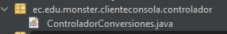

Figura 27. Creación de controlador - Cliente consola

ConversionController coordina la selección de magnitud y unidades con RestClient. Valida la sesión, invoca la ruta REST correspondiente y entrega el resultado a la vista.

Tabla 11. Clase ConversionController - Cliente consola

| package Monster.Client.controller;import Monster.Client.model.ConversionRequest;import Monster.Client.model.ConversionResponse;import Monster.Client.model.SessionModel;import Monster.Client.rest.RestClient;/** * [CONTROLADOR] Orquesta la ejecución de conversiones consumiendo el servicio RESTful. * * @author Julio Enrique Viche Castillo - GR09 - NRC 36884 */public class ConversionController { private final RestClient restClient; private final SessionModel session; public ConversionController(RestClient restClient, SessionModel session) { this.restClient = restClient; this.session = session; } public ConversionResponse ejecutarConversion(ConversionRequest req) { if (!session.isActivo() // session.getToken() == null) { return new ConversionResponse(false, 0.0, "Sesión inactiva. Debe iniciar sesión primero."); } if (req == null) { return new ConversionResponse(false, 0.0, "Parámetros de conversión inválidos."); } return restClient.convertir( req.getMagnitud(), req.getUnidadOrigen(), req.getUnidadDestino(), req.getValor(), session.getToken() ); }} |
| --- |

CLASE PRINCIPAL (EJECUCIÓN)

Finalmente, se codifica la clase Program.cs (Consola) que orquesta el flujo completo de la aplicación. El sistema inicia solicitando credenciales al usuario para invocar el servicio de seguridad; únicamente si la autenticación es exitosa, se instancia la interfaz y el controlador para permitir el uso de las operaciones de conversión.

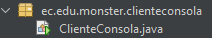

Figura 28. Creación de clase principal - Cliente consola

Tabla 12. Clase ConsoleClientApplication - Cliente consola

| package Monster.Client;import Monster.Client.controller.ConsoleAppController;import Monster.Client.model.SessionModel;import Monster.Client.rest.RestClient;import Monster.Client.view.ConsoleView;/** * Punto de entrada principal para el Cliente de Consola (TI.1.3 RESTful .NET). * * @author Julio Enrique Viche Castillo - GR09 - NRC 36884 */public class ConsoleClientApplication { public static void main(String[] args) { // Inicializar componentes MVC RestClient restClient = new RestClient(); SessionModel session = new SessionModel(); ConsoleView view = new ConsoleView(); ConsoleAppController controller = new ConsoleAppController(restClient, session, view); controller.iniciar(); }} |
| --- |

#### EJECUCIÓN DEL CLIENTE DE CONSOLA

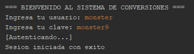

Figura 29. Login - Cliente consola

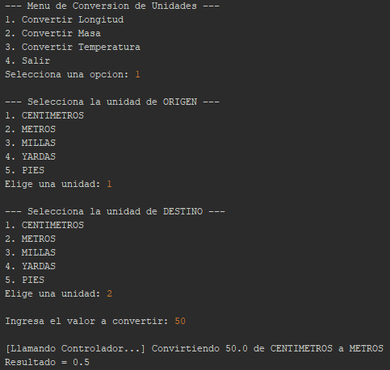

Figura 30. Conversión de Longitud - Cliente consola

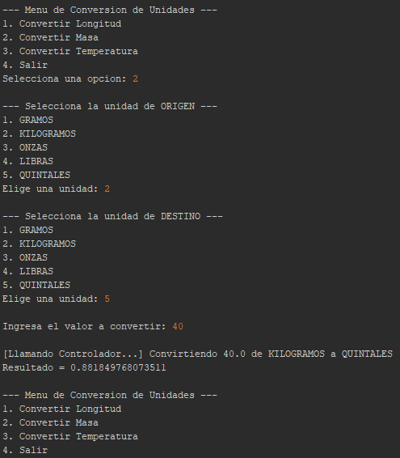

Figura 31. Conversión de Masa - Cliente consola

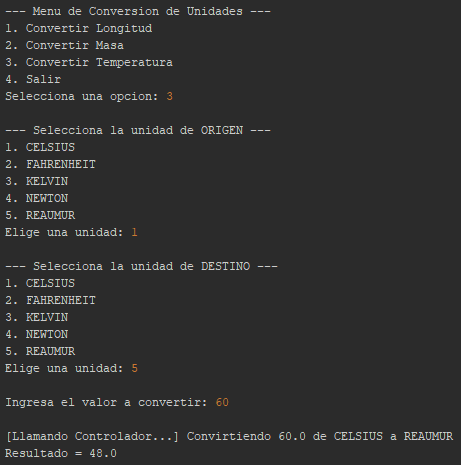

Figura 32. Conversión de Temperatura - Cliente consola

### CLIENTE ESCRITORIO

#### CREACIÓN DEL PROYECTO

El proyecto se crea de igual manera que el cliente de consola .NET Application

#### ESTRUCTURA DEL PROYECTO

El cliente de escritorio con interfaz gráfica se estructuró bajo el patrón MVC. Se crearon los paquetes modelo, vista y controlador para separar el diseño visual de la lógica de consumo del servicio web.

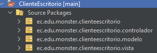

Figura 33. Estructura del proyecto - Cliente escritorio

### CODIFICACIÓN DEL PROYECTO CLIENTE ESCRITORIO

#### CREACIÓN DE MODELOS

Al no requerir base de datos, en el paquete modelo solo se manejan clases auxiliares y enumeradores. Estos sirven exclusivamente para llenar las opciones de listas desplegables en las ventanas.

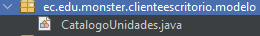

Figura 34. Creación de modelo - Cliente escritorio

CREACIÓN DE CONTROLADOR

El cliente de escritorio usa RestClient para invocar la API REST. Sus controladores reciben los datos de las ventanas, verifican la sesión y presentan la respuesta de conversión.

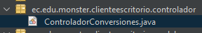

Figura 35. Creación de servicio - Cliente consola

Tabla 13. Clase ConversionController - Cliente escritorio

| package Monster.Client.controller;import Monster.Client.model.ConversionRequest;import Monster.Client.model.ConversionResponse;import Monster.Client.model.SessionModel;import Monster.Client.rest.RestClient;/** * [CONTROLADOR] Ejecución de conversiones desde la interfaz de escritorio Swing. * * @author Julio Enrique Viche Castillo - GR09 - NRC 36884 */public class ConversionController { private final RestClient restClient; private final SessionModel sessionModel; public ConversionController(RestClient restClient, SessionModel sessionModel) { this.restClient = restClient; this.sessionModel = sessionModel; } public ConversionResponse convertir(ConversionRequest req) { if (!sessionModel.isActivo() // sessionModel.getToken() == null) { return new ConversionResponse(false, 0.0, "Sesión no iniciada o token vencido."); } return restClient.convertir( req.getMagnitud(), req.getUnidadOrigen(), req.getUnidadDestino(), req.getValor(), sessionModel.getToken() ); }} |
| --- |

CREACIÓN DE VISTAS

En el paquete vista se diseñaron las interfaces gráficas utilizando los formularios (JFrames) de Visual Studio. Estas ventanas contienen los componentes visuales necesarios para interactuar con el usuario. Su función es estrictamente visual: capturan los datos de entrada y muestran los resultados obtenidos, delegando todo el procesamiento al controlador.

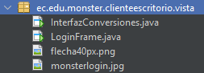

Figura 36. Creación de vistas - Cliente escritorio

CLASE PRINCIPAL (EJECUCIÓN)

La clase principal del proyecto funciona como el punto de entrada de la aplicación. Su única responsabilidad es instanciar la ventana inicial del sistema (la interfaz de inicio de sesión) y hacerla visible en la pantalla para iniciar el flujo gráfico del programa.

Figura 37. Creación de vistas - Cliente escritorio

#### EJECUCIÓN DEL CLIENTE DE ESCRITORIO

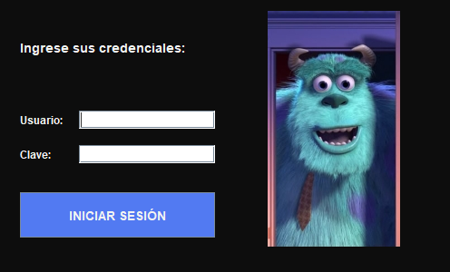

Figura 38. Login - Cliente escritorio

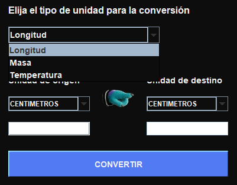

Figura 39. Pantalla de Conversiones - Cliente escritorio

### CLIENTE WEB

#### CREACIÓN DEL PROYECTO

El proyecto se crea de igual manera que el webservice con ‘Web Application’.

#### ESTRUCTURA DEL PROYECTO

El cliente web se desarrolló siguiendo el patrón MVC utilizando ASP.NET Core MVC con Controllers, Razor Views y JavaScript. La estructura separa la lógica de control (en el paquete controlador) de las interfaces de usuario (páginas web).

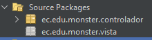

Figura 40. Estructura del proyecto - Cliente web

### CODIFICACIÓN DEL PROYECTO CLIENTE WEB

CONSUMO DEL Servicio RESTful (SERVLETS)

El cliente web usa LoginServlet y ConversionServlet para gestionar solicitudes del navegador y llamar a RestClient. Jetty 11 embebido escucha en el puerto 8081; las vistas son index.html y conversor.html.

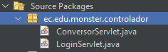

Figura 41. Creación de servlets - Cliente web

Tabla 14. Clase ConversionServlet - Cliente web

| package Monster.Client.controller;import Monster.Client.model.ConversionRequest;import Monster.Client.model.ConversionResponse;import Monster.Client.model.SessionModel;import Monster.Client.rest.RestClient;import jakarta.servlet.ServletException;import jakarta.servlet.annotation.WebServlet;import jakarta.servlet.http.HttpServlet;import jakarta.servlet.http.HttpServletRequest;import jakarta.servlet.http.HttpServletResponse;import jakarta.servlet.http.HttpSession;import java.io.IOException;import java.net.URLEncoder;import java.nio.charset.StandardCharsets;import java.util.Locale;/** * [CONTROLADOR] Servlet para el procesamiento de conversiones RESTful JSON. * Formateo numérico estricto a 2 decimales con punto decimal (Locale.US) * y límite de 16 caracteres. * * @author Julio Enrique Viche Castillo - GR09 - NRC 36884 */@WebServlet(name = "ConversionServlet", urlPatterns = {"/convertir"})public class ConversionServlet extends HttpServlet { private final RestClient restClient = new RestClient(); @Override protected void doPost(HttpServletRequest request, HttpServletResponse response) throws ServletException, IOException { request.setCharacterEncoding("UTF-8"); response.setCharacterEncoding("UTF-8"); HttpSession session = request.getSession(false); SessionModel sessionUser = (session != null) ? (SessionModel) session.getAttribute("sessionUser") : null; // Validación estricta de sesión activa (SINBDD) if (sessionUser == null // !sessionUser.isActivo() // sessionUser.getToken() == null) { response.sendRedirect(request.getContextPath() + "/index.html?error=SesionInvalida"); return; } String magnitud = request.getParameter("magnitud"); String unidadOrigen = request.getParameter("unidadOrigen"); String unidadDestino = request.getParameter("unidadDestino"); String valorStr = request.getParameter("valor"); if (magnitud == null // unidadOrigen == null // unidadDestino == null // valorStr == null) { response.sendRedirect(request.getContextPath() + "/conversor.html?error=" + URLEncoder.encode("Faltan parámetros obligatorios para la conversión.", StandardCharsets.UTF_8)); return; } double valor; try { String valorLimpio = valorStr.trim(); if (valorLimpio.length() > 16) { response.sendRedirect(request.getContextPath() + "/conversor.html?error=" + URLEncoder.encode("El valor numérico no puede superar los 16 caracteres.", StandardCharsets.UTF_8)); return; } if (!valorLimpio.matches("^-?\\d+(\\.\\d+)?$")) { response.sendRedirect(request.getContextPath() + "/conversor.html?error=" + URLEncoder.encode("Solo se permiten números y el punto decimal '.' (ejemplo: 25.5 o 100).", StandardCharsets.UTF_8)); return; } valor = Double.parseDouble(valorLimpio); } catch (NumberFormatException e) { response.sendRedirect(request.getContextPath() + "/conversor.html?error=" + URLEncoder.encode("Formato numérico no válido.", StandardCharsets.UTF_8)); return; } try { ConversionResponse resp = restClient.convertir( magnitud, unidadOrigen, unidadDestino, valor, sessionUser.getToken() ); if (resp != null && resp.isExito()) { String valorOrigenFmt = String.format(Locale.US, "%.2f", valor); String valorDestinoFmt = String.format(Locale.US, "%.2f", resp.getValorConvertido()); String resultadoTexto = valorDestinoFmt + " " + capitalizar(unidadDestino); String detalleTexto = valorOrigenFmt + " " + capitalizar(unidadOrigen) + " equivale a " + resultadoTexto; response.sendRedirect(request.getContextPath() + "/conversor.html?resultado=" + URLEncoder.encode(resultadoTexto, StandardCharsets.UTF_8) + "&detalle=" + URLEncoder.encode(detalleTexto, StandardCharsets.UTF_8) + "&usuario=" + URLEncoder.encode(sessionUser.getUsuario(), StandardCharsets.UTF_8) + "&token=" + sessionUser.getTokenAbreviado()); } else { String errorMsg = (resp != null) ? resp.getMensajeError() : "Sin respuesta del servidor REST"; response.sendRedirect(request.getContextPath() + "/conversor.html?error=" + URLEncoder.encode(errorMsg, StandardCharsets.UTF_8) + "&usuario=" + URLEncoder.encode(sessionUser.getUsuario(), StandardCharsets.UTF_8) + "&token=" + sessionUser.getTokenAbreviado()); } } catch (Exception e) { response.sendRedirect(request.getContextPath() + "/conversor.html?error=" + URLEncoder.encode("Error de comunicación: " + e.getMessage(), StandardCharsets.UTF_8) + "&usuario=" + URLEncoder.encode(sessionUser.getUsuario(), StandardCharsets.UTF_8) + "&token=" + sessionUser.getTokenAbreviado()); } } private String capitalizar(String str) { if (str == null // str.isEmpty()) return ""; return str.substring(0, 1).toUpperCase() + str.substring(1); }} |
| --- |

Tabla 15. Clase LoginServlet - Cliente web

| package Monster.Client.controller;import Monster.Client.model.LoginResponse;import Monster.Client.model.SessionModel;import Monster.Client.rest.RestClient;import jakarta.servlet.ServletException;import jakarta.servlet.annotation.WebServlet;import jakarta.servlet.http.HttpServlet;import jakarta.servlet.http.HttpServletRequest;import jakarta.servlet.http.HttpServletResponse;import jakarta.servlet.http.HttpSession;import java.io.IOException;import java.net.URLEncoder;import java.nio.charset.StandardCharsets;/** * [CONTROLADOR] Servlet para el procesamiento del inicio de sesión RESTful. * * @author Julio Enrique Viche Castillo - GR09 - NRC 36884 */@WebServlet(name = "LoginServlet", urlPatterns = {"/login"})public class LoginServlet extends HttpServlet { private final RestClient restClient = new RestClient(); @Override protected void doPost(HttpServletRequest request, HttpServletResponse response) throws ServletException, IOException { request.setCharacterEncoding("UTF-8"); response.setCharacterEncoding("UTF-8"); String usuario = request.getParameter("usuario"); String clave = request.getParameter("clave"); if (usuario == null // usuario.trim().isEmpty() // clave == null // clave.trim().isEmpty()) { response.sendRedirect(request.getContextPath() + "/index.html?error=" + URLEncoder.encode("Por favor, complete todos los campos de acceso.", StandardCharsets.UTF_8)); return; } try { LoginResponse loginResp = restClient.login(usuario.trim(), clave.trim()); if (loginResp != null && loginResp.isExito()) { HttpSession session = request.getSession(true); SessionModel sessionModel = new SessionModel(usuario.trim(), loginResp.getToken()); session.setAttribute("sessionUser", sessionModel); response.sendRedirect(request.getContextPath() + "/conversor.html?usuario=" + URLEncoder.encode(usuario.trim(), StandardCharsets.UTF_8) + "&token=" + sessionModel.getTokenAbreviado()); } else { String errorMsg = (loginResp != null) ? loginResp.getMensaje() : "Credenciales inválidas."; response.sendRedirect(request.getContextPath() + "/index.html?error=" + URLEncoder.encode(errorMsg, StandardCharsets.UTF_8)); } } catch (Exception e) { String errorMsg = "Error de comunicación con el Servidor REST: " + e.getMessage(); response.sendRedirect(request.getContextPath() + "/index.html?error=" + URLEncoder.encode(errorMsg, StandardCharsets.UTF_8)); } }} |
| --- |

CREACIÓN DE VISTAS

Las interfaces de usuario se construyeron utilizando HTML y la tecnología HTML (páginas HTML) dentro del directorio Web Pages. Se diseñaron dos vistas principales: index.html, que actúa como la pantalla de inicio de sesión interactuando con el LoginServlet, y conversor.html, que contiene los formularios dinámicos para seleccionar las unidades de medida, capturar los valores y mostrar los resultados procesados por el ConversionServlet.

Figura 42. Creación de vistas - Cliente web

Tabla 16. Archivo conversor.html - Cliente web

| <!DOCTYPE html><html lang="es"><head> <meta charset="UTF-8"> <meta name="viewport" content="width=device-width, initial-scale=1.0"> <title>Conversor de Unidades RESTful - Panel Web (GR09)</title> <link rel="stylesheet" href="css/style.css"></head><body> <!-- Encabezado con sesión activa --> <header class="header-bar"> 
 <h1>CONVERSOR DE UNIDADES (RESTFUL JAVA · SINBDD)</h1> 
ESPE · Arquitectura de Software (TI.1.3) / Autor: Julio Enrique Viche Castillo
 
 
  ● <strong id="lblUsuario">MONSTER</strong> (Sesión Activa)  <a href="logout" class="btn-logout">Cerrar Sesión</a> 
 </header> <!-- Panel Central del Conversor --> <main class="main-wrapper"> 
 <h2 class="card-title">Conversor de Unidades Multimagnitud</h2> 
Cálculos procesados mediante servicios web RESTful JSON protegidos por token
 

 <!-- 1. Pestañas de Magnitud --> <label class="form-label">1. Seleccione la Magnitud Física:</label> 
 <button type="button" class="segment-btn active" id="btnLongitud" onclick="cambiarMagnitud('Longitud')"> Longitud </button> <button type="button" class="segment-btn" id="btnMasa" onclick="cambiarMagnitud('Masa')"> Masa </button> <button type="button" class="segment-btn" id="btnTemperatura" onclick="cambiarMagnitud('Temperatura')"> Temperatura </button> 
 <!-- Formulario de Conversión --> <form action="convertir" method="POST" id="formConversion"> <input type="hidden" id="inputMagnitud" name="magnitud" value="Longitud"> <!-- 2. Valor Numérico --> 
 <label class="form-label" for="txtValor">2. Ingrese el Valor a Convertir:</label> <input type="text" id="txtValor" name="valor" class="form-input" autocomplete="off" inputmode="decimal" maxlength="16" pattern="^-?\d+(\.\d+)?$" title="Solo se permiten números y el punto decimal '.' (ej. 100 o 25.5)" onkeypress="return (event.charCode >= 48 && event.charCode <= 57) // (event.charCode === 46 && this.value.indexOf('.') === -1)" oninput="this.value = this.value.replace(/[^0-9.]/g, '').replace(/(\..*?)\..*/g, '$1').slice(0, 16)" value="100.00" required> 
 <!-- 3. Unidades Origen y Destino --> <label class="form-label">3. Configuración de Unidades:</label> 
 
 <select id="cmbOrigen" name="unidadOrigen" class="form-select"></select> 
 <button type="button" class="btn-swap" title="Intercambiar unidades" onclick="intercambiarUnidades()"> ⇄ </button> 
 <select id="cmbDestino" name="unidadDestino" class="form-select"></select> 
 
 <button type="submit" class="btn-primary" style="margin-top: 20px;"> Calcular Conversión REST </button> </form> <!-- 4. Tarjeta de Resultado --> 
 
0.00
 
Cálculo completado exitosamente
 
 
 </main> <!-- Barra de Estado Inferior --> <footer class="footer-bar"> Servidor Backend: <code>WS_CONV_UNI_RESTFULL_JAVA</code> (Modalidad SINBDD) Patrón Arquitectónico: Modelo - Vista - Controlador (JSP / Servlet) </footer> </body></html> |
| --- |

Tabla 17. Archivo index.html - Cliente web

| <!DOCTYPE html><html lang="es"><head> <meta charset="UTF-8"> <meta name="viewport" content="width=device-width, initial-scale=1.0"> <title>Acceso al Sistema - Conversor de Unidades RESTful (GR09)</title> <link rel="stylesheet" href="css/style.css"></head><body> <!-- Encabezado Institucional --> <header class="header-bar"> 
 <h1>UNIVERSIDAD DE LAS FUERZAS ARMADAS ESPE</h1> 
Arquitectura de Software (TI.1.3) · Grupo GR09 / Julio Enrique Viche Castillo
 
 
  ● Servidor RESTful JSON  
 </header> <!-- Contenedor del Formulario de Login --> <main class="main-wrapper"> 
 <h2 class="card-title">Iniciar Sesión</h2> 
Autenticación requerida para acceder al Conversor REST (SINBDD)
 

 

 <form action="login" method="POST"> 
 <label class="form-label" for="txtUsuario">Usuario:</label> <input type="text" id="txtUsuario" name="usuario" class="form-input" value="MONSTER" required autofocus> 
 
 <label class="form-label" for="txtClave">Contraseña:</label> <input type="password" id="txtClave" name="clave" class="form-input" value="MONSTER9" required> 
 
 <strong>Credenciales del curso:</strong> Usuario: <code>MONSTER</code> / Clave: <code>MONSTER9</code> 
 <button type="submit" class="btn-primary">Ingresar al Conversor</button> </form> 
 </main> <!-- Barra de Estado Inferior --> <footer class="footer-bar"> Servidor Backend: <code>WS_CONV_UNI_RESTFULL_JAVA</code> (Modalidad SINBDD) Patrón Arquitectónico: Modelo - Vista - Controlador (JSP / Servlet) </footer> </body></html> |
| --- |

EJECUCIÓN DEL CLIENTE DE WEB

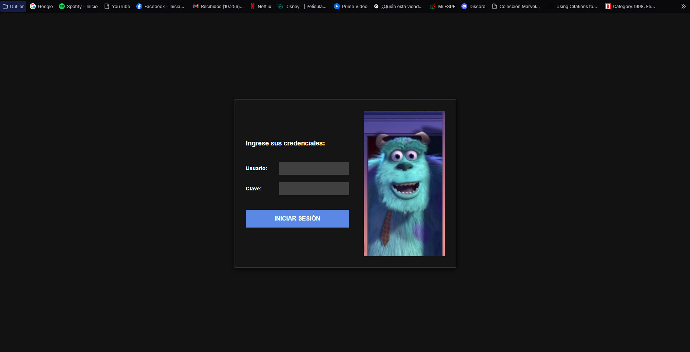

Figura 43. Login - Cliente web

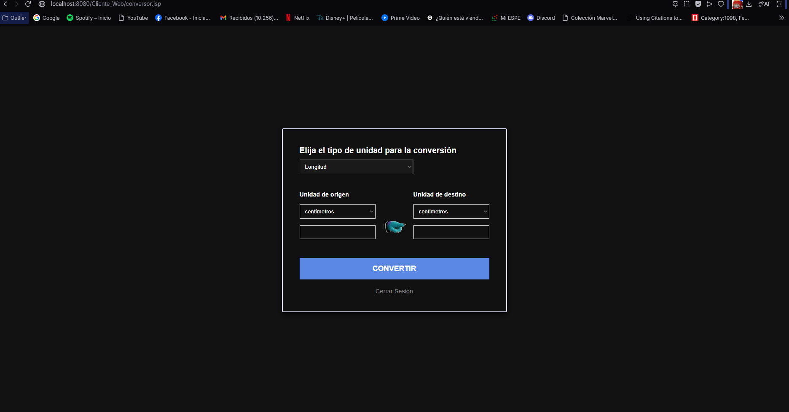

Figura 44. Pantalla de Conversiones - Cliente web

### CLIENTE MÓVIL

#### CREACIÓN DEL PROYECTO

El proyecto se debe crear en Android Studio. Se selecciona la opción ‘New Project’, en la pantalla siguiente ‘Empty Activity’ y finalmente se configura el proyecto con nombre, ubicación y la opción ‘Java’ en Build Configuration Laguaje. Finalizamos haciendo click en el botón ‘Finish’.

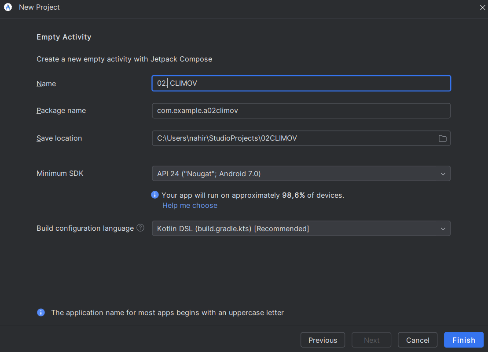

Figura 45. Configuración del proyecto - Cliente móvil

#### ESTRUCTURA DEL PROYECTO

El desarrollo de la aplicación móvil en Android Studio se organizó bajo el patrón arquitectónico MVC (Modelo-Vista-Controlador). Para asegurar el desacoplamiento de la lógica, la vista y el consumo de red, se estructuró el proyecto en los paquetes model, view y controller.

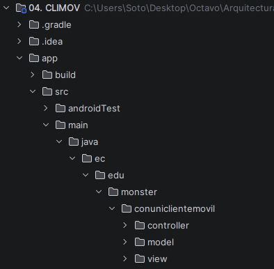

Figura 46. Estructura del proyecto - Cliente móvil

### CODIFICACIÓN DEL PROYECTO CLIENTE MÓVIL

#### CREACIÓN DE MODELOS

En el paquete model se crearon las clases necesarias para el intercambio de información: ConversionRequest, ConversionResult, LoginResult y la enumeración ServiceType.

La aplicación Android usa RestClient, HttpURLConnection y org.json para enviar solicitudes HTTP/JSON al servidor. Los controladores procesan inicio de sesión y conversiones de forma asíncrona y actualizan las actividades.

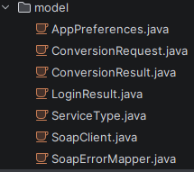

Figura 47. Creación de modelos - Cliente móvil

CREACIÓN DE CONTROLADORES

LoginController y ConversionController coordinan las actividades Android con RestClient. Ejecutan las llamadas de red fuera del hilo de interfaz y devuelven el resultado a las vistas.

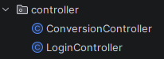

Figura 48. Creación de controladores - Cliente móvil

Tabla 18. Clase LoginController - Cliente móvil

| package Monster.Client.controller;import android.os.Handler;import android.os.Looper;import Monster.Client.model.LoginResponse;import Monster.Client.model.RestClient;import Monster.Client.model.SessionModel;/** * [CONTROLADOR] Gestiona el flujo de autenticación para la vista móvil RESTful. * * @author Julio Enrique Viche Castillo - GR09 - NRC 36884 */public class LoginController { public interface LoginCallback { void onSuccess(SessionModel session, String resolvedBaseUrl); void onError(String mensaje); } private final RestClient restClient; private final Handler mainHandler; public LoginController() { this.restClient = new RestClient(); this.mainHandler = new Handler(Looper.getMainLooper()); } public void procesarLogin(String baseUrl, String usuario, String clave, LoginCallback callback) { new Thread(() -> { try { if (baseUrl != null && !baseUrl.trim().isEmpty()) { restClient.setBaseUrl(baseUrl); } LoginResponse resp = restClient.login(usuario, clave); mainHandler.post(() -> { if (resp != null && resp.isExito() && resp.getToken() != null) { SessionModel session = new SessionModel(usuario, resp.getToken()); callback.onSuccess(session, restClient.getBaseUrl()); } else { String err = (resp != null && resp.getMensaje() != null) ? resp.getMensaje() : "Error al iniciar sesión."; callback.onError(err); } }); } catch (Exception e) { mainHandler.post(() -> callback.onError("Error de conexión: " + e.getMessage())); } }).start(); }} |
| --- |

Tabla 19. Clase ConversionController - Cliente móvil

| package Monster.Client.controller;import android.os.Handler;import android.os.Looper;import Monster.Client.model.ConversionRequest;import Monster.Client.model.ConversionResponse;import Monster.Client.model.RestClient;/** * [CONTROLADOR] Gestiona el despacho de conversiones de unidades RESTful. * * @author Julio Enrique Viche Castillo - GR09 - NRC 36884 */public class ConversionController { public interface ConversionCallback { void onSuccess(ConversionResponse response); void onError(String mensaje); } private final RestClient restClient; private final Handler mainHandler; public ConversionController() { this.restClient = new RestClient(); this.mainHandler = new Handler(Looper.getMainLooper()); } public void procesarConversion(String baseUrl, String token, ConversionRequest req, ConversionCallback callback) { new Thread(() -> { try { if (baseUrl != null && !baseUrl.trim().isEmpty()) { restClient.setBaseUrl(baseUrl); } ConversionResponse resp = restClient.convertir(req, token); mainHandler.post(() -> { if (resp != null && resp.isExito()) { callback.onSuccess(resp); } else { String err = (resp != null && resp.getMensajeError() != null) ? resp.getMensajeError() : "Error al procesar la conversión."; callback.onError(err); } }); } catch (Exception e) { mainHandler.post(() -> callback.onError("Error de red: " + e.getMessage())); } }).start(); }} |
| --- |

CREACIÓN DE VISTAS

Se crean los archivos de interfaz gráfica en el paquete views.

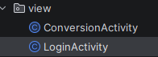

Figura 49. Creación de vistas - Cliente móvil

#### EJECUCIÓN DEL CLIENTE DE MÓVIL

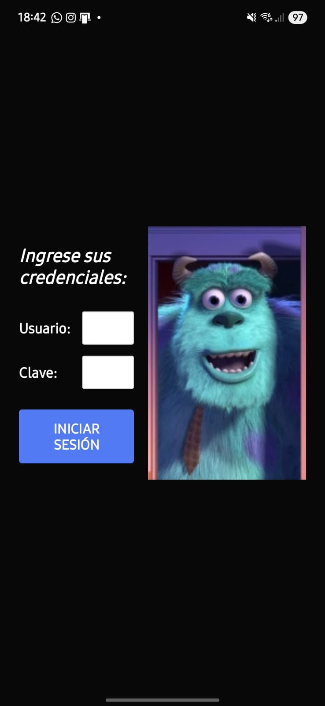

Figura 50. Login - Cliente móvil

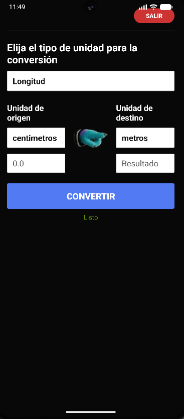

Figura 51. Pantalla de Conversiones - Cliente móvil

#### CONCLUSIONES

El proyecto integra Java, Jakarta REST con Jersey, Kestrel y clientes HTTP/JSON. La configuración de Visual Studio, Maven y Android Studio permite ejecutar el servidor y los clientes con una arquitectura RESTful y sin base de datos.

La implementación de los módulos de seguridad y conversiones evidenció la importancia de separar correctamente la lógica de negocio y la capa de exposición del servicio web. A pesar de no contar con conexión a una base de datos, el uso de DTOs, validaciones en memoria y manejo de sesiones simuladas dio como resultado soluciones mantenibles, escalables y con un nivel adecuado de desacoplamiento.

Los clientes de consola, escritorio, web con HTML/Controllers ASP.NET Core y móvil Android consumen la API REST. Envían solicitudes HTTP con JSON, obtienen un token en auth/login y lo incluyen en las conversiones de longitud, masa y temperatura.

La solución organiza la API en recursos Jakarta REST implementados con Jersey y ejecutados sobre Kestrel (.NET 10). Los clientes Java consumen rutas HTTP con JSON y completan el flujo desde la autenticación hasta las conversiones, sin una base de datos.

#### RECOMENDACIONES

Mantener la estructura modular de los clientes y el patrón MVC en las interfaces para facilitar su evolución. Los recursos REST del servidor deben conservar responsabilidades claras para autenticación y conversiones.

Implementar respuestas HTTP de error con mensajes JSON claros cuando el cliente envíe unidades no soportadas o datos inválidos; esto facilitará el diagnóstico de solicitudes REST.

Añadir validaciones más estrictas en los servicios, especialmente en el control del tiempo de vida de las sesiones del usuario y en el bloqueo de peticiones con valores numéricos inválidos (como medidas de masa negativas).

Como mejora futura, se puede integrar un sistema de logs en Kestrel para registrar solicitudes HTTP, códigos de respuesta y errores de conversión, facilitando el diagnóstico de la API REST.

Implementar mecanismos de caché o estructuras de datos optimizadas en memoria para los catálogos de unidades, en caso de que el sistema escale a un volumen masivo de peticiones concurrentes.

Desarrollar pruebas unitarias en la capa de servicios para asegurar la exactitud de las fórmulas matemáticas utilizadas en las transformaciones de temperatura, longitud y masa ante futuras modificaciones.

Mejorar la interfaz de usuario en los clientes web y móvil incorporando retroalimentación visual más precisa, controles de validación en los formularios y manejo asíncrono avanzado para no bloquear las pantallas durante la espera de respuesta del servidor.

Documentar las rutas HTTP, sus métodos, los campos JSON de solicitud y respuesta y los códigos de estado para que otros clientes puedan consumir la API REST.
