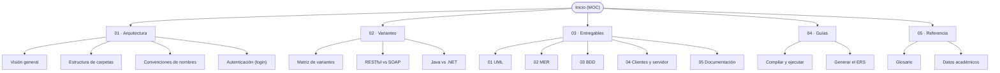

# Inicio — Mapa de contenido

Bienvenido al vault de documentación del proyecto **TI.1.1 — Conversor de unidades**
(Arquitectura de Software, PAO 2026-51, NRC 36884, grupo GR09, integrante
**Julio Enrique Viche Castillo**).

> [!tip] ¿Eres un agente de IA?
> Empieza por el archivo [`AGENTS.md`](../AGENTS.md) de la raíz del repositorio: contiene
> las reglas de trabajo. Este vault es la **fuente de verdad** de la documentación.

---

## Mapa del vault

---

## Secciones

### 01 · Arquitectura
- [[vault/01-architecture/overview|Visión general]]
- [[vault/01-architecture/folder-structure|Estructura de carpetas]]
- [[vault/01-architecture/naming-conventions|Convenciones de nombres]]
- [[vault/01-architecture/authentication|Autenticación (login)]]

### 02 · Variantes
- [[vault/02-variants/variant-matrix|Matriz de variantes]]
- [[vault/02-variants/restful-vs-soap|RESTful vs SOAP]]
- [[vault/02-variants/java-vs-dotnet|Java vs .NET]]

### 03 · Entregables
- [[vault/03-deliverables/01-uml|01 · UML]]
- [[vault/03-deliverables/srs-template|Plantilla ERS / SRS (Documento base)]]
- [[vault/03-deliverables/srs-variations|Variaciones del ERS por Taller (TI.1.1 a TI.1.4)]]
- [[vault/03-deliverables/02-mer|02 · MER]]
- [[vault/03-deliverables/03-bdd|03 · BDD]]
- [[vault/03-deliverables/04-clients-and-server|04 · Clientes y servidor]]
- [[vault/03-deliverables/05-documentation|05 · Documentación]]

### 04 · Guías
- [[vault/04-guides/build-and-run|Compilar y ejecutar]]
- [[vault/04-guides/generate-ers|Generar el ERS]]

### 05 · Referencia
- [[vault/05-reference/glossary|Glosario]]
- [[vault/05-reference/academic-data|Datos académicos]]

---

## Estado rápido

| Elemento | Estado |
| --- | --- |
| README raíz | ✅ |
| AGENTS.md | ✅ |
| 4 variantes (carpetas) | ✅ creadas (vacías) |
| Documentación del vault | ✅ |
| Código del servidor/clientes | ⬜ pendiente |

> [!note] Caso de estudio
> Conversor de unidades con inicio de sesión, **sin base de datos** (SINBDD). **Todo
> proyecto inicia con login** y las credenciales van **quemadas**: `MONSTER` / `MONSTER9`.
> Ver [[vault/01-architecture/authentication|Autenticación (login)]].
