# Inicio — Mapa de contenido

Bienvenido al vault de documentación del proyecto **TI.1.1 — Conversor de unidades**
(Arquitectura de Software, PAO 2026-51, NRC 36884, grupo GR09, integrante
**Julio Enrique Viche Castillo**).

> [!tip] ¿Eres un agente de IA?
> Empieza por el archivo [`AGENTS.md`](../AGENTS.md) de la raíz del repositorio: contiene
> las reglas de trabajo. Este vault es la **fuente de verdad** de la documentación.

---

## Mapa del vault

```mermaid
flowchart TD
    I(["Inicio (MOC)"]) --> A["01 · Arquitectura"]
    I --> V["02 · Variantes"]
    I --> E["03 · Entregables"]
    I --> G["04 · Guías"]
    I --> R["05 · Referencia"]
    I --> T["06 · Projects"]

    A --> A1["Visión general"]
    A --> A2["Estructura de carpetas"]
    A --> A3["Convenciones de nombres"]
    A --> A4["Autenticación (login)"]
    A --> A5["Requerimientos adicionales"]

    V --> V1["Matriz de variantes"]
    V --> V2["RESTful vs SOAP"]
    V --> V3["Java vs .NET"]

    E --> E1["01 UML"]
    E --> E2["02 MER"]
    E --> E3["03 BDD"]
    E --> E4["04 Clientes y servidor"]
    E --> E5["05 Documentación"]

    G --> G1["Compilar y ejecutar"]
    G --> G2["Generar el ERS"]

    R --> R1["Glosario"]
    R --> R2["Datos académicos"]

    T --> T1["TI.1.1 · SOAP Java"]
    T --> T2["TI.1.2 · SOAP .NET"]
    T --> T3["TI.1.3 · RESTful Java"]
    T --> T4["TI.1.4 · RESTful .NET"]
```

---

## Secciones

### 01 · Arquitectura
- [Visión general](01-architecture/overview.md)
- [Estructura de carpetas](01-architecture/folder-structure.md)
- [Convenciones de nombres](01-architecture/naming-conventions.md)
- [Autenticación (login)](01-architecture/authentication.md)
- [Requerimientos adicionales (decisiones del usuario)](01-architecture/additional-requirements.md)

### 02 · Variantes
- [Matriz de variantes](02-variants/variant-matrix.md)
- [RESTful vs SOAP](02-variants/restful-vs-soap.md)
- [Java vs .NET](02-variants/java-vs-dotnet.md)

### 03 · Entregables
- [01 · UML](03-deliverables/01-uml.md)
- [Plantilla ERS / SRS (Documento base)](03-deliverables/srs-template.md)
- [Variaciones del ERS por Taller (TI.1.1 a TI.1.4)](03-deliverables/srs-variations.md)
- [02 · MER](03-deliverables/02-mer.md)
- [03 · BDD](03-deliverables/03-bdd.md)
- [04 · Clientes y servidor](03-deliverables/04-clients-and-server.md)
- [05 · Documentación](03-deliverables/05-documentation.md)

### 04 · Guías
- [Instalación y replicabilidad del entorno](04-guides/environment-setup.md)
- [Compilar y ejecutar](04-guides/build-and-run.md)
- [Generar el ERS](04-guides/generate-ers.md)

### 05 · Referencia
- [Glosario](05-reference/glossary.md)
- [Datos académicos](05-reference/academic-data.md)

### 06 · Projects
- [06 · Projects](06-projects/index.md)
  - [TI.1.1 · SOAP Java](06-projects/ti-1-1-soap-java/index.md) ([ERS](06-projects/ti-1-1-soap-java/srs.md) · [Diagramas](06-projects/ti-1-1-soap-java/diagrams.md) · [Manual Técnico](06-projects/ti-1-1-soap-java/technical-manual.md))
  - [TI.1.2 · SOAP .NET](06-projects/ti-1-2-soap-dotnet/index.md) ([ERS](06-projects/ti-1-2-soap-dotnet/srs.md) · [Diagramas](06-projects/ti-1-2-soap-dotnet/diagrams.md))
  - [TI.1.3 · RESTful Java](06-projects/ti-1-3-rest-java/index.md) ([ERS](06-projects/ti-1-3-rest-java/srs.md) · [Diagramas](06-projects/ti-1-3-rest-java/diagrams.md))
  - [TI.1.4 · RESTful .NET](06-projects/ti-1-4-rest-dotnet/index.md) ([ERS](06-projects/ti-1-4-rest-dotnet/srs.md) · [Diagramas](06-projects/ti-1-4-rest-dotnet/diagrams.md))

---

## Estado rápido

| Elemento | Estado |
| --- | --- |
| README raíz | ✅ |
| AGENTS.md | ✅ |
| 4 variantes (carpetas) | ✅ creadas |
| Documentación del vault | ✅ |
| Código del servidor | 🟡 TI.1.1 implementado (clientes y variantes pendientes) |

> [!note] Caso de estudio
> Conversor de unidades con inicio de sesión, **sin base de datos** (SINBDD). **Todo
> proyecto inicia con login** y las credenciales van **quemadas**: `MONSTER` / `MONSTER9`.
> Ver [Autenticación (login)](01-architecture/authentication.md).
